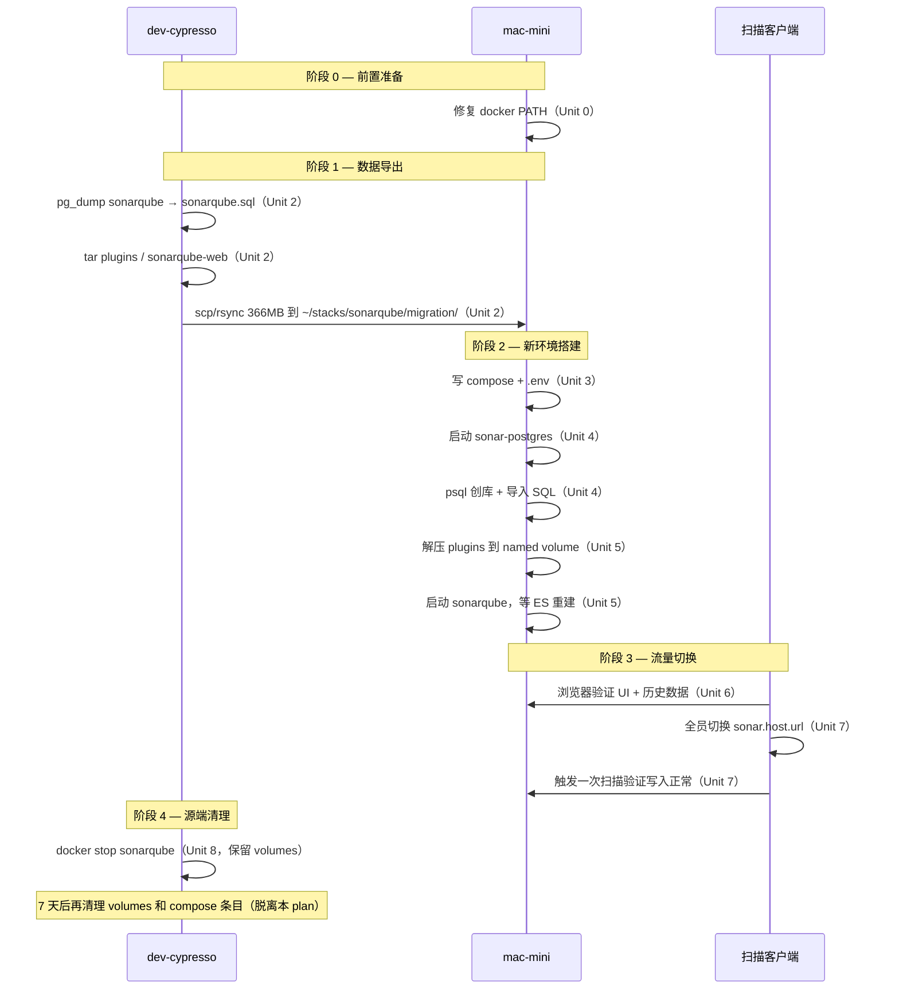

# 将 SonarQube 从 dev-cypresso 无损迁移到 mac-mini

## Overview

把目前跑在 `dev-cypresso`（AWS t3.xlarge）上的 SonarQube 26.3.0-community 整体搬到家里的 `mac-mini`（M4，arm64，32G RAM，10 核），通过现有 Tailscale 网络服务团队访问。释放 dev-cypresso 上持续 10% CPU + 2.1G 内存占用（SonarQube + ES + CE 三个 JVM），同时根除"SonarQube 跑在 PostgreSQL 18 上"这个未来一定踩雷的潜在隐患。

迁移目标是 **bit-for-bit 无损**：用户、权限、Quality Gate、Quality Profile、规则覆盖、项目历史、Issue、第三方分支插件（`sonarqube-community-branch-plugin-26.3.0.jar`）、以及业主在 `sonarqube-web/` bind mount 中手工修复的 CSS Bug，全部带走。

## Problem Frame

### 现状
- `dev-cypresso` 上 SonarQube 容器 24h 占 ~10% CPU、2.1G RES，是该机长期高 CPU 基线的重要贡献者之一（2026-05-12 整机僵死故障的间接放大器，详见 `docs/solutions/dev-cypresso/performance-issues/t3-cpu-credit-exhausted-instance-hang-2026-05-12.md`）
- SonarQube 当前连接 `shared-postgres`（PostgreSQL 18.3）。SonarQube 26.x **官方仅支持 PG 13–17**，18 不在支持矩阵里。当前能跑只是没踩到差异点
- 团队所有 CI / 本地扫描客户端 `sonar.host.url` 当前指向 `dev-cypresso` 上的 SonarQube 入口
- `sonarqube-web` 是 bind mount，业主在宿主目录里手工修复了若干 CSS / web.xml 加载 Bug，**这部分修改不在 git 里**，必须以文件形式带走
- SonarQube 26.3.0 官方镜像支持 multi-arch（amd64 + arm64），M4 上原生跑 arm64 镜像，不需要 Rosetta

### mac-mini 已具备条件
- 7×24 开机，已作为团队内部"家用服务器"运行（CI sonarqube runner、postgres 容器、其它服务）
- Tailscale 节点 `mac-mini` (`100.108.64.126`)，团队通过 tailscale 隧道访问延迟 < 10 ms
- 32G RAM、10 核 CPU、780G 可用磁盘——资源充裕
- 已装 Docker Desktop（`/usr/local/bin/docker`）

### 阻塞点
- **mac-mini 上 SSH 非交互 shell 看不到 docker**：`gitstatus` 在 `~/.zshrc` 里启动失败导致 zsh 提前退出，PATH 里虽然有 `/usr/local/bin/docker` 但命令未生效。这必须先修，否则后续所有 SSH 自动化都跑不通
- **mac-mini 现有 postgres 容器版本/用途未知**：不能盲目复用。SonarQube 26.x 对 PG 主版本敏感（13–17），且共享 PG 会引入备份、参数、升级耦合
- **当前 PG 跨大版本**：dev-cypresso shared-postgres = PG18，目标 mac-mini sonar-postgres = PG17（在 SonarQube 支持矩阵里且与 dev-cypresso 上其它库无关）。`pg_dump` 跨版本 restore 是支持的（pg_dump 设计为向后兼容数据格式），但需要用 PG18 的 `pg_dump` 导出、PG17 的 `psql/pg_restore` 导入

## Requirements Trace

- **R1.** SonarQube Web UI 在 mac-mini 上启动后，所有历史项目、用户、权限、Quality Gate/Profile、规则、Issue 数据完整可见
- **R2.** `sonarqube-community-branch-plugin-26.3.0.jar` 插件加载成功（Web 和 CE 两个 JVM 的 `-javaagent` 都生效），分支 / PR 分析能力保留
- **R3.** 业主在 `sonarqube-web/` 中的所有手工修改保留（CSS Bug 修复、web.xml 调整、字体、图标），UI 加载样式正常
- **R4.** 团队通过 tailscale 域名 / IP 能访问新地址，全员替换 `sonar.host.url` 后扫描结果继续累计在同一项目历史上
- **R5.** SonarQube 跑在官方支持的 PG 版本（13–17），消除 PG18 的潜在风险
- **R6.** `mac-mini` SSH 非交互 shell 能直接调用 `docker` 命令，为后续自动化运维铺路
- **R7.** dev-cypresso 上 SonarQube 容器停止后，释放的资源（~10% CPU + 2.1G RAM）能让 mem_limit=4G 配额还给系统

## Scope Boundaries

### 不在本次范围内
- 不升级 SonarQube 版本（保持 26.3.0.120487-community，避免迁移 + 升级两个变化叠加）
- 不替换 community-branch-plugin（保持 26.3.0 jar，与 SonarQube 版本严格匹配）
- 不改造扫描客户端的 SonarQube 接入方式（仍是 `sonar.host.url` + token，只换 URL）
- 不迁移 mac-mini 上已有的其它服务
- 不为 SonarQube 配 HTTPS（tailscale 链路本身加密，HTTP 走内部即可；如果未来要给外部访问再加 nginx + cert）

### Deferred to Separate Tasks
- **mac-mini docker daemon 资源调优**（如 Docker Desktop 给 docker VM 分配 CPU/内存上限调整）：先按默认值跑，观察一周后再调
- **SonarQube 备份自动化**（每日 pg_dump + 异地存档）：单独立项
- **dev-cypresso 上 infra docker-compose.yml 删除 sonarqube 服务条目**：迁移稳定一周后清理，单独的 git 提交

## Context & Research

### dev-cypresso 上的 SonarQube 状态分布

| # | 类型 | 存储位置 | 大小 | 处理方式 |
|---|---|---|---|---|
| 1 | PostgreSQL 数据库 `sonarqube` | `shared-postgres` 容器内（PG18.3）| **302 MB** | `pg_dump --format=custom` 完整导出 |
| 2 | ES 索引 + 工作数据 | volume `sonarqube_data` | 342 MB | **放弃**，新机器上启动时让 SonarQube 从 DB 重建（避免 x86→arm64 的 Lucene 段格式潜在不兼容） |
| 3 | 插件 jar | volume `sonarqube_extensions` | 6.4 MB | 直接 `tar` 打包带走，目录里只有 `plugins/sonarqube-community-branch-plugin-26.3.0.jar` |
| 4 | **业主修过的 web 静态资源** | bind mount `./sonarqube-web/` → `/opt/sonarqube/web` | 57 MB | `tar` 整目录带走，作为新机器上的 bind mount |
| 5 | 日志 | volume `sonarqube_logs` | 9.8 MB | 弃，新机器从空开始记 |
| 6 | 临时文件 | volume `sonarqube_temp` | 307 MB | 弃，SonarQube 启动自动重建 |
| 7 | 容器环境变量 | compose env_file | — | 重新生成 `.env`，密码可保持一致（DB 一起搬） |

**关键约束**：
- 实际数据迁移量 = 302 (DB dump) + 6.4 (plugins) + 57 (web) ≈ **366 MB**
- tailscale tailnet 内部传输，从 dev-cypresso → mac-mini 走 wireguard 加密直连或 DERP 中继，按上行 50 Mbps 估算 ~1 分钟完成

### 关键技术决策的依据

- **SonarQube 26.3.x 支持矩阵**：官方 docker hub README 标注支持的 PG 版本为 13、14、15、16、17（截至 2026-05）。PG 18 缺席。继续在 PG18 上跑是 unsupported configuration
- **arm64 镜像可用性**：`docker manifest inspect sonarqube:26.3.0-community` 在公开镜像上能看到 `linux/amd64` + `linux/arm64` 两条 manifest，原生 arm64 运行不需要 Rosetta
- **pg_dump 跨版本兼容性**：PG 官方明确支持"用新版 pg_dump 导出"到"旧版 psql/pg_restore 导入"的方向受限——必须用**目标版本（或更新）**的 `pg_dump` 工具，而不是源版本的。所以**在 dev-cypresso 上用 PG18 的 pg_dump** 导出，再到 mac-mini 上 PG17 容器内 `psql` 导入。一般来说这条路径在两个相邻大版本（如 17→18）间是可以走的，但**有风险**：PG 新版本可能引入旧版 psql 不识别的 SQL（虽然 sonarqube 这种小型业务库的概率极低）。为降低风险，导出用 `--no-owner --no-privileges`（避免 GRANT/ROLE 差异）+ 纯文本 SQL `--format=plain` + 加 `--quote-all-identifiers`（增强兼容性）

### 关联文档

- 2026-05-12 dev-cypresso 故障与加固：`docs/solutions/dev-cypresso/performance-issues/t3-cpu-credit-exhausted-instance-hang-2026-05-12.md`

## Key Technical Decisions

1. **SonarQube 配独立的专用 PG 容器，不复用 mac-mini 现有 postgres**
   - 原因：版本约束（必须 PG 13–17）、隔离爆炸半径、备份独立、回滚简单
   - 选型：`postgres:17-alpine`（arm64 原生、镜像小、官方维护）

2. **新 SonarQube + 新 PG 跑在 mac-mini 上的独立 docker compose project**，目录 `~/stacks/sonarqube/`
   - 不混进 mac-mini 上其它已有 stack
   - 用独立的 docker bridge 网络 `sonar-net`，不依赖 mac-mini 上的其它网络

3. **保持 SonarQube 镜像版本严格一致**：`sonarqube:26.3.0.120487-community`（而不是 latest 或 26.3-community），避免镜像更新引入差异

4. **放弃迁移 ES 索引**：`sonarqube_data` volume 不带过去，让 SonarQube 启动时从 DB 重建。代价是首次启动慢 5–15 分钟（302MB 库），收益是消除 x86→arm64 的 Lucene 段格式潜在风险

5. **`sonarqube-web` 改用宿主目录 bind mount**：和 dev-cypresso 一致，新机器上是 `~/stacks/sonarqube/sonarqube-web/`，整目录从源机器 rsync 过去。这样未来再有 CSS 调整不需要进容器

6. **DNS 入口用 tailscale 短域名 `mac-mini`**：不依赖 magicDNS 的 `*.taila93443.ts.net` 长域名（避免 2026-05-12 故障的同类教训）；团队成员的 tailscale 配置都能解析 `mac-mini` 短域名

7. **SonarQube DB 凭证保持一致**（用户名 / 密码 / 库名 / 端口都不变）：减少环境差异，方便对账。需要从 dev-cypresso 上 `infra/.env` 取出 `SONARQUBE_DB_*` 系列变量复制过去

8. **修复 mac-mini SSH 非交互 docker PATH 问题**作为前置 Unit 0，所有后续 SSH 自动化才能跑

9. **回滚方案**：dev-cypresso 上 sonarqube 容器先 `docker stop`（不删），volumes 全保留至少 7 天；扫描客户端的 host.url 切换文档化，回滚时一句话切回

## Open Questions

### Resolved During Planning

- **复用 mini 已有 postgres 还是新开**：决定**新开独立容器**（业主在对话中确认 + PG 版本约束）
- **要不要带 ES 索引**：决定**弃，让 SQ 重建**（架构兼容性风险大于重建时间成本）
- **SonarQube 镜像 tag 是否升级**：保持原版本 `26.3.0.120487-community`（变化最小化）

### Deferred to Implementation

- **mac-mini 上 ~/stacks 目录是否已存在 / 权限是否合适**：Unit 1 进入时检查
- **mac-mini 上 docker network 命名是否冲突**：执行 Unit 3 时再 `docker network ls` 确认
- **扫描客户端切换的具体 GHA workflow 文件清单**：需要在 Unit 7 时由业主或对应项目 maintainer 提供清单（不是技术问题，是组织内信息收集），plan 中只标注"必须完成 host.url 切换"作为完成条件
- **mac-mini docker desktop 给 docker VM 分配的资源**：先观察实际运行，需要时再调

## Output Structure

```
mac-mini:~/stacks/sonarqube/
├── docker-compose.yml          # SonarQube + 专用 PG 的 compose
├── .env                        # DB 凭证（不进 git，仅本机）
├── .env.example                # 示意模板（可选，便于将来重建）
├── sonarqube-web/              # 从 dev-cypresso rsync 过来的整目录（bind mount）
│   ├── WEB-INF/
│   ├── css/
│   ├── fonts/
│   ├── images/
│   ├── js/
│   └── ...
└── migration/                  # 一次性数据，迁移完成后可清理
    ├── sonarqube.sql           # 从 dev-cypresso 来的 pg_dump
    └── plugins.tar.gz          # 从 extensions volume 打包来的 jar
```

## High-Level Technical Design

> *本图描述迁移过程中数据流动方向，是迁移流程的整体形状，不是具体命令。具体命令在各 Implementation Unit 中给出。*



## Implementation Units

- [ ] **Unit 0：修复 mac-mini SSH 非交互 shell 的 docker PATH**

**Goal:** 让 `ssh mac-mini "docker ps"` 等远程命令能直接生效，为后续所有 Unit 的远程执行铺路。

**Requirements:** R6

**Dependencies:** 无

**Files:**
- 修改 mac-mini 上：`~/.zshrc`（隔离 gitstatus 错误，仅交互 shell 加载）
- 或新建 mac-mini 上：`~/.zshenv`（保证非交互 shell 也加载 docker PATH）

**Approach:**
- 根因：mac-mini 的 `~/.zshrc` 引用了 powerlevel10k 的 `gitstatus`，但 gitstatus 初始化要求 `setopt monitor`，而非交互 shell 默认没有这个选项 → gitstatus 抛错 → zsh 提前终止 → 后续 PATH 修改和 alias 等都不生效 → `docker` 命令找不到
- 两条路径任选其一：
  - **路径 A（推荐，影响面小）**：在 `~/.zshenv` 中显式追加 `export PATH="/usr/local/bin:$PATH"`。zshenv 在所有 zsh 调用时都加载，且不依赖 gitstatus
  - **路径 B**：在 `~/.zshrc` 顶部用条件包裹 gitstatus 初始化：`[[ -o interactive ]] && source ...gitstatus...`，让非交互 shell 跳过
- 优先用路径 A，因为不动既有 zshrc 配置，回滚最简单

**Patterns to follow:**
- macOS zsh 启动文件加载顺序：`.zshenv` → `.zprofile`（登录 shell） → `.zshrc`（交互 shell） → `.zlogin`（登录 shell）。非交互非登录 ssh 命令只会加载 `.zshenv`

**Test scenarios:**
- Happy path：`ssh mac-mini "docker --version"` 返回版本号，退出码 0
- Happy path：`ssh mac-mini "docker compose version"` 返回 compose 版本，退出码 0
- Happy path：`ssh mac-mini "docker ps --format '{{.Names}}'"` 列出当前运行容器
- 不回归：交互式 `ssh mac-mini` 进入 shell 后，原有 gitstatus 提示符仍然正常显示

**Verification:**
- 三条 ssh 命令全部一次成功，无 "command not found" 或 gitstatus 错误

---

- [ ] **Unit 1：mac-mini 上准备目录结构**

**Goal:** 在 mac-mini 上建好 `~/stacks/sonarqube/` 目录树，规划清楚 compose / env / bind mount / 临时数据各自的位置。

**Requirements:** R1, R2, R3

**Dependencies:** Unit 0

**Files:**
- 创建：`~/stacks/sonarqube/`（mac-mini）
- 创建：`~/stacks/sonarqube/migration/`（mac-mini，临时数据着陆点）
- 创建：`~/stacks/sonarqube/sonarqube-web/`（mac-mini，等 Unit 2 rsync 填充）

**Approach:**
- 仅 `mkdir -p`，权限按 mac-mini 当前 user (konghai) 默认即可
- 提前检查路径是否已有同名内容（避免覆盖意外的存量数据）

**Test scenarios:**
- Test expectation: none — 仅基础设施目录创建，无行为可测

**Verification:**
- `ssh mac-mini "ls -d ~/stacks/sonarqube/migration ~/stacks/sonarqube/sonarqube-web"` 返回两个路径

---

- [ ] **Unit 2：从 dev-cypresso 导出数据并传到 mac-mini**

**Goal:** 把三份要带走的数据（DB dump、plugins、web 目录）打包后传到 mac-mini，作为后续重建的输入。

**Requirements:** R1, R2, R3

**Dependencies:** Unit 1

**Files:**
- 生成（在 dev-cypresso 上临时落盘）：`/tmp/sonarqube-migration-20260513/sonarqube.sql`
- 生成（在 dev-cypresso 上临时落盘）：`/tmp/sonarqube-migration-20260513/plugins.tar.gz`
- 生成（mac-mini 上着陆）：`~/stacks/sonarqube/migration/sonarqube.sql`
- 生成（mac-mini 上着陆）：`~/stacks/sonarqube/migration/plugins.tar.gz`
- 生成（mac-mini 上着陆）：`~/stacks/sonarqube/sonarqube-web/`（rsync 自 dev-cypresso 的 bind mount）

**Approach:**
- DB 导出（在 dev-cypresso 上）：
  - `docker exec shared-postgres pg_dump -U sonarqube -d sonarqube --no-owner --no-privileges --quote-all-identifiers --format=plain > /tmp/sonarqube-migration-20260513/sonarqube.sql`
  - 用 `--no-owner --no-privileges` 避免 PG18→PG17 跨版本时 ROLE/GRANT 不一致
  - 用 `--format=plain`（纯 SQL）便于跨版本时 `psql` 直接执行；`--quote-all-identifiers` 增强对保留字差异的兼容
- 插件打包：从 named volume 取
  - `sudo tar -czf /tmp/sonarqube-migration-20260513/plugins.tar.gz -C /var/lib/docker/volumes/sonarqube_extensions/_data .`
- web 目录：从 bind mount 直接 rsync 整目录
  - 在本机（运维笔记仓库这台 Mac）做中转：`rsync -avz dev-cypresso:/home/ec2-user/stacks/infra/sonarqube-web/ mac-mini:~/stacks/sonarqube/sonarqube-web/`
  - 或者用 dev-cypresso → mac-mini 直传：两机都在同一 tailscale 网络，可走 `scp` 或 `rsync over ssh`
- 传输前后做校验和（`sha256sum`）确保完整性

**Test scenarios:**
- Happy path：mac-mini 上 `sonarqube.sql` 文件存在，大小约 300MB（与 DB 数据大小匹配）
- Happy path：mac-mini 上 `plugins.tar.gz` 解压后包含 `plugins/sonarqube-community-branch-plugin-26.3.0.jar`
- Happy path：mac-mini 上 `sonarqube-web/` 包含 `WEB-INF/web.xml` 和 `css/*` 目录
- 完整性：dev-cypresso 上原文件 sha256 == mac-mini 上对应文件 sha256

**Verification:**
- `ssh mac-mini "ls -la ~/stacks/sonarqube/migration/ && du -sh ~/stacks/sonarqube/sonarqube-web/"` 显示三份数据齐全且大小合理（>300MB SQL、>6MB tar、>50MB web）

---

- [ ] **Unit 3：编写 mac-mini 上的 SonarQube docker-compose**

**Goal:** 写一份独立的 `docker-compose.yml` + `.env`，定义 sonarqube + 专用 postgres 17，使用独立网络。

**Requirements:** R1, R2, R3, R5

**Dependencies:** Unit 1

**Files:**
- 创建：`~/stacks/sonarqube/docker-compose.yml`（mac-mini）
- 创建：`~/stacks/sonarqube/.env`（mac-mini，含 DB 凭证）
- 可选创建：`~/stacks/sonarqube/.env.example`（值脱敏，方便将来重建）

**Approach:**
- 服务定义：
  - `sonar-postgres`: `postgres:17-alpine`（arm64 原生），volume `sonar_pg_data`，仅暴露给同 compose project 的网络（不映射端口到宿主）
  - `sonarqube`: `sonarqube:26.3.0.120487-community`，`depends_on: sonar-postgres (condition: service_healthy)`，端口 `127.0.0.1:9000:9000`（HTTP，仅本机回环，团队通过 tailscale → mac-mini:9000 访问）
- 关键配置（从 dev-cypresso 的 sonarqube 容器搬过来）：
  - `SONAR_JDBC_URL: jdbc:postgresql://sonar-postgres:5432/sonarqube`
  - `SONAR_JDBC_USERNAME` / `SONAR_JDBC_PASSWORD` 从 `.env` 读取（值与 dev-cypresso 上的 SONARQUBE_DB_USER/PASSWORD 一致）
  - `SONAR_WEB_JAVAOPTS=-javaagent:/opt/sonarqube/extensions/plugins/sonarqube-community-branch-plugin-26.3.0.jar=web`
  - `SONAR_CE_JAVAOPTS=-javaagent:/opt/sonarqube/extensions/plugins/sonarqube-community-branch-plugin-26.3.0.jar=ce`
- Volume 设计：
  - `sonar_pg_data`（named volume）：PG 17 数据
  - `sonarqube_data`（named volume）：让 SonarQube 自建空目录，启动时从 DB 重建 ES 索引
  - `sonarqube_extensions`（named volume）：等 Unit 5 解压 plugins.tar.gz 进去
  - `sonarqube_logs`（named volume）：新建空目录
  - `./sonarqube-web:/opt/sonarqube/web`（bind mount）：保留业主的 CSS 修复
- `ulimits`（nofile soft/hard 131072，nproc 8192）：与 dev-cypresso 上保持一致（SonarQube 强制要求）
- `healthcheck`：sonar-postgres 用 `pg_isready`；sonarqube 用 `curl -fsS http://127.0.0.1:9000/api/system/status`
- 不设 `restart` 的特殊重启策略（用默认 `unless-stopped`）
- 不加 mem_limit：业主明确要求 SonarQube 在 mini 上资源不限

**Patterns to follow:**
- dev-cypresso 的 `/home/ec2-user/stacks/infra/docker-compose.yml` 中 sonarqube + postgres 的 service 定义，作为照搬基础

**Test scenarios:**
- Happy path：`docker compose -f ~/stacks/sonarqube/docker-compose.yml config` 输出合法 yaml，没有 yaml 解析错或缺失变量
- Happy path：解析后 `sonarqube` 的环境变量包含 `-javaagent:...sonarqube-community-branch-plugin-26.3.0.jar=web`
- Happy path：解析后 `sonar-postgres` 使用镜像 `postgres:17-alpine`
- Error path：故意把 `.env` 中 `SONARQUBE_DB_PASSWORD` 留空，`docker compose config` 应报告缺失变量

**Verification:**
- `docker compose -f ~/stacks/sonarqube/docker-compose.yml config --quiet` 退出码 0，无 warning

---

- [ ] **Unit 4：启动 sonar-postgres 并导入数据**

**Goal:** 让 mac-mini 上的 PG17 容器跑起来，把 dev-cypresso 上的 302MB sonarqube 库完整导入。

**Requirements:** R1, R5

**Dependencies:** Unit 2 (migration/sonarqube.sql 已就位), Unit 3 (compose 已写)

**Files:**
- 无新文件；只对 named volume `sonar_pg_data` 写入数据

**Approach:**
- `docker compose up -d sonar-postgres`，等 healthcheck `healthy`
- 在容器内创建 sonarqube user 和 db（PG17 默认 superuser=postgres，先创建业务 role + db）：
  - `CREATE USER sonarqube WITH PASSWORD '<...>';`
  - `CREATE DATABASE sonarqube OWNER sonarqube;`
- 用 `docker exec -i sonar-postgres psql -U sonarqube -d sonarqube < migration/sonarqube.sql` 导入
- 如导入过程出现 PG18→PG17 不兼容的 SQL，记录具体错误 → 评估是否需要在 SQL 中手工修复对应行（小型业务库的概率极低，但作为预案）

**Patterns to follow:**
- PG 官方推荐的 `--no-owner --no-privileges` 已经在导出阶段应用，导入时不需要超级权限

**Test scenarios:**
- Happy path：`docker exec sonar-postgres psql -U sonarqube -d sonarqube -c "\dt"` 列出 SonarQube 的表（包含 `users`、`projects`、`issues`、`rules` 等）
- Happy path：`SELECT COUNT(*) FROM users` 返回 > 0（团队成员数）
- Happy path：`SELECT COUNT(*) FROM projects` 与 dev-cypresso 上同一查询的结果一致
- Error path：故意把 sql 文件改坏一行，`psql` 应在该行报错并停止（用 `ON_ERROR_STOP=1` 严格模式）

**Verification:**
- 三个 happy path 查询全部成功，数量与 dev-cypresso 对账一致

---

- [ ] **Unit 5：恢复插件 + 启动 SonarQube + 等待 ES 重建**

**Goal:** 把 community-branch-plugin 放进 extensions volume，启动 sonarqube，等它从 DB 重建 ES 索引完成。

**Requirements:** R1, R2, R3

**Dependencies:** Unit 2 (plugins.tar.gz 已就位), Unit 4 (DB 导入成功)

**Files:**
- 无新文件；对 named volume `sonarqube_extensions` 写入

**Approach:**
- 解压 plugins：用一次性 helper 容器把 tar.gz 内容解到 named volume
  - `docker run --rm -v sonarqube_extensions:/dest -v ~/stacks/sonarqube/migration:/src alpine sh -c "tar -xzf /src/plugins.tar.gz -C /dest"`
  - 验证 `docker run --rm -v sonarqube_extensions:/x alpine ls /x/plugins/` 看到 `sonarqube-community-branch-plugin-26.3.0.jar`
- `docker compose up -d sonarqube`
- 监控启动日志：`docker compose logs -f sonarqube`，等待出现 `SonarQube is up` 信号
- 关注是否有 ES 索引重建相关日志（`Indexes are being rebuilt` / `Rebuilding indexes`），观察持续时间

**Test scenarios:**
- Happy path：sonarqube 容器状态 healthy（5–15 分钟内）
- Happy path：容器内 `ls /opt/sonarqube/extensions/plugins/` 看到 community-branch-plugin
- Happy path：启动日志中能看到 `-javaagent:...community-branch-plugin-26.3.0.jar=web` 出现在 Web JVM 启动参数行（说明插件被加载）
- Error path：故意先不解压 plugins 启动 sonarqube → 容器应启动但 community 分支功能缺失（用于验证插件确实是必需的）

**Verification:**
- `curl -sf http://127.0.0.1:9000/api/system/status` 返回 `{"status":"UP"}` 且 `id`/`version` 字段正确

---

- [ ] **Unit 6：在 mac-mini 本地做完整功能验证（流量切换前）**

**Goal:** 在 mac-mini 上从浏览器视角端到端验证 SonarQube 数据无损、UI 样式正常、分支插件工作，再进入团队级流量切换。

**Requirements:** R1, R2, R3

**Dependencies:** Unit 5

**Files:**
- 无；纯验证

**Approach:**
- 通过 tailscale 短域名 `http://mac-mini:9000` 在团队成员（业主）的浏览器中访问
- 验证清单：
  1. 登录页正常加载（CSS Bug 修复体现 — 重点验证业主之前修复的具体那个 Bug 不再出现）
  2. 用一个团队历史账号登录成功（验证用户表 + 密码 hash 完整）
  3. 浏览历史项目列表，数量与 dev-cypresso 一致
  4. 进入一个项目，看到历史 Issue、Measure、Quality Gate 状态
  5. 进入 Quality Profile 页面，看到自定义规则
  6. 进入 Administration → Marketplace，确认 community-branch-plugin 显示已安装
  7. 触发一次空扫描或读取一个 PR 的分支分析（如果团队 GHA 有保留旧的 PR 数据）→ 验证 R2

**Test scenarios:**
- Happy path：上述 7 项全通过
- Edge case：检查浏览器开发者工具，无 404 / 500 静态资源加载错误（验证 sonarqube-web bind mount 完整）
- Edge case：随机抽 3 个项目对比 dev-cypresso 和 mac-mini 上的 Issue 总数

**Verification:**
- 业主 ✅ 7 项验证清单全部通过；浏览器 console 无错误

---

- [ ] **Unit 7：扫描客户端切换 + dev-cypresso 与 mac-mini 双写过渡（可选）**

**Goal:** 把团队所有 SonarQube 接入点的 `sonar.host.url` 从 dev-cypresso 切到 mac-mini。

**Requirements:** R4

**Dependencies:** Unit 6 通过

**Files:**
- 不在本仓库；变更分布在各业务仓的 GHA workflow（`.github/workflows/*.yml`）、Maven `settings.xml`、本地 IDE 插件配置等

**Approach:**
- 业主或对应项目 maintainer 提供完整接入点清单
- 集中改一次 PR / 配置：所有 `sonar.host.url: https://sonar.dev-cypresso.xxx` 改为 `http://mac-mini:9000`（或团队约定的内部域名）
- 团队成员在本地需要 tailscale 在线才能访问
- 触发至少 1 次每个业务仓的 CI，确认扫描数据写入 mac-mini 上的 SonarQube

**双写过渡（可选）**：如果团队风险偏好保守，可保留 dev-cypresso 上 sonarqube 容器运行 1–2 周，仅切换扫描目标。这样万一新环境有问题可一句话回滚。

**Test scenarios:**
- Happy path：每个业务仓至少触发一次 CI 扫描，在 mac-mini 上的 SonarQube 看到新分析结果（带新的扫描时间戳）
- Edge case：从某项目 dev-cypresso 上的最后一次分析时间戳，对比 mac-mini 上同项目最新分析时间戳，确认连续性
- Error path：若某个 client 切换后扫描失败，能从 client 日志看到具体错误（网络、认证等），按情况修

**Verification:**
- 至少 N 个业务仓（业主提供清单）成功在 mac-mini 上的 SonarQube 留下新扫描记录

---

- [ ] **Unit 8：dev-cypresso 上停 SonarQube（保留数据兜底）**

**Goal:** 释放 dev-cypresso 资源，但保留 SonarQube 容器和 volumes 至少 7 天作为回滚兜底。

**Requirements:** R7

**Dependencies:** Unit 7 全部业务仓切换完成且稳定 24h+

**Files:**
- 不修改 dev-cypresso 上的 `/home/ec2-user/stacks/infra/docker-compose.yml`（保留服务定义，仅停止容器）

**Approach:**
- `ssh dev-cypresso "docker compose -f /home/ec2-user/stacks/infra/docker-compose.yml stop sonarqube"`
- 验证容器状态 `Exited`，但 volumes（sonarqube_data / extensions / logs / temp）保留
- 验证 `mem_limit=4G` 的额度被释放，机器 free memory 增加 ~2G
- 验证 dev-cypresso 整体 CPU 长期均值下降 8–12 个百分点（业主可在 24h 后看 CloudWatch）

**Test scenarios:**
- Happy path：sonarqube 容器 `Exited`，`mas-icare-portal` / `icare-backend-api-1` / 其它共享 postgres 的服务**不受影响**（验证它们没有依赖 sonarqube）
- Happy path：`docker volume ls | grep sonarqube` 仍能看到所有 sonarqube_ 开头的 volume
- Edge case：mac-mini 上的 SonarQube 在 dev-cypresso 停 sonarqube 后继续正常服务（验证两边无隐性依赖）

**Verification:**
- dev-cypresso 上 `docker ps --format '{{.Names}}'` 不再包含 sonarqube；其它容器全部 Up
- mac-mini 上 SonarQube 继续 healthy

## System-Wide Impact

- **接入点变更**：所有扫描客户端的 `sonar.host.url` 必须切换；切换不彻底会导致部分项目历史断点（一部分扫描进 dev-cypresso，一部分进 mac-mini）。Unit 7 的清单收集是关键
- **DNS 依赖**：团队成员的 tailscale 必须在线才能访问 mac-mini。这是相比 dev-cypresso 时代（公网 + nginx）的新约束。需要业主告知团队
- **mac-mini 离线影响**：mac-mini 重启 / 断电时 SonarQube 全员不可用。dev-cypresso 时代由 AWS 高可用兜底；现在由家用电源 + 家庭网络兜底。能接受是因为 SonarQube 不是关键路径（CI 失败可重跑），但要写进文档
- **dev-cypresso 上 shared-postgres 的 sonarqube 库**：迁移后是死数据，长期占 302MB。Unit 9（脱离本 plan，7 天后做）会清理
- **不影响**：dev-cypresso 上其它共享 postgres 的服务（icare 等）；mac-mini 上其它 stack；团队 tailscale 网络拓扑
- **回滚路径**：切回 `sonar.host.url` 到 dev-cypresso → `docker compose -f infra/docker-compose.yml start sonarqube` 即可。回滚窗口期内 mac-mini 上新扫描的数据将丢失（业务上可接受，重新扫描即可）

## Risks & Dependencies

| Risk | Mitigation |
|------|------------|
| PG18 → PG17 `pg_dump` 导入失败（新版本 SQL 语法不向下兼容） | 用 `--no-owner --no-privileges --quote-all-identifiers` 增强兼容；导入用 `ON_ERROR_STOP=1` 立即暴露问题；备份 dev-cypresso 上原数据库不动便于重做 |
| `sonarqube-community-branch-plugin-26.3.0.jar` 在 arm64 上不兼容 | JAR 是字节码跨平台；若启动失败则用 SonarQube Marketplace 重装；最坏情况临时禁用分支功能 |
| ES 索引从 302MB 库重建慢（> 15 分钟） | Unit 5 验证可拉长等待时间；这是一次性成本 |
| mac-mini 家庭网络抖动影响团队扫描 | tailscale 自带重连和 DERP 中继；SonarQube client 大多支持重试；若长期抖动可考虑给 mac-mini 上的 tailscaled 配 derp 中继优先级 |
| 扫描客户端切换时部分项目漏切 | Unit 7 要求业主或 maintainer 提供完整清单；切换后 dev-cypresso 上 sonarqube 保留 24h+ 能从访问日志（如保留）看到漏切的 client |
| mac-mini 重启后 docker 容器未自启 | `restart: unless-stopped` 已配；额外可在 Docker Desktop 设置中确保 "Start Docker Desktop when you log in" |
| dev-cypresso 上 `sonarqube-web/` 中的 CSS 修复无 git 记录，未来再迁移困难 | 本次迁移完成后建议业主把 `sonarqube-web/` diff 出来沉淀到本仓库（与 SonarQube 原版差异作为 patch）。脱离本 plan，作为后续动作 |

## Documentation / Operational Notes

- 迁移完成后在 `docs/solutions/mac-mini/`（新目录）下记一篇 `sonarqube-migrated-from-dev-cypresso-2026-05-13.md`，文档化：新 `sonar.host.url`、登录方式、备份策略、回滚步骤、和 dev-cypresso 历史的关联
- 同时更新 `docs/solutions/dev-cypresso/performance-issues/t3-cpu-credit-exhausted-instance-hang-2026-05-12.md` 的 "待执行" 列表，把"SonarQube 迁出"勾掉
- 给团队 IM 群发一次切换通知：新 URL、tailscale 在线要求、切换截止日期
- mac-mini 上 `~/stacks/sonarqube/migration/` 在迁移稳定 7 天后可清理（~366MB）

## Sources & References

- 2026-05-12 dev-cypresso 故障与系统加固：`docs/solutions/dev-cypresso/performance-issues/t3-cpu-credit-exhausted-instance-hang-2026-05-12.md`
- dev-cypresso 上 SonarQube 现有配置：`/home/ec2-user/stacks/infra/docker-compose.yml`（远端文件，本仓库未签入）
- 业主修复的 sonarqube-web：`/home/ec2-user/stacks/infra/sonarqube-web/`（远端 bind mount，本仓库未签入）
- SonarQube 26.x 官方 PG 版本支持矩阵：[SonarQube docs - Prerequisites](https://docs.sonarsource.com/sonarqube-server/latest/setup-and-upgrade/install-the-server/prerequisites/)
- PostgreSQL 跨版本 pg_dump 兼容性：[PG docs - pg_dump](https://www.postgresql.org/docs/current/app-pgdump.html)
- macOS zsh 启动文件加载顺序：[zsh manpage - STARTUP/SHUTDOWN FILES](https://zsh.sourceforge.io/Doc/Release/Files.html#Files)
