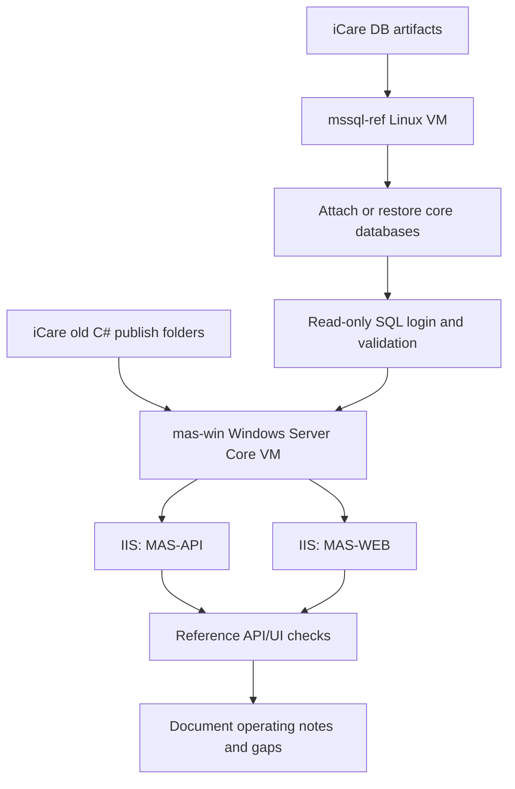

# 部署 MAS 老系统参考环境（MSSQL + IIS）

## Summary

在 `pve` 上搭建一套只供团队重构参考的 MAS 老系统环境：先恢复 MSSQL 参考库，再创建 Windows Server Core + IIS VM 部署 `MAS-API` 和 `MAS-WEB`。目标是能稳定读取旧数据、打开关键页面和 API，帮助 Go + React 重构对照旧行为；不承载生产流量，不保留写入能力作为目标。

---

## Problem Frame

团队正在用 Go + React 重构 MAS 老系统，但需要一个可访问的旧系统实例作为行为参考。现有旧系统包是 ASP.NET Framework / IIS 发布产物，数据库资产分散在 iCare 仓库的备份和本地 SQL Server 数据目录中；如果先部署 IIS 应用，排障会被数据库连接、库名、账号、旧路径和外部依赖混在一起。

---

## Requirements

- R1. 在 `pve` 上建立一套隔离的参考环境，不影响现有生产或测试服务器。
- R2. MSSQL 参考库优先恢复核心三库：`medicalassistance`、`authprovidermasweb`、`maswebkit`。
- R3. SQL Server 必须支持旧系统可能依赖的 Full-Text Search。
- R4. 应用侧部署 `MAS-API` 与 `MAS-WEB`，保持 ASP.NET Framework / IIS 运行形态。
- R5. 应用配置必须指向参考 MSSQL 实例，不能继续指向旧生产内网 IP。
- R6. 环境只供参考读取；邮件、外部 API、文件上传、生产回调等写入或外发能力默认关闭或替换为本地占位。
- R7. 部署过程要沉淀为可复现的运维记录，不写入明文密码、token、SMTP 密钥、私钥。
- R8. 每个关键阶段完成后要能快照或回滚，避免反复重装 Windows / SQL Server。

---

## Scope Boundaries

- 不把这套环境对公网开放；默认仅局域网或 SSH/VPN 内访问。
- 不迁移生产邮件发送、外部支付、外部 API、真实上传回调等副作用能力。
- 不修复旧系统业务 Bug；只做让参考环境可运行的配置适配。
- 不把旧 C# 系统迁移到 .NET Core / Linux；应用仍按 Windows + IIS + .NET Framework 运行。
- 不把数据库作为新 Go 系统的权威数据源；它只是旧行为参考库。
- 不在计划阶段决定所有缺失旧库的处理方式；缺失库以运行时实际报错为准逐项补齐或降级。

### Deferred to Follow-Up Work

- FnOS VM + 显卡硬解直通：PVE 已准备 IOMMU，但不在 MAS 老系统参考环境首轮范围内。
- 对旧系统做自动化 UI 回归：首轮只做关键页面和 API 手动/脚本化烟测。
- 将参考环境接入团队域名、证书、SSO 或统一认证：首轮不做。

---

## Context & Research

**Target repos:** this plan is stored in the Server repo. File paths labeled "Server repo" are relative to this repo; file paths labeled "iCare repo" are relative to the sibling iCare repo.

### Relevant Code and Patterns

- iCare repo: `docs/MAS-old-c#/old-C#-code/MAS-API/Web.config`
  - `targetFramework="4.6.1"`
  - 使用 `System.Web.Mvc`、`System.Web.Http`、`Microsoft.Owin`、`EntityFramework`
  - 连接串主要指向 `medicalassistance`、`authprovidermasweb`、`maswebkit`，另有 `insularsalesportal`、`masprepaid`、`msdb` 等旧依赖
  - 存在 `C:\TopLogic\...`、`Z:\...`、`\\10.0.0.4\...`、旧内网 IP 和 SMTP 配置
- iCare repo: `docs/MAS-old-c#/old-C#-code/MAS-WEB/Web.config`
  - `targetFramework="4.7.2"`
  - MVC 5.2 / OWIN / IIS 配置
  - 依赖 `serverlink`、PDF URL、上传路径、附件路径、SMTP 等外部配置
- iCare repo: `backend/db-bak/`
  - `authprovidermas_preprod_compact-13052026.bak` 约 3.5G
  - `maswebkit_preprod_compact-13052026.bak` 约 2.6G
  - `medicalassistance_prepro_05032026.bak` 约 97G
- iCare repo: `backend/.local/mssql/data/` 和 `backend/.local/mssql/log/`
  - 已存在较紧凑的 MDF/LDF：`medicalassistance` 约 2.9G、`authprovidermas` 约 7.8M、`maswebkit` 约 28M，日志文件较小
- Server repo: `pve/README.md`
  - PVE 9.1.11，内核 `7.0.2-3-pve`
  - `nvme-data` 为 lvmthin，约 934.67 GiB 可用
  - KVM 与 IOMMU 已验证，`intel_iommu=on iommu=pt` 生效

### Institutional Learnings

- `docs/solutions/dev-cypresso/database-issues/restore-bak-with-huge-log-via-temp-disk-2026-05-13.md`
  - SQL Server restore 会按备份里的物理文件大小预分配，巨大 LDF 会导致恢复需要远超实际数据量的空间。
  - 对 5G/10G 级别备份，流式传输和恢复路径必须绕开宿主 `/tmp`。
  - 恢复后切 SIMPLE + shrink log + 重新生成紧凑备份是已验证的路径。
- `docs/solutions/nas/database-issues/mssql-sparse-file-disk-usage-illusion-2026-05-13.md`
  - SQL Server 数据文件逻辑大小和实际占用差距很大时，不应直接按文件管理器显示判断数据是否丢失。
  - 验证应优先使用 SQL Server 自身视图，例如数据库文件、对象行数和关键表查询。
- `docs/solutions/nas/database-issues/mssql-shrink-bloated-transaction-log-2026-05-13.md`
  - SIMPLE 模式只截断日志可复用部分，不会自动缩小物理 LDF；必要时需要 `DBCC SHRINKFILE`。
- `docs/solutions/nas/runtime-errors/docker-restart-policy-unless-stopped-trap-2026-05-13.md`
  - 若使用容器承载 SQL Server，关键容器应使用 `restart=always`，不要依赖 `unless-stopped`。
- `docs/solutions/best-practices/sqlcmd-shell-pitfalls-2026-05-13.md`
  - 通过 SSH + 容器执行 `sqlcmd` 时要避免外层 shell 吃掉环境变量、输出截断、`/tmp` 空间不足、路径不可写等问题。

### External References

- Microsoft SQL Server on Linux / containers 与 SQL Server 2022 Developer Edition 作为参考环境的部署依据。
- Microsoft ASP.NET Framework 应用仍需 Windows + IIS；Linux 上直接运行 `System.Web` 不是首选路线。
- Proxmox VE 单节点 VM 运行 Windows Server Core 与 Linux VM 是标准用法。

---

## Key Technical Decisions

- 先做 MSSQL，再做 C# 应用：数据库连通和库名匹配是旧系统启动和查询的前置条件，先把数据层稳定下来能显著降低 IIS 排障噪音。
- MSSQL 跑在独立 Linux VM，不直接跑在 PVE 宿主：隔离 SQL Server 包、Docker 或系统服务对 PVE 的影响，并便于单独快照。
- SQL Server 首选 2022 Developer Edition + Full-Text Search：本地已有 MDF/LDF 很可能来自较新实例；SQL Server 只能向前兼容 attach/restore，2022 对参考用途更稳。
- 优先尝试使用已存在的紧凑 MDF/LDF attach：这比直接恢复 97G `medicalassistance` 原始备份更快、占用更可控。若 attach 失败，再回退到 `.bak` restore。
- 核心库名以旧系统期望为准：应用配置期望 `medicalassistance`、`authprovidermasweb`、`maswebkit`，即使底层文件来自 preprod 命名，也应 attach/restore 到这些库名，减少配置修改面。
- Windows VM 使用 Server Core：用户明确不想使用完整版 Windows；旧系统只作参考，排障可通过 PowerShell、IIS 管理脚本和 PVE Console 完成。
- 应用配置使用部署副本：不修改 iCare 仓库中的原始 `Web.config`，在 Windows VM 中生成脱敏后的部署副本，关闭外发和生产路径。
- 每个阶段建立快照点：`mssql-installed`、`db-attached`、`windows-core-installed`、`iis-aspnet-ready`、`mas-app-deployed`，降低反复试错成本。

---

## Open Questions

### Resolved During Planning

- 是否先部署 C# 还是数据库：先部署数据库。
- 是否使用 PVE：已裸机安装 PVE，并完成 KVM/IOMMU/No-Subscription 源/系统升级。
- 是否使用完整版 Windows：不使用，优先 Windows Server Core。
- 是否以生产可用为目标：不是，只作重构参考和读取旧数据。

### Deferred to Implementation

- 本地 MDF/LDF 的确切 SQL Server 版本：执行 attach 前通过 SQL Server 错误信息确认；若版本不兼容，改用可兼容的 `.bak` 或升级 SQL Server 版本。
- `medicalassistance` 是否使用 2.9G MDF 足够覆盖参考场景：通过关键表行数和页面烟测验证；不够时再恢复 97G 原始备份。
- `insularsalesportal`、`masprepaid`、`msdb` 等依赖是否阻塞核心页面：运行时按报错判断，首轮不主动恢复未知库。
- Windows Server Core ISO、VirtIO ISO 的本地存放位置：执行时按 PVE 当前 ISO 存储选择。
- 旧系统登录账号和测试路径：部署后从数据库和历史记录中确认，必要时创建只读测试账号或使用已有测试账号。

---

## High-Level Technical Design

> *This illustrates the intended approach and is directional guidance for review, not implementation specification. The implementing agent should treat it as context, not code to reproduce.*

---

## Implementation Units

### U1. 准备 MSSQL Linux VM

**Goal:** 在 PVE 上创建独立的 `mssql-ref` VM，作为 MAS 参考数据库宿主。

**Requirements:** R1, R2, R3, R8

**Dependencies:** None

**Files:**
- Modify: `pve/README.md`
- Create: `docs/solutions/pve/best-practices/mas-legacy-reference-environment-2026-05-16.md` *(部署完成后沉淀，执行中可先草稿)*

**Approach:**
- VM 使用 `nvme-data` 存储，给足恢复和 attach 空间。
- 初始建议：2-4 vCPU、8-12G RAM、200G+ 系统/数据盘；若走 97G 原始备份恢复，临时扩容或单独加数据盘。
- 网络接入 `vmbr0`，数据库端口仅局域网可达；不做公网暴露。
- 安装完成后先快照 `mssql-os-ready`。

**Patterns to follow:**
- `pve/README.md` 的 PVE 存储和网络记录。
- `dev-cypresso/README.md` 中 SQL Server 运行清单的记录风格。

**Test scenarios:**
- Happy path: VM 能从 PVE 启动并通过 SSH 登录。
- Happy path: VM 能访问局域网和 PVE，可从本机或 PVE 传入数据库文件。
- Error path: 如果 VM 创建后网络不通，排查 `vmbr0`、guest 网卡驱动和 DHCP/静态 IP，再继续 SQL Server。

**Verification:**
- `mssql-ref` VM 在线，有固定 IP 或可稳定解析的主机名。
- `pve/README.md` 记录 VM 名称、IP、资源、磁盘位置。

---

### U2. 安装 SQL Server 2022 Developer + Full-Text Search

**Goal:** 在 `mssql-ref` 上安装支持全文检索的 SQL Server 参考实例。

**Requirements:** R2, R3, R8

**Dependencies:** U1

**Files:**
- Modify: `pve/README.md`
- Create: `pve/secrets.local.md` *(本地未入库，记录 SA 和只读账号凭据位置，不写入仓库)*

**Approach:**
- 优先选 SQL Server 2022 Developer Edition，并安装 Full-Text Search。
- 可以采用原生 Linux 包或容器方式；若使用容器，关键容器 restart policy 设为 `always`，数据目录挂到 VM 内持久磁盘。
- 记录 SQL Server 版本、端口、数据目录、备份目录、服务管理方式。
- 安装后先快照 `mssql-installed`。

**Patterns to follow:**
- `dev-cypresso/README.md` 的 SQL Server 版本、特性、数据卷、凭据记录结构。
- `docs/solutions/nas/runtime-errors/docker-restart-policy-unless-stopped-trap-2026-05-13.md` 的 restart policy 经验。

**Test scenarios:**
- Happy path: SQL Server 服务启动后，本机能执行版本查询。
- Happy path: Full-Text Search 组件可查询到已安装状态。
- Error path: 如果 SQL Server 无法启动，检查内存、端口、数据目录权限和容器日志/系统日志。

**Verification:**
- SQL Server 版本和 FTS 状态被记录。
- `sqlcmd` 或等价客户端可从本机连接。

---

### U3. 恢复或附加核心数据库

**Goal:** 让 `mssql-ref` 上出现旧系统期望的核心库：`medicalassistance`、`authprovidermasweb`、`maswebkit`。

**Requirements:** R2, R3, R5, R8

**Dependencies:** U2

**Files:**
- Read (iCare repo): `backend/.local/mssql/data/`
- Read (iCare repo): `backend/.local/mssql/log/`
- Read (iCare repo): `backend/db-bak/`
- Modify: `pve/README.md`
- Create/Modify: `docs/solutions/pve/best-practices/mas-legacy-reference-environment-2026-05-16.md`

**Approach:**
- 第一选择：传输 `backend/.local/mssql/data/` 与 `backend/.local/mssql/log/` 中的核心 MDF/LDF，attach 到目标库名：
  - `medicalassistance`
  - `authprovidermasweb`
  - `maswebkit`
- 第二选择：如果 attach 因版本、文件状态或一致性失败，则恢复紧凑 `.bak`：
  - `authprovidermas_preprod_compact-13052026.bak`
  - `maswebkit_preprod_compact-13052026.bak`
- 第三选择：若 `medicalassistance` 的 2.9G MDF 数据不足或不可 attach，再评估恢复 97G `medicalassistance_prepro_05032026.bak`，并预留足够空间。
- 恢复/attach 后统一设置 SIMPLE recovery，必要时收缩异常大的日志文件。
- 完成后快照 `db-attached`。

**Execution note:** Characterization-first：恢复后先记录数据库文件大小、关键表行数、库名、兼容级别，再进入应用部署。

**Patterns to follow:**
- `docs/solutions/dev-cypresso/database-issues/restore-bak-with-huge-log-via-temp-disk-2026-05-13.md`
- `docs/solutions/nas/database-issues/mssql-sparse-file-disk-usage-illusion-2026-05-13.md`
- `docs/solutions/nas/database-issues/mssql-shrink-bloated-transaction-log-2026-05-13.md`

**Test scenarios:**
- Happy path: 三个核心库都处于 `ONLINE`。
- Happy path: 每个库能查询 `sys.database_files`，并记录数据文件和日志文件实际状态。
- Happy path: 对关键业务表执行行数抽样，确认不是空库。
- Edge case: attach 文件名包含 preprod，但数据库名必须匹配旧系统配置期望。
- Error path: restore 需要预分配巨大 LDF 时，停止继续写入系统盘，改走临时盘/紧凑备份路径。

**Verification:**
- 三个核心库可查询。
- 记录库名、文件大小、关键表抽样结果。
- PVE 快照或 SQL VM 快照已建立。

---

### U4. 建立只读应用账号和数据库连通验证

**Goal:** 为旧系统创建只读 SQL 登录，并验证 Windows/IIS VM 后续可以用该账号读核心数据。

**Requirements:** R2, R5, R6, R7

**Dependencies:** U3

**Files:**
- Create: `pve/secrets.local.md` *(本地未入库)*
- Modify: `pve/README.md`

**Approach:**
- 不复用 `Web.config` 中的历史生产账号和明文密码。
- 创建参考环境专用 SQL 登录，默认只授予核心库 `db_datareader`。
- 如果旧系统启动必须执行少量写入动作（例如 session、audit log、登录日志），优先通过应用配置关闭；关闭不了再单独评估是否给特定表最小写权限。
- 记录凭据存放位置，不把密码写入 git。

**Patterns to follow:**
- AGENTS.md 的敏感信息约定。
- `docs/solutions/best-practices/sqlcmd-shell-pitfalls-2026-05-13.md` 的 SQL 查询和远程执行注意事项。

**Test scenarios:**
- Happy path: 只读账号能连接三个核心库。
- Happy path: 只读账号能查询旧系统首页、登录、常用列表所需的核心表。
- Error path: 只读账号尝试执行写入语句应失败，除非后续明确授予最小写权限。
- Integration: 从与 Windows VM 同网段的机器验证 SQL 1433 连通。

**Verification:**
- 只读账号连通性通过。
- 权限边界被记录。
- 应用配置需要的数据库主机、库名、账号策略明确。

---

### U5. 创建 Windows Server Core IIS VM

**Goal:** 创建 `mas-win` VM，安装 IIS、ASP.NET 4.x、.NET Framework 4.8 和运行旧系统所需的基础组件。

**Requirements:** R1, R4, R8

**Dependencies:** U4

**Files:**
- Modify: `pve/README.md`
- Create/Modify: `docs/solutions/pve/best-practices/mas-legacy-reference-environment-2026-05-16.md`

**Approach:**
- Windows Server Core VM 放在 `nvme-data`。
- 初始建议：2-4 vCPU、4-8G RAM、80G+ 系统盘；后续按 IIS 和 Rotativa/PDF 依赖调整。
- 网卡使用 VirtIO，安装 VirtIO 驱动；磁盘优先 VirtIO SCSI。
- 安装 IIS、ASP.NET 4.x、.NET Framework 4.8、必要的 URL Rewrite / VC++ runtime / 字体和 PDF 依赖。
- 安装完成后快照 `windows-core-installed` 和 `iis-aspnet-ready`。

**Patterns to follow:**
- `pve/README.md` 的 VM 记录方式。
- 旧系统 `MAS-WEB/Rotativa`、`Reports`、`Uploads` 目录提示的运行依赖。

**Test scenarios:**
- Happy path: Windows Server Core VM 可通过 RDP/PowerShell/PVE Console 管理。
- Happy path: IIS 默认站点或测试站点能返回 HTTP 200。
- Happy path: .NET Framework 4.x ASP.NET handler 能运行简单测试页。
- Error path: 如果 VirtIO 网卡或磁盘驱动导致安装不可见，回退到临时兼容驱动后再切回 VirtIO。

**Verification:**
- IIS 和 ASP.NET 运行正常。
- 快照点已创建。
- VM IP、资源、管理方式记录到 `pve/README.md`。

---

### U6. 部署 MAS-API 与 MAS-WEB 应用包

**Goal:** 将旧系统发布包部署到 `mas-win` 的 IIS，并生成参考环境专用配置。

**Requirements:** R4, R5, R6, R7, R8

**Dependencies:** U5

**Files:**
- Read (iCare repo): `docs/MAS-old-c#/old-C#-code/MAS-API/`
- Read (iCare repo): `docs/MAS-old-c#/old-C#-code/MAS-WEB/`
- Create: `pve/mas-reference-config-notes.local.md` *(本地未入库，记录敏感配置映射位置)*
- Modify: `pve/README.md`

**Approach:**
- 不修改 iCare 原始发布包；复制到 Windows VM 后生成部署副本。
- IIS 中分别创建 `MAS-API` 和 `MAS-WEB` 站点或 Application，端口先用局域网内部端口，避免占用 PVE 管理端口。
- 配置副本中替换数据库主机、库名和只读账号。
- 禁用或本地化外发能力：
  - SMTP 改为本地占位或禁用。
  - 外部 API key / client secret 不写入部署配置。
  - `Z:\...`、`\\10.0.0.4\...`、`C:\TopLogic\...` 映射到 VM 内本地目录。
  - PDF host、upload URL、serverlink 指向参考环境内部地址。
- 为 `Uploads`、`Attachments`、`Logs`、`Downloads`、`Reports`、`Rotativa` 准备本地目录和 IIS AppPool 权限。
- 部署后快照 `mas-app-deployed`。

**Execution note:** Characterization-first：先只做最小配置让站点启动，再逐个处理运行时报错；不要一次性猜完所有旧外部依赖。

**Patterns to follow:**
- `docs/MAS-old-c#/old-C#-code/MAS-API/Web.config`
- `docs/MAS-old-c#/old-C#-code/MAS-WEB/Web.config`
- AGENTS.md 的敏感信息约定。

**Test scenarios:**
- Happy path: `MAS-API` 应用池启动，基础路由或 HelpPage 可访问。
- Happy path: `MAS-WEB` 首页或登录页可访问。
- Integration: `MAS-WEB` 调用 `MAS-API` 的内部地址能通。
- Error path: SMTP、外部 API、文件上传路径触发时不应访问真实生产服务。
- Edge case: 应用启动时报缺失目录时，补齐本地目录和权限，而不是恢复旧 UNC 路径。

**Verification:**
- 两个 IIS 站点运行。
- Web.config 部署副本不包含真实生产密钥或外发凭据。
- 关键目录存在且 AppPool 可写日志。

---

### U7. 运行旧系统参考烟测

**Goal:** 证明这套环境能作为重构参考：能打开页面、读数据库、返回关键 API 数据，并明确哪些模块因缺失依赖暂不可用。

**Requirements:** R1, R2, R4, R5, R6

**Dependencies:** U6

**Files:**
- Create: `pve/mas-reference-smoke-test-2026-05-16.md`
- Modify: `pve/README.md`
- Create/Modify: `docs/solutions/pve/best-practices/mas-legacy-reference-environment-2026-05-16.md`

**Approach:**
- 选取最小烟测集：
  - IIS 站点健康。
  - 登录页或首页打开。
  - 一个 API GET 请求返回 JSON。
  - 一个核心列表页能读数据库。
  - 一条典型查询能从 `medicalassistance` 返回数据。
- 对失败项分类：
  - 缺库/缺表。
  - 只读权限不足。
  - 旧文件路径缺失。
  - SMTP/外部 API 被禁用。
  - PDF/Rotativa/字体依赖缺失。
- 只修复阻塞参考读取的失败；外发和生产集成失败记录为预期限制。

**Patterns to follow:**
- iCare docs 中现有 verification 输出的记录风格。
- `docs/solutions/README.md` 的运维文档结构。

**Test scenarios:**
- Happy path: 首页/登录页返回 200。
- Happy path: 至少一个需要数据库的 API 返回非空业务数据。
- Happy path: 至少一个 MAS-WEB 页面读出旧数据。
- Error path: 邮件发送、生产 URL、真实上传路径不会被触发或不会访问真实外部服务。
- Edge case: 如果页面因缺失非核心库失败，应记录模块名和缺失库，不扩大到全量恢复。

**Verification:**
- `pve/mas-reference-smoke-test-2026-05-16.md` 记录通过/失败项。
- 失败项有分类和下一步建议。
- 团队能用该环境对照至少一个重构模块。

---

### U8. 固化运维档案和回滚点

**Goal:** 把部署结果、凭据位置、快照点、访问方式、限制项和后续事项写入 Server 运维仓库。

**Requirements:** R1, R7, R8

**Dependencies:** U7

**Files:**
- Modify: `pve/README.md`
- Create/Modify: `docs/solutions/pve/best-practices/mas-legacy-reference-environment-2026-05-16.md`
- Create: `pve/secrets.local.md` *(本地未入库，如尚未创建)*

**Approach:**
- `pve/README.md` 记录 VM 清单、IP、资源、用途、快照点。
- `docs/solutions/pve/...` 记录部署步骤和踩坑，不写明文密码。
- 本地 `secrets.local.md` 只记录敏感信息位置或本地未入库凭据，确保不进入 git。
- 明确回滚方式：
  - SQL VM 回滚到 `db-attached`。
  - Windows VM 回滚到 `iis-aspnet-ready` 或 `mas-app-deployed`。
  - 应用配置回滚到部署前副本。

**Patterns to follow:**
- `docs/solutions/README.md`
- `dev-cypresso/README.md`
- `pve/README.md`

**Test scenarios:**
- Test expectation: none -- 文档固化任务，无运行时行为变更。

**Verification:**
- 文档能让下一次会话从 VM 名、IP、快照点和限制项继续工作。
- 仓库检索不到明文密码、token、私钥。

---

## System-Wide Impact

- **Interaction graph:** PVE 宿主只承载 VM；MSSQL 在 `mssql-ref`，IIS 在 `mas-win`，两者通过 `vmbr0` 局域网通信。旧系统内部的 `MAS-WEB -> MAS-API -> MSSQL` 关系保留。
- **Error propagation:** 数据库连接失败会表现为 IIS 500 或 API 错误；烟测需要按数据库、IIS、应用配置、旧外部依赖四类分层定位。
- **State lifecycle risks:** 即使目标是只读，旧系统可能在登录、审计、session、日志等路径写数据库或文件。首轮应尽量关闭写入；关闭不了时只给最小写权限并记录。
- **API surface parity:** 不要求新 Go/React 系统接入该旧环境；该环境只作为人和测试脚本的参考对象。
- **Integration coverage:** 仅靠 SQL 查询不能证明旧系统可参考，必须至少跑通一个 Web 页面和一个 API 调用。
- **Unchanged invariants:** 不改变 PVE 宿主网络、IOMMU、存储池结构；不修改 iCare 原始旧系统发布包。

---

## Risks & Dependencies

| Risk | Mitigation |
|------|------------|
| MDF/LDF 版本高于目标 SQL Server，attach 失败 | 使用 SQL Server 2022；若仍失败，改用 `.bak` restore 或确认源版本后升级目标 |
| 97G 原始 `medicalassistance` 备份恢复耗时和占用过大 | 优先使用已恢复的紧凑 MDF/LDF；只有数据不足时才恢复原始备份 |
| 旧系统启动时需要写数据库 | 默认只读；按报错评估最小写权限，优先关闭审计/邮件/外发 |
| Web.config 含生产密钥和旧内网地址 | 只在部署副本中配置；原始文件不改，文档不写明文密钥 |
| Windows Server Core 排障不如完整版直观 | 每个阶段快照；先用最小 IIS 测试页验证 ASP.NET，再部署 MAS |
| 缺失 `insularsalesportal`、`masprepaid` 等非核心库 | 首轮记录模块限制；只在阻塞目标参考流程时补库 |
| Rotativa/PDF/字体依赖缺失 | 首轮不把 PDF 作为核心验收；如目标模块需要，再单独补依赖 |
| 参考环境误发邮件或调用生产 API | SMTP 和外部 URL 默认禁用/替换为本地占位，烟测验证不外发 |

---

## Operational Notes

- PVE 当前适合创建 VM：KVM 可用，IOMMU passthrough 已启用，`nvme-data` 在线且空间充足。
- 所有破坏性动作继续遵守 AGENTS.md：重启、删除、改防火墙、改数据库 schema/data 前先确认。
- 数据恢复和 attach 操作虽是参考环境，也要先保留原始文件副本，不覆盖 iCare 仓库中的备份和 MDF/LDF。
- 若执行中生成新密码、连接串、Windows 管理员密码，应写入本地未入库文件或密码管理器，不写进计划和解决方案文档。

---

## Documentation Plan

- 更新 `pve/README.md`：记录 `mssql-ref`、`mas-win`、IP、资源、快照点、访问入口。
- 新增 `docs/solutions/pve/best-practices/mas-legacy-reference-environment-2026-05-16.md`：沉淀完整部署流程、坑点、验证结果。
- 使用 `pve/secrets.local.md` 记录敏感信息位置，确保未入库。
- 使用 `pve/mas-reference-smoke-test-2026-05-16.md` 记录可参考模块和已知不可用模块。
