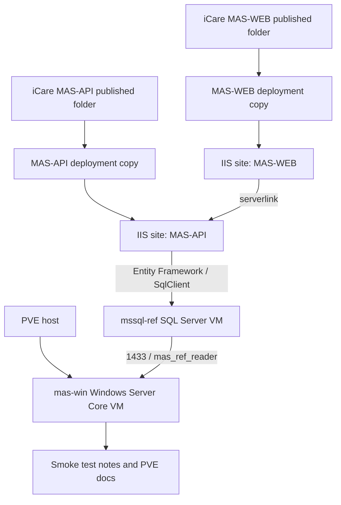

# 部署 MAS 老 C# 发布包到 Windows Server Core

## Summary

在 PVE 上新增一台 Windows Server Core VM，安装 IIS / ASP.NET 4.x，把 iCare 仓库中的 `MAS-API` 和 `MAS-WEB` 发布包部署为一套只供重构参考的旧系统实例。数据库继续使用已恢复完成的 `mssql-ref`，应用配置使用部署副本，替换旧生产地址、关闭外发能力，并通过烟测确认页面和 API 能读取旧数据。

---

## Problem Frame

团队正在用 Go + React 重构 MAS 老系统，需要能打开旧页面、调用旧 API、读取旧数据库来对照历史行为。数据库参考 VM 已经完成，但 C# 发布包仍包含旧生产连接串、SMTP 配置、硬编码文件路径和 PDF 依赖；如果直接丢进 IIS，很容易误连旧环境或把排障范围扩大到外部系统。

---

## Requirements

- R1. 在 PVE 上创建隔离的 Windows Server Core 参考 VM，不影响 PVE 宿主和现有 `mssql-ref`。
- R2. Windows VM 必须能运行 ASP.NET Framework 4.6.1 / 4.7.2 的 System.Web / MVC / Web API 发布包。
- R3. `MAS-API` 和 `MAS-WEB` 必须作为两个可访问的 IIS 站点或应用运行。
- R4. 应用数据库连接必须指向 `mssql-ref` 上已恢复的 `medicalassistance`、`authprovidermasweb`、`maswebkit`。
- R5. 应用配置不得继续使用旧生产内网 IP、旧 SQL 账号、真实 SMTP 密钥或外部生产回调。
- R6. 旧文件路径、上传目录、附件目录、日志目录和 PDF 依赖要在 Windows VM 内本地化，满足参考读取和基础页面运行。
- R7. 部署结果要可回滚：Windows 基线、IIS 基线、应用部署后都要有快照点。
- R8. 部署过程和烟测结果要沉淀到 Server 运维仓库；文档只记录敏感信息位置，不记录明文密码、token、SMTP 密钥或私钥。

---

## Scope Boundaries

- 不把旧 C# 系统改造成 .NET Core、Linux 容器或新架构；首轮按 Windows + IIS + .NET Framework 运行。
- 不安装完整版 Windows Desktop Experience，除非 Server Core 被 GUI-only 依赖明确阻塞。
- 不修改 iCare 仓库中的原始发布包；只在 Windows VM 内生成部署副本。
- 不对公网开放旧系统；默认仅局域网访问。
- 不恢复真实邮件发送、生产外部 API、生产上传盘、生产回调或支付等副作用能力。
- 不修复旧系统业务 Bug；只做运行参考环境所需的配置和运行时适配。
- 不以 PDF/报表导出作为首轮核心验收；如果目标参考流程需要，再补 Rotativa / 字体 / runtime 依赖。

### Deferred to Follow-Up Work

- 给旧系统加自动化 UI 回归：首轮只做人工或脚本化烟测记录。
- 把旧环境挂到统一域名、HTTPS、SSO 或团队网关：首轮只使用局域网 IP 和端口。
- 为 Go + React 重构项目接入自动对照测试：待旧系统参考环境稳定后再设计。

---

## Context & Research

**Target repos:** this plan is stored in the Server repo. File paths labeled "Server repo" are relative to this repo. File paths labeled "iCare repo" are relative to the sibling iCare repo.

### Relevant Code and Patterns

- iCare repo: `docs/MAS-old-c#/old-C#-code/MAS-API/Web.config`
  - `targetFramework="4.6.1"`
  - 使用 IIS `system.webServer`、`runAllManagedModulesForAllRequests`、`ExtensionlessUrlHandler-Integrated-4.0`
  - 数据库连接串集中在 `connectionStrings`，当前仍包含旧 SQL Server 地址、旧账号和旧密码
  - 文件路径包含 `C:\TopLogic\...`、`C:\Toplogic\...`、`Z:\UploadsProd`
  - SMTP 指向 Office 365，需要在部署副本中禁用或替换为占位
- iCare repo: `docs/MAS-old-c#/old-C#-code/MAS-WEB/Web.config`
  - `targetFramework="4.7.2"`
  - `serverlink` 当前指向旧 API 地址，需要改为 Windows VM 内 `MAS-API` 地址
  - SMTP 指向 Office 365，需要在部署副本中禁用或替换为占位
- iCare repo: `docs/MAS-old-c#/old-C#-code/MAS-WEB/Rotativa/`
  - 包含 `wkhtmltopdf.exe` 和 `wkhtmltoimage.exe`，说明 PDF/图片导出依赖 Windows 可执行文件、字体和进程权限
- iCare repo: `docs/MAS-old-c#/old-C#-code/MAS-API/bin/` and `docs/MAS-old-c#/old-C#-code/MAS-WEB/bin/`
  - 发布包已经包含 MVC、Web API、OWIN、Entity Framework 等 DLL
  - 未发现 `.sln` / `.csproj`，首轮按已发布应用部署，不在 VM 内编译
- Server repo: `pve/README.md`
  - PVE 9.1.11，KVM 和 IOMMU 已启用，`nvme-data` 在线
  - `mssql-ref` VM 已恢复三套核心库，IP 为 `192.168.2.20`
  - SQL 只读账号 `mas_ref_reader` 已授予三库 `db_datareader`
- Server repo: `docs/plans/2026-05-16-001-feat-mas-legacy-reference-environment-plan.md`
  - 总体计划已完成 SQL 阶段，本计划细化后续 Windows/IIS/C# 发布包阶段
- Server repo: `docs/solutions/pve/best-practices/mas-legacy-reference-sql-vm-2026-05-16.md`
  - 记录了 SQL Server VM、数据库恢复、只读账号、快照和当前限制

### Institutional Learnings

- Server repo: `docs/solutions/pve/best-practices/mas-legacy-reference-sql-vm-2026-05-16.md`
  - SQL 层已稳定，后续应用部署应只连接 `192.168.2.20,1433`，不要回到旧生产地址。
  - 凭据只保存在 VM 内 `/root/mssql-secrets.env`，仓库文档不写明文密码。
  - `nvme-data` 保留多个快照后有 thin provisioning 逻辑分配压力，Windows VM 快照要有节制。
- Server repo: `docs/solutions/nas/database-issues/mssql-sparse-file-disk-usage-illusion-2026-05-13.md`
  - 不要只凭文件大小判断数据完整性；应用烟测要结合关键页面、API 和数据库抽样。
- Server repo: `docs/solutions/best-practices/sqlcmd-shell-pitfalls-2026-05-13.md`
  - 远程 SQL 验证要注意 shell quoting、输出截断和凭据泄露。

### External References

- Microsoft Windows Server Core roles and services: Server Core 支持 IIS、ASP.NET 4.x、.NET Extensibility 4.x、ISAPI Extensions / Filters 等角色服务。
- Microsoft .NET Framework on Windows Server: Windows Server 2022 自带 .NET Framework 4.8，可运行面向 4.6.1 / 4.7.2 的 .NET Framework 应用。
- Microsoft IIS / ASP.NET deployment guidance: ASP.NET Framework Web 应用应在 IIS 中使用 .NET CLR v4.0、Integrated pipeline，并配置应用池权限。

---

## Key Technical Decisions

- 新建独立 Windows Server Core VM，而不是把 IIS 装到 PVE 宿主或 SQL VM：隔离 Windows 运行时、IIS、应用池权限和旧系统文件写入，便于快照回滚。
- 继续使用 Server Core：目标只是参考环境，用户明确不希望使用完整版 Windows；当前依赖看起来是 ASP.NET Framework + IIS + 发布包 DLL，没有必须依赖桌面 UI 的证据。
- 先部署最小 IIS / ASP.NET 基线，再复制 MAS 发布包：先用简单 ASP.NET 验证 IIS 管线，避免把 Windows 驱动、IIS 角色、应用配置问题混在一起。
- `MAS-API` 和 `MAS-WEB` 分成两个 IIS 站点或应用池：便于分别定位 API、Web 前端、应用池权限和 `serverlink` 配置问题。
- 配置改动只发生在 VM 内部署副本：iCare 原始发布包作为证据保留，避免把脱敏或本地路径改动提交回旧系统归档。
- 数据库账号先使用只读登录：符合参考读取目标；如果旧系统登录、审计或 session 必须写库，再按报错最小授权，不预先放宽权限。
- SMTP、外部 URL、上传盘和生产回调默认禁用或替换为本地占位：避免参考环境误触发外发。
- Rotativa/PDF 作为二级能力处理：先保证页面/API/数据库读取；只有目标参考模块需要 PDF 时，再补字体、VC++ runtime 和进程权限。

---

## Open Questions

### Resolved During Planning

- 是否使用 Windows Server Core：使用，除非执行时发现不可替代的 GUI-only 依赖。
- 是否需要编译 C# 源码：首轮不需要；当前目录更像发布包，按 IIS 部署处理。
- 是否复用原始 `Web.config`：不直接复用；以原始配置为模板，在 VM 内生成部署副本。
- 是否恢复生产外发能力：不恢复；邮件、外部 API、生产上传盘和回调默认关闭或本地化。

### Deferred to Implementation

- Windows Server ISO 和 VirtIO ISO 的具体来源：执行时按 PVE 当前 ISO 存储确认；如缺失，再由用户提供或确认下载官方评估镜像。
- Windows VM 的最终 IP：执行时从局域网规划选择，计划中以 `mas-win` 作为主机名占位。
- IIS 端口：建议 API 用 `9020`、Web 用 `9021`，但执行时需避开已有占用。
- 只读 SQL 登录是否足够：取决于旧系统登录和页面加载时是否写数据库；先按只读尝试，再按错误最小放权。
- 缺失的非核心数据库：如果运行时报 `insularsalesportal`、`masprepaid`、`msdb` 等依赖，先判断是否阻塞目标参考流程，再决定补库或降级。
- PDF/报表依赖：如果目标页面需要 Rotativa，再单独验证 `wkhtmltopdf.exe`、字体和进程权限。

---

## High-Level Technical Design

> *This illustrates the intended approach and is directional guidance for review, not implementation specification. The implementing agent should treat it as context, not code to reproduce.*

---

## Implementation Units

### U1. 准备 Windows Server Core VM 安装介质和 VM 壳

**Goal:** 在 PVE 上准备 `mas-win` VM 所需 ISO、VirtIO 驱动和基础 VM 配置，但不安装应用。

**Requirements:** R1, R2, R7

**Dependencies:** None

**Files:**
- Modify: `pve/README.md`
- Create/Modify: `docs/solutions/pve/best-practices/mas-csharp-iis-reference-deploy-2026-05-16.md`

**Approach:**
- 检查 PVE ISO 存储是否已有 Windows Server ISO 和 VirtIO ISO。
- 如缺失 ISO，先让用户确认提供路径或下载来源；不要使用来路不明镜像。
- VM 放在 `nvme-data`，初始建议 4 vCPU、8 GiB RAM、100-120G 系统盘，网卡使用 VirtIO，磁盘使用 VirtIO SCSI。
- VM 名称建议 `mas-win`，用途标注为 MAS 老 C# 参考应用，不对公网开放。
- 创建 VM 壳后记录 VMID、资源、磁盘、网络桥接和 ISO 来源。

**Patterns to follow:**
- Server repo: `pve/README.md` 的 VM 清单记录方式。
- Server repo: `docs/solutions/pve/best-practices/mas-legacy-reference-sql-vm-2026-05-16.md` 的凭据和快照记录方式。

**Test scenarios:**
- Happy path: PVE Web UI 或 CLI 中能看到 `mas-win` VM，磁盘位于 `nvme-data`。
- Happy path: VM Console 能进入 Windows 安装流程，并能加载 VirtIO 存储/网卡驱动。
- Error path: 如果安装器看不到磁盘或网卡，确认 VirtIO ISO 版本和驱动加载路径，不切换到长期低性能设备作为最终方案。

**Verification:**
- `pve/README.md` 记录 `mas-win` 的 VMID、资源、ISO、存储和网络。
- 未开始任何会影响 `mssql-ref` 的操作。

---

### U2. 安装 Windows Server Core 基线并启用远程管理

**Goal:** 完成 Windows Server Core 安装、网络配置、基础补丁和可维护的远程管理入口。

**Requirements:** R1, R2, R7

**Dependencies:** U1

**Files:**
- Modify: `pve/README.md`
- Create/Modify: `docs/solutions/pve/best-practices/mas-csharp-iis-reference-deploy-2026-05-16.md`

**Approach:**
- 安装 Windows Server Core，设置本地管理员密码并记录到本地未入库的凭据位置。
- 配置静态 IP 或 DHCP 保留，确保 `mas-win` 能访问 `mssql-ref` 的 `192.168.2.20:1433`。
- 启用必要的远程管理方式，例如 PowerShell Remoting 或 RDP；如果启用防火墙规则，先记录变更范围。
- 安装 VirtIO guest tools / qemu guest agent，便于 PVE 读取 IP 和执行优雅关机。
- 打 Windows 更新到稳定基线后创建快照 `windows-core-ready`。

**Patterns to follow:**
- Server repo: `AGENTS.md` 的服务器操作守则，改防火墙和重启前先确认。
- Server repo: `pve/README.md` 的网络和快照记录方式。

**Test scenarios:**
- Happy path: 从本机或 PVE 能稳定 ping / 远程进入 `mas-win`。
- Happy path: `mas-win` 能连通 `192.168.2.20:1433`。
- Happy path: PVE 能显示 guest agent 状态或至少能从文档记录到 VM IP。
- Error path: 如果 Windows 防火墙阻断远程管理，只开放必要管理端口，不关闭整个防火墙作为长期状态。

**Verification:**
- `mas-win` 可远程管理。
- 已建立 `windows-core-ready` 快照。
- 管理员密码只记录在本地未入库位置或密码管理器。

---

### U3. 安装 IIS、ASP.NET 4.x 和运行时依赖

**Goal:** 让 Windows Server Core 具备运行 ASP.NET Framework MVC/Web API 发布包的 IIS 基线。

**Requirements:** R2, R3, R7

**Dependencies:** U2

**Files:**
- Modify: `pve/README.md`
- Create/Modify: `docs/solutions/pve/best-practices/mas-csharp-iis-reference-deploy-2026-05-16.md`

**Approach:**
- 安装 IIS、ASP.NET 4.x、.NET Extensibility 4.x、ISAPI Extensions / Filters、静态内容、默认文档、HTTP 日志等必要角色服务。
- 确认 .NET Framework 4.8 可用；它应兼容目标为 4.6.1 和 4.7.2 的应用。
- 创建一个最小 ASP.NET Framework 测试站点或测试应用，验证 IIS 管线、应用池和 handler 正常。
- 预留后续依赖位置：URL Rewrite、VC++ runtime、字体、Rotativa 相关权限先列为待验证，不在基线阶段过度安装。
- 基线通过后创建快照 `iis-aspnet-ready`。

**Patterns to follow:**
- Microsoft Server Core IIS / ASP.NET 角色服务文档。
- iCare repo: `docs/MAS-old-c#/old-C#-code/MAS-API/Web.config` 中的 `system.webServer` 配置。
- iCare repo: `docs/MAS-old-c#/old-C#-code/MAS-WEB/Web.config` 中的 ASP.NET 4.7.2 配置。

**Test scenarios:**
- Happy path: IIS 测试站点返回 HTTP 200。
- Happy path: ASP.NET 4.x 测试应用由 .NET CLR v4.0 / Integrated pipeline 正常处理。
- Edge case: 如果默认文档或 extensionless routing 不生效，补齐 IIS handler / module 角色，而不是先改 MAS 应用代码。
- Error path: 如果 .NET 注册或 handler 缺失导致 500，先修复 IIS 角色服务，再进入 MAS 发布包部署。

**Verification:**
- IIS 和 ASP.NET 4.x 基线可运行。
- 已建立 `iis-aspnet-ready` 快照。
- 文档记录安装的 Windows features 和是否安装额外 runtime。

---

### U4. 复制发布包并建立部署目录结构

**Goal:** 把 `MAS-API` 和 `MAS-WEB` 发布包复制到 Windows VM 的部署目录，并创建本地数据目录和权限。

**Requirements:** R3, R6, R7

**Dependencies:** U3

**Files:**
- Read (iCare repo): `docs/MAS-old-c#/old-C#-code/MAS-API/`
- Read (iCare repo): `docs/MAS-old-c#/old-C#-code/MAS-WEB/`
- Modify: `pve/README.md`
- Create/Modify: `docs/solutions/pve/best-practices/mas-csharp-iis-reference-deploy-2026-05-16.md`

**Approach:**
- 在 Windows VM 内创建部署根目录，例如 `C:\MAS\Apps\MAS-API`、`C:\MAS\Apps\MAS-WEB`、`C:\MAS\Data\...`。
- 复制发布包内容到部署目录，保留原始 `Web.config` 备份，再创建部署副本。
- 创建本地目录替代旧路径：Uploads、Attachments、Logs、Downloads、Reports、App_Data、Rotativa work/temp 等。
- 为对应 IIS AppPool identity 授予最小读写权限：应用目录只读，数据/日志/上传目录可写。
- 不把 VM 内生成的部署配置回写到 iCare 仓库。

**Execution note:** Characterization-first：先让目录和权限满足应用启动，再根据运行时缺失项补目录，不一次性猜完全部历史盘符。

**Patterns to follow:**
- iCare repo: `docs/MAS-old-c#/old-C#-code/MAS-API/Attachments/`
- iCare repo: `docs/MAS-old-c#/old-C#-code/MAS-WEB/Uploads/`
- iCare repo: `docs/MAS-old-c#/old-C#-code/MAS-WEB/Rotativa/`

**Test scenarios:**
- Happy path: 两个部署目录包含 `bin/`、`Web.config`、静态资源和必要子目录。
- Happy path: AppPool identity 能写入 Logs / Uploads / App_Data 中的测试文件。
- Error path: 如果复制过程中遇到 macOS 元数据文件或压缩包，不删除原始归档；只在部署副本中决定是否忽略。
- Integration: 部署副本能与 IIS 应用池路径匹配，不依赖原始本机路径。

**Verification:**
- Windows VM 中存在 `MAS-API` 和 `MAS-WEB` 部署目录。
- 本地数据目录和权限满足应用运行。
- 原始 iCare 发布包未被修改。

---

### U5. 生成脱敏部署配置并连接 `mssql-ref`

**Goal:** 在 Windows VM 内生成参考环境专用 `Web.config`，替换数据库、API、文件路径和外发配置。

**Requirements:** R4, R5, R6, R8

**Dependencies:** U4

**Files:**
- Read (iCare repo): `docs/MAS-old-c#/old-C#-code/MAS-API/Web.config`
- Read (iCare repo): `docs/MAS-old-c#/old-C#-code/MAS-WEB/Web.config`
- Modify: `pve/README.md`
- Create: `pve/mas-csharp-reference-config-notes.local.md` *(本地未入库，如需要记录敏感映射位置)*
- Create/Modify: `docs/solutions/pve/best-practices/mas-csharp-iis-reference-deploy-2026-05-16.md`

**Approach:**
- `MAS-API` 连接串统一改到 `mssql-ref`：
  - `medicalassistance`
  - `authprovidermasweb`
  - `maswebkit`
- SQL 用户先使用 `mas_ref_reader`；密码从 `mssql-ref` 的凭据文件读取后只写入 Windows VM 部署配置，不写入仓库。
- 对仍指向未知库的连接串先分级处理：
  - 阻塞核心页面的库：记录错误后决定补库或改为可降级配置。
  - 非核心模块库：保留为已知限制，不为首轮扩大恢复范围。
- `MAS-WEB` 的 `serverlink` 改为 `MAS-API` 在同 VM 或同局域网内的地址。
- SMTP、外部生产 URL、旧内网 IP、旧上传盘和真实 API key 全部禁用、占位或指向本地无害端点。
- 文件路径统一指向 `C:\MAS\Data\...` 下的本地目录。

**Execution note:** Start with the smallest config that lets the app start, then record each runtime failure before widening config or permissions.

**Patterns to follow:**
- Server repo: `AGENTS.md` 的“不要在文档里写明文密码、token、私钥”约定。
- Server repo: `docs/solutions/pve/best-practices/mas-legacy-reference-sql-vm-2026-05-16.md` 的凭据位置记录方式。

**Test scenarios:**
- Happy path: `MAS-API` 能用部署配置连接 `medicalassistance`、`authprovidermasweb`、`maswebkit`。
- Happy path: `MAS-WEB` 调用新的 `serverlink`，不会访问旧 API 地址。
- Error path: 使用旧生产 SQL IP、旧 SQL 账号、真实 SMTP 密钥或外部生产 URL 的配置项应被替换或记录为禁用。
- Edge case: 只读账号导致登录或审计写入失败时，先记录触发表和调用路径，再决定是否授予最小写权限。
- Integration: 从 Web 页面触发 API 调用时，链路为 `MAS-WEB -> MAS-API -> mssql-ref`。

**Verification:**
- 部署副本中核心连接串指向 `192.168.2.20,1433`。
- 仓库文档和计划不包含明文密码或真实 SMTP 密钥。
- 配置差异和敏感信息位置被记录到本地未入库文件或运维说明中。

---

### U6. 创建 IIS 应用池和站点

**Goal:** 在 IIS 中分别承载 `MAS-API` 和 `MAS-WEB`，并建立最小可访问入口。

**Requirements:** R2, R3, R4, R7

**Dependencies:** U5

**Files:**
- Modify: `pve/README.md`
- Create/Modify: `docs/solutions/pve/best-practices/mas-csharp-iis-reference-deploy-2026-05-16.md`

**Approach:**
- 创建两个独立 AppPool，使用 .NET CLR v4.0、Integrated pipeline。
- API 和 Web 分别绑定不同端口，建议初始为 API `9020`、Web `9021`，执行时以实际端口占用为准。
- 应用池 identity 使用最小权限访问部署目录、数据目录和日志目录。
- 设置应用池回收、启动模式、日志路径，便于排障。
- 站点启动后创建快照 `mas-iis-sites-ready`。

**Patterns to follow:**
- iCare repo: `docs/MAS-old-c#/old-C#-code/MAS-API/Web.config` 的 IIS handler / module 配置。
- iCare repo: `docs/MAS-old-c#/old-C#-code/MAS-WEB/Web.config` 的 MVC 站点配置。

**Test scenarios:**
- Happy path: `MAS-API` 站点启动，基础路由或 HelpPage 不因 IIS 管线缺失而失败。
- Happy path: `MAS-WEB` 首页或登录页返回 HTTP 200 或可解释的应用层错误。
- Error path: 如果应用池立即停止，检查 .NET runtime、文件权限、配置解析和 bin DLL 缺失。
- Integration: `MAS-WEB` 的 API 调用打到本地 `MAS-API`，而不是旧地址。

**Verification:**
- 两个 IIS 站点存在、绑定端口明确、应用池可启动。
- PVE 有 `mas-iis-sites-ready` 快照。
- `pve/README.md` 记录访问入口。

---

### U7. 执行参考环境烟测并分类失败

**Goal:** 验证这套旧系统实例足够支持重构参考，并明确不可用模块的原因。

**Requirements:** R3, R4, R5, R6, R8

**Dependencies:** U6

**Files:**
- Create: `pve/mas-csharp-reference-smoke-test-2026-05-16.md`
- Modify: `pve/README.md`
- Create/Modify: `docs/solutions/pve/best-practices/mas-csharp-iis-reference-deploy-2026-05-16.md`

**Approach:**
- 先做基础烟测：
  - `MAS-API` 站点响应。
  - `MAS-WEB` 首页或登录页响应。
  - 至少一个 API GET 读取数据库并返回业务数据。
  - 至少一个 Web 页面通过 API 或直接读取旧数据。
- 对失败分类记录：
  - 数据库权限不足。
  - 缺失非核心数据库。
  - 缺失目录或 AppPool 权限。
  - SMTP / 外部 API 被禁用导致的预期失败。
  - Rotativa / PDF / 字体依赖缺失。
  - 旧系统自身业务或配置错误。
- 只修复阻塞参考读取的失败；外发和生产集成失败记录为预期限制。
- 核心烟测通过后创建快照 `mas-csharp-smoke-ready`。

**Execution note:** Characterization-first：每个失败先记录 URL、动作、错误类型和相关日志，再决定是否改配置或授权。

**Patterns to follow:**
- Server repo: `docs/solutions/README.md` 的故障文档结构。
- Server repo: `pve/README.md` 的运行状态记录方式。

**Test scenarios:**
- Happy path: API 基础入口返回 200 或可解释的 JSON 响应。
- Happy path: Web 首页或登录页可访问。
- Happy path: 一个需要 `medicalassistance` 的查询路径返回非空数据。
- Happy path: 一个需要 `authprovidermasweb` 的认证或用户相关路径能读库。
- Happy path: 一个需要 `maswebkit` 的模块能读库，若不是核心路径则记录为后续验证。
- Error path: 邮件发送、生产 URL、真实上传路径不会访问真实外部服务。
- Edge case: PDF/Rotativa 失败不阻塞首轮验收，除非目标参考模块依赖 PDF。

**Verification:**
- 烟测文档记录通过项、失败项、失败分类和下一步建议。
- 团队至少能打开一个旧页面和一个旧 API 来对照重构行为。
- 已建立 `mas-csharp-smoke-ready` 快照。

---

### U8. 固化运行档案、限制和回滚路径

**Goal:** 把 Windows/IIS/C# 部署结果沉淀为后续会话可恢复的运维档案。

**Requirements:** R7, R8

**Dependencies:** U7

**Files:**
- Modify: `pve/README.md`
- Create/Modify: `docs/solutions/pve/best-practices/mas-csharp-iis-reference-deploy-2026-05-16.md`
- Create/Modify: `pve/mas-csharp-reference-smoke-test-2026-05-16.md`
- Create: `pve/mas-csharp-reference-config-notes.local.md` *(本地未入库，如需要)*

**Approach:**
- 在 `pve/README.md` 中记录：
  - `mas-win` VMID、IP、资源、磁盘、快照。
  - `MAS-API` 和 `MAS-WEB` 访问端口。
  - 与 `mssql-ref` 的连接关系。
  - 已知限制和下一步。
- 在 solution 文档中记录部署过程、关键决策、踩坑、验证方式和回滚方法。
- 明确回滚路径：
  - 回到 `iis-aspnet-ready`：保留 Windows/IIS 基线，重新部署应用。
  - 回到 `mas-iis-sites-ready`：保留站点和配置，重新修复烟测问题。
  - 回到 `mas-csharp-smoke-ready`：恢复已通过烟测的参考环境。
- 扫描计划和文档，确保不包含明文密码、token、SMTP 密钥或私钥。

**Patterns to follow:**
- Server repo: `AGENTS.md`
- Server repo: `docs/solutions/README.md`
- Server repo: `docs/solutions/pve/best-practices/mas-legacy-reference-sql-vm-2026-05-16.md`

**Test scenarios:**
- Test expectation: none -- 文档和运维记录任务，不引入新的运行时行为。

**Verification:**
- 下一次会话能只凭 Server repo 文档找到 VM、入口、凭据位置、快照点和限制项。
- 仓库检索不到明文敏感信息。

---

## System-Wide Impact

- **Interaction graph:** `MAS-WEB`、`MAS-API` 和 SQL Server 分离为两个 VM：`mas-win` 负责 IIS / C#，`mssql-ref` 负责 SQL Server。跨 VM 依赖只有局域网 SQL 连接和本机 Web/API 调用。
- **Error propagation:** SQL 权限或缺库通常表现为 API 500；文件权限通常表现为 IIS 500、应用池停止或应用日志错误；外部能力被禁用应记录为预期限制。
- **State lifecycle risks:** 旧系统可能在登录、审计、上传、日志、报表生成时写数据库或文件。首轮以本地文件写入和只读数据库为边界，任何数据库写权限都必须按触发表最小化。
- **API surface parity:** 新 Go/React 系统不直接依赖该旧环境；该环境只提供人工参考和后续可能的对照测试输入。
- **Integration coverage:** 单独打开 IIS 默认页不足以证明可用；必须验证 `MAS-WEB -> MAS-API -> mssql-ref` 的完整读取链路。
- **Unchanged invariants:** 不改 PVE 宿主网络和存储结构；不改 `mssql-ref` 当前三库恢复状态；不修改 iCare 原始发布包。

---

## Risks & Dependencies

| Risk | Mitigation |
|------|------------|
| Windows ISO 或 VirtIO ISO 不可用 | 执行前先检查 PVE ISO 存储；缺失时让用户提供或确认下载官方来源 |
| Server Core 缺少某个 GUI-only 安装器或依赖 | 先按 IIS/.NET/发布包最小路径执行；只有明确阻塞时才评估完整版 Windows 或离线安装依赖 |
| 只读 SQL 账号导致登录或页面加载失败 | 先记录触发表和动作；优先关闭写入功能，必要时授予最小表级写权限 |
| 部署配置误保留生产 SMTP 或外部 URL | 部署副本必须做脱敏检查；烟测验证不会外发邮件或访问生产服务 |
| 旧硬编码路径导致目录不存在 | 统一映射到 `C:\MAS\Data\...`，缺失路径按运行时报错补齐并记录 |
| Rotativa / PDF 在 Server Core 上失败 | 不作为首轮核心验收；需要时补字体、VC++ runtime、权限和临时目录 |
| `insularsalesportal`、`masprepaid` 等非核心库缺失 | 只在阻塞目标参考流程时补库；否则记录为已知不可用模块 |
| PVE thin pool 逻辑分配压力增加 | Windows VM 快照只保留关键点，部署稳定后清理无用快照前先确认 |
| 应用日志泄露旧密钥或连接串 | 日志路径只放 VM 本地；写入文档前脱敏，不提交日志原文 |

---

## Dependencies / Prerequisites

- PVE `pve` 主机在线，`nvme-data` 有足够空间创建 Windows VM。
- `mssql-ref` VM 在线，SQL Server 监听 `192.168.2.20:1433`。
- 三个核心库 `medicalassistance`、`authprovidermasweb`、`maswebkit` 处于 `ONLINE`。
- 能从安全位置读取 `mas_ref_reader` 密码，但不写入仓库。
- Windows Server ISO 和 VirtIO ISO 可用，或用户确认获取方式。
- 本机到 PVE / Windows VM 的局域网连接稳定。

---

## Operational / Rollout Notes

- 任何重启 Windows VM、修改防火墙、删除快照、扩大 SQL 权限前都要先向用户确认。
- Windows 管理员密码、SQL 密码、SMTP 替代凭据只写入本地未入库文件或密码管理器。
- 如果需要从本机复制发布包到 Windows VM，优先使用可恢复传输方式，并保留原始文件不改。
- 执行时每完成一个关键快照点再进入下一阶段，避免反复重装 Windows。

---

## Documentation Plan

- 更新 Server repo: `pve/README.md`，加入 `mas-win` VM、访问端口、快照点、限制项。
- 新增 Server repo: `docs/solutions/pve/best-practices/mas-csharp-iis-reference-deploy-2026-05-16.md`，记录部署过程、配置策略、问题和验证。
- 新增 Server repo: `pve/mas-csharp-reference-smoke-test-2026-05-16.md`，记录烟测项和已知不可用模块。
- 如需要记录敏感配置映射，仅创建本地未入库文件 `pve/mas-csharp-reference-config-notes.local.md`。

---

## Sources & References

- Server repo: `docs/plans/2026-05-16-001-feat-mas-legacy-reference-environment-plan.md`
- Server repo: `pve/README.md`
- Server repo: `docs/solutions/pve/best-practices/mas-legacy-reference-sql-vm-2026-05-16.md`
- iCare repo: `docs/MAS-old-c#/old-C#-code/MAS-API/Web.config`
- iCare repo: `docs/MAS-old-c#/old-C#-code/MAS-WEB/Web.config`
- iCare repo: `docs/MAS-old-c#/old-C#-code/MAS-WEB/Rotativa/`
- Microsoft Learn: `https://learn.microsoft.com/en-us/windows-server/administration/server-core/server-core-roles-and-services`
- Microsoft Learn: `https://learn.microsoft.com/en-us/dotnet/framework/install/on-windows-and-server`
