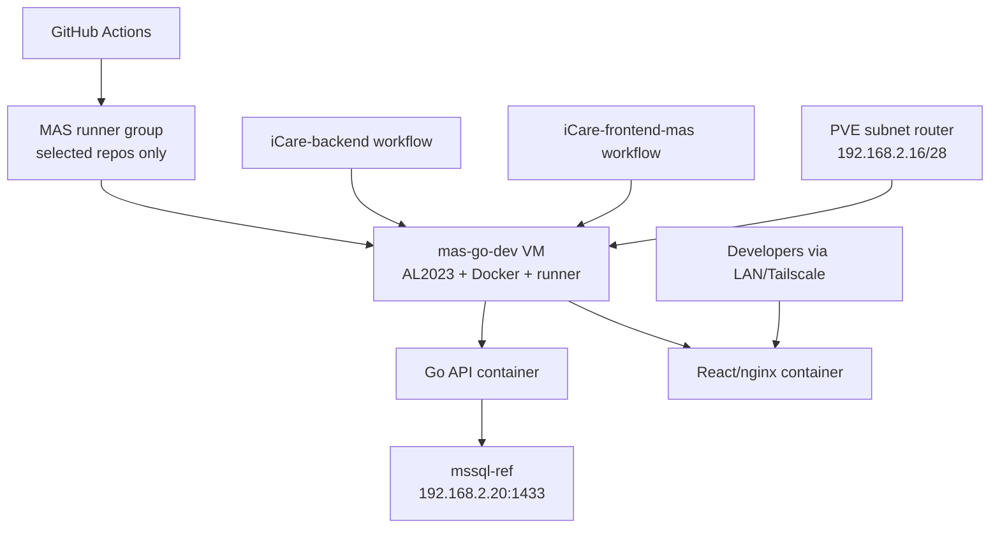

# 新增 MAS Go + React 内网自动部署环境

## Summary

在 PVE 上新增 `mas-go-dev` Linux VM，作为 MAS Go 后端和 React 前端的并行内网部署目标。现有 `dev-cypresso` 部署路径保持不删减，新路径通过 MAS 专用 GitHub Actions organization runner group 调度到 VM 内 self-hosted runner，并在 VM 内本地 checkout、build、deploy，减少透明代理外网流量。

---

## Problem Frame

MAS 重构需要一套能连接完整参考 SQL Server 的内网调试环境；当前 `dev-cypresso` 公网测试机没有完整数据库，且现有 registry push/pull 部署模型会对 PVE 所在网络的透明代理产生额外流量。源需求见 `docs/brainstorms/mas-go-dev-deployment-requirements-2026-05-17.md`。

---

## Requirements

- R1. 新版 MAS 内网环境必须部署在独立 VM `mas-go-dev`，不污染 PVE 宿主机应用运行时。
- R2. `mas-go-dev` 操作系统优先对齐 `dev-cypresso` 的 Amazon Linux 2023 x86_64。
- R3. `mas-go-dev` 使用固定内网 IP `192.168.2.22`，纳入团队公共服务网段。
- R4. 新增 GitHub Actions self-hosted runner 部署路径，但现有 `dev-cypresso` workflow 行为必须保留。
- R5. runner 只允许 MAS 后端和 MAS 前端两个私有仓库使用。
- R6. 新内网部署路径在 VM 内本地 checkout、Docker build 和启动服务，不常规 push/pull 业务镜像。
- R7. 构建缓存、依赖缓存和 Docker 层缓存需要持久保留，避免重复消耗透明代理流量。
- R8. PVE Tailscale subnet route 扩展为 `192.168.2.16/28`，把 `.16-.31` 作为团队公共服务网段。
- R9. `mas-go-dev` 能访问 GitHub、依赖源、基础镜像 registry 和 `mssql-ref` SQL Server。
- R10. 后端默认连接 `mssql-ref` 的 SQL Server：`192.168.2.20:1433`。
- R11. 文档和仓库不得写入明文密码、token、私钥、runner registration token 或数据库凭据。
- R12. organization runner group 使用 selected repositories 限制到 `iCare-backend` 与 `iCare-frontend-mas`。
- R13. PVE 网络配置、Tailscale route、VM 创建和 runner 注册都必须有备份、验证和回滚记录。

**Origin actors:** A1 MAS 开发者, A2 GitHub Actions, A3 `mas-go-dev` VM, A4 `mssql-ref` VM, A5 `pve` 宿主机
**Origin flows:** F1 自动部署, F2 内网调试

---

## Scope Boundaries

- 不删除、不替换、不降级现有 `dev-cypresso` 部署 workflow；本计划只新增并行部署目标。
- 不把 `mas-go-dev` 作为生产环境，不承诺公网访问、高可用或灾备。
- 不在 PVE 宿主机上直接运行 MAS 应用、Docker Compose stack 或 GitHub Actions runner。
- 不把业务镜像 registry 作为新内网部署的常规依赖；后续如需归档镜像另行设计。
- 不在计划阶段决定所有 MAS 业务环境变量的最终值；凭据和业务配置在实施时从现有安全位置读取并写入 VM 本地私有 env 文件。
- 不修改 `mssql-ref` schema 或数据；新环境只消费参考数据库。

### Deferred to Follow-Up Work

- 内网域名、TLS 证书和统一入口：首轮可用 IP/端口或现有 nginx 入口验证，域名化单独处理。
- 镜像归档和跨机器回滚：首轮以 VM 内 build cache 和 compose 回滚为主。
- 多 runner/autoscaling/ephemeral runner：当前只规划一台持久 runner，后续根据并发和安全需求再升级。

---

## Context & Research

### Relevant Code and Patterns

- Server repo: `pve/README.md`
  - PVE 当前 `vmbr0` 为 `192.168.2.10/24`，gateway `192.168.2.1`。
  - 当前 VM：`110 / mssql-ref`、`120 / mas-win`。
  - `nvme-data` 当前约 29.45% 使用，约 691G 可用，足够新增 `mas-go-dev` 120G thin-provisioned 磁盘。
  - Tailscale 当前 primary routes 为 `192.168.2.20/32`、`192.168.2.21/32`。
- Server repo: `docs/solutions/pve/best-practices/pve-tailscale-subnet-router-2026-05-16.md`
  - PVE 已承担 subnet router，SNAT 默认开启；客户端访问 VM 时 VM 看到来源可能是 PVE。
  - Tailscale route 变更需要 Admin Console approve，并建议关闭 key expiry。
- Server repo: `docs/solutions/pve/best-practices/mas-legacy-reference-sql-vm-2026-05-16.md`
  - `mssql-ref` 为 `192.168.2.20`，SQL Server 监听 `0.0.0.0:1433`。
  - 当前 `mas_ref_reader` 名称沿用只读阶段，但已提升为三库 `db_owner`，不要按只读账号理解。
- Server repo: `docs/solutions/pve/best-practices/mas-csharp-iis-reference-deploy-2026-05-16.md`
  - 旧 C# 参考应用 `mas-win` 使用 `192.168.2.21`，已证明 PVE 内 VM 能连接 `mssql-ref`。
- Target repo `cypressoai/iCare-backend`
  - `.github/workflows/deploy.yml` 当前使用 `dev-cypresso-ci` runner，执行 build/push，再 SSH 到服务器 pull 镜像并重启服务。
  - `backend.compose.yaml` 已有 Docker Compose 服务定义、healthcheck、外部 `shared-services` network 和 `DOCKER_ENV_FILE` 约定。
  - `Dockerfile` 使用 Go `1.25.7`，构建阶段会下载 Go modules、安装 `swag` 与 `migrate`。
- Target repo `cypressoai/iCare-frontend-mas`
  - `.github/workflows/deploy.yml` 当前使用 `dev-cypresso-ci` runner，执行 build/push，再 SSH 到服务器 pull 镜像并重启服务。
  - `frontend-mas.compose.yaml` 当前依赖外部注入 `MAS_IMAGE`，没有本地 build 配置。
  - `Dockerfile` 使用 Node 20-alpine 构建，但 `package.json` 的 engines 标注 Node `24.x`；计划实施时需要确认是否升级 Dockerfile 或接受当前 Dockerfile 行为。

### Institutional Learnings

- `docs/solutions/dev-cypresso/integration-issues/docker-image-buildup-fills-disk-2026-05-14.md`
  - 现有 registry 镜像部署路径曾因历史镜像累积填满磁盘；新内网路径虽然不 pull 业务镜像，但仍必须设计 Docker cache 和 dangling layer 清理。
- `docs/solutions/dev-cypresso/performance-issues/t3-cpu-credit-exhausted-instance-hang-2026-05-12.md`
  - 多个 runner 并发和重服务混跑会放大 CPU 风险；`mas-go-dev` 首轮只规划一个持久 runner，避免同机无边界并发。
  - DNS 和 Tailscale 启动期依赖可能导致服务长尾故障；新 VM 的数据库连接应直接使用 `192.168.2.20:1433`，不要依赖 MagicDNS。
- `docs/solutions/mac-mini/sonarqube-migrated-from-dev-cypresso-2026-05-13.md`
  - self-hosted runner 是主动出站连接 GitHub；GitHub 不需要入站访问内网 runner。
  - runner 本身不应缓存业务配置，关键参数从 workflow secrets 和 VM 本地 env 文件注入。
- `docs/solutions/pve/best-practices/pve-tailscale-subnet-router-2026-05-16.md`
  - route approve、key expiry 和 SNAT 行为需要写入运维记录。

### External References

- GitHub Docs: organization-level runner groups 支持 selected repositories，并建议 self-hosted runner 只用于 private repositories。
- GitHub Docs: self-hosted runner 需要出站 HTTPS 443 访问 GitHub；persistent runner 会自动更新，若长期不更新可能停止接 job。
- Tailscale Docs: subnet router 需要启用 IP forwarding、advertise routes、Admin Console approve route，并用 ACL 控制访问；默认 SNAT 会让后端 VM 看到来源为 subnet router。

---

## Key Technical Decisions

- `mas-go-dev` 使用独立 VM，而不是 PVE 宿主：沿用 `mssql-ref` / `mas-win` 的隔离模式，便于快照、回滚和清理。
- VM 规格按 `4 vCPU / 16 GiB RAM / 120G disk` 规划：Go + React 运行负载不重，但 VM 内 Docker build、Node 依赖和 build cache 更需要内存与磁盘余量。
- VMID 建议使用 `130`：延续现有 `110 mssql-ref`、`120 mas-win` 的编号顺序。
- 操作系统优先 Amazon Linux 2023 x86_64：`dev-cypresso` 当前是 AL2023，Docker/Compose 行为和包管理器更接近现有部署环境。
- 新部署路径是 additive：`dev-cypresso` 现有 build/push/SSH pull 路径保持可用；新增 `mas-go-dev` job 不应成为现有部署的前置依赖。
- `mas-go-dev` 本地 build 不 push 业务镜像：Docker image tag 以本机 local tag 或 commit SHA 标记，compose 只引用本机镜像。
- 前后端 workflow 保持仓库独立：后端仓库部署后端服务，前端仓库部署前端服务；二者共享 VM 和 base stack 目录，但互不删除对方服务。
- MAS runner group 新建而不是复用 `Default`：当前 `Default` visibility 为 `all`，不满足最小权限。
- Tailscale route 改为 `192.168.2.16/28`：这是团队公共服务网段约定；实施时需要确认 `.16-.31` 不放私人设备。
- 数据库连接使用 `192.168.2.20:1433`：避免 Tailscale DNS 或 MagicDNS 在启动期不可用时影响容器。

---

## Open Questions

### Resolved During Planning

- 是否替换 `dev-cypresso` 部署路径：不替换，只新增并行 `mas-go-dev` 部署。
- 是否使用 repo-level runner：不优先使用；已验证 `k-cypresso` 可读 `cypressoai` org runner group API，按 organization runner group 规划。
- `mas-go-dev` 初始规格：按 `4 vCPU / 16 GiB / 120G` 规划，优先保证前端构建和缓存空间。
- Tailscale route 形态：使用 `192.168.2.16/28`。

### Deferred to Implementation

- Amazon Linux 2023 cloud image 获取方式：PVE 当前无 AL2023 镜像；实施时下载并校验，失败时再评估临时回退 Ubuntu 的兼容成本。
- GitHub runner group 创建方式：可用 GitHub UI 或 REST API；实施时选择更稳妥的一种，并记录 group ID。
- `mas-go-dev` 自动部署触发分支：计划建议自动部署 `develop`，保留 `workflow_dispatch` 手动部署其它分支；如团队想让 `main` 也自动部署到内网，需要实施前确认。
- 前端 Dockerfile Node 版本：`package.json` 要求 Node 24，现有 Dockerfile 使用 Node 20；实施时应先验证 build 是否仍通过，再决定是否升级 Dockerfile。
- 后端 SQL 凭据角色：当前 `mas_ref_reader` 在参考库中已是 `db_owner`；实施时按新版调试需求决定是否沿用该账号或新建更小权限账号。

---

## High-Level Technical Design

> *This illustrates the intended approach and is directional guidance for review, not implementation specification. The implementing agent should treat it as context, not code to reproduce.*

---

## Implementation Units

### U1. PVE Preflight 和地址规划

**Goal:** 确认 PVE 当前状态、VMID/IP/存储/镜像条件，并把 `mas-go-dev` 的目标资源写入 Server repo。

**Requirements:** R1, R2, R3, R13

**Dependencies:** None

**Files:**
- Modify: `pve/README.md`
- Create/Modify: `docs/solutions/pve/best-practices/mas-go-dev-deployment-2026-05-17.md`

**Approach:**
- 记录当前 PVE VM 清单、`nvme-data` 可用容量、Tailscale route、`/etc/network/interfaces` 备份状态和现有 ISO/cloud image。
- 规划 `mas-go-dev` 为 VMID `130`、IP `192.168.2.22/24`、gateway `192.168.2.1`、存储 `nvme-data`、4 vCPU、16 GiB RAM、120G thin disk。
- 明确实施前如果 `130` 或 `.22` 被占用，必须停下来重新选编号/IP 并更新文档。

**Patterns to follow:**
- `pve/README.md` 中 `mssql-ref`、`mas-win` 的 VM 清单和自启动记录。
- `docs/solutions/pve/best-practices/mas-legacy-reference-sql-vm-2026-05-16.md` 的 VM 信息与凭据位置记录方式。

**Test scenarios:**
- Happy path: PVE 清单中 `110`、`120` 已存在，`130` 未占用，`192.168.2.22` 未被局域网响应。
- Edge case: `130` 或 `.22` 已占用时，计划执行停止，不复用已有 VM/设备。
- Error path: `nvme-data` 可用空间不足以安全创建 120G thin disk 时，计划执行停止并重新评估磁盘或快照清理。

**Verification:**
- 文档记录目标 VMID/IP/资源、当前 PVE 状态和实施前阻断条件。

---

### U2. 创建 `mas-go-dev` Amazon Linux 2023 VM

**Goal:** 在 PVE 上创建可 SSH、可 Docker build、可自启动的 AL2023 VM。

**Requirements:** R1, R2, R3, R7, R13

**Dependencies:** U1

**Files:**
- Modify: `pve/README.md`
- Create/Modify: `docs/solutions/pve/best-practices/mas-go-dev-deployment-2026-05-17.md`

**Approach:**
- 获取 Amazon Linux 2023 x86_64 cloud image 并导入 PVE；保留镜像来源、校验方式和本地落点。
- 使用 cloud-init 配置主机名、SSH 公钥、静态 IP 和基础用户；安装 QEMU guest agent。
- 在 VM 内安装 Docker Engine、Docker Compose v2、Git、基础构建工具、Node/Go 构建所需系统依赖和常用排障工具。
- Docker 数据根目录保留在 VM 系统盘；首轮通过 120G 磁盘和定期 prune 管控，不额外挂载数据盘。
- 配置 VM onboot，并让启动顺序晚于 `mssql-ref`，避免宿主重启后 MAS 应用早于 SQL Server。
- 基线完成后创建 PVE 快照，例如 `mas-go-dev-base-ready`。

**Patterns to follow:**
- `pve/README.md` 的自启动顺序记录。
- `dev-cypresso` 当前环境：Amazon Linux 2023、Docker 25.x、Compose v2。

**Test scenarios:**
- Happy path: 从本机能 SSH 到 `mas-go-dev`，VM 内能解析公网域名并出站访问 GitHub。
- Happy path: VM 内 `docker` 和 `docker compose` 可用，普通 runner 用户具备受控 Docker 执行能力。
- Happy path: VM 内能连接 `192.168.2.20:1433`。
- Error path: AL2023 image 下载或启动失败时，不改用其它 OS 继续硬做；记录失败并评估兼容回退。
- Integration: PVE 宿主重启或手动启动顺序中，`mssql-ref` 先于 `mas-go-dev` 启动。

**Verification:**
- `mas-go-dev` VM 运行、guest agent 可用、Docker 可用、SQL Server 端口可达，并有基线快照。

---

### U3. 扩展 PVE Tailscale subnet route

**Goal:** 将 PVE subnet router 从 `.20/.21` 两个 `/32` 扩展为团队公共服务网段 `192.168.2.16/28`。

**Requirements:** R3, R8, R13

**Dependencies:** U1

**Files:**
- Modify: `pve/README.md`
- Modify: `docs/solutions/pve/best-practices/pve-tailscale-subnet-router-2026-05-16.md`
- Create/Modify: `docs/solutions/pve/best-practices/mas-go-dev-deployment-2026-05-17.md`

**Approach:**
- 修改前记录当前 Tailscale state、AllowedIPs、PrimaryRoutes 和 `/etc/network/interfaces` 备份。
- 将 advertised route 更新为 `192.168.2.16/28`，并在 Tailscale Admin Console approve 新 route。
- 保持默认 SNAT，不在首轮引入 return route 或 `--snat-subnet-routes=false`。
- 确认 Tailscale ACL 允许目标团队访问该网段，并确认 `.16-.31` 仅用于团队公共服务。
- 更新文档，把原 `.20/.21` `/32` 记录改为新网段，并保留历史变更说明。

**Patterns to follow:**
- `docs/solutions/pve/best-practices/pve-tailscale-subnet-router-2026-05-16.md` 的 approve、key expiry、SNAT 说明。
- Tailscale 官方 subnet router 文档：advertise routes 后需要 Admin Console approve 和 ACL 允许。

**Test scenarios:**
- Happy path: Tailnet 客户端能访问 `192.168.2.20:1433`、`192.168.2.21:9021` 和 `192.168.2.22` 的服务端口。
- Edge case: 局域网内设备访问 `192.168.2.20-.22` 仍走本地 LAN，不因客户端 accept routes 产生绕路问题。
- Error path: Admin Console 未 approve 新 route 时，文档明确记录本机 advertise 已完成但外部 Tailnet 不可达。
- Integration: Tailscale route 改为 `/28` 后，原 `mssql-ref` 和 `mas-win` 访问不退化。

**Verification:**
- PVE self status 显示 `192.168.2.16/28` 为 primary route，Tailnet 客户端可访问三台 MAS 相关 VM。

---

### U4. 创建 MAS 专用 GitHub runner group 与 VM runner

**Goal:** 让 `cypressoai/iCare-backend` 和 `cypressoai/iCare-frontend-mas` 能把新增内网部署 job 调度到 `mas-go-dev`，且不开放给其它仓库。

**Requirements:** R4, R5, R11, R12

**Dependencies:** U2

**Files:**
- Create/Modify: `docs/solutions/pve/best-practices/mas-go-dev-deployment-2026-05-17.md`

**Approach:**
- 在 `cypressoai` 创建 MAS 专用 organization runner group，repository access 设为 selected repositories。
- 将 selected repositories 限制到 `iCare-backend` 和 `iCare-frontend-mas`。
- 在 `mas-go-dev` 上注册一台持久 self-hosted runner，放入该 runner group，使用专用 label，例如 `mas-go-dev`、`linux`、`x64`、`docker`。
- runner registration token 只在注册时使用，不写入仓库或长期保存。
- runner 以 systemd service 运行；限制同机并发先从一台 runner 开始，避免 build 并发压垮 VM。
- 保留现有 `Default` runner group 和现有 runners，不迁移 `dev-cypresso-ci`、`mac-mini-sonar` 或其它 runner。

**Patterns to follow:**
- 当前 `cypressoai` org runner group 只有 `Default`，visibility 为 `all`，不能作为 MAS 专用 runner group。
- GitHub Docs runner groups selected repositories 访问控制。
- `docs/solutions/mac-mini/sonarqube-migrated-from-dev-cypresso-2026-05-13.md` 对 runner 主动出站连接 GitHub 的解释。

**Test scenarios:**
- Happy path: `iCare-backend` workflow 能通过 `runs-on` label 匹配到 `mas-go-dev` runner。
- Happy path: `iCare-frontend-mas` workflow 能通过同一 runner group 调度。
- Edge case: 其它 org 仓库无法选择或调度该 runner group。
- Error path: runner 离线时，新增内网部署 job 排队但不影响现有 `dev-cypresso` 部署 job。
- Security: runner token、GitHub PAT、数据库密码不出现在 repo 文件或 GitHub job 日志中。

**Verification:**
- GitHub org runner group 显示 selected repositories 正确，`mas-go-dev` runner online，两个目标仓库能运行最小手动 job。

---

### U5. 准备 `mas-go-dev` runtime stack 和私有配置

**Goal:** 在 VM 内建立前后端共享部署目录、Docker network、私有 env 文件和基础运维约定。

**Requirements:** R6, R7, R9, R10, R11

**Dependencies:** U2, U4

**Files:**
- Create/Modify: `docs/solutions/pve/best-practices/mas-go-dev-deployment-2026-05-17.md`
- Create: `pve/mas-go-dev-runtime-notes.local.md` *(本地私有记录，如需要；不得提交敏感内容)*

**Approach:**
- 在 VM 内创建统一 stack 根目录，用于后端、前端、compose 文件、env 文件和运行日志定位。
- 建立后端 compose 需要的外部 Docker network，例如沿用 `shared-services` 命名，避免改动后端 compose 的网络模型。
- 创建后端私有 env 文件，数据库 host 指向 `192.168.2.20`，端口 `1433`，凭据从安全位置读取后只写在 VM 本地。
- 创建前端私有配置，确保构建产物的 API base URL 指向同机反代或约定路径，而不是旧公网地址。
- 定义本机 Docker image 命名约定和 cache 目录；新部署路径使用本地 image tag，不登录 GHCR。
- 明确 Docker prune 策略：清理 dangling layers 和过旧本地 tag，但不删除 volumes 和当前运行服务依赖层。

**Patterns to follow:**
- `backend.compose.yaml` 的 `DOCKER_ENV_FILE`、healthcheck 和 external network 约定。
- `frontend-mas.compose.yaml` 的端口绑定和 `MAS_IMAGE` 约定，但新路径需要支持本地 build/tag。
- `docs/solutions/dev-cypresso/integration-issues/docker-image-buildup-fills-disk-2026-05-14.md` 的“不要清理 volumes，只清理确认不用的 image”经验。

**Test scenarios:**
- Happy path: 后端容器通过 VM 本地 env 连接 `mssql-ref` 并通过 healthcheck。
- Happy path: 前端容器可通过同机或约定入口访问后端 API。
- Edge case: env 文件缺失时 compose 配置阶段失败，不启动半配置容器。
- Error path: SQL Server 不可达时后端失败可观测，前端部署不覆盖后端失败信息。
- Integration: 后端和前端 compose 操作互不删除对方容器、network 或 env 文件。

**Verification:**
- VM 内 stack 目录清晰，私有配置权限受限，Docker network 存在，手动本地 build/up 可跑通最小服务。

---

### U6. 扩展 `iCare-backend` 部署 workflow

**Goal:** 在后端仓库新增 `mas-go-dev` 内网部署 job，同时保留现有 `dev-cypresso` build/push/deploy 路径。

**Requirements:** R4, R6, R7, R10, R11

**Dependencies:** U4, U5

**Files:**
- Target repo `cypressoai/iCare-backend`
- Modify: `.github/workflows/deploy.yml`
- Modify: `backend.compose.yaml`
- Modify: `Dockerfile` *(仅当本地 build cache 或 AL2023 兼容需要调整时)*
- Test: `.github/workflows/deploy.yml`

**Approach:**
- 保留现有 `set-vars`、`test`、`build-and-push`、`deploy` jobs 的行为和依赖，不移除 `dev-cypresso-ci` labels、GHCR login、SSH deploy 或 image cleanup。
- 新增独立 `deploy-mas-go-dev` job，使用 `runs-on` 指向 MAS 专用 runner label。
- 新 job 在 `mas-go-dev` runner 工作目录内 checkout 代码，执行本地 Docker build，并以本地 image tag 更新后端服务。
- 新 job 不依赖 `build-and-push` 成功；它应依赖测试通过，但不要被 GHCR push/pull 步骤绑死。
- 新 job 使用 VM 本地 env 文件，而不是把数据库凭据放入 GitHub workflow。
- 建议自动触发 `develop` 分支，保留 `workflow_dispatch` 允许手动部署其它分支；现有 main/master/develop 到 `dev-cypresso` 的行为不变。
- 运行 migration/seed 前必须确认这是参考环境允许的行为；如果新版 Go 后端 migration 会改 SQL Server schema，应先禁用或拆成手动步骤。

**Patterns to follow:**
- 现有 `.github/workflows/deploy.yml` 的 concurrency 和测试 gate。
- `backend.compose.yaml` 的 healthcheck、`DOCKER_ENV_FILE` 和 `seed` 服务约定。

**Test scenarios:**
- Happy path: push 到 `develop` 后，现有 `dev-cypresso` deploy 仍按原路径运行，新增 `mas-go-dev` job 也能完成本地 build/up。
- Happy path: 手动触发 workflow 并选择分支时，`mas-go-dev` job 部署该分支代码。
- Edge case: GHCR build/push 失败时，不错误地阻断已通过测试且可本地 build 的 `mas-go-dev` 部署，除非失败来自共享测试阶段。
- Error path: `mas-go-dev` runner 离线时，现有 `dev-cypresso` deploy 不受影响。
- Error path: 本地 env 文件缺失或 SQL Server 不可达时，`mas-go-dev` job 失败并保留旧容器运行状态。
- Integration: 后端部署成功后 `/healthz` 通过，且数据库连接实际指向 `192.168.2.20:1433`。

**Verification:**
- 后端 workflow 同时保留旧部署和新增内网部署；`mas-go-dev` 本地 Docker image 出现在 VM 内，服务健康检查通过。

---

### U7. 扩展 `iCare-frontend-mas` 部署 workflow

**Goal:** 在前端仓库新增 `mas-go-dev` 内网部署 job，同时保留现有 `dev-cypresso` build/push/deploy 路径。

**Requirements:** R4, R6, R7, R9, R11

**Dependencies:** U4, U5, U6

**Files:**
- Target repo `cypressoai/iCare-frontend-mas`
- Modify: `.github/workflows/deploy.yml`
- Modify: `frontend-mas.compose.yaml`
- Modify: `Dockerfile` *(若 Node 24 对齐需要调整)*
- Test: `.github/workflows/deploy.yml`

**Approach:**
- 保留现有 `set-vars`、`quality-gate`、`build-and-push`、`deploy` jobs 的行为和 `dev-cypresso-ci` runner 使用。
- 新增独立 `deploy-mas-go-dev` job，调度到 MAS 专用 runner，在 VM 内 checkout 和本地 Docker build。
- 新路径使用内网 API base URL 或同机反代路径，确保前端访问 `mas-go-dev` 后端，而不是 `dev-cypresso` 或 mock API。
- 处理 Node 版本差异：优先让 Dockerfile 和 `package.json` engines 对齐到 Node 24；如果暂不改 Dockerfile，必须在计划执行记录中写明验证结果。
- 新 job 不登录 GHCR、不 pull `MAS_IMAGE`，而是引用本机 build 出来的 image tag。
- 与后端一样，建议自动触发 `develop` 分支，并保留 `workflow_dispatch` 手动部署其它分支。

**Patterns to follow:**
- 现有 `.github/workflows/deploy.yml` 的 quality gate 和 concurrency。
- `frontend-mas.compose.yaml` 的服务名、container name 和端口绑定。

**Test scenarios:**
- Happy path: push 到 `develop` 后，现有 `dev-cypresso` 前端部署保持原行为，新增 `mas-go-dev` 前端部署成功。
- Happy path: 前端页面从 `mas-go-dev` 访问时，API 请求命中 `mas-go-dev` 后端。
- Edge case: 后端尚未部署或 healthcheck 失败时，前端部署不误报整体环境可用；烟测能暴露 API 不通。
- Error path: Node 20 Dockerfile 无法满足 Node 24 项目要求时，部署失败在 build 阶段，旧部署路径不受影响。
- Integration: 前端部署后能打开登录页或核心入口，并能发起至少一个后端 API 请求。

**Verification:**
- 前端 workflow 保留旧路径并新增内网路径；`mas-go-dev` 上前端容器运行，能访问同机后端 API。

---

### U8. 端到端验证、回滚和文档沉淀

**Goal:** 验证新内网环境从 GitHub Actions 到前后端服务、数据库和 Tailscale 访问全链路可用，并沉淀运维记录。

**Requirements:** R3, R4, R8, R10, R11, R13

**Dependencies:** U3, U6, U7

**Files:**
- Modify: `pve/README.md`
- Create/Modify: `docs/solutions/pve/best-practices/mas-go-dev-deployment-2026-05-17.md`
- Create: `pve/mas-go-dev-smoke-test-2026-05-17.md`

**Approach:**
- 用 workflow_dispatch 分别触发后端和前端内网部署，确认 runner 调度、checkout、本地 build、compose up 和 healthcheck。
- 从家庭局域网和 Tailnet 客户端分别访问 `mas-go-dev` 服务。
- 验证后端数据库连接目标为 `mssql-ref`，并做只读或允许范围内的最小业务查询。
- 验证现有 `dev-cypresso` 部署 workflow 未被删减：旧 labels、旧 jobs、旧 secrets 和旧 deploy 入口仍存在。
- 记录 rollback：workflow 回滚、VM 快照回滚、Tailscale route 回滚、runner group 禁用/移除、服务容器回退。
- 创建最终 PVE 快照，例如 `mas-go-dev-deploy-ready`。

**Patterns to follow:**
- `pve/mas-csharp-reference-smoke-test-2026-05-16.md` 的烟测记录方式。
- `docs/solutions/pve/best-practices/mas-csharp-iis-reference-deploy-2026-05-16.md` 的 final snapshot 和 operational notes 结构。

**Test scenarios:**
- Happy path: 后端 workflow 新内网 job 成功，`mas-go-dev` 后端 healthcheck 通过。
- Happy path: 前端 workflow 新内网 job 成功，浏览器能打开前端并访问后端。
- Happy path: Tailnet 客户端能通过 `192.168.2.22` 访问新环境。
- Edge case: 只触发后端部署时，前端容器不被删除；只触发前端部署时，后端容器不被删除。
- Error path: 新内网部署失败时，`dev-cypresso` 当前服务仍可用。
- Integration: 新环境前端、后端、SQL Server 三者组成完整调试链路，且 PVE 宿主不运行 MAS 应用容器。

**Verification:**
- 烟测文档、solution 文档和 `pve/README.md` 都更新完成；GitHub Actions、PVE、Tailscale 和应用访问均有可复查证据。

---

## System-Wide Impact

- **Interaction graph:** 新增 `mas-go-dev` VM、MAS runner group、两个仓库的新增 deploy job、PVE Tailscale `/28` route；现有 `dev-cypresso` deploy、`mac-mini-sonar` 分析 runner、`mssql-ref` 和 `mas-win` 保持原职责。
- **Error propagation:** 新内网部署失败必须只失败新增 job，不阻断现有 `dev-cypresso` deploy；共享测试阶段失败仍应阻断所有部署目标。
- **State lifecycle risks:** VM 内 Docker build cache 和本地 images 会持续增长，需要 prune 策略；不能清理 volumes、env 文件或当前运行镜像层。
- **API surface parity:** 前端和后端仓库 workflow 会新增 runner label 和部署 job；现有 workflow dispatch、branch triggers 和旧 secrets 继续可用。
- **Integration coverage:** 单仓库 job 成功不足以证明环境可用；必须覆盖前端 -> 后端 -> SQL Server 的端到端烟测。
- **Unchanged invariants:** PVE 宿主不运行应用容器；`dev-cypresso` 部署路径保留；`mssql-ref` 数据库不做 schema/data 改动。

---

## Risks & Dependencies

| Risk | Mitigation |
|------|------------|
| `192.168.2.16/28` 暴露了 `.16-.31` 整段 | 将该网段明确设为团队公共服务区；Tailscale ACL 只允许团队访问；不要把私人设备放入该段 |
| runner 被无关仓库使用 | 新建 MAS 专用 runner group，并限制 selected repositories |
| VM 内本地 build 使磁盘增长 | 120G 起步，保留 Docker cache 但定期清理 dangling/旧 tag；不清理 volumes |
| 前端 Node 版本不一致 | 实施时验证 Dockerfile Node 版本与 `package.json` engines；必要时把 Dockerfile 调整到 Node 24 |
| migration/seed 修改参考 SQL Server | 后端内网部署前审查 seed/migration 行为；必要时禁用自动 schema mutation 或改为手动步骤 |
| 新 job 误影响 `dev-cypresso` | 新增 job 与旧 jobs 解耦；旧 deploy job 不删不改核心行为；测试用 workflow diff 和手动 dispatch 验证 |
| PVE route 改动导致旧参考环境不可达 | 变更前记录当前 route；approve `/28` 后验证 `.20`、`.21`、`.22`；必要时回滚到 `.20/.21` `/32` |
| 透明代理无法访问部分依赖源 | 首次部署前在 VM 内做 GitHub、Go module、npm、Docker base image preflight；失败时记录代理或镜像源修复项 |

---

## Documentation / Operational Notes

- 更新 `pve/README.md`：加入 `mas-go-dev` VM、IP、资源、自启动顺序、Tailscale `/28`、访问入口、快照点。
- 新增 `docs/solutions/pve/best-practices/mas-go-dev-deployment-2026-05-17.md`：记录实际部署过程、runner group、VM 基线、workflow 变更、验证和回滚。
- 新增 `pve/mas-go-dev-smoke-test-2026-05-17.md`：记录后端、前端、数据库、Tailscale、旧部署不变性的烟测结果。
- 如需记录本地敏感映射或临时 token 获取位置，只写入未提交的 `.local.md` 文件或服务器 root-only 文件，不进入仓库。

---

## Sources & References

- **Origin document:** [docs/brainstorms/mas-go-dev-deployment-requirements-2026-05-17.md](../brainstorms/mas-go-dev-deployment-requirements-2026-05-17.md)
- Server repo: `pve/README.md`
- Server repo: `docs/solutions/pve/best-practices/pve-tailscale-subnet-router-2026-05-16.md`
- Server repo: `docs/solutions/pve/best-practices/mas-legacy-reference-sql-vm-2026-05-16.md`
- Server repo: `docs/solutions/pve/best-practices/mas-csharp-iis-reference-deploy-2026-05-16.md`
- Server repo: `docs/solutions/dev-cypresso/integration-issues/docker-image-buildup-fills-disk-2026-05-14.md`
- Server repo: `docs/solutions/dev-cypresso/performance-issues/t3-cpu-credit-exhausted-instance-hang-2026-05-12.md`
- Target repo `cypressoai/iCare-backend`: `.github/workflows/deploy.yml`, `backend.compose.yaml`, `Dockerfile`, `go.mod`
- Target repo `cypressoai/iCare-frontend-mas`: `.github/workflows/deploy.yml`, `frontend-mas.compose.yaml`, `Dockerfile`, `package.json`
- GitHub Docs: [Managing access to self-hosted runners using groups](https://docs.github.com/en/actions/how-tos/manage-runners/self-hosted-runners/manage-access)
- GitHub Docs: [Self-hosted runners reference](https://docs.github.com/en/actions/reference/runners/self-hosted-runners)
- Tailscale Docs: [Subnet routers](https://tailscale.com/docs/features/subnet-routers)
