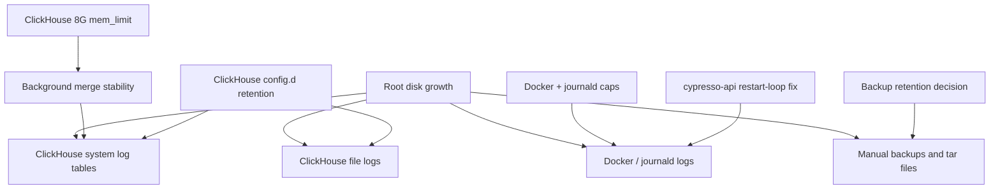

# 修复 dev-cypresso ClickHouse 日志膨胀与磁盘增长

## Summary

在 `dev-cypresso` 上把 ClickHouse 从临时止血状态固化为可持续运行配置：将内存限制从当前 5G 提升到 8G，给 ClickHouse 文件日志和系统日志表设置保留边界，补齐 Docker/journald 日志上限，并把 `cypresso-api` 重启循环作为独立增长风险修复。

---

## Problem Frame

2026-05-18 的排查显示，根盘 100G 曾因日志和缓存增长逼近危险区间。低风险清理后根盘从约 71G 降到约 59-60G，但增长源仍需要长期治理：ClickHouse 自身 `system.trace_log`、`system.text_log` 等诊断日志曾占用 6G+，文件日志约 1.4G，触发日志膨胀的直接错误是后台 merge 反复 `MEMORY_LIMIT_EXCEEDED`。当前 ClickHouse 已临时提升到 5G，但目标状态是 8G 并配套保留策略，避免再次靠人工清理救火。

---

## Requirements

- R1. ClickHouse 容器内存限制提升到 8G，并在 compose 配置中持久化，不能只做一次性 `docker update`。
- R2. ClickHouse 文件日志必须有明确保留边界，避免 `clickhouse-server.log` / `clickhouse-server.err.log` 无限制增长。
- R3. ClickHouse 系统日志表必须加 TTL 或关闭不需要的高噪音日志表，至少覆盖 `trace_log`、`text_log`、`metric_log`、`asynchronous_metric_log`。
- R4. ClickHouse 后台 merge 不应再因 3G/5G 级别内存限制反复触发 `MEMORY_LIMIT_EXCEEDED` 并刷日志。
- R5. Docker 默认日志和 systemd journald 必须有全局上限；已有服务级 `json-file` 轮转配置不得被破坏。
- R6. `cypresso-api` 的重启循环必须定位并制定修复，不允许长期依赖 `restart: unless-stopped` 掩盖正常退出。
- R7. `dev-cypresso:home/ec2-user` 和 SQL Server volume 中的大备份文件只做保留策略确认；未确认前不删除业务备份。
- R8. 所有远端配置改动前必须备份，重启类操作需说明影响和回滚路径。
- R9. 实施结果需要沉淀到 `docs/solutions/dev-cypresso/`，方便后续磁盘告警或日志膨胀复盘。

---

## Scope Boundaries

- 不删除 SQL Server 数据文件、ClickHouse 业务表、named volumes 或 `dev-cypresso:home/ec2-user/backups` 下的备份文件。
- 不改 iCare 后端、前端或 Cypresso 应用业务代码。
- 不迁移 ClickHouse、SQL Server、SonarQube、MongoDB 等基础服务到新机器。
- 不把本次计划扩展成完整监控平台建设；只补齐当前磁盘增长风险的配置边界和验证。
- 不在计划阶段写入任何明文密码、token、私钥或 ClickHouse/SQL Server 凭据。

### Deferred to Follow-Up Work

- 磁盘自动告警：可以后续补 `node_exporter`、CloudWatch alarm 或轻量 cron 检查。
- 备份生命周期管理：SQL bak、tar 包、runner 工具缓存的保留天数需要用户确认后单独执行。
- `cypresso-api` 应用级根因修复如果需要改源码，应在对应应用仓另开计划或 issue。

---

## Context & Research

### Relevant Code and Patterns

- `AGENTS.md`
  - `dev-cypresso` 虽是测试环境，但仍要求配置/服务改动前备份，危险动作前说明影响与回滚。
  - 本仓是运维笔记仓，变更应沉淀到 `docs/solutions/`。
- `docs/solutions/dev-cypresso/integration-issues/docker-image-buildup-fills-disk-2026-05-14.md`
  - dev-cypresso 曾因 Docker 镜像累积导致根盘 100%。
  - 清理策略必须避开 volumes，不能用 `docker system prune -a --volumes`。
- `docs/solutions/dev-cypresso/runtime-errors/nginx-fail-on-boot-dns-not-ready-2026-05-13.md`
  - 运维修复应使用配置备份、最小改动和可验证回滚。
- 远端现状快照（2026-05-18）
  - 根盘约 `100G / 60G used / 41G free`。
  - 宿主内存约 15G，总 available 约 8G。
  - `shared-clickhouse` 当前已临时运行在 `5GiB` 限制下，内存使用约 445MiB。
  - `cypresso-api` `RestartCount` 已超过 600，仍在重启循环。
  - ClickHouse 业务侧主要是 `default.monitoring_*`，之前膨胀大头是 `system.*` 诊断日志表。

### Institutional Learnings

- Docker 清理要区分 image/build cache 和 named volume；volume 是数据库和持久数据边界。
- 日志问题不能只靠人工 truncate；必须加日志保留上限或降低日志级别。
- `restart: unless-stopped` 能保服务存活，但也可能掩盖进程正常退出并持续制造日志。

### External References

- ClickHouse 官方配置支持通过 `config.d` XML 覆盖日志级别、文件日志大小/数量，以及各类 system log 表配置。
- Docker `json-file` logging driver 支持 `max-size` / `max-file`，适合作为容器日志兜底边界。
- systemd journald 支持 `SystemMaxUse` / `MaxRetentionSec`，适合作为系统日志兜底边界。

---

## Key Technical Decisions

- 先把 ClickHouse `mem_limit` 提到 8G，再限制系统日志：内存不足是本次日志刷屏的触发器，日志 TTL 是防止再次放大的保护层，两者都需要。
- ClickHouse 配置优先用挂载的 `config.d` 文件，而不是进入容器内手改：容器重建后配置仍可恢复，且能纳入 `stacks/infra` 管理。
- 系统日志表优先保留短周期 TTL，而不是全部关闭：`text_log` 和 `trace_log` 对排障有价值，但不应保留到 GB 级。
- Docker 全局日志上限保持兜底，服务级日志上限继续保留：`cypresso-ai` compose 已有 `10m x 3`，全局 `100m x 3` 作为没有显式配置服务的上限。
- 备份文件只纳入清单和保留决策，不默认删除：SQL bak 和 tar 包可能是恢复链路的一部分，必须先确认业务价值。
- `cypresso-api` 重启循环先做运行方式判定：如果它应常驻，就修启动/退出原因；如果它本来是初始化任务，就调整 restart policy 或拆成 job。

---

## Open Questions

### Resolved During Planning

- ClickHouse 是否能加内存：可以。宿主约 15G RAM，当前 available 约 8G，目标 8G 需要配合观察 SQL Server、SonarQube 和 MongoDB 的峰值。
- ClickHouse 是做什么的：它被 `cypresso-api` 通过 `CLICKHOUSE_HOST=shared-clickhouse` 使用，当前主要承载监控/分析类数据和 ClickHouse 自身 system log。
- 是否立即删除大备份释放空间：不纳入本计划的默认执行；只建立清单和保留策略。

### Deferred to Implementation

- ClickHouse system log TTL 的具体天数：建议 3-7 天，实施时根据团队需要选择并记录。
- 是否降低 `send_logs_level` 到 `warning` 或仅降低服务器日志级别：实施时以不影响必要排障为边界确认。
- `cypresso-api` 正常退出的最终原因：需要看容器完整启动日志、entrypoint 和应用配置后确定。
- 8G 限制是否足够消除 merge 错误：实施后通过 ClickHouse `system.text_log` / `error_log` 和文件日志增长观察确认。

---

## High-Level Technical Design

> *This illustrates the intended approach and is directional guidance for review, not implementation specification. The implementing agent should treat it as context, not code to reproduce.*

---

## Implementation Units

### U1. 固化 ClickHouse 8G 内存限制

**Goal:** 将 `shared-clickhouse` 的持久配置从当前 5G 提升到 8G，并用可回滚方式重建单个 ClickHouse 服务。

**Requirements:** R1, R4, R8

**Dependencies:** None

**Files:**
- Modify: `docs/solutions/dev-cypresso/runtime-errors/clickhouse-log-growth-disk-pressure-2026-05-18.md`

**Remote targets:**
- `dev-cypresso:home/ec2-user/stacks/infra/docker-compose.yml`

**Approach:**
- 实施前记录 `df -h /`、`free -h`、`docker stats` 和 `docker inspect shared-clickhouse` 当前值。
- 备份 infra compose 文件，再把 clickhouse service 的 `mem_limit` 调整为 `8g`。
- 只重建 `clickhouse` service，不重启整组 infra。
- 验证容器实际 `HostConfig.Memory` 为 8G，`SELECT 1` 成功，healthcheck 回到 healthy。
- 观察 SQL Server、SonarQube、MongoDB 的内存使用，确认宿主没有明显 swap 压力。

**Patterns to follow:**
- `AGENTS.md` 的服务器配置备份规则。
- 既有 `docs/solutions/dev-cypresso/runtime-errors/nginx-fail-on-boot-dns-not-ready-2026-05-13.md` 的备份、应用、验证写法。

**Test scenarios:**
- Happy path: ClickHouse 重建后 `shared-clickhouse` 变为 healthy，内存限制显示 8GiB，查询 `SELECT 1` 成功。
- Edge case: 宿主 available memory 低于预期时，不继续扩大内存限制，先回滚到 5G 并记录原因。
- Error path: ClickHouse 重建失败时，使用备份 compose 恢复 5G 配置并重建服务。
- Integration: `cypresso-api` 仍能连接 ClickHouse，监控相关表可读。

**Verification:**
- `shared-clickhouse` healthy。
- `docker inspect` 显示 8G memory limit。
- 10-15 分钟内没有新的 ClickHouse `MEMORY_LIMIT_EXCEEDED` 高频刷屏。

---

### U2. 增加 ClickHouse 文件日志保留策略

**Goal:** 给 ClickHouse 容器日志目录中的 server log / error log 设置大小和数量上限，并降低无用噪音。

**Requirements:** R2, R8

**Dependencies:** U1

**Files:**
- Modify: `docs/solutions/dev-cypresso/runtime-errors/clickhouse-log-growth-disk-pressure-2026-05-18.md`

**Remote targets:**
- `dev-cypresso:home/ec2-user/stacks/infra/docker-compose.yml`
- `dev-cypresso:home/ec2-user/stacks/infra/clickhouse-config/`

**Approach:**
- 在 infra stack 下新增 ClickHouse 配置目录，并通过 compose 只读挂载到容器的 `config.d`。
- 配置 ClickHouse server log 的 `level`、`size`、`count`，将常规日志控制在可预期范围。
- 保留 error log，但同样设置轮转边界。
- 重建 ClickHouse 后验证配置被加载，文件日志目录不会继续无界增长。

**Patterns to follow:**
- Docker Compose named volume 继续承载 `shared_clickhouse_logs`，配置文件只作为容器配置挂载，不迁移日志 volume。

**Test scenarios:**
- Happy path: 配置挂载后 ClickHouse 正常启动，日志文件存在且轮转配置生效。
- Edge case: 配置 XML 格式错误时，ClickHouse 启动失败；必须回滚挂载或配置文件并恢复服务。
- Error path: 日志级别过低导致排障信息不足时，可回退到 `information` 但保留大小/数量边界。

**Verification:**
- ClickHouse 容器 healthy。
- `shared_clickhouse_logs` 在稳定运行后保持 MB 级或可解释增长，不再快速增长到 GB 级。

---

### U3. 增加 ClickHouse system log 表 TTL 或降采样策略

**Goal:** 防止 `system.trace_log`、`system.text_log`、`system.metric_log` 等内部表再次累积到 GB 级。

**Requirements:** R3, R4, R8

**Dependencies:** U1

**Files:**
- Modify: `docs/solutions/dev-cypresso/runtime-errors/clickhouse-log-growth-disk-pressure-2026-05-18.md`

**Remote targets:**
- `dev-cypresso:home/ec2-user/stacks/infra/clickhouse-config/`
- `dev-cypresso:var/lib/docker/volumes/shared_clickhouse_data`

**Approach:**
- 使用 ClickHouse 支持的 system log 配置，为高噪音表设置短 TTL，建议初始 3-7 天。
- 覆盖 `trace_log`、`text_log`、`metric_log`、`asynchronous_metric_log`、`query_log`、`processors_profile_log`。
- 对 `trace_log` 优先考虑缩短保留或关闭；对 `query_log` 保留短周期以便排障。
- 实施后手动 flush logs，并验证 `system.parts` 中 system log 表大小保持受控。

**Patterns to follow:**
- 本次排查发现的空间分布：清理前 `system.trace_log` 约 5.04GiB、`system.text_log` 约 1.10GiB，业务表仅 KB 级。

**Test scenarios:**
- Happy path: system log 表仍可查询最近日志，但旧分区会按 TTL 清理。
- Edge case: TTL 配置未作用于既有表时，需要用 ClickHouse 支持的方式调整表 TTL 或重建对应 system log 表配置。
- Error path: 配置导致 system log 初始化失败时，回滚配置并保留 U2 文件日志作为排障来源。
- Integration: `default.monitoring_*` 业务表不受 TTL 误伤。

**Verification:**
- `system.parts` 中 system log 表大小在观察窗口内稳定，不出现分钟级快速增长。
- `default` 库业务表仍存在且可读。

---

### U4. 固化 Docker 与 journald 日志上限

**Goal:** 为非 ClickHouse 容器日志和系统日志设置兜底上限，避免其它服务成为下一个磁盘增长源。

**Requirements:** R5, R8

**Dependencies:** None

**Files:**
- Modify: `docs/solutions/dev-cypresso/runtime-errors/clickhouse-log-growth-disk-pressure-2026-05-18.md`

**Remote targets:**
- `dev-cypresso:etc/docker/daemon.json`
- `dev-cypresso:etc/systemd/journald.conf.d/`

**Approach:**
- 保留 Docker 当前 `json-file` driver 和全局 `max-size` / `max-file` 兜底；如需调整，只做收敛而不是放宽。
- 对 journald 增加 drop-in 或配置项，设置 `SystemMaxUse` 和必要的保留时间。
- 修改 Docker daemon 配置属于影响面较大的动作；若 daemon reload/restart 会影响容器，实施前必须明确维护窗口或采用不需重启的验证路径。
- journald 配置可通过 daemon reload/restart journald 生效，执行前记录当前磁盘占用。

**Patterns to follow:**
- `cypresso-ai` compose 已有服务级 `10m x 3` 日志轮转，不应被删除。
- 之前已将 journald 从约 590M vacuum 到约 174M，说明上限配置适合固化。

**Test scenarios:**
- Happy path: Docker 全局 logging opts 存在，新增容器默认不会无限写 JSON log。
- Edge case: 某些服务已有更严格 logging 配置时，服务级配置继续优先生效。
- Error path: Docker 配置 JSON 无效时，不重启 Docker；先修复配置校验。

**Verification:**
- Docker 配置可解析。
- journald 上限可从 systemd 配置中读出。
- `dev-cypresso:var/log` 和 `dev-cypresso:var/lib/docker/containers` 没有异常大日志文件。

---

### U5. 排查并修复 `cypresso-api` 重启循环

**Goal:** 找出 `cypresso-api` 为什么正常退出并被反复拉起，避免它继续制造启动日志和隐藏服务不稳定。

**Requirements:** R6, R8

**Dependencies:** None

**Files:**
- Modify: `docs/solutions/dev-cypresso/runtime-errors/clickhouse-log-growth-disk-pressure-2026-05-18.md`

**Remote targets:**
- `dev-cypresso:home/ec2-user/stacks/cypresso-ai/docker-compose.yml`
- `dev-cypresso:home/ec2-user/stacks/cypresso-ai/api.env`

**Approach:**
- 先收集 `docker inspect`、完整容器日志尾部、entrypoint/command、健康检查和 compose restart policy。
- 判定 `cypresso-api` 是常驻 API 服务还是一次性初始化/迁移进程。
- 如果应常驻，定位退出点：端口绑定、配置缺失、主进程启动后退出、后台 goroutine 退出、数据库连接逻辑等。
- 如果是一次性任务，调整 compose 形态，不再用 `unless-stopped` 无限重启。
- 该单元可能需要进入应用仓修源码；若超出运维配置范围，应产出明确 issue，而不是在服务器上热修应用代码。

**Patterns to follow:**
- `docs/solutions/nas/runtime-errors/docker-restart-policy-unless-stopped-trap-2026-05-13.md` 对 restart policy 掩盖问题的经验。

**Test scenarios:**
- Happy path: 修复后 `RestartCount` 不再持续增长，容器保持运行或按预期退出且不被重启。
- Edge case: 应用需要跑初始化再启动 API 时，初始化应幂等且不会导致主进程退出。
- Error path: 临时关闭 restart policy 前必须确认服务影响，避免把正在被用户访问的 API 直接停掉。
- Integration: `cypresso-ui` 访问 API 的路径仍可用，ClickHouse 连接不受影响。

**Verification:**
- 观察窗口内 `RestartCount` 稳定。
- Docker 日志不再周期性重复打印初始化流程。

---

### U6. 建立备份和缓存保留清单

**Goal:** 明确哪些大文件可以清理、哪些必须保留，避免下次磁盘告警时临时判断。

**Requirements:** R7, R9

**Dependencies:** None

**Files:**
- Modify: `docs/solutions/dev-cypresso/runtime-errors/clickhouse-log-growth-disk-pressure-2026-05-18.md`

**Remote targets:**
- `dev-cypresso:home/ec2-user/backups`
- `dev-cypresso:home/ec2-user`
- `dev-cypresso:var/lib/docker/volumes/shared_sqlserver_data/_data/backup`

**Approach:**
- 建立大文件清单：`mssql-server-2022.tar`、SonarQube 插件备份、SQL bak、runner tarball、工具缓存。
- 给每类文件标注用途、创建日期、大小、是否已有其它副本、建议保留策略。
- 未获确认前不删除 SQL bak 和业务恢复相关 tar 包。
- 对明显可重建缓存（如 runner `_work/_tool`、npm/sonar cache）只给建议，不默认执行。

**Patterns to follow:**
- `docs/solutions/dev-cypresso/database-issues/restore-bak-with-huge-log-via-temp-disk-2026-05-13.md` 对数据库备份和恢复链路的谨慎处理。

**Test scenarios:**
- Test expectation: none -- 这是清单和保留策略文档单元，不改变运行行为。

**Verification:**
- 文档列出每个 200M+ 大文件的处理建议。
- 用户可以按清单逐项批准或拒绝清理。

---

### U7. 写入最终运维复盘文档

**Goal:** 把本次 ClickHouse 日志膨胀、清理结果、长期配置和验证方法沉淀为可复用方案。

**Requirements:** R9

**Dependencies:** U1, U2, U3, U4, U5, U6

**Files:**
- Create: `docs/solutions/dev-cypresso/runtime-errors/clickhouse-log-growth-disk-pressure-2026-05-18.md`

**Approach:**
- 记录现象、根因、已释放空间、最终配置、验证命令和回滚方法。
- 明确不要删除 volumes、不要直接清业务备份、不要只 truncate 日志不加保留策略。
- 补充后续自检指标：根盘使用率、ClickHouse system log 表大小、ClickHouse 文件日志大小、`cypresso-api` RestartCount。

**Patterns to follow:**
- `docs/solutions/dev-cypresso/integration-issues/docker-image-buildup-fills-disk-2026-05-14.md` 的 Problem / Symptoms / Solution / Prevention 结构。

**Test scenarios:**
- Test expectation: none -- 文档沉淀单元，不改变运行行为。

**Verification:**
- 文档包含 frontmatter，路径符合 `docs/solutions/README.md` 约定。
- 后续遇到磁盘增长问题时，可按文档完成只读自检和低风险止血。

---

## System-Wide Impact

- **Service availability:** U1-U3 会重建 `shared-clickhouse`，短时间影响依赖 ClickHouse 的 `cypresso-api` 监控/分析写入；不应影响 iCare SQL Server 数据。
- **Data safety:** 本计划不删除 named volume，不改业务库 schema，不清 SQL Server 数据文件。
- **Operational safety:** Docker daemon 相关变更可能影响所有容器，U4 必须在实施前单独评估是否需要维护窗口。
- **Resource pressure:** ClickHouse 8G 限制会减少宿主内存余量；需要观察 SQL Server、SonarQube、MongoDB 和 swap。
- **Log observability:** 降低日志级别和 TTL 会减少历史诊断深度，但换来可控磁盘增长。

---

## Risks & Dependencies

| Risk | Mitigation |
|------|------------|
| ClickHouse 提到 8G 后宿主内存紧张 | 实施前后记录 `free`、`docker stats`、swap；若 swap 明显增长或服务不稳，回滚到 5G 并优先调低 merge 并发 |
| ClickHouse 配置 XML 错误导致容器启动失败 | 所有配置改动先备份；只重建 ClickHouse；失败时移除新配置并用备份 compose 恢复 |
| Docker daemon 配置变更影响所有容器 | U4 独立执行，先校验 JSON；需要 restart 时先说明影响并取得确认 |
| system log TTL 误伤需要排障的历史日志 | 初始保留 3-7 天，不做 0 天或全部关闭；保留文件 error log 的短周期 |
| `cypresso-api` 根因落在应用源码 | 运维层只定位和记录；源码修复另开应用仓任务 |
| 大备份被误删导致恢复链路断裂 | 只建立清单，不经确认不删除 bak/tar 恢复资产 |

---

## Documentation / Operational Notes

- 计划实施前必须再次确认 `dev-cypresso` 当前磁盘、内存、ClickHouse 健康和 `cypresso-api` RestartCount。
- 实施顺序建议：U1 -> U2/U3 -> 观察 -> U4 -> U5 -> U6 -> U7。
- 每个远端配置文件改动都要保留 timestamp 备份。
- 实施完成后建议至少观察 30-60 分钟，确认 `system.trace_log` / `text_log` 没有重新快速增长。

---

## Sources & References

- Server guidance: `AGENTS.md`
- Prior disk incident: `docs/solutions/dev-cypresso/integration-issues/docker-image-buildup-fills-disk-2026-05-14.md`
- Prior runtime pattern: `docs/solutions/dev-cypresso/runtime-errors/nginx-fail-on-boot-dns-not-ready-2026-05-13.md`
- Related restart-policy learning: `docs/solutions/nas/runtime-errors/docker-restart-policy-unless-stopped-trap-2026-05-13.md`
- Target server: `dev-cypresso`
