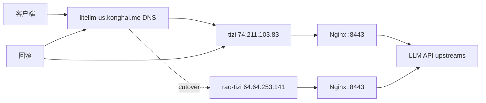

# 迁移 litellm-us 反向代理到 rao-tizi

## Summary

将 `litellm-us.konghai.me` 的 Nginx 反向代理从主代理服务器 `tizi` 迁移到备用代理服务器 `rao-tizi`，以避开 `tizi` 流量超额导致的关机风险。迁移按“先备用机就绪并可回滚，再切 DNS”的方式执行，保持现有 `8443` HTTPS 反代端口，避免占用两台机器上现有 `s-ui` 使用的 `443` 端口。

---

## Problem Frame

`tizi` 当前面临流量超过限额和即将关机的风险，但 `litellm-us.konghai.me` 上仍承载多家 LLM API 的透传入口。现场只读检查显示：主机 `tizi` 上 Nginx 已运行并监听 `80` / `8443`，`443` 被 `s-ui` 占用；备用机 `rao-tizi` 出站访问上游 API 正常，但尚未安装 Nginx / certbot，且防火墙只放行 `443/tcp`。

---

## Requirements

- R1. 将 `litellm-us.konghai.me` 的反向代理迁移到 `rao-tizi`，使域名最终指向 `64.64.253.141`。
- R2. 保留现有反代行为：`/openai/`、`/anthropic/`、`/cerebras/`、`/xai/`、`/groq/` 继续透传到对应上游 API。
- R3. 保留现有端口策略：Nginx 使用 `80` 和 `8443`，不占用 `443`，避免影响 `s-ui`。
- R4. 迁移前备份当前配置、证书和防火墙状态；任何安装、放行端口、启动服务、DNS 切换都必须先经用户确认。
- R5. 备用机具备可持续证书续期能力，不能只依赖即将到期的复制证书。
- R6. 提供切换前、切换后和回滚验证方法，确保失败时可快速回到 `tizi`。
- R7. 执行完成后更新运维时间线；若沉淀出可复用经验，再补充 `docs/solutions/`。

---

## Scope Boundaries

- 本计划只迁移 `litellm-us.konghai.me` 的 Nginx 反向代理，不迁移 `s-ui` 代理服务。
- 不调整 `443` 端口归属，不停止或重启 `s-ui`。
- 不重构反代路径、不新增上游供应商、不改变上游 API Host 透传策略。
- 不清理 `tizi` 上历史 Nginx 配置、证书或日志；切换稳定前只允许停用或保留，删除另起计划。
- 不处理服务器流量账单、套餐升级或供应商侧关机策略。

### Deferred to Follow-Up Work

- 若后续希望标准化所有代理服务器的 Nginx / certbot 管理方式，可另写跨服务器最佳实践。
- 若希望把 `litellm-us.konghai.me` 从 `8443` 改到 `443`，需要单独评估 `s-ui` 端口冲突和客户端兼容性。

---

## Context & Research

### Relevant Code and Patterns

- `AGENTS.md`：所有服务器默认按生产对待；危险动作如重启、改防火墙、修改服务配置前必须先征得用户确认。
- `docs/operations/README.md`：日常服务器操作记录写入 `docs/operations/<server>.md`，按时间倒序追加原因、影响、回滚、变更、验证。
- `docs/plans/2026-05-19-001-fix-bt-ssl-acme-challenge-plan.md`：生产证书问题计划采用分阶段验证、备份、回滚和文档沉淀的结构。

### Current Server Findings

- `tizi`
  - IP：`74.211.103.83`
  - 系统：Rocky Linux 9.7
  - Nginx：`nginx/1.20.1`，active / enabled
  - Nginx 配置：`/etc/nginx/conf.d/llm-proxy.conf`
  - 监听：`80/tcp`、`8443/tcp`；`443/tcp` 被 `sui` 进程占用
  - 防火墙：已放行 `80/tcp`、`443/tcp`、`8443/tcp`
  - 证书：`/etc/letsencrypt/live/litellm-us.konghai.me/`
  - 当前证书到期：`2026-05-25 09:59:45 CST`
  - 当前 DNS：`litellm-us.konghai.me` 解析到 `74.211.103.83`
- `rao-tizi`
  - IP：`64.64.253.141`
  - 系统：Rocky Linux 9.7
  - Nginx：未安装
  - certbot：未安装
  - 监听：`443/tcp` 被 `sui` 进程占用；`80/tcp` 和 `8443/tcp` 当前空闲
  - 防火墙：当前只放行 `443/tcp`
  - 出站连通性：OpenAI、Anthropic、Groq、Cerebras、x.ai 均可访问并返回上游 API 预期响应

### Institutional Learnings

- `docs/solutions/nyh-prod/integration-issues/baota-panel-stale-ssl-cert-in-memory-2026-05-11.md`：证书写到磁盘不等于端口已加载新证书，迁移验收必须同时核对磁盘证书和端口返回证书。
- `docs/solutions/nyh-prod/integration-issues/baota-ssl-acme-challenge-routing-fix-2026-05-19.md`：Let’s Encrypt 续期链路要验证真实 challenge 路由和 reload 后的端口证书，避免只看申请命令成功。

### External References

- 未使用外部文档。本计划依据当前服务器只读检查、仓库运维约定和既有证书复盘经验制定。

---

## Key Technical Decisions

- 保持 `8443` 作为 HTTPS 反代端口：这与 `tizi` 现状一致，能避免和 `s-ui` 的 `443` 监听冲突，也降低客户端配置变更范围。
- 在 DNS 切换前先让 `rao-tizi` 完整通过本机和指定解析验证：DNS 是回滚杠杆，不能在备用机未就绪时提前切换。
- 证书采用“两阶段策略”：短期可复制现有证书用于预热和配置测试，最终必须在 `rao-tizi` 建立 certbot 续期配置，避免 `2026-05-25` 后失效。
- 防火墙只补齐本服务必需端口：`80/tcp` 用于 HTTP-01 / 跳转，`8443/tcp` 用于反代服务，不扩大开放面。
- 对 `tizi` 采取保留而非删除：切换稳定前保留原 Nginx 配置和证书，作为 DNS 回滚目标。

---

## Open Questions

### Resolved During Planning

- 是否把 Nginx 改到 `443`？决议：不改。两台机器 `443` 都由 `s-ui` 占用，本次迁移沿用 `8443`。
- 是否迁移 `s-ui`？决议：不迁移。本次只迁移 `litellm-us.konghai.me` 的 Nginx 反向代理。
- 是否自动执行 DNS 切换？决议：不自动执行。DNS 切换作为单独确认点。

### Deferred to Implementation

- `rao-tizi` 上 certbot 的最终安装来源：执行时根据 Rocky Linux 9.7 当前可用仓库选择系统包或 snap / pipx 等稳定方式，并记录实际来源。
- DNS 服务商的具体变更入口和 TTL：执行时以当前 DNS 托管方为准，计划只要求低 TTL、明确切换和回滚目标。
- 是否短暂停用 `tizi` 上 Nginx：切换稳定后再由用户确认；不是完成迁移的前置条件。

---

## High-Level Technical Design

> *This illustrates the intended approach and is directional guidance for review, not implementation specification. The implementing agent should treat it as context, not code to reproduce.*

迁移成功的核心不是“文件复制完成”，而是 `rao-tizi` 在 DNS 切换前已经能用目标域名和 `8443` 端口完成 TLS、路径转发、上游连通和证书续期验证；DNS 切换只是把流量入口指向已验证的新目标。

---

## Implementation Units

### U1. 迁移前冻结现场与备份

**Goal:** 在任何变更前固化 `tizi` 和 `rao-tizi` 的当前状态，确保后续变更可审计、可回滚。

**Requirements:** R4, R6

**Dependencies:** None

**Files:**
- Add/Update: `docs/operations/tizi.md`
- Add/Update: `docs/operations/rao-tizi.md`

**Approach:**
- 在 `tizi` 备份 Nginx 配置、Let’s Encrypt 证书目录、续期配置、crontab 和防火墙状态。
- 在 `rao-tizi` 记录当前监听端口、firewalld 状态、`s-ui` 服务状态、包安装状态和出站 API 连通性。
- 明确备份路径和恢复方式，避免后续只知道“做过备份”但找不到备份点。
- 变更前再次确认 `443` 仍由 `s-ui` 占用，避免迁移计划误伤已有代理服务。

**Patterns to follow:**
- `docs/operations/README.md` 的操作记录格式。
- `docs/plans/2026-05-19-001-fix-bt-ssl-acme-challenge-plan.md` 的生产证书备份与验证思路。

**Test scenarios:**
- Happy path: 执行前能列出 `tizi` 原配置和证书备份位置，且能说明如何从备份恢复。
- Edge case: 如果 `rao-tizi` 已被临时安装过 Nginx 或开放过端口，先记录差异，再决定是否复用或回滚。
- Error path: 如果任一备份失败，停止后续安装和防火墙变更，避免在无回滚点时继续。

**Verification:**
- 两台机器的基线状态、备份路径、影响范围和回滚方式已写入操作记录草稿或执行日志。
- 迁移操作者能在不重新探测的情况下说清 `tizi` 的原始配置入口和证书路径。

---

### U2. 准备 rao-tizi 的 Nginx 运行环境

**Goal:** 让 `rao-tizi` 具备承载现有 `litellm-us` Nginx 反代的基础环境，但不抢占 `443`。

**Requirements:** R1, R3, R4, R5

**Dependencies:** U1

**Files:**
- Add/Update: `docs/operations/rao-tizi.md`

**Approach:**
- 经用户确认后，在 `rao-tizi` 安装 Nginx 和 certbot 所需组件。
- 复制 `tizi` 上的 `llm-proxy.conf` 逻辑到 `rao-tizi`，但保留 `8443 ssl http2` 监听策略。
- 为 `80/tcp` 和 `8443/tcp` 调整 firewalld，调整前记录当前规则，调整后只新增必要端口。
- 启动 Nginx 前先做配置语法检查；确认 Nginx 不监听 `443`。
- 设置 Nginx 开机自启，但保留 `s-ui` 的 `443` 监听不变。

**Patterns to follow:**
- `AGENTS.md` 的生产服务器危险动作确认规则。
- `tizi` 当前 `/etc/nginx/conf.d/llm-proxy.conf` 的端口和路径结构。

**Test scenarios:**
- Happy path: `rao-tizi` 上 Nginx 能安装、配置通过语法检查，并监听 `80` / `8443`。
- Edge case: 如果包仓库缺少 certbot 插件，Nginx 先以静态配置就绪，证书续期方案进入 U3 处理。
- Error path: 如果 firewalld 变更失败或规则不符合预期，停止启动 Nginx 并按 U1 记录的规则回滚。
- Integration: Nginx 启动后，`s-ui` 的 `443` 监听仍存在且未被 Nginx 占用。

**Verification:**
- `rao-tizi` 上 `80/tcp` 和 `8443/tcp` 可监听，`443/tcp` 仍属于 `s-ui`。
- Nginx 配置语法通过，firewalld 仅新增迁移所需端口。

---

### U3. 建立证书与续期链路

**Goal:** 让 `rao-tizi` 在 DNS 切换前后都能提供有效 TLS，并具备长期续期能力。

**Requirements:** R3, R5, R6

**Dependencies:** U2

**Files:**
- Add/Update: `docs/operations/rao-tizi.md`
- Add/Update: `docs/solutions/tizi/integration-issues/litellm-proxy-migration-2026-05-20.md`（仅当执行暴露出可复用证书迁移经验时创建）

**Approach:**
- 短期测试可使用 `tizi` 当前证书副本，但必须标注其到期时间和来源，不能把复制证书视为最终状态。
- DNS 切换前，用指定解析或本机 Host 方式验证 `rao-tizi` 上 Nginx 能用 `litellm-us.konghai.me` 的 SNI 返回正确证书。
- DNS 切换到 `rao-tizi` 后，使用 HTTP-01 或其它可审计方式在备用机建立正式续期配置。
- 续期配置必须包含 deploy hook 或等效 reload 机制，让新证书加载到 Nginx。
- 核对磁盘证书和端口证书，避免出现“磁盘新证书已存在但端口仍返回旧证书”的问题。

**Patterns to follow:**
- `docs/solutions/nyh-prod/integration-issues/baota-panel-stale-ssl-cert-in-memory-2026-05-11.md` 的磁盘证书与端口证书双重验证模式。
- `docs/solutions/nyh-prod/integration-issues/baota-ssl-acme-challenge-routing-fix-2026-05-19.md` 的 HTTP-01 可达性和 reload 验证思路。

**Test scenarios:**
- Happy path: `rao-tizi` 使用 `litellm-us.konghai.me` SNI 返回有效证书，且端口证书与磁盘证书一致。
- Happy path: 正式续期配置建立后，续期 dry-run 或等效验证能触发正确的 challenge / reload 链路。
- Edge case: 如果 DNS 尚未切换，证书申请无法通过 HTTP-01，则保留复制证书用于预切验证，正式续期延后到 DNS 切换后立即完成。
- Error path: 如果证书申请失败，回滚到复制证书服务状态，并阻止关闭 `tizi` 侧服务。
- Integration: 证书 reload 不影响 `rao-tizi` 上 `s-ui` 的 `443` 服务。

**Verification:**
- `rao-tizi` 上 TLS 握手成功，证书 CN / SAN 覆盖 `litellm-us.konghai.me`。
- certbot 或最终选定的续期工具存在自动续期入口，且 reload hook 可审计。

---

### U4. 预切流量验证

**Goal:** 在不改 DNS 的情况下验证 `rao-tizi` 的反代行为与 `tizi` 等价。

**Requirements:** R2, R3, R6

**Dependencies:** U2, U3

**Files:**
- Add/Update: `docs/operations/rao-tizi.md`

**Approach:**
- 使用指定解析方式把 `litellm-us.konghai.me:8443` 临时指向 `64.64.253.141` 进行验证。
- 对 `/openai/`、`/anthropic/`、`/cerebras/`、`/xai/`、`/groq/` 分别做无密钥或低风险请求，确认返回来自上游 API，而不是 Nginx 本地错误、TLS 错误或连接超时。
- 对 `80` 端口验证跳转策略，并确认跳转不会错误引导到被 `s-ui` 占用的 `443` 端口造成误判；若现有配置的默认 HTTPS 跳转与实际 `8443` 客户端用法冲突，需要在执行时显式记录并由用户确认是否调整。
- 对比 `tizi` 和 `rao-tizi` 的响应头、状态码类别和错误形态，确认差异可解释。

**Patterns to follow:**
- 当前 `tizi` 上 `llm-proxy.conf` 的各上游 Host 透传设置。

**Test scenarios:**
- Happy path: 五个代理路径在 `rao-tizi` 上均能到达对应上游 API，并返回预期的认证错误、方法错误或上游错误。
- Edge case: 某个上游因地区或风控返回 4xx / 421 时，只要能证明响应来自上游而非本机配置错误，即可视作连通。
- Error path: 如果任一路径返回 Nginx 502 / 504、TLS 错误或连接超时，先修正备用机配置，不进入 DNS 切换。
- Integration: `80`、`8443`、`443` 三个端口行为清晰，不让客户端误连 `443` 上的 `s-ui`。

**Verification:**
- 预切验证矩阵记录每个路径的状态、上游归属和是否通过。
- 备用机通过完整路径验证前，不进入 U5。

---

### U5. DNS 切换与上线验证

**Goal:** 将 `litellm-us.konghai.me` 的公网流量切到 `rao-tizi`，并保留可快速回滚能力。

**Requirements:** R1, R2, R5, R6

**Dependencies:** U4

**Files:**
- Add/Update: `docs/operations/tizi.md`
- Add/Update: `docs/operations/rao-tizi.md`

**Approach:**
- 切换前降低或确认 DNS TTL，记录旧解析值 `74.211.103.83` 和新解析值 `64.64.253.141`。
- 经用户确认后，将 DNS 记录切向 `rao-tizi`。
- 在 DNS 生效窗口内同时用指定解析和公网解析验证，避免本地缓存误判。
- 切换后立即验证 TLS、五个代理路径、Nginx 日志、上游错误形态和系统资源。
- DNS 稳定后，在 `rao-tizi` 建立或复核正式证书续期链路，确保不依赖即将到期的复制证书。
- 保持 `tizi` 侧 Nginx 配置和证书不删除，作为回滚目标。

**Patterns to follow:**
- `docs/operations/README.md` 的“原因 / 影响 / 回滚 / 变更 / 验证”记录格式。

**Test scenarios:**
- Happy path: 公网 DNS 解析到 `64.64.253.141` 后，`litellm-us.konghai.me:8443` 能正常代理五个上游路径。
- Edge case: 部分地区 DNS 缓存仍指向 `tizi` 时，两边服务短期并行，避免解析漂移期间中断。
- Error path: 如果新目标出现 TLS 错误、路径级 5xx 或 Nginx 无法稳定运行，DNS 回滚到 `74.211.103.83`。
- Integration: 切换期间 `s-ui` 的 `443` 服务不被修改，`litellm-us` 客户端仍使用原端口访问。

**Verification:**
- 公网解析、指定解析和端口证书均指向并证明 `rao-tizi` 正在服务。
- `tizi` 流量开始下降，且回滚目标仍可用。

---

### U6. 收尾、观察和文档沉淀

**Goal:** 完成迁移后的观察、回滚窗口管理和仓库记录，避免运维状态只存在于对话里。

**Requirements:** R6, R7

**Dependencies:** U5

**Files:**
- Add/Update: `docs/operations/tizi.md`
- Add/Update: `docs/operations/rao-tizi.md`
- Add: `docs/solutions/tizi/integration-issues/litellm-proxy-migration-2026-05-20.md`（仅当有可复用复盘时创建）

**Approach:**
- 在迁移完成后观察 Nginx 错误日志、访问日志、系统资源和证书续期入口。
- 记录最终状态：DNS 指向、服务监听、防火墙规则、证书路径、续期机制、回滚方式。
- 明确何时可以停用 `tizi` 上的 Nginx 或保持冷备；停用属于服务变更，需要再次确认。
- 如果迁移中发现可复用问题，例如 `8443` 与 HTTP 跳转不一致、证书复制后的续期接管、firewalld 端口差异，再写入 `docs/solutions/`。
- 工作区有变更时按仓库约定使用中文目的说明提交。

**Patterns to follow:**
- `docs/solutions/README.md` 的方案文档命名和 frontmatter 约定。
- `docs/operations/README.md` 的时间线格式。

**Test scenarios:**
- Happy path: 操作记录完整覆盖两台服务器的原因、影响、回滚、变更和验证。
- Edge case: 如果最终未创建 `docs/solutions/`，操作记录需说明原因：本次只是按计划迁移，没有形成新的可复用故障复盘。
- Error path: 如果迁移回滚，文档仍记录失败原因、回滚动作和下一步阻塞点。

**Verification:**
- 仓库中可以通过 `docs/operations/tizi.md` 和 `docs/operations/rao-tizi.md` 还原迁移时间线。
- 如有解决方案文档，其路径符合 `docs/solutions/<server>/<category>/<slug>-<YYYY-MM-DD>.md`。
- 文档变更完成后提交到 `main`。

---

## System-Wide Impact

- **Interaction graph:** DNS 指向决定流量进入 `tizi` 还是 `rao-tizi`；Nginx 只负责 `80` / `8443`；`s-ui` 继续占用 `443`。
- **Error propagation:** 上游 API 的 4xx / 421 / 405 等响应可以是健康信号，Nginx 本地 5xx、TLS 握手失败、连接超时才是迁移阻断信号。
- **State lifecycle risks:** 复制证书是短期状态，正式续期配置才是长期状态；必须避免切换后忘记接管续期。
- **API surface parity:** 客户端仍应使用原域名和 `8443` 端口；路径和上游 Host 透传行为保持一致。
- **Integration coverage:** 需要覆盖 DNS、TLS、Nginx、firewalld、certbot、上游 API 出站连通和操作文档，单点验证不足以判定迁移成功。
- **Unchanged invariants:** 不改变 `s-ui`、不占用 `443`、不删除 `tizi` 原服务，直到用户另行确认。

---

## Risks & Dependencies

| Risk | Mitigation |
|------|------------|
| `tizi` 在迁移完成前被关机 | 优先让 `rao-tizi` 配置和证书预热，DNS 切换前保留复制证书测试路径；必要时先切低 TTL 并准备快速切换 |
| `rao-tizi` 未放行 `8443` 导致服务不可达 | 防火墙变更作为 U2 的明确确认点，变更后立即验证公网端口 |
| `443` 被 Nginx 误占用影响 `s-ui` | 配置和验证都要求 Nginx 不监听 `443`，上线前后检查 `ss` 输出 |
| 证书在 `2026-05-25` 到期 | U3 要求在迁移后建立正式续期链路，并验证端口证书加载 |
| DNS 缓存导致部分客户端仍访问 `tizi` | 切换窗口两边服务并行，稳定后再决定是否停用旧服务 |
| HTTP 端口跳转到默认 `443` 造成误解 | U4 明确检查 `80` 跳转策略；如需改为带 `8443` 的跳转，执行时需用户确认 |

---

## Documentation / Operational Notes

- 执行迁移时必须先在对话中说明要做什么、预期影响和回滚方式。
- 安装软件、修改 firewalld、启动 Nginx、修改 DNS、停用旧服务都属于需要用户确认的动作。
- 最终至少更新 `docs/operations/rao-tizi.md`；如果 `tizi` 侧也执行了备份、保留、停用或回滚动作，同步更新 `docs/operations/tizi.md`。
- 如果执行过程中形成可复用经验，优先使用 `docs/solutions/` 约定沉淀，server 字段可选 `tizi` 或 `rao-tizi`，按实际问题归属选择。

---

## Sources & References

- Repo guidance: `AGENTS.md`
- Operations format: `docs/operations/README.md`
- Solutions format: `docs/solutions/README.md`
- Similar plan pattern: `docs/plans/2026-05-19-001-fix-bt-ssl-acme-challenge-plan.md`
- Related solution pattern: `docs/solutions/nyh-prod/integration-issues/baota-panel-stale-ssl-cert-in-memory-2026-05-11.md`
