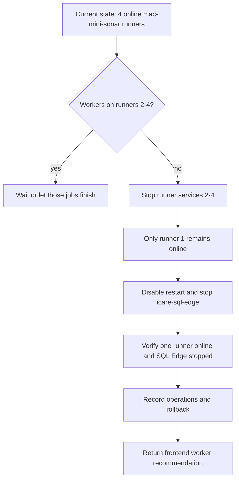

# perf: 串行化 mac-mini runner 并释放测试资源

## Summary

将 `mac-mini` 上的 GitHub Actions runner 并发从 4 个收敛到 1 个，让重 CPU 的 `iCare-frontend-mas` 测试 job 独占主机资源。同步停用已不重要的 `icare-sql-edge` 容器并关闭其 `restart=always`，释放内存和 swap 压力。前端 Vitest worker 数只作为运维侧建议回传，不在本计划内修改前端仓库。

---

## Problem Frame

`iCare-frontend-mas` 的 PR CI 中 `Frontend Tests` 单次约 9m43s，其中 95% 时间在 `npm run test:ci`。前一轮只读审计确认，慢点不是依赖安装或缓存，而是 `mac-mini` 上 4 个 `mac-mini-sonar-*` runner 可同时接 job，导致多个 Vitest 进程树同机争抢 CPU。当前脚本固定 `--maxWorkers=2`，单 job 偏保守；但在 4 个 runner 并发模型下直接升到 `4` 或更高会放大争抢。

用户已确认新的优化方向：牺牲少见的多 job 并发，换取常见情况下单个 job 更快完成。`mac-mini` 上 Docker 容器内服务不是本轮优先级，`icare-sql-edge` 可以停用释放资源。`--maxWorkers` 属于前端仓脚本参数，runner 侧不做仓库修改，只给出建议值。

---

## Requirements

**Runner concurrency**

- R1. `mac-mini` 最终只保留 1 个在线 GitHub Actions runner 承接 `mac-mini-sonar` label 的 job。
- R2. 停用其它 runner 时不删除 runner 注册、工作目录或缓存，确保可快速回滚。
- R3. 停 runner 前必须确认没有正在执行的目标 runner `Runner.Worker`，避免中断 CI。

**Host resource posture**

- R4. `icare-sql-edge` 必须停止并关闭自动重启策略，释放其约 8-9 GiB 常驻内存。
- R5. 其它 Docker 服务不纳入本轮停用范围，除非实施时发现它们阻塞 runner 可用性。

**Frontend handoff**

- R6. 运维侧需要回传安全的 `test:ci` worker 建议值，默认建议从 `8` 起步，`10` 作为前端项目侧对照压测候选。
- R7. 本计划不修改 `iCare-frontend-mas` 仓库；最终写入 `package.json` 的值由前端项目侧执行和提交。

**Documentation and rollback**

- R8. 所有 runner / Docker 运行状态变更必须追加到 `docs/operations/mac-mini.md`，包含影响、回滚方式和验证结果。
- R9. 运维仓提交只记录 runner 和主机资源变更，不混入前端仓脚本改动。

---

## Scope Boundaries

### In Scope

- 停用 `mac-mini-sonar-2..4` service，保留 `mac-mini-sonar-1` 作为唯一在线 runner。
- 将 `icare-sql-edge` 从 `restart=always` 改为不自动重启，并停止容器。
- 回传 `iCare-frontend-mas` 的 `test:ci` worker 建议值。
- 更新 `docs/operations/mac-mini.md` 记录实际操作。

### Out of Scope

- 不删除 runner 注册、runner 工作目录、tool cache、npm cache 或 Sonar scanner cache。
- 不调整 GitHub organization runner group、repository access 或 workflow required checks。
- 不停用 `sonarqube`、`sonar-postgres`、`acquilang-postgres`、`richer-*` 等其它容器。
- 不改 `sonar.yml` 的 job 拆分方式，除非执行时发现 runner 串行化后 job 排队行为不可接受。
- 不修改 `iCare-frontend-mas` 的 `package.json`、workflow 或其它前端仓文件。

### Deferred to Follow-Up Work

- 前端项目侧在独立分支中把 `test:ci` 从 `--maxWorkers=2` 调整到建议值，并按其仓库 Jira / GitFlow 约定提交。
- 若 `test:coverage:ci` 仍然慢，再由前端项目单独评估 coverage job 的 worker 策略。
- 若单 runner 排队影响团队吞吐，再评估专用 label 或按仓库拆 runner 的中间方案。
- 若 macOS 后台服务长期抢 CPU，再单独评估 Spotlight、Photo Analysis 或 Docker Desktop 资源策略。

---

## Key Technical Decisions

- **保留 1 个 runner，而不是 4 个 runner 加大 worker:** 当前机器是 4 个性能核 + 6 个能效核，4 个 runner 同时跑 frontend test 时已经出现 CPU idle 0%。串行化 runner 先消除同机多 job 争抢，再让单 job 使用更多 worker，优化目标更直接。
- **停 runner service 而不是删除 runner:** 停 service 能让 GitHub 调度器只看到 1 个 online runner，同时保留回滚路径；删除注册会增加恢复成本，且不利于保留既有 work folder 和 tool cache。
- **关闭 `icare-sql-edge` restart policy 后再 stop:** 当前容器是 `restart=always`。只执行 stop 会在 Docker Desktop 或主机重启后重新拉起，无法稳定释放内存。
- **建议前端从 `maxWorkers=8` 起步，谨慎压测 `10`:** `10` 等于所有逻辑核心数，但 jsdom/Vitest 还有主进程、esbuild、GC 和系统后台开销。`8` 更可能是稳定起点，`10` 需要前端项目侧用同一 runner 模型实测证明更快且不触发 watchdog。
- **运维记录和前端脚本修改分离:** runner 和 Docker 状态属于运维仓事实记录；`test:ci` 脚本属于 `iCare-frontend-mas` 仓库行为。运维侧只回传建议值。

---

## High-Level Technical Design

---

## Implementation Units

### U1. Preflight runner and host state

- **Goal:** Establish a safe baseline before making service changes.
- **Requirements:** R1, R2, R3, R4, R8.
- **Dependencies:** None.
- **Files:** `docs/operations/mac-mini.md`.
- **Approach:** Check active runner services, active `Runner.Worker` processes, `icare-sql-edge` restart policy, memory/swap pressure, and top CPU consumers. If any target runner is executing a job, wait for it to finish before stopping that service.
- **Patterns to follow:** `docs/operations/mac-mini.md` records impact, rollback, actions, and validation in reverse chronological order.
- **Test scenarios:** Test expectation: none -- this is a preflight and documentation unit, not application behavior.
- **Verification:** The implementer can name the runner slot to keep, the runner slots to stop, the current `icare-sql-edge` restart policy, and whether the target runner slots are idle enough to proceed.

### U2. Collapse mac-mini runner concurrency to one online runner

- **Goal:** Stop `mac-mini-sonar-2..4` while keeping `mac-mini-sonar-1` online and preserving all runner files for rollback.
- **Requirements:** R1, R2, R3, R8.
- **Dependencies:** U1.
- **Files:** `docs/operations/mac-mini.md`.
- **Approach:** Use each runner directory's service wrapper to stop the three non-primary launch agents. Do not uninstall runners, delete work folders, or change labels. Record the stopped services and the exact rollback action.
- **Patterns to follow:** `docs/solutions/dev-cypresso/performance-issues/t3-cpu-credit-exhausted-instance-hang-2026-05-12.md` records prior operational precedent for reducing runner count to avoid CPU pressure.
- **Test scenarios:** Test expectation: none -- runner service state is verified operationally rather than through repository tests.
- **Verification:** `launchctl` shows only `actions.runner.cypressoai.mac-mini-sonar-1` online, GitHub Actions can still assign `mac-mini-sonar` jobs, and stopped runner directories remain intact.

### U3. Stop icare-sql-edge and prevent automatic restart

- **Goal:** Release the SQL Edge container's memory footprint and prevent it from returning after Docker or host restart.
- **Requirements:** R4, R5, R8.
- **Dependencies:** U1.
- **Files:** `docs/operations/mac-mini.md`.
- **Approach:** Record the current restart policy, change `icare-sql-edge` to no automatic restart, then stop the container. Do not remove the container or its volumes.
- **Patterns to follow:** Existing operations records consistently include rollback commands for container restart-policy changes.
- **Test scenarios:** Test expectation: none -- container state is verified by Docker state and host resource observations.
- **Verification:** Docker reports `icare-sql-edge` as stopped with no automatic restart policy, and memory/swap pressure decreases after the container exits.

### U4. Record operations and return frontend worker recommendation

- **Goal:** Document the new host model and provide a safe worker recommendation to the frontend project.
- **Requirements:** R6, R7, R8, R9.
- **Dependencies:** U2, U3.
- **Files:** `docs/operations/mac-mini.md`.
- **Approach:** Append the actual runner and Docker changes, their impact, rollback commands, and verification. Recommend frontend project set `test:ci` to `--maxWorkers=8` first, with `10` reserved for a follow-up benchmark on the now-serial runner.
- **Patterns to follow:** `docs/operations/mac-mini.md` uses reverse chronological records with reason, impact, rollback, actions, and verification.
- **Test scenarios:**
  - Happy path: operations record states only `mac-mini-sonar-1` remains online and `icare-sql-edge` is stopped with restart disabled.
  - Queue behavior: future GitHub Actions jobs for `mac-mini-sonar` queue behind the single online runner instead of running concurrently.
  - Rollback path: restarting `mac-mini-sonar-2..4` returns the previous 4-runner concurrency model; restoring `icare-sql-edge` restart policy and starting the container returns the prior SQL Edge state.
- **Verification:** Operations documentation names the final runner model, `icare-sql-edge` state, recommended frontend worker starting point, and rollback commands.

---

## Risks & Dependencies

| Risk | Mitigation |
| --- | --- |
| `maxWorkers=10` saturates all cores and becomes slower than `8` | Recommend `8` as the first frontend-side value and keep `10` as a benchmark candidate. |
| Stopping runner services interrupts active CI | U1 requires checking `Runner.Worker` on target runner slots and waiting for jobs to finish before service changes. |
| Single runner creates unacceptable queue time during rare bursts | Roll back by starting `mac-mini-sonar-2..4`, or follow up with dedicated labels for heavy tests vs. light scans. |
| `icare-sql-edge` is unexpectedly still needed | Do not delete the container or volumes; rollback is to restore `restart=always` and start the container. |
| Frontend worker change needs Jira / GitFlow handling | Do not modify the frontend repo in this operation; hand off the recommendation to that project. |

---

## Documentation / Operational Notes

- `mac-mini` is treated as production-like infrastructure for CI. Service stops and Docker restart-policy changes require explicit impact and rollback records.
- The operation should preserve the existing short `workFolder` layout for runner slots `s1..s4`; it fixed prior GPG socket path issues and should not be reverted.
- The final handoff to the frontend project should recommend `--maxWorkers=8` as the starting value and explain that `10` is a follow-up benchmark candidate.

---

## Sources / Research

- `docs/operations/mac-mini.md`: current 4-runner model, CPU idle 0% under concurrent Vitest, `icare-sql-edge` memory footprint, and prior workFolder changes.
- `docs/solutions/mac-mini/workflow-issues/github-actions-runner-vpn-traffic-optimization-2026-05-20.md`: persistent self-hosted runner behavior and local-cache assumptions.
- `docs/solutions/mac-mini/integration-issues/sonarqube-scanner-cli-cache-never-hits-4part-version-2026-06-09.md`: runner-layer environment fixes and verification patterns.
- `docs/solutions/dev-cypresso/performance-issues/t3-cpu-credit-exhausted-instance-hang-2026-05-12.md`: prior precedent for reducing self-hosted runner concurrency to control host CPU pressure.
- Target repo `iCare-frontend-mas`: `.github/workflows/sonar.yml` calls `npm run test:ci` for `Frontend Tests`; `package.json` currently sets `test:ci` to `vitest run --reporter=dot --maxWorkers=2 --testTimeout=30000`.
