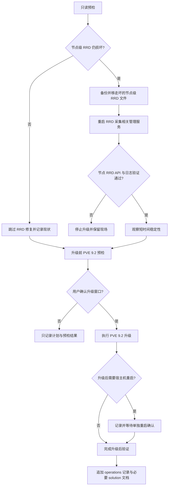

# 修复 PVE 节点 RRD 后升级 PVE 9.2

## Summary

先对 `pve` 宿主机执行节点级 RRD 最小修复，恢复 Web UI 节点图表与停止 RRD 日志刷屏；验证稳定后，再把 PVE 9.1 升级到 PVE 9.2。计划不重启 VM，不默认重启宿主机；任何服务重启、升级和可能影响管理面的动作都必须在执行前再次获得用户确认。

---

## Problem Frame

`pve` 当前节点级 RRD 文件 `/var/lib/rrdcached/db/pve-node-9.0/pve` 为 0 字节，`pmxcfs` 每 10 秒报 `mmaping file ... Invalid argument`。`pvesh get /nodes/pve/rrddata --timeframe hour` 失败，PVE Web UI 节点 overview 图表可能不显示；VM 级与 storage 级 RRD 数据正常。

本仓库此前只把该问题作为 `docs/operations/mas-go-dev.md` 的附带发现记录，尚未修复。用户已确认执行策略：先做最小修复，再升级 PVE 9.2。

---

## Requirements

**RRD 修复**

- R1. 只修复损坏的节点级 RRD 文件，保留 VM 与 storage RRD 历史数据。
- R2. 修复前必须备份当前 0 字节文件或保留带时间戳的坏文件副本。
- R3. 修复后节点级 RRD API 必须恢复返回数据，且最近日志不再持续出现 `pve-node-9.0/pve` 的 mmap 错误。

**PVE 9.2 升级**

- R4. 只有在 RRD 最小修复通过验证并观察稳定后，才进入 PVE 9.2 升级。
- R5. 升级前必须完成只读预检，明确可升级包、仓库来源、当前版本、VM 状态、存储状态和可回滚边界。
- R6. 升级过程中不主动重启 VM 或宿主机；如包升级提示必须重启宿主机，先记录并等待用户确认维护窗口。
- R7. 升级后必须验证 PVE 管理面、RRD 图表数据、VM 状态、storage 状态和关键 VM 的基础可达性。

**文档与审计**

- R8. 每次实际操作后必须追加 `docs/operations/pve.md`，记录时间、原因、影响、回滚、变更和验证。
- R9. 如果执行中确认这是可复用故障模式，另写 `docs/solutions/pve/runtime-errors/` 或合适类别下的方案文档。

---

## Scope Boundaries

- 本计划只覆盖 `pve` 宿主机的节点级 RRD 最小修复与 PVE 9.2 升级。
- 不清空整个 `/var/lib/rrdcached/db`，除非最小修复失败且用户另行确认。
- 不主动删除 RRD 备份或坏文件副本。
- 不修改 VM 配置、网络、防火墙、数据库 schema/data、Tailscale、GitHub Actions runner 或应用部署目录。
- 不把“宿主机重启”纳入默认执行范围；如升级后需要重启，仅作为后续维护窗口候选动作。
- 不在计划阶段执行任何服务器变更。

### Deferred to Follow-Up Work

- 为 PVE 图表与日志建立长期巡检或告警。
- 清理历史 RRD 备份文件。
- 将 PVE 9.2 升级后的宿主机 kernel 重启纳入单独维护窗口。

---

## High-Level Technical Design

---

## Key Technical Decisions

- **先修 RRD，再升级 PVE 9.2:** 当前坏文件已是 0 字节，升级不保证自动修复；先恢复指标采集可减少升级时的干扰变量。
- **采用最小修复而不是全量清空 RRD cache:** 目前只有 `pve-node-9.0/pve` 损坏，VM 与 storage RRD 正常；全量清空会丢更多历史图表数据。
- **停止在 RRD 修复失败后继续升级:** 如果最小修复失败，说明现场可能还有未识别的 `rrdcached`、`pmxcfs` 或文件系统问题，继续升级会扩大排查面。
- **升级动作拆成独立确认点:** PVE 升级会影响管理面服务并可能引入宿主机重启需求，必须和 RRD 修复分开确认。
- **文档先落 `docs/operations/pve.md`:** 这是日常运维操作时间线；只有确认有复用价值时，再补 `docs/solutions/`。

---

## Implementation Units

### U1. RRD 修复前预检与确认

**Goal:** 在任何变更前确认现场仍符合“单个节点级 RRD 损坏”的判断，并让用户确认即将重启管理侧采集服务。

**Requirements:** R1, R2, R5

**Dependencies:** 无

**Files:**

- Modify: `docs/operations/pve.md`

**Approach:**

- 复查 PVE 版本、当前 kernel、APT 候选版本、VM 清单、storage 状态和 RRD 文件树。
- 复查 `pve-node-9.0/pve` 文件大小、mtime、节点 RRD API 错误、VM/storage RRD API 正常。
- 说明预期影响：短暂影响 PVE 图表/状态采集，不影响正在运行的 VM。
- 在执行服务停止或重启前等待用户明确确认。

**Patterns to follow:** `docs/operations/pve.md` 既有记录格式；AGENTS 里的生产服务器操作守则。

**Test scenarios:**

- Happy path: 预检仍显示仅节点级 RRD 文件损坏，VM/storage RRD 正常。
- Edge case: 如果 VM 或 storage RRD 也开始失败，停止最小修复计划并重新诊断。
- Error path: 如果磁盘空间、inode、权限、时间同步或 storage 状态异常，先解决基础异常，不进入 RRD 文件移走步骤。
- Integration: 预检不改变服务器状态，只产生可记录的当前状态证据。

**Verification:** 用户看到影响、回滚和确认点；`docs/operations/pve.md` 在实际执行后可追加完整记录。

### U2. 执行节点级 RRD 最小修复

**Goal:** 只移走损坏的节点级 RRD 文件，让 PVE 重新生成该文件并恢复节点图表数据。

**Requirements:** R1, R2, R3

**Dependencies:** U1

**Files:**

- Modify: `docs/operations/pve.md`

**Approach:**

- 对损坏文件做带时间戳的备份或改名保留。
- 仅围绕 `rrdcached`、`rrdcached.socket`、`pvestatd` 做必要管理侧服务操作。
- 避免触碰 `pve-vm-9.0` 与 `pve-storage-9.0`。
- 如果最小修复未恢复，停止升级计划并保留现场。

**Patterns to follow:** 先备份再改动；危险动作前确认；记录影响和回滚。

**Test scenarios:**

- Happy path: 新的 `pve-node-9.0/pve` 生成且非 0 字节，节点 RRD API 返回最近数据点。
- Edge case: 新文件生成较慢时，等待短时间观察，不立即升级。
- Error path: 如果 API 仍报 mmap 错误，保留坏文件副本与日志，停止后续升级。
- Integration: VM `110`、`120`、`130` 的 RRD API 仍能返回数据，storage RRD 仍能返回数据。

**Verification:** 节点图表 API 成功；最近日志不再持续出现同一路径的 RRD mmap 错误；VM/storage 数据未受损。

### U3. 观察并记录 RRD 修复结果

**Goal:** 给 RRD 重建留出短时间采集窗口，并把修复结果落到运维时间线。

**Requirements:** R3, R8, R9

**Dependencies:** U2

**Files:**

- Modify: `docs/operations/pve.md`
- Add optional: `docs/solutions/pve/runtime-errors/pve-node-rrd-corruption-2026-06-12.md`

**Approach:**

- 观察 5-10 分钟，确认错误不再按 10 秒周期刷屏。
- 记录修复动作、备份位置、影响面、回滚方式、验证结果。
- 判断是否补 `docs/solutions/`：如果最小修复成功且模式清晰，沉淀为 PVE 9 RRD 损坏处理经验。

**Patterns to follow:** `docs/operations/README.md` 的时间线字段；`docs/solutions/README.md` 的 solution 命名约定。

**Test scenarios:**

- Happy path: 观察期内 RRD 错误消失，节点数据持续增长。
- Edge case: 只剩旧日志但无新日志，记录验证时间窗口避免误判。
- Error path: 错误恢复出现时，标记最小修复失败并停止升级。
- Integration: 操作记录能从“原因 -> 影响 -> 回滚 -> 验证”完整复盘。

**Verification:** `docs/operations/pve.md` 有新条目；如创建 solution 文档，frontmatter 与 `server: pve` 合规。

### U4. PVE 9.2 升级前预检与执行

**Goal:** 在 RRD 修复稳定后，把 PVE 从 9.1 系升级到仓库候选的 9.2 系。

**Requirements:** R4, R5, R6

**Dependencies:** U3

**Files:**

- Modify: `docs/operations/pve.md`

**Approach:**

- 读取当前版本、APT 源、可升级包、held packages、磁盘空间、VM 状态和 storage 状态。
- 明确升级影响：PVE Web UI/API 管理面可能短暂中断，运行中的 VM 通常不受影响。
- 在用户确认升级窗口后执行升级。
- 如果升级提示需要宿主机重启，记录原因并等待单独确认，不在本单元直接重启。

**Patterns to follow:** PVE 维护动作先预检、再确认、再变更；不把重启“顺手做掉”。

**Test scenarios:**

- Happy path: 升级包解析正常，无 held package 阻断，PVE 管理服务升级完成。
- Edge case: APT 提示配置文件冲突，暂停并让用户选择保留或替换策略。
- Error path: 仓库不可达、包依赖冲突或升级中断时，不继续做清理动作；保留日志用于恢复。
- Integration: 升级前后的 VM 清单一致，storage 仍 active。

**Verification:** `pveversion -v` 显示 PVE 9.2 相关版本；PVE 管理面可访问；未发生 VM 意外停止。

### U5. 升级后回归验证与文档收尾

**Goal:** 确认升级后 RRD、PVE 管理面、VM 和 storage 均处于预期状态，并完成审计记录。

**Requirements:** R6, R7, R8, R9

**Dependencies:** U4

**Files:**

- Modify: `docs/operations/pve.md`
- Modify optional: `pve/README.md`
- Add optional: `docs/solutions/pve/best-practices/pve-9-2-upgrade-2026-06-12.md`

**Approach:**

- 复查节点 RRD API、VM RRD API、storage RRD API 和最近 RRD 日志。
- 复查 VM `110`、`120`、`130` 的运行状态与关键可达性。
- 记录升级后是否需要安排宿主机重启。
- 若 PVE 版本、kernel 或关键维护约定在 `pve/README.md` 中已有固定记录，按需更新。

**Patterns to follow:** 操作时间线倒序追加；敏感信息不入库；可复用经验进 `docs/solutions/`。

**Test scenarios:**

- Happy path: PVE 9.2 升级完成后，节点/VM/storage RRD 全部返回数据。
- Edge case: 升级完成但运行 kernel 仍是旧版本，记录“待维护窗口重启”而不立即处理。
- Error path: 管理面异常或 RRD 错误复现时，停止收尾并进入排查，不删除任何备份。
- Integration: `mssql-ref`、`mas-win`、`mas-go-dev` 状态与升级前一致。

**Verification:** 运维记录完整；如有 follow-up 重启窗口或 solution 文档，记录清晰且可追踪。

---

## Acceptance Examples

- AE1. 当最小修复完成后，读取 `/nodes/pve/rrddata` 返回数据表，而不是 `rrd_fetch_r failed`。
- AE2. 当最小修复完成后，最近两分钟日志没有继续出现 `/var/lib/rrdcached/db/pve-node-9.0/pve` 的 mmap 错误。
- AE3. 当 PVE 9.2 升级完成后，三台既有 VM 仍处于升级前的运行状态，storage 仍 active。
- AE4. 当升级提示需要宿主机重启时，计划执行停在“记录并等待确认”，不直接重启。

---

## Risks & Dependencies

- **RRD 历史丢失:** 最小修复会丢失节点级 RRD 历史文件内容；该文件当前已为 0 字节，实际可恢复价值很低。VM/storage 历史不应受影响。
- **管理面短暂波动:** `rrdcached`、`pvestatd` 和 PVE 包升级会影响管理面状态采集或 Web UI/API，需在用户确认后执行。
- **升级后待重启:** PVE 9.2 可能升级 kernel 或核心虚拟化组件；是否重启宿主机必须作为单独维护窗口处理。
- **无完整系统快照:** PVE 宿主机不是普通 VM，回滚主要依赖包管理状态、文件备份和维护窗口，而不是一键快照。

---

## Operational Notes

- 执行前必须再次说明动作、预期影响和可回滚性。
- 对 `pve` 虽标注为开发测试虚拟化宿主，仍按生产式谨慎处理；它承载 `mssql-ref`、`mas-win`、`mas-go-dev` 等关键参考/开发环境。
- 任何重启服务、升级包、重启宿主机、删除备份的动作都必须先获得用户确认。
- 操作完成后如果工作区有文档变更，按仓库约定提交中文目的明确的 commit。

---

## Sources & Research

- `docs/operations/mas-go-dev.md`：2026-06-10 记录过 PVE 节点级 RRD 损坏的附带发现。
- `docs/operations/pve.md` 与 `docs/operations/README.md`：提供 PVE 运维时间线格式和既有记录风格。
- Proxmox forum: [Proxmox 9 no data in the overview](https://forum.proxmox.com/threads/proxmox-9-no-data-in-the-overview.170239/)，同类症状为 `pve-node-9.0/<hostname>` mmap 失败，重建 RRD cache 后恢复。
- Proxmox pve-devel mailing list: [Expand and migrate RRD data and add/change summary graphs](https://lore.proxmox.com/pve-devel/DBOJ7YLX5AL1.3M8J791J4K9J4%40proxmox.com/)，记录 PVE 9 RRD 数据格式与聚合窗口变更、升级迁移工具和 live RRD 文件交互注意事项。
- Proxmox forum: [Proxmox Virtual Environment 9.2 available!](https://forum.proxmox.com/threads/proxmox-virtual-environment-9-2-available.183742/)，确认 PVE 9.1 可通过 apt/GUI 升级到 9.2。
