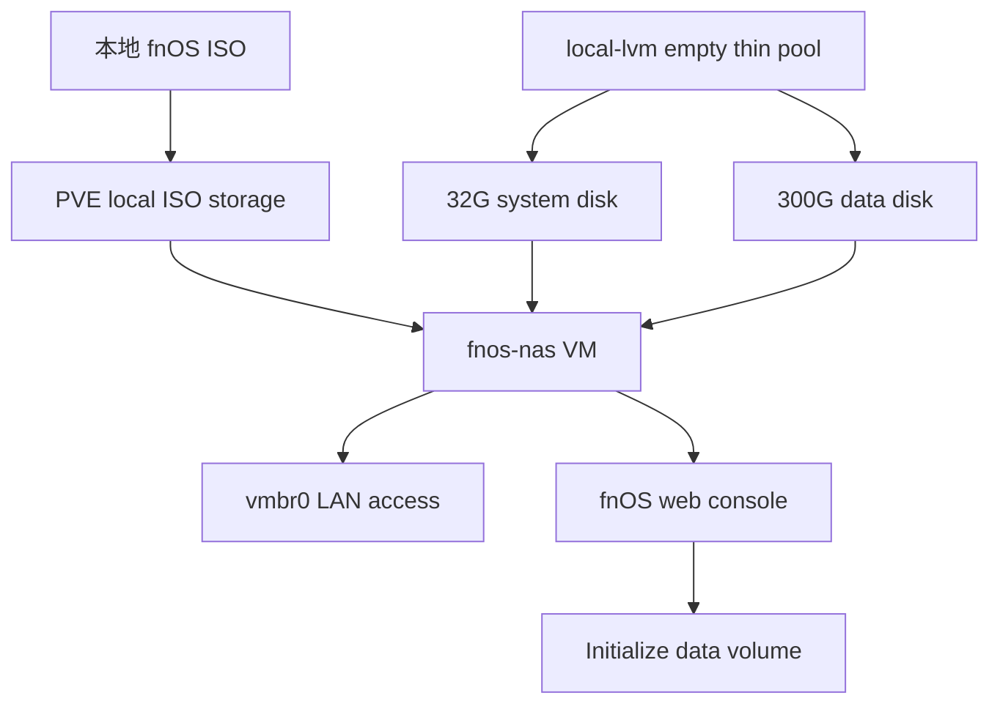

# 在 PVE 上部署 fnOS NAS VM

## Summary

在 `pve` 上新增一台 `fnos-nas` VM，用于运行飞牛 fnOS 并存放可重新下载的影视资源。VM 使用 PVE 系统盘上空闲的 `local-lvm`，避免占用现有 `nvme-data` 上的 MAS 参考/开发环境。

---

## Problem Frame

本地仓库根目录已有 fnOS 安装镜像 `fnos_Mainland-PE_x86_1.1.3107_1809.iso`，但镜像尚未上传到 PVE。PVE 宿主机当前有一块 480G SATA SSD 作为系统盘，其中 `local-lvm` 约 350.8G 为空闲 thin pool；现有三台 VM 均运行在 1TB NVMe 的 `nvme-data` 上。

该 NAS 只用于影视资源，数据可重新下载，不需要复杂灾备、硬盘直通或 ZFS/RAID 方案。当前宿主机内存余量偏紧，初始配置应保守。

---

## Requirements

- R1. 新增 fnOS VM 不影响现有 `mssql-ref`、`mas-win`、`mas-go-dev` 三台 VM。
- R2. fnOS 安装镜像必须从本地仓库上传到 PVE 的 `local` ISO 存储，且不纳入 Git 提交。
- R3. VM 磁盘必须放在 `local-lvm`，使用独立系统盘和独立数据盘。
- R4. 初始数据盘容量按影视资源不超过 300G 规划，不为不可用数据做额外备份链路。
- R5. VM 初始不开启 `onboot`，确认 fnOS 稳定可访问后再决定是否纳入宿主机自启动。
- R6. 部署完成后必须验证 VM 启动、网络可访问、fnOS 后台可进入、数据盘可初始化并可写入。
- R7. 实际操作完成后必须追加 `docs/operations/pve.md`，并按需更新 `pve/README.md` 的 VM 清单。

---

## Scope Boundaries

- 不做物理硬盘直通、HBA 直通、ZFS pool、RAID 或 PCIe 设备直通。
- 不改动 PVE 宿主机网络、防火墙、Tailscale route、APT 源或现有 VM 配置。
- 不把 `fnos-nas` 作为重要数据存储，不承诺单盘故障恢复。
- 不创建长期快照；如安装前后临时打快照，验证后应及时清理。
- 不在计划阶段上传 ISO、创建 VM、启动 VM 或修改服务器配置。

### Deferred to Follow-Up Work

- 如果后续需要外网或 Tailnet 访问 fnOS，再单独规划固定 IP、Tailscale route、端口暴露和访问控制。
- 如果后续影视资源超过 300G，再评估扩容数据盘或改用独立物理盘。
- 如果 fnOS 后续承载重要数据，再重新设计备份、快照和异地副本策略。

---

## High-Level Technical Design

---

## Key Technical Decisions

- **使用 `local-lvm` 承载 fnOS 磁盘:** `local-lvm` 当前为空闲，适合承载低价值影视数据；`nvme-data` 已承载 MAS 参考和开发环境，应避免继续叠加非必要负载。
- **系统盘和数据盘分离:** fnOS 重装或系统故障时，数据盘边界更清晰；影视资源可以重下，数据盘不需要复杂保护。
- **系统盘 32G，数据盘 300G:** 该组合满足当前不超过 300G 的影视资源目标，同时给 fnOS 系统、插件和缓存留出基础空间。
- **初始内存 2G，CPU 2 cores:** 当前 PVE 可用内存约 3.7G，先保守启动；若 fnOS 插件、媒体刮削或后台服务需要更多资源，再提高到 4G。
- **不开启自启动:** 新 NAS VM 先作为手动启动服务，避免宿主机重启后和现有 VM 抢资源；稳定后再评估 `onboot` 与启动顺序。
- **不做硬盘直通:** 数据不重要且容量小，虚拟磁盘更容易删除、迁移、重装和记录。

---

## Implementation Units

### U1. 部署前预检与参数冻结

**Goal:** 在任何写操作前确认 PVE 当前状态、VMID/IP 候选、ISO 文件和资源余量。

**Requirements:** R1, R2, R3, R4, R5

**Dependencies:** 无

**Files:**

- Modify: `docs/operations/pve.md`
- Modify optional: `pve/README.md`

**Approach:**

- 复查 PVE 存储状态：`local`、`local-lvm`、`nvme-data` 均应 active。
- 复查 `local-lvm` 可用容量，确认足够创建 `32G + 300G` 两块 thin-provisioned 磁盘。
- 复查当前 VMID，候选使用 `140`；候选名称使用 `fnos-nas`。
- 如需要固定 LAN IP，优先候选 `192.168.2.23/24`，实施前必须确认未被占用；也可以先使用 DHCP。
- 冻结初始规格：2 cores、2G RAM、`VirtIO SCSI single`、`vmbr0`、`onboot=0`。

**Patterns to follow:** `pve/README.md` 的 VM 清单记录方式；`docs/operations/pve.md` 的时间线格式；生产服务器操作守则中的“先说明影响、可回滚、再确认”。

**Test scenarios:**

- Happy path: VMID `140` 未占用，`local-lvm` active 且空闲容量足够，ISO 文件在本地可读。
- Edge case: `192.168.2.23` 已被占用时，改用 DHCP 或重新选择未占用地址。
- Error path: `local-lvm` 不再为空闲或容量不足时，停止部署并重新评估磁盘分配。
- Integration: 预检不修改 PVE 配置，不影响现有三台 VM。

**Verification:** 用户确认最终 VMID、名称、磁盘容量、CPU/内存和网络策略后，才进入上传与创建 VM。

### U2. 上传 fnOS ISO 到 PVE

**Goal:** 把本地 fnOS ISO 放入 PVE 的 `local` ISO 存储，供 Web UI 或 CLI 创建 VM 时挂载。

**Requirements:** R2

**Dependencies:** U1

**Files:**

- Modify: `docs/operations/pve.md`

**Approach:**

- 将本地 `fnos_Mainland-PE_x86_1.1.3107_1809.iso` 上传到 PVE 的 `/var/lib/vz/template/iso/`。
- 上传后核对文件大小和 PVE `local` 存储可见性。
- 不把 ISO 加入 Git；若后续容易误加，可再单独考虑 `.gitignore` 规则。

**Patterns to follow:** PVE 现有 ISO 都放在 `local` 存储；大文件不进入运维笔记仓库。

**Test scenarios:**

- Happy path: PVE ISO 目录出现 fnOS ISO，大小约 3.2G。
- Error path: 上传中断或文件大小不一致时，删除不完整文件后重新上传，避免挂载坏镜像。
- Integration: `local` 存储剩余空间仍足够保留该 ISO 和现有镜像。

**Verification:** PVE Web UI 的 `local` ISO 列表能看到 fnOS ISO，或 PVE CLI 能识别该 ISO。

### U3. 创建 `fnos-nas` VM 壳和两块虚拟磁盘

**Goal:** 创建 fnOS VM 基础配置，但不启用开机自启，不影响现有 VM。

**Requirements:** R1, R3, R4, R5

**Dependencies:** U2

**Files:**

- Modify: `docs/operations/pve.md`
- Modify optional: `pve/README.md`

**Approach:**

- 创建 VMID `140`、名称 `fnos-nas` 的 VM。
- 挂载 fnOS ISO，使用 `vmbr0` 网络和 VirtIO 网卡。
- 创建 `local-lvm` 上的系统盘 `32G` 和数据盘 `300G`，开启 discard；底层是 SSD，可开启 SSD emulation。
- BIOS 优先使用 UEFI/OVMF；若安装器启动异常，退回 SeaBIOS 作为实施时选择。
- 保持 `onboot=0`，避免新 VM 加入宿主机重启恢复链路。

**Patterns to follow:** 现有 Linux VM 的 `VirtIO SCSI single`、`discard=on`、`vmbr0` 约定；避免在 `nvme-data` 继续堆非 MAS 业务负载。

**Test scenarios:**

- Happy path: PVE VM 清单出现 `140 fnos-nas`，两块磁盘均位于 `local-lvm`。
- Edge case: fnOS 安装器不识别 VirtIO 磁盘或网卡时，调整控制器或网卡模型后重试，并记录最终配置。
- Error path: 创建 VM 后发现磁盘落到错误 storage 时，安装前删除错误磁盘并重新创建。
- Integration: `mssql-ref`、`mas-win`、`mas-go-dev` 仍保持 running，`nvme-data` 没有新增 fnOS 卷。

**Verification:** VM 配置显示 ISO、系统盘、数据盘、网络桥接和 `onboot=0` 均符合计划。

### U4. 安装 fnOS 并初始化数据盘

**Goal:** 完成 fnOS 安装，把第二块磁盘初始化为影视资源数据卷。

**Requirements:** R4, R6

**Dependencies:** U3

**Files:**

- Modify: `docs/operations/pve.md`

**Approach:**

- 启动 VM 并通过控制台完成 fnOS 安装。
- 安装目标选择 32G 系统盘，避免把系统装到 300G 数据盘。
- 首次进入 fnOS 后初始化第二块数据盘，作为影视资源主存储。
- 不在 fnOS 里配置不可逆或复杂的磁盘池方案；该数据盘按可重下资源处理。

**Patterns to follow:** 系统盘与数据盘分离；任何会格式化磁盘的动作执行前再次确认目标盘。

**Test scenarios:**

- Happy path: fnOS 从系统盘启动，Web 后台可访问，数据盘可初始化为存储卷。
- Edge case: fnOS 安装过程无法明确区分两块盘时，停止安装并根据容量确认目标盘。
- Error path: 安装失败或启动循环时，保留 VM 配置现场，优先检查 BIOS/控制器选择，不删除现有 PVE 资源。
- Integration: 初始化数据盘只影响 `fnos-nas` VM 内第二块虚拟盘，不触碰 PVE 宿主磁盘分区。

**Verification:** fnOS 后台显示系统正常，300G 数据卷可用，并能写入/删除测试文件。

### U5. 部署后验证、记录和资源复盘

**Goal:** 验证 fnOS 可用性，记录部署结果，并决定是否需要调整内存或自启动。

**Requirements:** R1, R5, R6, R7

**Dependencies:** U4

**Files:**

- Modify: `docs/operations/pve.md`
- Modify: `pve/README.md`
- Add optional: `docs/solutions/pve/best-practices/fnos-nas-vm-deployment-2026-06-18.md`

**Approach:**

- 验证 PVE 侧 VM 状态、宿主机内存余量、`local-lvm` thin pool 占用和现有三台 VM 状态。
- 验证 fnOS 后台访问、数据盘容量、基础文件写入和重启后可恢复。
- 记录 VMID、名称、IP 或访问方式、CPU/内存、磁盘、storage、ISO 来源和 `onboot` 状态。
- 只有在用户确认需要宿主机重启后自动恢复 NAS 时，才单独启用 `onboot`。

**Patterns to follow:** `docs/operations/pve.md` 最新记录倒序追加；`pve/README.md` VM 清单和存储章节保持当前状态。

**Test scenarios:**

- Happy path: 从局域网能访问 fnOS 后台，数据卷容量接近 300G，测试文件读写正常。
- Edge case: 宿主机 available memory 低于安全余量时，保持 2G 内存，不提升到 4G。
- Error path: fnOS 占用异常或影响现有 VM 时，先关闭 `fnos-nas`，再复盘资源配置。
- Integration: `pvesm status` 显示 `local-lvm` 和 `nvme-data` 均 active，现有 VM 仍 running。

**Verification:** `docs/operations/pve.md` 有完整操作记录，`pve/README.md` 反映新 VM 现况；如部署过程形成可复用经验，再补 solution 文档。

---

## Risks & Dependencies

- **`local-lvm` 容量余量有限:** `32G + 300G` 的逻辑分配接近该 thin pool 上限；不要为该 VM 长期保留快照，也不要继续在 `local-lvm` 上叠加大容量 VM。
- **宿主机内存余量偏紧:** 当前 PVE available memory 约 3.7G，fnOS 初始只给 2G；如果后续启用更多插件，再评估是否牺牲其它 VM 余量。
- **fnOS 对 VirtIO 支持需安装时确认:** 如果安装器不识别 VirtIO 设备，实施时需要调整磁盘控制器或网卡模型，并把最终配置写入记录。
- **ISO 在仓库根目录未跟踪:** 该文件很大且不应提交；部署完成后可保留本地副本、移动到非仓库目录，或单独加忽略规则。

---

## Acceptance Examples

- AE1. 当 VM 创建完成后，`fnos-nas` 的系统盘和数据盘都位于 `local-lvm`，`nvme-data` 没有新增 fnOS 卷。
- AE2. 当 fnOS 安装完成后，浏览器可进入 fnOS 后台，且后台能看到已初始化的数据卷。
- AE3. 当部署记录完成后，`docs/operations/pve.md` 记录时间、原因、影响、回滚、变更和验证结果。

---

## Sources & Research

- `pve/README.md`：PVE 9.2.3、网络、存储、现有 VM、自启动和文档记录约定。
- `docs/operations/pve.md`：PVE 维护时间线和实际操作记录格式。
- `docs/solutions/pve/best-practices/snapshot-vs-backup-strategy-2026-06-14.md`：单宿主本地备份/快照的限制，以及不要长期堆积快照的经验。
- 本次只读排查：`sda` 上 `local-lvm` 约 350.8G 且当前 0% 使用；`nvme-data` 已承载 VM `110`、`120`、`130`；本地 ISO 大小约 3.2G。
