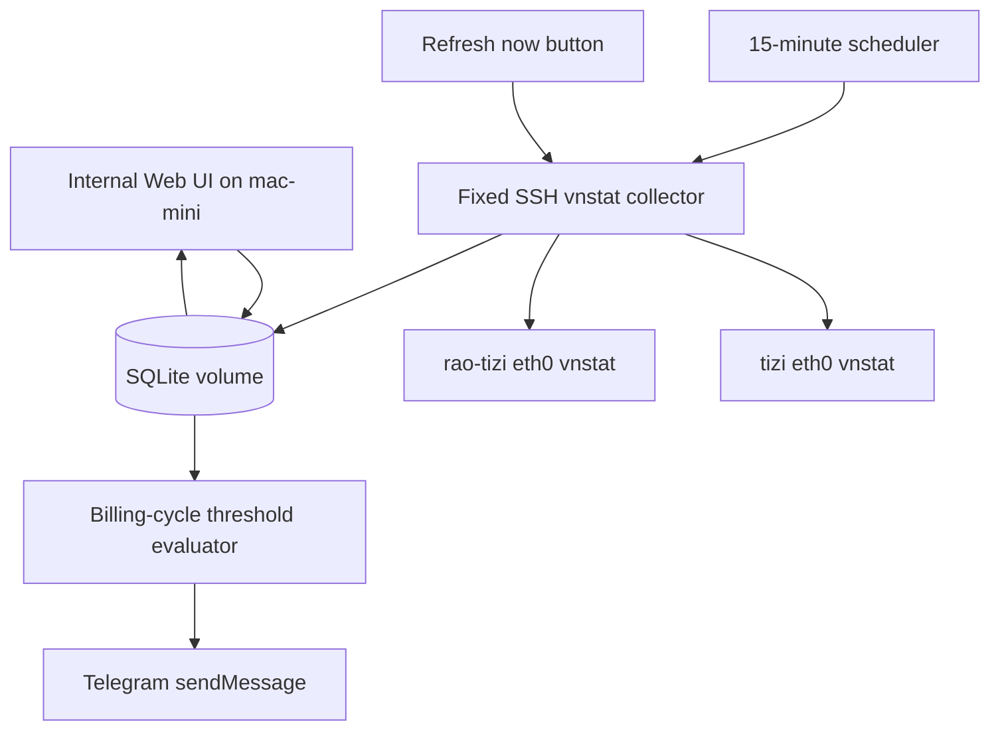

# VPS Traffic Monitor - Plan

## Goal Capsule

- **Objective:** Build a Dockerized traffic monitoring service on `mac-mini` for `tizi` and `rao-tizi`, using `vnstat` data over SSH to track VPS billing-cycle usage and notify when thresholds are crossed.
- **Product authority:** The service is a personal operations tool for keeping weak proxy VPS nodes under traffic limits without adding new always-on services to those nodes.
- **Execution profile:** Code work in a separate project, deployed as a Docker container on `mac-mini`, with local persistent storage and Telegram notification secrets kept out of the image and repository.
- **Open blockers:** Confirm the actual VPS billing reset day for each server before production use, and provide Telegram bot token / chat id through local secret configuration.

---

## Product Contract

### Summary

Build an internal Dockerized Web app on `mac-mini` that monitors `tizi` and `rao-tizi` traffic by periodically reading `vnstat` over SSH.
It calculates `eth0 rx + tx` usage by each VPS provider billing cycle, shows current-cycle and recent trend views, and sends Telegram alerts for threshold crossings or repeated collection failures.

### Problem Frame

`tizi` and `rao-tizi` are weak proxy VPS nodes where traffic overage can lead to throttling, shutdown, or emergency migration work.
Both nodes already run `vnstat`, and prior operations notes identify Telegram threshold alerts as the next monitoring step.
The earlier node-local script idea is useful, but an internal Web app on `mac-mini` gives better visibility while keeping the proxy nodes nearly unchanged.

### Key Decisions

- **Centralize on `mac-mini`.** The monitor runs as one Docker project on `mac-mini`; the VPS nodes expose no new Web service and run no new monitoring daemon beyond existing `vnstat`.
- **Use billing reset day configuration.** Each server has a manually configured monthly reset day, so usage follows the VPS provider billing cycle rather than calendar-month `vnstat -m` totals.
- **Measure `eth0 rx + tx`.** Alerts and UI totals use the same traffic accounting model as `vnstat total`, matching the likely VPS provider accounting model better than `tx` alone.
- **Keep the UI internal and low-risk.** The Web UI is for inner network / Tailscale access only, has no public login system, and exposes only a fixed refresh action.
- **Favor actual threshold alerts over prediction.** Version 1 sends notifications only when real usage crosses configured thresholds; trend prediction may be displayed later but does not page the user in v1.

### Actors

- A1. **Operator:** The user who views traffic status, receives Telegram alerts, and adjusts local configuration outside the Web UI.
- A2. **Monitor service:** The Dockerized app running on `mac-mini`.
- A3. **VPS nodes:** `tizi` and `rao-tizi`, queried over existing SSH aliases for fixed `vnstat` commands.
- A4. **Telegram chat:** The notification destination for threshold, collection failure, and recovery messages.

### Requirements

**Deployment and configuration**

- R1. The service must run as a Dockerized project on `mac-mini` with persistent local storage mounted outside the image.
- R2. The service must monitor `tizi` and `rao-tizi` through the existing SSH aliases and must not require a new agent or Web endpoint on either VPS.
- R3. Each server must have a configured billing reset day, interface name, display name, and shared threshold list.
- R4. The first version must use shared thresholds of `100 GiB`, `200 GiB`, and `300 GiB` for all monitored servers.

**Collection and accounting**

- R5. The service must collect traffic data every 15 minutes during normal operation.
- R6. Each collection must read `vnstat` data for `eth0` and calculate total usage as `rx + tx`.
- R7. Usage shown and alerted must be scoped to the current VPS billing cycle derived from that server's reset day.
- R8. The service must preserve all collected history while defaulting trend views to the most recent 90 days.

**Notifications**

- R9. When a server crosses a configured threshold within the current billing cycle, the service must send a Telegram notification once for that server, cycle, and threshold.
- R10. On first startup, if a server is already above multiple thresholds, the service must send only the highest crossed threshold and mark lower thresholds as handled.
- R11. If a server has 3 consecutive collection failures, or no successful collection for more than 45 minutes, the service must send a Telegram failure notification.
- R12. When collection recovers after a failure notification, the service should send one recovery notification.

**Web UI**

- R13. The Web UI must show one current-cycle summary per server, including used traffic, threshold progress, billing cycle range, next reset date, and last successful collection time.
- R14. The Web UI must show recent historical trends for each server, including daily usage and cumulative usage over the default 90-day window.
- R15. The Web UI may provide a single "refresh now" action that triggers the same fixed collection workflow as the scheduler.
- R16. The Web UI must not provide configuration editing, arbitrary command execution, threshold mutation, or test notification controls in v1.

**Security and operations**

- R17. SSH config and private keys, if mounted into the container, must be read-only and must not be displayed in the UI or logged in full.
- R18. Telegram token and chat id must be supplied through local secret configuration and must never be written to the repository or Docker image.
- R19. The service must store collection history, alert state, and notification history in SQLite-backed persistent storage.
- R20. Error display must be useful for operations while redacting sensitive local paths, secret values, and raw command details that could leak key material.

### Key Flows

- F1. **Scheduled traffic collection**
  - **Trigger:** The 15-minute scheduler fires.
  - **Actors:** A2, A3.
  - **Steps:** The monitor connects to each configured server over SSH, runs the fixed `vnstat` read command, parses the current traffic data, stores a snapshot, and updates billing-cycle totals.
  - **Outcome:** The UI and alert evaluator see fresh data for each reachable server.
  - **Covered by:** R2, R5, R6, R7, R8, R19.

- F2. **Threshold notification**
  - **Trigger:** A collection result puts a server over a threshold that has not been handled for the current billing cycle.
  - **Actors:** A2, A4.
  - **Steps:** The monitor records the threshold state, sends one Telegram message naming the server, billing cycle, threshold, and current usage, then suppresses repeat alerts for that same threshold.
  - **Outcome:** The operator receives a clear warning without duplicate messages.
  - **Covered by:** R4, R9, R10, R18, R19.

- F3. **Collection failure and recovery**
  - **Trigger:** A server reaches the configured failure condition, or later returns to successful collection.
  - **Actors:** A2, A4.
  - **Steps:** The monitor records failure state, sends one failure message after the threshold is met, and sends one recovery message after a successful collection resumes.
  - **Outcome:** Monitoring failures are visible even when the operator is not watching the UI.
  - **Covered by:** R11, R12, R19, R20.

- F4. **Operator status check**
  - **Trigger:** The operator opens the internal Web UI.
  - **Actors:** A1, A2.
  - **Steps:** The UI presents current-cycle cards and recent trend charts, and optionally lets the operator run the fixed refresh workflow.
  - **Outcome:** The operator can quickly judge current usage, trend direction, and data freshness.
  - **Covered by:** R13, R14, R15, R16.

### Acceptance Examples

- AE1. **Covers R7, R9.** Given `rao-tizi` has a reset day of 11, when usage crosses `100 GiB` between the 11th and the next reset date, then the alert is counted against that billing cycle rather than the calendar month.
- AE2. **Covers R10.** Given a first successful collection finds `250 GiB` already used, when alert state is empty, then the service sends only the `200 GiB` alert and marks `100 GiB` as handled for that cycle.
- AE3. **Covers R11, R12.** Given `tizi` fails collection three times in a row, when a later collection succeeds, then the service sends one failure notification and one recovery notification, not repeated failure messages every cycle.
- AE4. **Covers R15, R16.** Given the operator clicks "refresh now", when the action runs, then it performs only the fixed collection flow and cannot run arbitrary shell commands or change configuration.

### Success Criteria

- The operator can open the internal UI and understand each server's current billing-cycle usage, next reset date, latest sample freshness, and recent traffic trend in under one minute.
- A crossed threshold produces exactly one Telegram notification per server, billing cycle, and threshold.
- Repeated SSH or `vnstat` failures are noticed through Telegram without requiring the operator to poll the UI.
- The proxy VPS nodes remain operationally light: no new long-running monitoring service, no new exposed monitoring port, and no change to proxy traffic handling.

### Scope Boundaries

- No public Web exposure, login system, or HTTPS certificate management for the monitor UI in v1.
- No VPS provider panel integration or API-based billing reconciliation in v1.
- No nftables port / process traffic breakdown in v1; the monitor uses `vnstat` interface-level totals only.
- No predictive Telegram alert for projected overage in v1.
- No Web UI editing for servers, thresholds, SSH settings, Telegram settings, or notification tests in v1.
- No node-local Telegram bot service on `tizi` or `rao-tizi` in v1.

### Dependencies / Assumptions

- `tizi` and `rao-tizi` continue to have working `vnstat` data for `eth0`.
- `mac-mini` can SSH to both servers using existing aliases from the environment where the Docker container runs.
- The Docker deployment can mount the required SSH config and private keys read-only, or an equivalent read-only secret mechanism.
- The Telegram Bot API is reachable from `mac-mini`.
- Billing reset days are manually maintained and are treated as the source of truth for cycle boundaries.

### Outstanding Questions

**Resolve before deployment**

- What are the confirmed VPS billing reset days for `tizi` and `rao-tizi`?
- What local URL / port should the internal Web UI use on `mac-mini`?

**Deferred to planning**

- Which concrete Web framework and charting approach should the standalone project use?
- What exact redaction rules should be applied to SSH and command errors before they reach logs or UI?
- Should Docker deployment use a single compose file, a local env file, Docker secrets, or a combination for secret delivery?

### Sources / Research

- `docs/operations/tizi-traffic-accounting-plan-2026-06-19.md` records the original `vnstat` + Telegram alert direction and the requirement that monitoring stay near-zero overhead on the proxy VPS.
- `docs/operations/rao-tizi-traffic-accounting-plan-2026-06-19.md` mirrors the same plan for `rao-tizi` and notes that the two proxy servers can share one Telegram notification mechanism.
- `docs/operations/tizi.md` and `docs/operations/rao-tizi.md` record that `vnstat` was installed and enabled on both servers on 2026-06-19.
