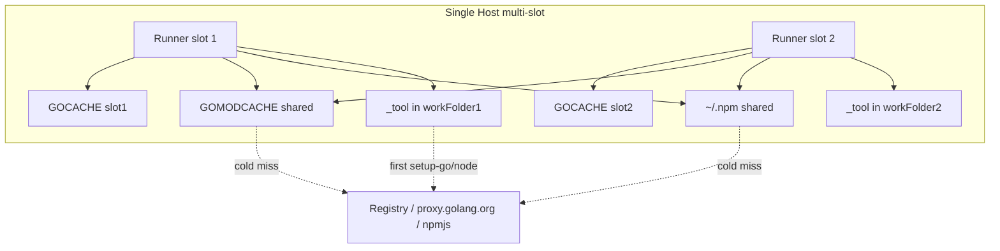

# ops: CI runner 缓存基线（减流量 / 提效 / 防 CYP-322）

## Goal Capsule

**Objective:** 统一 `backend-ci` / 前端共享池相关 self-hosted runner 的磁盘缓存策略：per-slot `GOCACHE` 防并发竞态，合理共享 `GOMODCACHE`/`npm`，清理膨胀与陈旧 tool，并沉淀 runbook；可选小改 iCare workflow 注释与 golangci 条件安装。

**Authority:** 2026-07-20 缓存审计结论 + 用户确认「全量」范围；生产/准生产机操作仍遵守 `AGENTS.md`（危险动作先确认、时间线自动记录）。

**Stop when:** 四机缓存策略与 checklist 一致；mas-go-dev go-build 回到健康水位；lemon/umac npm 明显变热或有明确预热步骤；文档已 commit；可选 workflow PR 合并或明确延期。

**Out of this goal:** 不改 Sonar/质量门逻辑；不引入 GitHub Actions remote cache；不重做 runner 注册；不迁部署机 `dev-cypresso-ci` 的 Docker 流量优化（仅文档可提及 frontend `/tmp` buildx 已知债）。

---

## Product Contract

### Summary

self-hosted 池已扩到 mac-mini / lemon-imac / umacbook-pro / mas-go-dev-ci，但 **Go 编译缓存隔离只在 mac-mini 落地**；lemon/umac/mas 多 slot 共享默认 `GOCACHE`，存在 CYP-322 同类竞态；mas-go-dev `go-build` 已膨胀到约 **125GB**；lemon/umac 的 `~/.npm` 偏冷，前端 `prefer-offline` 收益差。目标是 runner 层根治，而不是 workflow 层打开远程 cache 或关掉校验。

### Requirements

| ID | Requirement |
|----|-------------|
| R1 | 任意同一主机上 **≥2 个** 承接 Go job 的 runner slot，必须使用 **互不重叠的 `GOCACHE` 目录**。 |
| R2 | 同一主机上 **`GOMODCACHE` 默认共享一份**（减重复 `go mod download` 流量与磁盘）；若实现中发现竞态，可退回 per-slot 并记文档。 |
| R3 | `npm` 继续用 **主机级 `~/.npm`** + workflow `npm ci --prefer-offline`；**不**启用 `setup-node`/`setup-go` 的 GitHub remote cache。 |
| R4 | mas-go-dev 上 `actions-runner` 用户的 go-build 从 ~125GB **瘦身到可维护水位**（目标个位数～十几 GB 量级，或至少释放数十 GB 并建立复膨胀门槛）。 |
| R5 | mac-mini 既有 per-slot `GOCACHE` 保留；可选将 **4 份 `GOMODCACHE` 收敛为全机共享**；对过大 go-build 有修剪策略。 |
| R6 | lemon/umac 的 npm cache 对 **当前 `frontend-mas` package-lock** 预热完整：`npm ci --offline` 可装齐 899 packages。说明：npm 11 对该 lock 的完整 `_cacache` 实测约 **140–160MB**（~866 content files）；mac-mini `~/.npm` 9.5G 为历史多项目堆积，**不是**单 lock 达标尺。 |
| R7 | 清理各 slot `_tool` 中 **明确过期** 的 Go/Node 次要版本（确认当前 job 使用版本后）。 |
| R8 | `docs/runbooks/ci-runner-pools.md` 增加 **缓存基线 checklist**；各机 `docs/operations/<host>.md` 追加时间线；Server 仓 `main` commit。 |
| R9 | （可选但本计划「全量」包含）iCare-backend：条件安装 golangci-lint、更新 sonar 注释中过时的「单实例」表述。 |
| R10 | （可选）iCare-frontend-mas：不强制改多次 `npm ci` 结构；仅在文档说明 self-hosted 下重复 install 可接受、依赖热 npm cache。若改 workflow，须单独说明收益。 |

### Actors

| ID | Actor |
|----|--------|
| A1 | 运维执行者（本计划 `ce-work` / 人工）：SSH 改 runner `.env`、清缓存、重启 service |
| A2 | CI 开发者：合并可选 backend/frontend workflow PR |
| A3 | GitHub Actions jobs：消费 runner 注入的 env 与磁盘 cache |

### Key Flows

| ID | Flow |
|----|------|
| F1 | 改 `.env` → 确认无 `Runner.Worker` → 重启该 slot → 用 Listener 真实 PATH/env 验证 `GOCACHE` |
| F2 | 后端 Sonar/Lint 落到 lemon 或 umac 或 mas-go-dev-ci → 写各自 GOCACHE、读共享 GOMODCACHE → 无 race fail |
| F3 | 前端 job 落到 lemon/umac → `npm ci --prefer-offline` 主要命中 `~/.npm` |

### Acceptance Examples

| ID | Example |
|----|---------|
| AE1 | lemon-imac-1 与 lemon-imac-2 的 `.env` 中 `GOCACHE` 路径不同；两 slot 同时空闲时各触发含 `go test` 的 job 不出现 go cache 竞态类失败。 |
| AE2 | mas-go-dev `du -sh ~actions-runner/.cache/go-build`（或 per-slot 新路径合计）远低于 125GB，且磁盘 avail 明显上升。 |
| AE3 | 任意 backend-ci slot：`printenv GOCACHE`（job 内）指向该 slot 目录；`go env GOMODCACHE` 为约定共享路径。 |
| AE4 | runbook 含「贴 backend-ci 前」的 gpg **与** 缓存检查项；operations 时间线已记。 |

### Scope Boundaries

**In scope**

- Hosts: `mac-mini`, `lemon-imac`, `umacbook-pro`, `mas-go-dev`（ci-1/ci-2；部署 runner `mas-go-dev` 仅在共享 HOME 缓存策略时顺带对齐，不强制 per-slot 若单实例）
- Runner labels 池：`backend-ci`、`frontend-tests-ci`、`frontend-quality-ci`（缓存对它们生效）
- Docs: `docs/runbooks/ci-runner-pools.md`, `docs/operations/{mac-mini,lemon-imac,umacbook-pro,mas-go-dev}.md`
- Optional PRs: `cypressoai/iCare-backend`, 文档向说明可写在 Server 仓

**Out of scope / Deferred**

- 开启 GitHub Actions `actions/cache` 或 `setup-go/node` remote cache
- 改造 frontend 为「共享 node_modules 目录」（跨 job 不安全）
- frontend deploy 仍用 `/tmp` buildx（dev-cypresso 债，另开计划）
- 删除/重建 runner 注册、改 labels 池成员
- 改 Sonar 质量门阈值或 Scanner 版本 pin

### Success Criteria

- R1–R8 全部满足；R9 有 PR 或明确记录「本迭代跳过」
- 无未备份的 `.env` 覆盖；重启未打断正在运行的 `Runner.Worker`（或已征得用户同意）
- Server 仓变更已 `git commit`（`main`）

---

## Planning Contract

### Key Technical Decisions

| Decision | Choice | Rationale |
|----------|--------|-----------|
| KTD1 GOCACHE | **Per-slot 目录**，写在各 runner `.env` | 复用 mac-mini CYP-322 已验证模式；多 slot 并发写同一 go-build 会 race |
| KTD2 GOMODCACHE | **每主机共享一份**（新建如 `~/gha/cache/go-mod` 或 Linux `~actions-runner/go/pkg/mod`） | module 内容寻址，共享可减流量/磁盘；风险低于 GOCACHE |
| KTD3 npm | 保持用户 home `~/.npm` 共享；workflow 不改 prefer-offline 策略 | self-hosted 正确形态；开 remote cache 反而增 GitHub 流量 |
| KTD4 setup-go/node cache | 保持 `cache: false` / 不配置 cache | 依赖本地 tool-cache + 上述磁盘 cache |
| KTD5 mas 瘦身 | 在 **无 Worker** 时对旧共享 go-build 执行 `go clean -cache` 或迁走后重建；随后切 per-slot | 125GB 是稳定性风险；先瘦身再隔离，避免拷 125GB×2 |
| KTD6 mac-mini GOMODCACHE | **收敛为共享**（改 4 个 `.env` 指向同一路径）；GOCACHE 保持 per-slot | 省 ~4.5GB 重复 mod；改后需重启 4 slot |
| KTD7 修剪门槛 | go-build 单 slot **>20GB** 或 mas 合计 **>30GB** 触发清理（runbook） | 防止复膨胀 |
| KTD8 workflow 改动 | backend：条件装 golangci + 注释；frontend：默认 **只文档**，不强制改 job 结构 | 用户要全量，但 frontend 结构改收益/风险比低 |

### High-Level Technical Design



**Env injection (directional):**

```text
# slot N .env
LANG=...
GOCACHE=<runner-dir>/cache/go-build
GOMODCACHE=<host-shared>/go-mod
# npm: default home cache, no env required
```

**Restart rule:** 仅 idle slot；有 `Runner.Worker` 则等待或跳过该 slot 并记 follow-up。

### Assumptions

- 各机 SSH 别名 `mac-mini` / `lemon-imac` / `umacbook-pro` / `mas-go-dev` 可用；lemon/umac 用户 `for-konghai`，mas 用户 `actions-runner`（sudo -u）。
- 业务仓 workflow 继续 `cache: false`；本地 env 注入会被 setup-go 尊重（不覆盖已有 GOCACHE）。
- 共享 `GOMODCACHE` 在并发 `go mod download` 下可接受；若出现损坏再 per-slot 回退。

### Sequencing

1. **文档先写 checklist 草稿**（可与 U1 并行）→ 执行中以实测为准更新  
2. **mas-go-dev 先瘦身再隔离**（避免复制巨石缓存）  
3. **lemon → umac → mac-mini GOMOD 收敛**（可并行，但每机串行 slot）  
4. **npm 预热**（可在隔离完成后）  
5. **tool 清理**（低风险，可靠后）  
6. **可选 iCare-backend PR**  
7. **时间线 + Server commit**

### Risks & Mitigations

| Risk | Mitigation |
|------|------------|
| 重启打断进行中 job | 查 Worker / `busy`；只重启 idle；必要时用户确认 |
| 共享 GOMODCACHE 损坏 | 备份路径记录；回退 per-slot；`go clean -modcache` 重建 |
| go clean 后冷启动变慢 | 可接受一次性；后续 job 回填 |
| 8GB 机磁盘 | lemon/umac 盘尚可；避免 per-slot 复制 14GB go-build——**新建空 GOCACHE**，勿 `cp -a` 旧缓存 |
| mas 磁盘在清理前又被写满 | 优先 U1；清理窗口内尽量暂停重 backend job |

### Alternatives Considered

| Approach | Why not chosen |
|----------|----------------|
| 全开 GitHub Actions cache | 增加上传/下载 GitHub 流量，与「减公网」目标相反 |
| 全部共享 GOCACHE（含 mac） | 已知 CYP-322 race |
| 全部 per-slot GOMODCACHE | 磁盘与流量浪费；mac 已证明可隔离但非最优 |
| 不碰 mas 125GB，只加隔离 | 巨石仍占盘；新 GOCACHE 若从空开始即可，但旧目录仍占 125G 必须处理 |

---

## Implementation Units

### U1. mas-go-dev：瘦身 go-build + per-slot GOCACHE

**Goal:** 消除 ~125GB 共享 go-build 风险，并为 ci-1/ci-2 建立独立 GOCACHE。

**Requirements:** R1, R2, R4

**Dependencies:** none（优先）

**Files:**

- 主机：`/opt/actions-runner/mas-go-dev-ci-1/.env`、`mas-go-dev-ci-2/.env`（及可选 `mas-go-dev/.env`）
- 新建目录：如 `/opt/actions-runner/mas-go-dev-ci-N/cache/go-build`；共享 `GOMODCACHE` 可用 `/home/actions-runner/go/pkg/mod`
- 文档：`docs/operations/mas-go-dev.md`

**Approach:**

1. 只读确认磁盘、当前 `du`、有无 Worker。  
2. 备份两份 `.env`。  
3. 对 **旧** `~/.cache/go-build`：在无 backend Go job 时 `sudo -u actions-runner bash -lc 'go clean -cache'`（或移走目录后重建空目录）。**不要**把 125GB 拷进 per-slot。  
4. 写 per-slot `GOCACHE`；`GOMODCACHE` 指向共享 mod 路径。  
5. idle 时重启 ci-1/ci-2 service。  
6. 验证 job env 或 Listener 启动后目录写入。

**Execution note:** Prefer smoke verification on the host (du + sample job) over unit tests.

**Patterns to follow:** mac-mini per-slot GOCACHE；mas dirmngr/gpg 基线变更流程（备份 → 改 → 重启 → 验证 → 时间线）。

**Test scenarios:**

- Happy: 清理后 go-build 体积显著下降；两 slot GOCACHE 路径不同且目录存在。  
- Edge: 清理时有 Worker → 中止清理并记录，不强制 kill。  
- Failure: service 起不来 → 还原 `.env.bak` 并重启。

**Verification:** AE2 + AE3 on mas-go-dev-ci；operations 时间线已写。

---

### U2. lemon-imac：per-slot GOCACHE + 共享 GOMODCACHE

**Goal:** 与 mac-mini 策略对齐，消除双 slot 共享默认 go-build。

**Requirements:** R1, R2

**Dependencies:** none（可与 U1 并行，建议 U1 后）

**Files:**

- `~/actions-runner/lemon-imac-{1,2}/.env`
- 新建 `~/actions-runner/lemon-imac-{1,2}/cache/go-build`
- 新建共享 `~/gha/cache/go-mod`（或等价短路径）
- `docs/operations/lemon-imac.md`

**Approach:**

1. 备份 `.env`。  
2. **不要**复制现有 14GB `~/Library/Caches/go-build` 到新路径——新 GOCACHE 从空开始（冷一次即可）。  
3. 共享 GOMODCACHE：可将现有 `~/go/pkg/mod` 作为共享目标（已有 1.4G），或迁到 `~/gha/cache/go-mod`。  
4. 两 slot idle 则重启。  
5. 验证。

**Patterns to follow:** U1；mac-mini `.env` 形状。

**Test scenarios:**

- Happy: 两 slot `GOCACHE` 不同、`GOMODCACHE` 相同。  
- Edge: 一 slot busy → 只改 idle，busy 记 follow-up。

**Verification:** AE1, AE3；时间线。

---

### U3. umacbook-pro：与 lemon 同构的 GOCACHE / GOMODCACHE

**Goal:** 与 U2 相同策略落到 umacbook-pro-1/2。

**Requirements:** R1, R2

**Dependencies:** U2 可作为模板（模式复用）

**Files:**

- `~/actions-runner/umacbook-pro-{1,2}/.env`
- cache 目录；`docs/operations/umacbook-pro.md`

**Approach:** 复制 U2 步骤；注意合盖机可能掉线，改完确认 Listener online。

**Test scenarios:** 同 U2。

**Verification:** AE3；GitHub runner API online。

---

### U4. mac-mini：GOMODCACHE 收敛共享 + go-build 修剪策略落地

**Goal:** 保留 per-slot GOCACHE；四份 GOMOD 合一；对过大 go-build 修剪并文档化门槛。

**Requirements:** R1, R2, R5, R7（tool 可选本单元或 U6）

**Dependencies:** U1–U3 非硬依赖；可并行但建议在双 8GB 机完成后再动主力机

**Files:**

- `~/actions-runner/mac-mini-sonar-{1..4}/.env`
- 共享目录如 `~/gha/cache/go-mod`（可 rsync 一份现有 go-mod 后切换）
- `docs/operations/mac-mini.md`

**Approach:**

1. 选一份最完整的 slot `cache/go-mod` 作为共享源，或沿用 `~/go/pkg/mod`。  
2. 四 slot `.env` 的 `GOMODCACHE` 改同一路径；`GOCACHE` 不变。  
3. 逐个 idle 重启（或等全 idle）。  
4. 对 go-build >20GB 的 slot：`GOCACHE=<path> go clean -cache`（用该环境）或按文件年龄修剪——**执行前确认无 Worker**。  
5. 可选删除 login 用户闲置 `~/Library/Caches/go-build`（runner 不用的死缓存）。

**Test scenarios:**

- Happy: 四 slot `go env GOMODCACHE` 相同、GOCACHE 各异。  
- Edge: 共享 mod 首次并发 download 成功。  
- 体积: 至少一个曾 >20GB 的 slot 修剪后下降。

**Verification:** R5；时间线。

---

### U5. lemon / umac npm 预热

**Goal:** 提高前端 job `prefer-offline` 命中率，减少 registry 流量。

**Requirements:** R3, R6

**Dependencies:** U2, U3（非强；可并行）

**Files:** 主机 `~/.npm`；可选临时 clone 路径；`docs/operations/lemon-imac.md` / `umacbook-pro.md`

**Approach:**

1. 在 lemon 与 umac 上，用与 CI 一致的 Node（setup-node 缓存的 24.x 或 brew node 24）对 `frontend-mas` 的 `package-lock.json` 执行一次 `npm ci --prefer-offline`（临时目录即可，目的是填 `_cacache`）。  
2. 或触发一次真实 frontend-tests job 后测量 `du -sh ~/.npm`。  
3. 记录预热后体积。

**Execution note:** Prefer runtime smoke (`du` + 一次 npm ci 日志) over unit tests.

**Test scenarios:**

- Happy: 预热后对当前 package-lock 执行 `npm ci --offline` 成功（完整 cacache）。  
- Note: npm 11 下该 lock 完整体积约 140–160MB，不以 GB 为尺（见 R6 修订）。  
- Failure: 无网络/锁文件变更 → 记录失败不阻断其他单元。

**Verification:** R6 / G4（offline 装齐）。

---

### U6. 清理陈旧 tool 版本（四机）

**Goal:** 删除确认无用的旧 `go`/`node` tool-cache 版本，回收磁盘。

**Requirements:** R7

**Dependencies:** U1–U4 完成后更安全（版本已稳定）

**Files:** 各 slot `workFolder/_tool/go/*`、`_tool/node/*`

**Approach:**

1. 列出每 slot `_tool/go` / `_tool/node` 版本。  
2. 对照当前 `go.mod`（1.25.7）与 frontend `node-version: 24`。  
3. 删除明确多余版本（如 go 1.25.0、node 22.x）；保留 24.x 与 1.25.7。  
4. 不删 sonar-scanner-cli 现行版本。

**Test scenarios:**

- Happy: 下一 job 的 setup-go/node 仍 cache hit。  
- Failure: 误删导致重下 → 可接受一次性网络，记时间线。

**Verification:** 列表干净；抽样 job tool cache hit。

---

### U7. iCare-backend workflow 小优化（可选全量）

**Goal:** Lint 步跳过已安装的同版本 golangci-lint；注释与缓存现实一致。

**Requirements:** R9

**Dependencies:** U1–U4 推荐先完成（注释描述才真实）

**Files:**

- 目标仓 `iCare-backend`：`.github/workflows/sonar.yml`、`.github/workflows/deploy.yml`（及 ecom/sup 若同样 `go install`）

**Approach:**

1. 分支自 `develop`。  
2. Install 步骤：检测 `golangci-lint version` 是否匹配 pin 版本，匹配则 skip install。  
3. 更新 GOCACHE 注释：列出四机策略，删除「仅 mas-go-dev-ci-1 单实例」。  
4. PR → CI 绿 → merge（用户曾授权合并类 PR 时可直接合）。

**Patterns to follow:** 现有 Conventional Commits / PR 习惯。

**Test scenarios:**

- Happy: Lint job 日志显示 skip 或 install 一次后二次命中。  
- Regression: 版本 bump 后仍会 install。

**Verification:** PR CI 通过。

**Test expectation:** CI 即验证；无新增单元测试文件。

---

### U8. Runbook + 全机时间线 + Server commit

**Goal:** 制度化检查清单，防止下次扩池再漏缓存基线。

**Requirements:** R8, R10 文档部分

**Dependencies:** U1–U6 的结果数据（体积、路径）写入文档

**Files:**

- `docs/runbooks/ci-runner-pools.md`（缓存 checklist 段）
- `docs/operations/mac-mini.md`、`lemon-imac.md`、`umacbook-pro.md`、`mas-go-dev.md`
- 本计划可更新状态注记（可选）

**Approach:**

1. runbook 增加「缓存基线」表：GOCACHE per-slot、GOMODCACHE shared、npm shared、修剪门槛、验证命令。  
2. 与已有 gpg checklist 并列（贴 `backend-ci` 前两者都要）。  
3. 各机时间线倒序追加。  
4. `main` 上中文 Conventional Commit。

**Test scenarios:**

- Test expectation: none -- documentation only; verify via review that paths match live hosts.

**Verification:** git commit 存在；路径与 U1–U4 实测一致。

---

## Verification Contract

| Gate | Outcome |
|------|---------|
| G1 隔离 | 每 multi-slot 主机：slot 间 GOCACHE 路径不同 |
| G2 共享 | 同主机 GOMODCACHE 路径一致（mac 收敛后） |
| G3 磁盘 | mas go-build 不再处于 ~125GB 级 |
| G4 流量代理指标 | lemon/umac `npm ci --offline` 对 frontend-mas lock 成功（完整 cacache）；CI 可用 `--prefer-offline` |
| G5 文档 | runbook + 4 机 operations + commit |
| G6 CI | 抽样 backend Sonar/Lint 与 frontend shard 成功（可自然触发或 workflow_dispatch） |

**Do not** use GitHub Actions cache hit rate as success metric.

---

## Definition of Done

- [x] U1–U6 完成或明确跳过原因写入计划/时间线  
- [x] U8 完成（文档与 commit 强制）  
- [x] U7 完成或「跳过」有记录（PR #1094 merged）  
- [x] G1–G5 满足；G6 至少有一轮成功抽样（run 29739587770 Lint@ci-1 Sonar@ci-2）  
- [x] 无未还原的失败中断状态（service online、`.env` 有效）  

**执行完成注记（2026-07-20）：**  
U1–U4/U8 主机与文档已落地；U5 以 offline `npm ci` 证明 lock 完整缓存（lemon ~143M / umac ~149M，见 R6 修订）；U6 已清 mas-go-dev 部署 runner `_tool/go/1.25.0` 与 ci 上旧版本；U7 = iCare-backend#1094。

---

## System-Wide Impact

| Party | Impact |
|-------|--------|
| CI 时长 | 首次冷 GOCACHE 可能变慢；稳态应持平或更快且更稳 |
| 磁盘 | mas 明显释放；mac 共享 mod 略降；lemon/umac npm 上升 |
| 网络 | 长期减少重复 go mod / 冷 npm；setup-go/node 仍 per-slot 首次下载 |
| 开发者 | 减少 flaky go cache race；无需改日常开发习惯 |

---

## Open Questions

| ID | Question | Blocking? |
|----|----------|-----------|
| Q1 | U7 backend PR 是否在本迭代必须 merge？ | 否 — 默认可做；用户可裁掉 |
| Q2 | frontend workflow 是否另开「减少重复 npm ci」专题？ | 否 — 默认不做结构改造 |

---

## Sources & Research

- Session audit 2026-07-20: four-host `du` / `.env` / `_tool` / workflow grep  
- `docs/plans/2026-05-14-008-refactor-mac-mini-sonar-runner-gocache-per-slot-plan.md`（iCare 侧历史，CYP-322）  
- `docs/solutions/mac-mini/.../sonarqube-scanner-cli-cache-never-hits-...`（runner PATH / 短 workFolder）  
- `docs/runbooks/ci-runner-pools.md`（池成员与 gpg checklist）  
- External research: skipped — strong local ops patterns; no new ecosystem library choice  

**Product Contract preservation:** N/A (ce-plan-bootstrap); scope fixed by user answer「全量（推荐）」.
