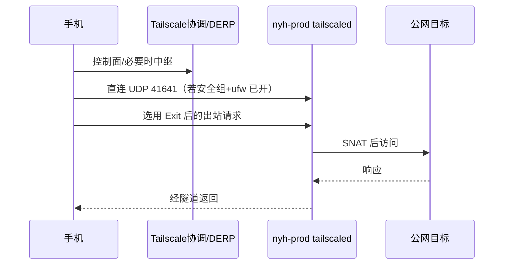

# nyh-prod Tailscale Exit Node 部署 - Plan

## Goal Capsule

在生产机 `nyh-prod`（香港阿里云，公网 `47.239.167.8`）**宿主机**安装 Tailscale，宣告 **Exit Node**，使个人手机经 Tailnet 出网时源 IP 固定为该机公网 IP，供需该出口的 App 稳定使用。

| 项 | 内容 |
| --- | --- |
| 权威 | 本 plan 的 R/KTD/U；生产纪律见 `AGENTS.md`；运维记录写 `docs/operations/nyh-prod.md` |
| 成功 | 手机启用 Exit 后公网 IP = `nyh-prod`；业务 80/443/SSH/Docker 无感；可秒停回滚 |
| 失败即停 | 装完后默认路由偏离 `eth0`、业务 HTTPS 异常、DNS/`resolv.conf` 被 MagicDNS 改坏且无法立即回滚 |
| 非目标 | 不做 tizi 分流节点；不装 3x-ui（仅当 Exit 不稳定时的后续备选）；不改 Nginx 443 |

**执行画像：** 运维变更（SSH + 阿里云安全组 + 可选 ufw）；需用户确认后再改防火墙/装包。落盘后执行方按 U 顺序做，每步验收。

---

## Product Contract

### Summary

单人、极小流量，需要 **出口 IP = `nyh-prod`**。已否决「Nginx 反代 443 + 3x-ui」与「生产机抢 443 REALITY」；优先 **Tailscale Exit Node**。不稳定再评估独立端口 3x-ui。

### Problem Frame

- 目标 App 要求稳定走香港该机 IP；流量极小、仅本人。
- `nyh-prod` 同时跑宝塔 Nginx、多业务 Docker；任何改默认路由/DNS/抢 443 的方案成本过高。
- 现网无 Tailscale（`tailscale` 未装）；`ip_forward=1` 已开（Docker）；`ufw` active。

### Requirements

#### 出口与身份

- R1. 手机经本方案出网时，公网源 IP 必须为 `nyh-prod` 当前公网 IPv4（装前只读基线为 `47.239.167.8`，以装后 `curl` 实测为准）。
- R2. 仅操作者本人（其 Tailscale 身份/设备）可使用该 Exit；不得对整个 tailnet 默认开放。
- R3. 本方案**不**纳入 `tizi-*` 代理分流体系；无订阅、无公开分享链接。

#### 生产安全

- R4. 不得占用或改写业务 `80`/`443`/`22` 及现有 Docker 已映射端口的监听职责。
- R5. 服务器侧 **不接受** MagicDNS 改写本机解析（`--accept-dns=false`）。
- R6. 服务器侧 **不接受** 其他节点宣告的子网路由（`--accept-routes=false`）。
- R7. `nyh-prod` 自身不得选用其他 Exit Node 作为上网路径。
- R8. 任意时刻可通过停止/禁用 Exit 或停 `tailscaled` 回滚，业务站在回滚后与装前等价可达。

#### 连通与暴露面

- R9. 阿里云安全组入站放行 **UDP 41641**（来源用户已选 `0.0.0.0/0`）；本机 `ufw` 同步放行同一端口（当前 ufw active）。
- R10. 优先争取 peer 直连（`direct`）；允许短暂 DERP，但稳定性验收须记录路径类型。
- R11. 不稳定且无法在合理调参后满足 R1 日常使用时，**延期**评估 3x-ui 冷门端口方案（不在本 plan 实施范围）。

### Actors

- A1. 操作者：本机 SSH `nyh-prod`、阿里云控制台、Tailscale Admin、手机 Tailscale App。
- A2. 生产业务：Nginx/宝塔站点与 Docker 服务（被动：不得被本次变更打断）。

### Key Flows

- F1. 安装与宣告：装 `tailscaled` → 登录 tailnet → advertise exit → 控制台 Approve → ACL 收紧。
- F2. 手机使用：登录同一 tailnet → 选择 `nyh-prod` 为 Exit → 查 IP / 开目标 App。
- F3. 回滚：取消 Exit 使用 → 服务器取消 advertise 或 `systemctl stop tailscaled` → 复验业务 443。

### Acceptance Examples

- AE1. Covers R1. 手机开 Exit 后访问 `https://ifconfig.me`（或等价）显示与 `nyh-prod` 公网 IP 一致。
- AE2. Covers R4/R8. 开 Exit 前后，代表性生产 HTTPS 域名仍 200 且证书正常；`docker stop` 级操作不需要——仅 `stop tailscaled` 后业务仍正常。
- AE3. Covers R5. 装后 `/etc/resolv.conf`（或 resolvectl）未指向 `100.100.100.100` 为唯一上游；业务域名解析仍可用。
- AE4. Covers R10. `tailscale status` 在手机在线时对 exit 节点尽量显示 `direct`；若仅为 `relay`，记入 operations 并进入稳定性观察窗。

### Success Criteria

1. Exit 可用且 R1 满足。
2. 生产业务验收通过（R4、AE2）。
3. 文档：`docs/operations/nyh-prod.md` 追加时间线；本 plan 保持为决策源。
4. 回滚演练至少做一次（停服务或取消 advertise）并记录。

### Scope Boundaries

**In scope**

- 宿主机安装 Tailscale、Exit Node、安全组/ufw UDP 41641、ACL/Approve、手机验收、运维文档与 commit。

**Out of scope**

- 3x-ui / REALITY / Nginx 反代代理。
- Docker 内跑 Tailscale。
- 把 `nyh-prod` 做成 subnet router 或宣告内网网段。
- 为团队其他人默认开放该 Exit。
- 修改业务站点、证书、宝塔面板端口。

**Deferred to follow-up**

- Exit 长期不稳 → 新开 plan：`3x-ui` 冷门端口 + 可选 REALITY。
- 若 tailnet 尚无 ACL 模板 → 实施时按最小权限写一条 exit 策略（见 KTD3）。

### Dependencies

- 操作者阿里云账号可改安全组（用户自报：将开 UDP 41641 / `0.0.0.0/0`）。
- 操作者 Tailscale 账号可登录 Admin、Approve exit、改 ACL。
- SSH `nyh-prod` 可用；生产维护窗口由操作者口头确认（低风险但仍按生产纪律）。

---

## Planning Contract

### Key Technical Decisions

- KTD1. **Exit Node 装在宿主机，不进 Docker。**  
  (session-settled: user-directed — chosen over Docker Tailscale: Exit 需转发/NAT，宿主机路径更简单、与现网 tizi 族习惯一致。)

- KTD2. **先 Tailscale Exit；不稳再 3x-ui。**  
  (session-settled: user-directed — chosen over 先上 3x-ui 或 443 反代: 少开代理业务端口、不碰 Nginx 443。)

- KTD3. **服务器 `tailscale up` 固定：`--advertise-exit-node --accept-dns=false --accept-routes=false`，hostname 建议 `nyh-prod`。**  
  防止 MagicDNS/外来路由干扰生产解析与默认路径。

- KTD4. **公网入站仅新增 UDP 41641（阿里云 SG + 本机 ufw）；控制面/DERP 依赖已有出站 443。**  
  不开则可能仅 DERP，Exit 体验变差；用户已同意 SG 来源 `0.0.0.0/0`。

- KTD5. **本机防火墙以 ufw 为准同步 41641/udp；不引入 firewalld。**  
  只读基线：`ufw Status: active`；改前 `ufw status numbered` 备份到对话或 `/root/backup/`。

- KTD6. **ACL：仅操作者身份/设备可 `autogroup:internet` via 该 exit；禁止 `* → 该 exit`。**  
  具体语法在实施时按当前 tailnet policy 版本书写；原则是最小权限。

- KTD7. **不在 `nyh-prod` 上启用「使用 Exit」；不宣告 subnet routes。**  
  服务器只做出口提供者，不做客户端拐弯。

### High-Level Technical Design

```text
[手机 Tailscale App]
        |  WireGuard (优先 UDP :41641 direct；否则 DERP/443)
        v
[nyh-prod tailscaled]  tailscale0 (100.x)
        |  ip_forward + SNAT/MASQUERADE (Exit)
        v
[eth0 → 阿里云公网 47.239.167.8…]
        |
        v
     互联网（源 IP = nyh-prod）

并行不变:
  公网客户端 → :80/:443 nginx / 业务 Docker（默认路由仍 eth0）
```



### Assumptions

- 手机与 `nyh-prod` 使用同一 tailnet（或已邀请的共享 tailnet）。
- 阿里云「防火墙/安全组」用户侧在实施前或实施同步完成；本 plan 实施含核验，不含代登阿里云控制台（除非另授）。
- 单人极小流量不触发云厂商滥用阈值的合理预期；仍禁止把 Exit 分享给他人。
- 大陆网络下 Tailscale 可能抖；验收设「观察窗」而非一次成功即永久结案。

### Implementation Constraints（生产纪律）

- 危险动作（改 ufw、装包、启用 exit、重启网络相关服务）**须用户确认后**再执行（`AGENTS.md`）。
- 改 ufw 前备份规则摘要；装包后先验收业务再 Approve exit 也可，但顺序推荐：SG/ufw → 安装登录 → 业务基线 → advertise → Approve → 手机测。
- 密钥、auth key、Admin 截图不入库；`docs/operations/nyh-prod.md` 不写私钥。
- 工作区变更在 `main` 提交中文说明（本仓库约定）。

### Sequencing

1. U1 基线与防火墙  
2. U2 安装登录与安全参数  
3. U3 Exit 批准与 ACL  
4. U4 手机验收与稳定性观察  
5. U5 文档与回滚记录  

U4 失败且无法改善 → 停 Exit，另开 3x-ui plan（R11）。

### Alternatives Considered

| 方案 | 未选原因 |
| --- | --- |
| Nginx 反代 443 + 3x-ui WS | 协议/配置复杂，碰生产 vhost |
| 3x-ui 独立端口 REALITY 优先 | 公网多一业务端口；作 **备选** 保留 |
| Docker 内 Tailscale Exit | NAT/权限复杂，生产收益低 |
| stream SNI + REALITY 占 443 | 整机 443 架构改造，风险过高 |

### Sources & Research

- 会话内只读：`nyh-prod` Debian 13、无 tailscale、ufw active、`ip_forward=1`、公网 `47.239.167.8`。
- Tailscale：默认 WireGuard **UDP 41641**；Exit Node；服务器建议 `--accept-dns=false`。
- 仓内对照：`docs/solutions/pve/best-practices/pve-tailscale-subnet-router-2026-05-16.md`（subnet router，**非** exit；仅参考转发/sysctl 意识）。
- 代理纪律对照：`docs/runbooks/proxy-node-reinstall-upgrade.md`（面板仅 TS 等；本方案无 3x-ui）。

---

## Implementation Units

### U1. 基线快照与入站 UDP 41641

**Goal:** 留下可回滚对照；阿里云 SG + 本机 ufw 放行 Tailscale 直连端口。

**Requirements:** R9, R4, R8  

**Dependencies:** 无  

**Files:**

- 修改（远端，非 git）：阿里云安全组；`ufw` 规则  
- 记录：`docs/operations/nyh-prod.md`（可在 U5 合并写，但 U1 结束应有笔记素材）

**Approach:**

1. 只读采集：`ss -tlnp`、`ip route`、`ip route get 1.1.1.1`、`ufw status numbered`、`sysctl net.ipv4.ip_forward`、`curl -4 ifconfig.me`、代表性业务 HTTPS 探活。
2. 确认用户侧阿里云入站 **UDP 41641 / 0.0.0.0/0** 已生效（安全组命中网卡/实例）。
3. **经用户确认后**：`ufw allow 41641/udp`（comment 标明 Tailscale），`ufw status` 复核；**不**改默认 policy、不关 ufw。
4. 备份：将 `ufw status numbered` 全文贴会话或写入服务器 `/root/backup/ufw-status-YYYYMMDD.txt`（权限 600）。

**Execution note:** 先只读基线，再动 ufw；阿里云侧以用户操作为主，实施者核验。

**Test scenarios:**

- 装 Tailscale 前：`ss -ulnp` 尚无 41641 属正常。
- ufw 列表出现 `41641/udp ALLOW`。
- 业务 HTTPS 探活与装前一致（本单元不装 TS，应完全无差异）。

**Verification:** 基线数字可复述；SG+ufw 双开 41641/udp；业务无变化。

---

### U2. 宿主机安装 tailscaled 并安全登录

**Goal:** 节点在线加入 tailnet，固定安全参数，**尚未**依赖 Approve 的 exit 流量。

**Requirements:** R4, R5, R6, R7  

**Dependencies:** U1  

**Files:**

- 远端：官方 Debian 安装方式安装 `tailscale`；systemd `tailscaled`
- 不入库：auth key / 登录 URL

**Approach:**

1. 官方安装脚本或 Debian 文档方式安装（与现网其他节点一致优先）。
2. `tailscale up` 使用 KTD3 参数；hostname `nyh-prod`（若 tailnet 重名则加后缀如 `nyh-prod-exit`，并在 operations 写明）。
3. 登录成功后：`tailscale ip -4`、`tailscale status`；`ss -ulnp | grep 41641`（或实际 port）。
4. 立刻验收：`ip route get 1.1.1.1` 仍出 `eth0`；`resolvectl status` 或 `resolv.conf` 无异常；业务 HTTPS；Docker `ps` 无异常重启风暴。
5. **暂不**在未做业务验收时 Approve exit 也可——advertise 可先带上，但控制台 Approve 放 U3。

**Test scenarios:**

- `systemctl is-active tailscaled` → active。
- 节点 Online；存在 `100.x` 地址。
- 默认路由与装前一致；AE3 满足。
- 从已有 tailnet 设备 `tailscale ping nyh-prod` 可达（允许先 relay）。

**Verification:** 节点在线且生产无回归；参数三件套已落实。

---

### U3. 批准 Exit Node 与最小 ACL

**Goal:** 控制台批准 exit；仅操作者可用该出口。

**Requirements:** R2, R1（能力就绪）, KTD6  

**Dependencies:** U2  

**Files:**

- Tailscale Admin（policy / exit approval）— 非 git
- 可选：仓内不存 ACL 全文若含敏感身份；operations 只写原则与「已收紧」

**Approach:**

1. Admin → 批准 `nyh-prod` 的 **Use as exit node**。
2. ACL：限制可使用该 exit 访问 `autogroup:internet` 的 src 为操作者；拒绝默认全员。
3. 服务器确认仍 `--accept-dns=false --accept-routes=false`；`tailscale status` 显示 offers exit node。
4. 不在服务器上 `tailscale set --exit-node=...`。

**Test scenarios:**

- 非授权测试账号（若有）无法选用该 exit；仅操作者设备可选。
- 服务器 `tailscale status` 无「正在使用某 exit」。

**Verification:** Approve 完成；ACL 最小权限；服务器自身不走 exit。

---

### U4. 手机启用 Exit 与稳定性观察

**Goal:** 证明 R1；记录 direct/relay；决定是否保持或回退。

**Requirements:** R1, R10, R11, AE1, AE4  

**Dependencies:** U3  

**Files:**

- 手机 Tailscale 客户端配置（非 git）
- `docs/operations/nyh-prod.md`（观察结论）

**Approach:**

1. 手机登录同一 tailnet → Exit Node 选 `nyh-prod`。
2. 查公网 IP；打开目标 App 做真实使用。
3. 两端记录：`tailscale status` 是否 `direct ...:41641` 或 `relay`。
4. 观察窗建议：至少一次「跨网络」（如 Wi-Fi / 蜂窝）与常用时段抽样；记录是否掉线、是否被迫 DERP。
5. 若持续不稳：关闭手机 Exit → 服务器 `tailscale set --advertise-exit-node=false` 或停服务 → 启动 **后续 3x-ui plan**（本 plan 不实施）。

**Test scenarios:**

- AE1 通过。
- 关闭手机 Exit 后，手机公网 IP 恢复运营商/当前网络。
- 开关 Exit 不影响服务器业务 443（AE2 再测）。

**Verification:** 操作者确认 App 可用；operations 写明路径类型与观察结论。

---

### U5. 运维文档、回滚演练与仓库提交

**Goal:** 可复盘、可回滚；笔记进 git。

**Requirements:** R8, 仓库约定  

**Dependencies:** U4（或 U4 失败后的安全回滚状态）  

**Files:**

- 修改：`docs/operations/nyh-prod.md`（时间倒序新条目）
- 本 plan 保持 implementation-ready，不写执行 checkbox 进度
- 可选：`CONCEPTS.md` 增补 Exit Node 词条（若实施中术语需对齐）

**Approach:**

1. 时间线条目：原因、影响、备份、回滚命令、变更时序、验证、后续（3x-ui 触发条件）。
2. 回滚演练一次并记录结果：  
   - 手机取消 Exit；和/或  
   - `tailscale set --advertise-exit-node=false`；和/或  
   - `systemctl stop tailscaled`  
   复验业务后按需恢复。
3. `main` 上中文 commit（如 `docs: 记录 nyh-prod Tailscale Exit Node 部署计划/结果`）。

**Test scenarios:**

- Test expectation: none for automated tests — 运维文档人工审阅；`git status` 干净于预期文件。

**Verification:** operations 条目完整；回滚命令可复制；commit 完成。

---

## Verification Contract

| 门禁 | 做法 |
| --- | --- |
| 业务无回归 | 装前/装后/回滚后：代表性 HTTPS、SSH、`docker ps` |
| 路由未劫持 | `ip route get 1.1.1.1` 出 `eth0`；服务器未设置 exit-node |
| DNS 未劫持 | 无强制 MagicDNS 唯一上游（R5/AE3） |
| Exit 功能 | 手机开 Exit → 公网 IP = nyh-prod（AE1） |
| 暴露面 | `ss -ulnp` 见 tailscaled/41641；无新增公网 TCP 代理端口 |
| 权限 | 仅操作者可用 exit（ACL） |
| 文档 | `docs/operations/nyh-prod.md` 已写 |

本仓库无应用单测；**不**要求 `release:validate`。质量门 = 上表 + 生产纪律。

---

## Definition of Done

- [ ] U1–U5 完成（或 U4 失败时已安全回滚并文档化「改走 3x-ui」决策）
- [ ] R1–R10 满足；R11 仅在失败路径触发
- [ ] AE1–AE4 有记录
- [ ] 无遗留实验性 iptables 手工规则未说明
- [ ] `docs/operations/nyh-prod.md` 已提交 `main`

---

## Risks & Dependencies

| 风险 | 缓解 |
| --- | --- |
| 大陆访问 Tailscale 不稳 / 长期 DERP | 观察窗；失败则 3x-ui 备选（R11/KTD2） |
| ufw/SG 只开一侧导致无直连 | U1 双检；status 看 direct vs relay |
| MagicDNS/accept-routes 误开 | KTD3 强制 false；U2 验收 resolv |
| Exit 被 tailnet 他人滥用 | KTD6 ACL；禁止分享 |
| 生产 IP 出口行为被投诉 | 单人小流量；可秒停 tailscaled |
| Docker 与 tailscaled iptables 交互 | 装后查容器与转发；异常即停 TS |

---

## Operational / Rollout Notes

**建议命令方向（非强制一字不差；实施时以官方 Debian 文档为准）：**

```bash
# U1 只读
ssh nyh-prod 'ufw status numbered; ip route get 1.1.1.1; curl -4 -s ifconfig.me; sysctl net.ipv4.ip_forward'

# U1 ufw（需确认后）
# ufw allow 41641/udp comment 'Tailscale'
# ufw status

# U2 安装后
# tailscale up --advertise-exit-node --accept-dns=false --accept-routes=false --hostname=nyh-prod

# 回滚
# tailscale set --advertise-exit-node=false
# systemctl stop tailscaled
```

**阿里云：** 入站 UDP 41641，来源 `0.0.0.0/0`（用户执行）；绑定到 `nyh-prod` 实例所在安全组。

**手机：** iOS/Android Tailscale 官方客户端 → Exit Node → `nyh-prod`。

---

## Open Questions

| ID | 问题 | 阻塞？ | 默认 |
| --- | --- | --- | --- |
| Q1 | 手机平台 iOS 还是 Android？（影响客户端点击路径文案） | 否 | 两套都写原则即可 |
| Q2 | tailnet 是否已有其他 exit？hostname 是否冲突？ | 否 | 冲突则 `nyh-prod-exit` |
| Q3 | 是否使用可复用 auth key 免交互登录？ | 否 | 首次 URL 登录亦可 |

---

## Appendix：回滚速查

```text
1. 手机：Exit Node → Off
2. 服务器：tailscale set --advertise-exit-node=false
3. 强回滚：systemctl stop tailscaled  （或 disable --now）
4. 防火墙（可选）：ufw delete allow 41641/udp
5. 验收：业务 HTTPS + SSH + docker ps
```
