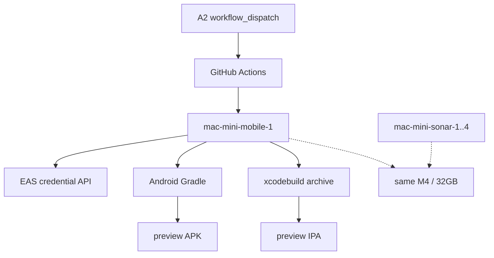
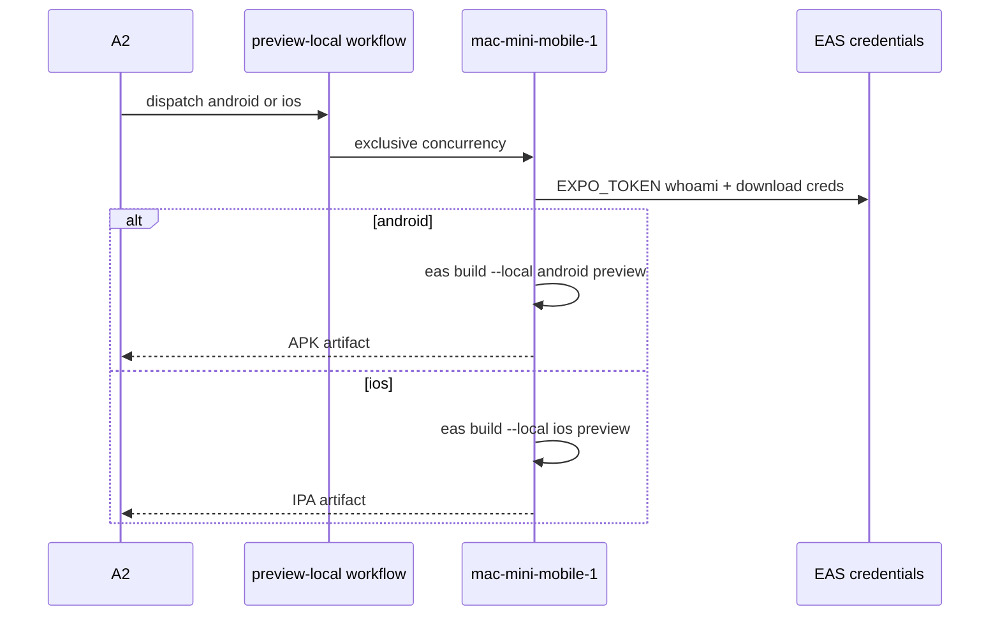
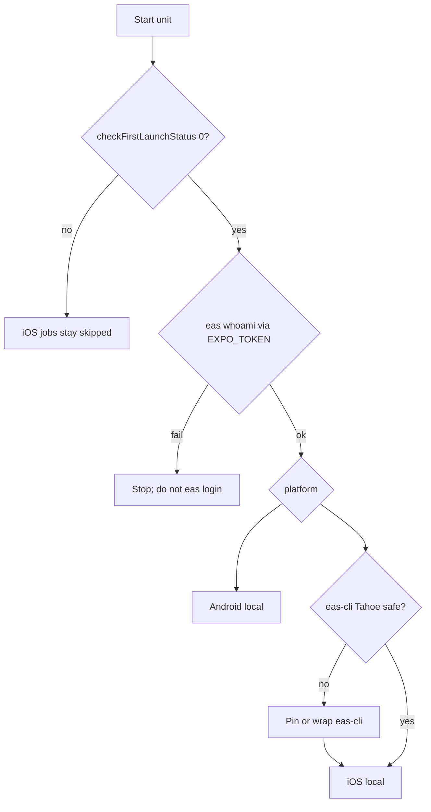

# Dedicated mac-mini slot for iCare preview local builds - Plan

**Target repos:** this Server ops repo (docs, runbooks, CONCEPTS); GitHub `cypressoai/iCare-mobile-app` (local sibling checkout `../iCare/mobile-app`, preview-local workflow only). Host work is on `mac-mini`.

**Product Contract preservation:** new bootstrap. Session-settled choices from the invoking conversation are labeled on the owning KTDs.

## Goal Capsule

**Objective:** Add one dedicated GitHub Actions runner on `mac-mini` that serially runs iCare member-app **preview** `eas build --local` for Android APK and iOS IPA, without joining the existing sonar / quality / backend pools.

**Authority:** 2026-08-17 read-only inventory and follow-up; user approved dedicated slot + both platforms + this plan-first path. Host danger actions still follow `AGENTS.md` (confirm before first launch, LaunchDaemon install, crontab, stopping sonar slots).

**Stop when:** `mac-mini-mobile-1` is online with the preview-local labels and no quality-gate labels; Android local APK succeeds once from that slot; iOS local IPA also succeeds once, or U5 records a written Tahoe/keychain blocker and the U6 iOS job stays `if:`-gated; `iCare-mobile-app` on `develop` can `workflow_dispatch` the Android path; Server docs and maintenance scripts include the fifth slot; abandoned host scratch is removed.

**Out of this goal:** production / Play / App Store cloud builds; enabling or rewriting `eas-build-qa.yml` / `eas-build-prod.yml` as cloud triggers; TestFlight submit; daily Metro / development-client loop; attaching quality-gate labels; parallel iOS+Android on the same host.

---

## Product Contract

### Summary

Preview native builds today wait on EAS cloud machines. `mac-mini` already has Xcode 26.6 and a full Android SDK, but no dedicated runner, no service-visible Node/JDK, and an unfinished Xcode first launch. The product is a fifth slot that only does preview local compiles, plus a `develop` workflow that talks to that slot.

### Problem Frame

EAS cloud queue plus a clean VM compile is what developers feel as "too slow." Reusing `mac-mini-sonar-1..4` would steal CPU from frontend/backend CI. A fifth slot with its own label keeps those pools honest and lets Android then iOS share one machine serially.

### Requirements

**Slot and scheduling**

- R1. `mac-mini` has exactly one additional runner named `mac-mini-mobile-1`, not named as `mac-mini-sonar-5`.
- R2. That runner keeps default `self-hosted` plus `macos`, `arm64`, and a new pool label `mobile-preview-ci`. It must not carry `mac-mini-sonar`, `frontend-quality-ci`, `frontend-tests-ci`, `frontend-sonar-ci`, or `backend-ci`.
- R3. iOS and Android preview local builds on this host are serial. The slot count is one, and the workflow concurrency group must not start a second native compile on the same host.
- R4. Existing sonar slots stay online unless the operator explicitly parks them for a heavy compile window.

**Build product**

- R5. The slot builds only EAS profile `preview` via `eas build --local`. Production stays on EAS cloud.
- R6. Android output is a preview APK for `ph.com.toplogic.insularhealth.preview`. iOS output is a signed preview IPA for the same bundle id.
- R7. Jobs authenticate with repo secret `EXPO_TOKEN`. No interactive `eas login` on the daemon session.
- R8. Android proof lands before the first iOS proof on this slot.

**Host and secrets**

- R9. The runner service can see Node (22.x matching `eas.json`), pnpm, Java 17, `ANDROID_HOME`, CocoaPods, and fastlane via that slot's `.path` / `.env`, verified on `Runner.Listener`, not on an SSH login shell.
- R10. Xcode first launch is complete (`xcodebuild -checkFirstLaunchStatus` not 69) before any iOS local job is treated as ready.
- R11. Tokens, keystores, `.p8` keys, and Firebase files stay out of git and out of commit messages.

**Docs and maintenance**

- R12. Resume, crontab `WORK_DIRS`, `ci-runner-pools.md`, `mac-mini-runner-start-stop.md`, `CONCEPTS.md`, and `docs/operations/mac-mini.md` all name the fifth slot.
- R13. `iCare-mobile-app` on branch `develop` gains a new `workflow_dispatch` workflow that targets `[self-hosted, macos, arm64, mobile-preview-ci]` and does not reuse the cloud `--no-wait` composite as-is.

### Actors

- A1. Ops implementer on `mac-mini` and this Server repo.
- A2. App developer who later clicks `workflow_dispatch` or asks for a preview package.
- A3. The `mac-mini-mobile-1` job process.
- A4. Concurrent jobs on `mac-mini-sonar-1..4` (resource neighbors, not customers of this slot).

### Key Flows

- F1. Host toolchain
  - **Trigger:** Plan execution starts.
  - **Actors:** A1
  - **Steps:** Confirm branch `main`; install Node 22 + pnpm; export JDK 17 and Android SDK into the future slot env; after user confirm, run Xcode first launch; do not interactive-login EAS.
  - **Outcome:** Android tools work in a non-interactive shell; iOS compile is unblocked at the Xcode layer.
- F2. Register dedicated slot
  - **Trigger:** F1 Android half is enough to register; iOS first launch may still be pending.
  - **Actors:** A1
  - **Steps:** Unpack runner beside existing slots; `config.sh --unattended` to org `cypressoai` / group `Default`; install LaunchDaemon (not `svc.sh install`); write `.env` / `.path`; verify labels on GitHub.
  - **Outcome:** Runner online, only preview-local labels.
- F3. Android local proof
  - **Trigger:** F2 online and `EXPO_TOKEN` present in the repo secret.
  - **Actors:** A1, A3
  - **Steps:** `eas whoami` non-interactive; `eas build --local --platform android --profile preview`; validate APK size and zip integrity.
  - **Outcome:** Durable preview APK from this host.
- F4. iOS local proof
  - **Trigger:** F1 Xcode first launch done and F3 succeeded.
  - **Actors:** A1, A3
  - **Steps:** Pin or wrap eas-cli so Tahoe `find-identity -v` cannot false-fail; local iOS preview build; confirm signed IPA.
  - **Outcome:** IPA exists. TestFlight submit is not required.
- F5. Develop workflow
  - **Trigger:** F3 done; F4 done or explicitly deferred with a documented skip in the workflow `ios` job.
  - **Actors:** A2, A3
  - **Steps:** Merge workflow on `develop`; `workflow_dispatch` with platform choice; jobs run serially on this slot; upload artifacts.
  - **Outcome:** Developers no longer need a personal Mac for preview native compile.

### Acceptance Examples

- AE1. Covers R2. GitHub runner `mac-mini-mobile-1` lists `self-hosted` and `mobile-preview-ci` and does not list `mac-mini-sonar` or `frontend-quality-ci`.
- AE2. Covers R6 / F3. Local Android preview APK is larger than 20MB and `unzip -t` passes.
- AE3. Covers R6 / F4. Local iOS preview IPA exists and codesign identity is the EAS-managed team `2ZSNV9MWK6`, not the personal Development identity `2329U9YKK8`.
- AE4. Covers R3 / R13. Two `workflow_dispatch` runs cannot compile iOS and Android at the same time on this host.
- AE5. Covers R12. `mac-mini-runner-resume.sh` and daily maintenance include `~/gha/m1`.

### Success Criteria

- Preview Android can be produced on `mac-mini` without an EAS cloud compile minute. Preview iOS can too, unless U5 records the Tahoe/keychain blocker and U6 keeps the iOS job gated.
- Quality-gate jobs never schedule onto `mac-mini-mobile-1`.
- A later reader can start, stop, and remove the slot from the updated runbooks.

### Scope Boundaries

**In scope**

- Fifth LaunchDaemon runner on `mac-mini` under user `konghai`.
- Preview `eas build --local` only.
- Server ops docs and host maintenance wiring.
- New `develop` workflow in `iCare-mobile-app`.

**Deferred for later**

- iOS local proof (R6 iOS / U5) if Tahoe or the daemon keychain blocks; U6 iOS stays `if:`-gated until that blocker is gone.
- `eas submit` / TestFlight (`~/.config/icare/testflight.json` is absent on this host).
- Firebase file secrets on CI so preview packages include FCM.
- Production AAB / store IPA on this slot.
- Auto-deploy of the APK via `scripts/deploy-icare-preview-apk.sh`.
- Parking sonar 1–4 automatically when a mobile job starts.

**Outside this product's identity**

- Replacing Metro / development-client for daily JS work.
- Using this slot as a general Mac CI overflow pool.

### Dependencies

- Org `cypressoai` registration token (A1, short-lived, never committed).
- Repo secret `EXPO_TOKEN` on `iCare-mobile-app` (already required by the unused cloud EAS action).
- Host already has Xcode 26.6, Android SDK, Homebrew OpenJDK 17, CocoaPods, fastlane.
- User confirmation before Xcode first launch, LaunchDaemon install, crontab edits, or stopping sonar slots.

---

## Planning Contract

### Key Technical Decisions

- KTD1. Dedicated fifth slot, not a fifth sonar member. `(session-settled: user-approved — chosen over reusing mac-mini-sonar-1..4: quality-gate jobs would share a native compile and starve each other)`
  Governs R1, R2, R4.
- KTD2. Both platforms on this one slot, serial only. `(session-settled: user-directed — chosen over Android-only or a second machine: one M4 can compile both if iOS and Android never overlap)`
  Governs R3, R6, R8.
- KTD3. Compile with `eas build --local`, not EAS cloud workers. `(session-settled: user-approved — chosen over keeping preview on Expo cloud: avoid queue and cloud minutes; credentials still download from EAS)`
  Governs R5, R7.
- KTD4. Pool label is `mobile-preview-ci`.
  Chosen over the conversational nickname `mobile-build` so the name matches `frontend-quality-ci` / `backend-ci` (capability, not hostname). Workflow match is `[self-hosted, macos, arm64, mobile-preview-ci]`.
  Governs R2, R13.
- KTD5. LaunchDaemon, never `svc.sh install`.
  Sonar 1–4 moved to `system/actions.runner.cypressoai.mac-mini-sonar-N` on 2026-08-15. Official `svc.sh install` puts a LaunchAgent back and double-starts after login. See `docs/runbooks/mac-mini-runner-start-stop.md`.
  Governs R1, R12.
- KTD6. Short workFolder `~/gha/m1`, program dir `~/actions-runner/mac-mini-mobile-1`.
  Mirrors `s1..s4` / `li*` / `u*`. Deep default work paths break macOS socket names (2026-06-09 Scanner cache learning).
  Governs R9, R12.
- KTD7. `EXPO_TOKEN` is a GitHub Actions secret injected per job, not a file in the runner dir committed anywhere.
  Interactive `eas login` left `~/.expo/state.json` with only a uuid. EAS `--local` still talks to Expo to fetch managed credentials.
  Governs R7, R11.
- KTD8. iOS signing uses the EAS ephemeral build keychain, not the locked login keychain.
  SSH already gets `User interaction is not allowed` on login.keychain. Personal Development `2329U9YKK8` cannot sign `distribution: store`. If ephemeral import still fails under the daemon, implementation may add a dedicated unlocked signing keychain — that is a fallback, not the first path.
  Governs R6, R10.
- KTD9. Pin eas-cli (or wrap `find-identity`) before trusting iOS local on Tahoe.
  eas-cli main still runs `security find-identity -v` against the temp keychain (eas-cli#3678). `eas-version: latest` is unsafe until a release contains that drop-`-v` fix.
  Governs R6, F4.
- KTD10. New workflow file; do not retarget `eas-build-qa.yml` / `eas-build-prod.yml` or the cloud composite.
  The existing composite is `ubuntu-latest` + `--no-wait` + cloud queue. Local builds must wait, pin eas-cli, and skip a redundant prebuild-before-`--local`.
  Governs R5, R13.
- KTD11. `setup-node` on the job with `use-github-cache: false`, plus host Node 22 on `.path` as a belt-and-suspenders for eas-cli wrappers.
  `eas.json` pins node `22.17.0` / pnpm `10.12.3`. Quality CI uses `.nvmrc` 24. Local EAS ignores `eas.json` `image` and uses whatever is on the machine.
  Governs R9.

### High-Level Technical Design

### Assumptions

- Org Default runner group can accept one more macOS runner.
- `iCare-mobile-app` already has or can receive secret `EXPO_TOKEN` with access to project `cypressoai-builds-team/icare-app`.
- Preview EAS Android keystore and iOS Distribution cert already exist in EAS (cloud preview has been used).
- Missing gitignored Firebase files on CI checkout only disable push; the package is still a valid preview build.
- EAS variables with Secret visibility are unavailable to `--local` (official limitation). This goal does not inject Maps or Firebase files.
- FileVault cold start still needs a person at the keyboard; this slot does not change that.

### Implementation Constraints

- Stay on Server `main`. `iCare-mobile-app` changes go to a `develop`-based PR, never a Server feature branch.
- Do not write tokens into docs or operations timelines.
- Do not use `at` for resume.
- Do not `rm` the slot `_tool` tree as cleanup.
- `eas build --local` default cleanup should stay on in CI. `EAS_LOCAL_BUILD_SKIP_CLEANUP=1` is only for a broken first iOS/Android debug, then delete the working dir.
- Confirm with the user before: `xcodebuild -runFirstLaunch`, installing a LaunchDaemon, editing crontab, stopping sonar 1–4.
- Never write `credentials.json`. Never copy keystore / `.p12` / `.p8` out of the EAS temp dir or upload them as artifacts. After every `--local` run, including a `SKIP_CLEANUP` debug, delete the working dir and leftover signing files under `~/gha/m1` and `/tmp`.
- If U5 needs a dedicated signing keychain after user confirm: not `login.keychain`, not unlocked from the plist, no Apple `.p8` import, delete it after the job.

### Sequencing

U1 (Android toolchain) → U2 (register slot) → U3 (docs/maintenance, can overlap U2 tail) → U4 (Android proof) → U5 (iOS proof) → U6 (develop workflow). U5 requires U1 Xcode first launch. U6 may ship Android-only if U5 is blocked, with the iOS job `if:` gated.

### Sources and Research

- `docs/runbooks/ci-runner-pools.md`, `docs/runbooks/mac-mini-runner-start-stop.md`, `docs/operations/mac-mini.md` (2026-08-15 Daemon; 2026-08-17 inventories).
- `docs/solutions/mac-mini/integration-issues/sonarqube-scanner-cli-cache-never-hits-4part-version-2026-06-09.md` — service PATH and short workFolder.
- `docs/solutions/mac-mini/workflow-issues/macos-at-disabled-do-not-schedule-runner-resume-with-at-2026-07-28.md` — no `at`; `svc.sh` must run from runner root.
- `docs/solutions/mac-mini/workflow-issues/github-actions-runner-vpn-traffic-optimization-2026-05-20.md` — no GitHub Cache API on persistent runners.
- `docs/solutions/mac-mini/performance-issues/frontend-mas-vitest-sharding-worker-tuning-2026-06-11.md` — do not stack native compile onto the four sonar slots.
- `../iCare/mobile-app/eas.json`, `../iCare/mobile-app/.github/actions/eas-build/action.yml`, `../iCare/.agents/skills/app-android-local-apk`.
- Expo local builds: https://docs.expo.dev/build-reference/local-builds/ (`--local` ignores `image`; Secret env unsupported; one platform per invocation).
- eas-cli#3678 / source `packages/build-tools/src/ios/credentials/keychain.ts` still uses `find-identity -v`.

---

## Implementation Units

### U1. Host toolchain for local EAS

- **Goal:** Non-interactive Android compile tools work; Xcode first launch is finished after user confirm.
- **Requirements:** R9, R10, R11
- **Dependencies:** none
- **Files:** host only (Homebrew `node@22`, slot `.path` written in U2); no Server file required until U3
- **Approach:**
  1. Install Homebrew `node@22` (keg-only) and enable pnpm 10.12.x via corepack. Do not rely on `fnm env` — LaunchDaemon `.path` cannot eval it. This host already has fnm with no Node version.
  2. Point `JAVA_HOME` at Homebrew OpenJDK 17. Point `ANDROID_HOME` / `ANDROID_SDK_ROOT` at `Library/Android/sdk`.
  3. After user confirm, run Xcode first launch until `xcodebuild -checkFirstLaunchStatus` is 0. This may need console sudo.
  4. Do not `eas login`. Leave `EXPO_TOKEN` for job secrets.
- **Execution note:** Smoke-first. Source the slot `.env` then `PATH` from the slot `.path` (after U2 writes them). Prove `node -v` is 22.x, `pnpm -v`, `java -version` is 17, `adb version`, and `xcodebuild -version`. Never `eval "$(fnm env)"`.
- **Patterns to follow:** Verify with the same PATH the Listener will use (2026-06-09 learning).
- **Test scenarios:**
  - Happy: `java -version` reports 17; `adb version` works; `pod --version` works.
  - Edge: `/usr/bin/java` still broken, but `JAVA_HOME` java works.
  - Error: first launch skipped → document iOS blocked; Android may continue.
- **Verification:** Written notes in the U3 timeline: Node version, JAVA_HOME, ANDROID_HOME, first-launch exit code.

### U2. Register `mac-mini-mobile-1`

- **Goal:** Fifth runner online as LaunchDaemon with preview-only labels.
- **Requirements:** R1, R2, R7, R9. KTD1, KTD4, KTD5, KTD6, KTD7
- **Dependencies:** U1 Android half
- **Files:** host `actions-runner/mac-mini-mobile-1/` (`.runner`, `.env`, `.path`); host `/Library/LaunchDaemons/actions.runner.cypressoai.mac-mini-mobile-1.plist` (after confirm)
- **Approach:**
  1. Reuse the existing osx-arm64 runner tarball beside the sonar slots; checksum then extract.
  2. `config.sh --unattended` to `https://github.com/cypressoai`, name `mac-mini-mobile-1`, work `/Users/konghai/gha/m1`. Keep default labels. Add `macos-arm64`, `mac-mini`, `mobile-preview-ci` only as extras if defaults do not already include `macos`/`arm64`.
  3. Clone the 2026-08-15 Daemon plist pattern. Do not run `svc.sh install`.
  4. `.env`: `PNPM_STORE_PATH` = `~/gha/cache/pnpm-store`; `ANDROID_HOME` / `ANDROID_SDK_ROOT`; `JAVA_HOME`. No `GOCACHE`. No `EXPO_TOKEN` in `.env`.
  5. `.path`: `/opt/homebrew/bin` first, then `/opt/homebrew/opt/node@22/bin`, `$JAVA_HOME/bin`, `$ANDROID_HOME/platform-tools`, `/usr/bin`, `/bin`.
  6. Restart this Listener only. Confirm GitHub labels via `gh api`.
- **Execution note:** Registration token stays in process memory. Confirm LaunchDaemon install before `launchctl bootstrap`.
- **Patterns to follow:** lemon/umac `config.sh --unattended`; mac-mini Daemon install (2026-08-15); never `--no-default-labels`.
- **Test scenarios:**
  - Happy: runner `online`; labels include `self-hosted` and `mobile-preview-ci`.
  - Edge: labels omit every quality-gate name (AE1).
  - Error: `svc.sh install` not present as a LaunchAgent after install.
  - Integration: `ps eww` on this Listener shows JAVA_HOME, ANDROID_HOME, PNPM_STORE_PATH, and Homebrew on PATH.
- **Verification:** `gh api` snapshot recorded in the operations timeline without the registration token.

### U3. Wire maintenance and Server docs

- **Goal:** Fifth slot is visible to resume, prune, and humans.
- **Requirements:** R12. KTD5, KTD6
- **Dependencies:** U2
- **Files:** `docs/runbooks/ci-runner-pools.md`; `docs/runbooks/mac-mini-runner-start-stop.md`; `docs/operations/mac-mini.md`; `CONCEPTS.md`; `AGENTS.md` if mac-mini directory table needs the new paths; host `~/bin/mac-mini-runner-resume.sh`; host crontab / `~/gha/scripts/gha-runner-maintenance.sh` `WORK_DIRS`
- **Approach:**
  1. Add a pool row `mobile-preview-ci` → only `mac-mini-mobile-1`. Explicitly "does not take quality or backend jobs."
  2. Extend start/stop/resume loops beyond `1..4`.
  3. Add `~/gha/m1` to `WORK_DIRS` so daily prune cannot silently skip it.
  4. Define the new CONCEPTS terms. Append the operations timeline after the real host change.
- **Execution note:** Docs and crontab are the unit; no app tests.
- **Patterns to follow:** lemon workFolder/plist sync warning; cache baseline plan R8.
- **Test scenarios:**
  - Happy: resume script names `mac-mini-mobile-1`.
  - Error: maintenance dry-run lists `~/gha/m1`.
- **Verification:** `Test expectation: none -- documentation and host script wiring; prove by reading the updated loops and a maintenance log line.`
  Completeness is AE5 plus a Server `main` commit.

### U4. Android preview local proof

- **Goal:** This slot produces a valid preview APK without EAS cloud compile.
- **Requirements:** R5, R6, R7, R8. KTD3, KTD7, KTD11
- **Dependencies:** U2
- **Files:** no Server source required; optional scratch under runner temp. Later U6 owns the workflow file.
- **Approach:**
  1. Prefer a draft U6 `workflow_dispatch` so `EXPO_TOKEN` arrives only as `secrets.EXPO_TOKEN`. Do not `export EXPO_TOKEN=` on SSH. If a host smoke is unavoidable, read a mode-600 file and delete it immediately; never `set -x` or `ps eww` a Worker while the token is set.
  2. `eas build --local --non-interactive --platform android --profile preview --output` a path outside the git worktree.
  3. Do not prebuild as a separate cloud-style step unless `--local` itself fails in a way the local-apk recipes already know (`gradle-lint`, sign-resume).
  4. Validate AE2. Keep Firebase files optional.
- **Execution note:** Prefer a one-off self-hosted workflow_dispatch after U6 draft, or a supervised host command using the same env as the Listener. Smoke the APK, do not invent Gradle unit tests.
- **Patterns to follow:** `app-android-local-apk` preflight and failure recipes; `setup-node-pnpm-install` with `use-github-cache: false`.
- **Test scenarios:**
  - Happy: APK >20MB, `unzip -t` ok, package `ph.com.toplogic.insularhealth.preview`.
  - Error: missing `EXPO_TOKEN` fails at whoami with a clear message and no interactive prompt.
  - Error: known ExtraTranslation lint → apply existing plugin on `develop`, do not patch around it.
- **Verification:** APK path, size, and sha256 in the operations timeline (no secrets).

### U5. iOS preview local proof

- **Goal:** This slot produces a signed preview IPA after Tahoe credential check is made safe.
- **Requirements:** R6, R10. KTD2, KTD8, KTD9
- **Dependencies:** U1 (first launch), U4
- **Files:** host eas-cli pin or a small wrapper script if upstream is still broken; do not vendor a patched npm cache as the long-term source of truth
- **Approach:**
  1. Confirm first-launch 0.
  2. Probe current pinned eas-cli: if Prepare credentials fails with "hasn't been imported successfully", drop `-v` via a pinned fork/wrapper. Record the exact eas-cli version.
  3. `eas build --local --non-interactive --platform ios --profile preview`.
  4. Confirm AE3. Do not configure ASC submit in this unit.
- **Execution note:** First iOS run is a characterization of Tahoe + Daemon keychain. If ephemeral keychain cannot unlock under launchd, stop and ask before inventing a login-keychain unlock.
- **Patterns to follow:** Expo local-build docs; eas-cli#3678 diagnosis already on disk in `docs/operations/mac-mini.md`.
- **Test scenarios:**
  - Happy: IPA produced; signing team `2ZSNV9MWK6`.
  - Error: eas-cli still on `find-identity -v` → job fails at Prepare credentials, not mid-xcodebuild.
  - Error: first launch still 69 → iOS job skipped, Android remains usable.
  - Integration: login.keychain stays locked; build still signs via EAS temp keychain.
- **Verification:** IPA exists; operations note names eas-cli version and whether the `-v` workaround was required.

### U6. `develop` preview-local workflow

- **Goal:** Developers trigger serial preview local builds from GitHub Actions.
- **Requirements:** R3, R13. KTD4, KTD10, KTD11
- **Dependencies:** U4; U5 or an explicit iOS `if:` skip
- **Files:** sibling checkout `../iCare/mobile-app` of repo `iCare-mobile-app`. In that repo: `.github/workflows/eas-build-preview-local.yml` only. Do not add a one-consumer local composite. Do not modify `.github/actions/eas-build/action.yml`, `eas-build-qa.yml`, or `eas-build-prod.yml`.
- **Approach:**
  1. `workflow_dispatch` input `platform`: `android` | `ios` | `all`.
  2. `runs-on: [self-hosted, macos, arm64, mobile-preview-ci]`.
  3. `concurrency.group: icare-mobile-preview-local`, `cancel-in-progress: false`.
  4. Timeout high enough for one platform (~90 minutes) or both serial (~180).
  5. Checkout + existing setup-node-pnpm-install (`use-github-cache: false`) + expo-github-action with **pinned** eas-cli + `EXPO_TOKEN`.
  6. One platform per `eas build --local` invocation. `all` is two sequential steps, not `platform: all`.
  7. Upload APK/IPA artifacts. Do not bind `release published`.
  8. PR against `develop`.
- **Execution note:** Workflow YAML is the feature. Prove with a real dispatch, not a unit test file.
- **Patterns to follow:** `setup-node-pnpm-install` cache-off path; do not copy `--no-wait` from the cloud composite.
- **Test scenarios:**
  - Happy: dispatch `android` completes on `mac-mini-mobile-1` and uploads an APK (Covers AE2).
  - Happy: dispatch `ios` after U5 completes on the same runner (Covers AE3).
  - Edge: dispatch `all` runs Android then iOS, never overlapping (Covers AE4).
  - Error: a `frontend-quality-ci` job is never seen on this runner.
  - Error: missing `EXPO_TOKEN` fails the whoami step.
- **Verification:** One green `android` dispatch URL recorded. iOS dispatch URL or a documented skip.

---

## Verification Contract

This is host and workflow smoke, not a unit-test suite.

| Gate | Command or check | When |
|------|------------------|------|
| Listener env | `ps eww` on `mac-mini-mobile-1` Listener contains JAVA_HOME, ANDROID_HOME, PNPM_STORE_PATH, Homebrew PATH | After U2 |
| Labels | `gh api orgs/cypressoai/actions/runners` filtered to `mac-mini-mobile-1` matches AE1 | After U2 |
| Android APK | size >20MB and `unzip -t` | After U4 |
| iOS IPA | file exists; codesign team `2ZSNV9MWK6` | After U5 |
| Workflow | `workflow_dispatch` on `develop` uses only `mobile-preview-ci` | After U6 |
| Docs | resume + `WORK_DIRS` include `m1` | After U3 |
| No secrets | `git grep` in Server and the mobile-app PR has no token/p8/keystore | Before each commit |

`release:validate` does not apply. Do not run `pnpm test` as a substitute for a native compile.

---

## Definition of Done

**Global**

- R1–R13 either met or explicitly deferred in Scope with a reason (only R6 iOS may defer if Tahoe/keychain blocks, and then U6 iOS stays gated).
- No quality-gate label on the new runner.
- No `EXPO_TOKEN` or signing material in git.
- Host scratch from failed `--local` runs removed.
- Server changes committed on `main`. mobile-app workflow on `develop` (merged or open PR with a green android dispatch).

**Per unit**

- U1: first-launch status recorded; Android tools work non-interactively.
- U2: runner online; AE1 true.
- U3: AE5 true; timeline written.
- U4: AE2 true.
- U5: AE3 true, or a written blocker that does not silently skip.
- U6: dispatch works; AE4 true.

---

## System-Wide Impact

The fifth Listener is cheap. One Gradle or `xcodebuild` on the same M4 as four sonar slots is not. Operators may still park 1–4 for a long iOS archive, but that is a manual confirm, not automatic.

`PNPM_STORE_PATH` is shared with quality slots. That is intended. Do not share this slot's workFolder.

---

## Risks and Dependencies

- Tahoe `find-identity -v` remains unfixed upstream → U5 must pin or wrap. Suboptimal but workable.
- LaunchDaemon + codesign may still fail after the `-v` fix → stop and ask; do not unlock login.keychain in a plist.
- Secret-visibility EAS env vars absent locally → preview APK may lack Maps key; Clinic Locator crash is a known deploy-checklist item, not a slot installer bug.
- Disk: one local EAS working dir can be tens of GB. CI must not leave `SKIP_CLEANUP` on.
- Registration and LaunchDaemon need org admin and host sudo.

---

## Documentation and Operational Notes

After host changes, append `docs/operations/mac-mini.md` in the existing reverse-chronology shape and commit on `main`. Do not put the panel-style entrance path, tokens, or Apple `.p8` in that entry.

Roll back the slot: bootout Daemon → `config.sh remove` with a removal token → delete program dir and `~/gha/m1` → revert resume/`WORK_DIRS`/runbooks.

---

## Open Questions

- Q1. **Deferred.** Exact eas-cli version that contains the Tahoe fix, if any ships during implementation. U5 measures this.
- Q2. **Deferred.** Whether preview CI must inject Maps / Firebase files for a tester-usable build. Out of this goal; packages without them are still valid compile proofs.
