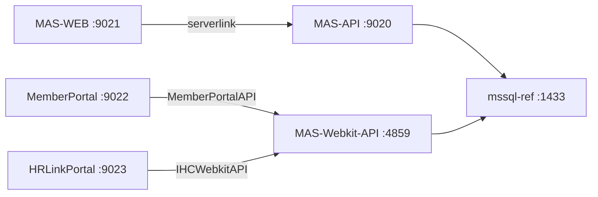
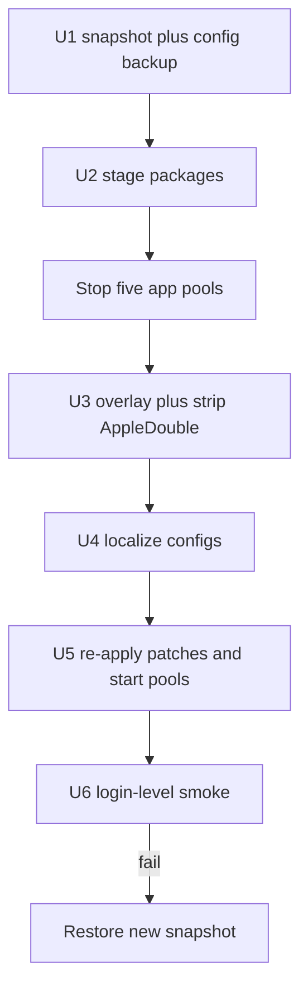

# mas-win 老 C# 发布包原地替换 - Plan

## Goal Capsule

- **Objective:** 用 `birnaries_20082026/` 这套 2026-08 发布包，原地覆盖 `mas-win`（PVE VM 120，`192.168.2.21`）上现有五个 IIS 站点，并重新做成参考环境。
- **Authority:** Product Contract > Planning Contract KTDs > 既有 `docs/operations/mas-win.md` 与 `docs/solutions/pve/best-practices/mas-csharp-iis-reference-deploy-2026-05-16.md`。
- **Out of scope here:** 新建站点、改库 / 还原库、OTP 微服务、Sales Portal、对公网开放、把发布包提交进 git。
- **Stop if:** 快照创建失败；覆盖后无法在启动应用池前完成本地化；smoke 发现仍在请求生产主机。
- **Execution profile:** 一次性运维窗口。先快照，再停池覆盖，本地化完成才启动。验证以登录级 smoke 为准，不是只看 HTTP 200。
- **Tail ownership:** 执行后追加 `docs/operations/mas-win.md`、更新 `pve/README.md` 的包源与快照名，并在 `main` 提交。危险动作（打快照以外的删除、iisreset、改防火墙）仍须先确认。

## Product Contract

### Summary

把五个正在跑的老 C# / IIS 站点全部换成 8 月 20 这套新发布包。站点名、端口、应用池不动。覆盖后立刻改回本地 SQL、路径、邮件和 API 基址，并按新文件重打上次的本地补丁。这一份计划只指导部署，不在写计划时执行。

### Problem Frame

`mas-win` 是对照用的参考环境，不是生产。现网站点版本偏旧（MAS-WEB `2026.02.19.00`，MemberPortal `2026.01.27.00`）。新包是生产形态：连接串指向 `172.0.0.6` / `10.0.0.5`，catalog 仍是 `medicalassistance`，SMTP 和上传盘是生产值，HRLink 还带 HTTPS Rewrite 和 Development 下的 cloudkit 地址。直接覆盖会连错库、打生产、或在 Server Core 上 500.19。

### Requirements

**Coverage**

- R1. 五个现网站点全部用新包覆盖：`MAS-API:9020`、`MAS-WEB:9021`、`MemberPortal:9022`、`HRLinkPortal:9023`、`MAS-Webkit-API:4859`。
- R2. 站点名、绑定端口、应用池名字和 CLR / ANCM 形态保持现状。
- R3. 覆盖前必须有可回滚的 PVE 快照；现有 `portals-pre-deploy` 不是本轮回滚点。

**Reference localization**

- R4. 应用不得再连生产 SQL、生产 SMTP、生产上传盘或 `cloudkit.toplogic.com.ph` / `ap.insularhealthcare.com.ph` 业务主机。
- R5. SQL 指向 `mssql-ref`：`192.168.2.20,1433`，登录名 `mas_ref_owner`，主库 catalog `medicalassistance_preprod`。密码只从 `mssql-ref:/root/mssql-secrets.env` 读，不写入仓库。
- R6. `MAS-WEB` 的 `serverlink` 指向 `http://192.168.2.21:9020/`。MemberPortal / HRLink 的 API 基址指向 `http://192.168.2.21:4859/`，不是 9020。
- R7. 上传与附件目录落在 `C:\MAS\Data\...`。`C:\MAS\Data` 本轮不覆盖。
- R8. SMTP 与 OTP 禁用或指到本机无效地址。MemberPortal `SkipOTP=1`。HRLink 登录表单不走 OTP 接口。

**Local patches and runtime**

- R9. 覆盖后按新文件重打上次仍需要的本地补丁：HRLink `with-otp`、MemberPortal store 回退；memberdetails 路由补丁仅在新包实际缺路由时再打。
- R10. 从 macOS 传入的包必须删掉 AppleDouble `._*`。含 URL Rewrite 的 `web.config` 必须去掉 Rewrite 段。
- R11. HRLink 运行时 `ASPNETCORE_ENVIRONMENT=Production`，避免 Development.json 盖掉已本地化的 API 地址。

**Safety and docs**

- R12. 发布包内的生产凭据、SMTP 密码、OAuth secret 不得进入 git commit 或公开文档。
- R13. 覆盖完成后，管理端、MemberPortal、HRLink 必须能用既有参考账号完成登录级 smoke（允许 Webkit 20–60s 慢路径）。
- R14. 执行结果写入 `docs/operations/mas-win.md`，并更新 `pve/README.md` 的包源与快照名。

### Actors

- A1. 运维实施者：传包、覆盖、本地化、smoke、写时间线。
- A2. iCare 对照用户：用 9021 / 9022 / 9023 打开旧页面，对照 Go 重构行为。

### Key Flows

- F1. 管理端登录
  - **Trigger:** A2 打开 `http://192.168.2.21:9021/`。
  - **Steps:** 登录页 200 → `POST :9020/user-signin` → cookie 首页 200。
  - **Outcome:** 读 `medicalassistance_preprod` + `authprovidermasweb`，不碰外网。
  - **Covered by:** R4, R5, R6, R13
- F2. Member Portal 两步登录
  - **Trigger:** A2 打开 `:9022`。
  - **Steps:** 邮箱检查 → 密码 → `SignInUser` / `ContinueSignIn` → Dashboard；store 图走本地回退。
  - **Outcome:** 经 Webkit `:4859` 取会员数据，无 OTP，无生产 Profile 拉取。
  - **Covered by:** R6, R8, R9, R13
- F3. HR Link 表单登录
  - **Trigger:** A2 打开 `:9023` 并点 Sign In。
  - **Steps:** 强刷后加载新入口 JS → `POST /api/auth`（带 app-sign，不走 with-otp）→ Dashboard。
  - **Outcome:** 经 Webkit 登录成功；Development.json / HTTPS Rewrite 未生效。
  - **Covered by:** R8, R9, R11, R13
- F4. 失败回滚
  - **Trigger:** 覆盖中途失败，或 smoke 发现外连 / 登录挂。
  - **Steps:** 停池 → 恢复本轮新快照 → 五站回到覆盖前可用态。
  - **Covered by:** R3

### Acceptance Examples

- AE1. Covers F1 / R13. Given 新包已覆盖且 MAS-API 连接串已本地化，When 用参考账号登录 9021，Then `user-signin` 返回 `status=200` 且 `error=false`，首页 200。
- AE2. Covers F2 / R9. Given MemberPortal 已覆盖，When 请求任意生产 Profile 的 `store?base64url=`，Then HTTP 200 且 `image/png`，不是 500。
- AE3. Covers F3 / R9. Given HRLink 已覆盖并强刷，When 用户点 Sign In，Then 浏览器打 `/api/auth` 而不是 `/api/auth/with-otp`，且返回 success。
- AE4. Covers R4. Given 五站已启动，When 检查运行时配置与出站，Then 无 `10.0.0.` / `172.0.0.` 生产 SQL、无 cloudkit、无 Office365 SMTP 实密。
- AE5. Covers R10. Given 解压完成，When 启动 MemberPortal 与 Webkit，Then 无 `App_Browsers/._*` 500，无 Rewrite 引起的 500.19。

### Success Criteria

- 五个站点 Started，端口与覆盖前一致。
- 三个门户能登录；两个 API 根路径保持 403。
- ADO.NET 连库身份是 `mas_ref_owner`，库名是 `medicalassistance_preprod`。
- 本轮新快照仍在，可作为回滚点。
- 运维时间线已写，`pve/README.md` 的包源与快照名已更新，仓库未提交发布包或明文密码。

### Scope Boundaries

**In**

- 原地覆盖五个现网站点。
- 参考环境本地化与上次仍需要的补丁。
- `.gitignore` 排除含密发布包目录。
- 运维文档更新。

**Out**

- 不改 `mssql-ref` schema / 数据（只读预检可以）。
- 不部署 OTP、Sales Portal、搜索引擎库、Azure SSO。
- 不把 `e1000` 换成 VirtIO，不 `iisreset`（除非 Hosting Bundle 缺失，当前已是 6.0.36）。
- 不提交 `birnaries_20082026/`。

#### Deferred to Follow-Up Work

- 新 Webkit 若已提供稳定 `v8/memberdetails`，再考虑把 MemberPortal `apiversion` 从 `v2` 调到 `v8`。
- `searchengine_db` / 真实 `apicachemas` 若对照需要，再单独恢复到 mssql-ref。
- 成功并稳定后，是否删除更旧的 `portals-pre-deploy`（删除须另确认）。
- 把 2026-07 门户补丁沉淀成独立 `docs/solutions/` 条目。

### Key Decisions

- KD1. 五个站点一起换，不拆批次。Governs R1.
- KD2. 强制改回本地参考栈，不用包内生产后端。Governs R4, R5, R6.
- KD3. 覆盖后按新文件重打本地补丁，不是先原包冒烟再决定。memberdetails 二进制补丁除外，见 KTD4。Governs R9.

## Planning Contract

### Assumptions

- 参考登录账号、OAuth client 与 `passwordexpiry` 仍是 2026-07 修过的状态；部署前只读抽查，坏了再修，不默认改库。
- 本轮短暂停站可接受；不另开维护公告流程。
- Hosting Bundle 6.0.36 足够跑新 HRLink（`net6.0`）。

### Key Technical Decisions

- KTD1. **五站一次窗口覆盖**（session-settled: user-approved — chosen over 只换子集: 新包五个目录与现网站点一一对应）。停全部相关 AppPool 后再拷文件，避免半新半旧。
- KTD2. **配置以现网已工作的本地化值为准，覆盖包内生产值**（session-settled: user-approved — chosen over 保留生产连接: 参考环境不能打生产）。MAS-API 的 appSettings `DATA_SOURCE_*` / `CATALOG_*` **和** 全部 EF `connectionStrings` 都要改；只改 `CATALOG_A` 不够。Webkit `authprovidermas` → `authprovidermasweb`，`apicachemas` 继续 remap 到 `maswebkit`。
- KTD3. **OAuth client 保留现网值**。新包 MAS-WEB `client_id` 与现网不同；现网值已对过 `authprovidermasweb`。覆盖后从 U1 备份的 config 拷回，不信任包内生产 GUID。MemberPortal / HRLink 现网 Login 值若与新包相同则无需改。
- KTD4. **补丁按新产物打，不复用 07-29 bak 路径**（session-settled: user-approved — chosen over 原包冒烟后再补: 已知 OTP / store 在新包里仍会炸）。细则：
  - HRLink：只改入口 `wwwroot/assets/index.9d92b79b.js` 里唯一的 `"/api/auth/with-otp"` → `"/api/auth"`。旧 `index.19d8eae8.js` 不是入口。
  - MemberPortal：`SkipOTP=1`；重建 `StoreFallbackModule`（新包没有该文件）；按需补 `isValidSqlDate`。
  - memberdetails：新 `TopLogic.WebApi.dll` 已含 `v8/memberdetails`；新 `MemberPortal.dll` 不再硬编码 `v8/`，走 `apiversion`（包内 `v2`）。**不要**盲目做 UTF-16 `v8`→`v7`。先保持 `v2`，登录失败再查实际请求路径。
- KTD5. **Overlay 策略：覆盖拷贝，不清空整个 Apps 目录。** 保留包没有的本地文件。`C:\MAS\Data` 不动。U1 备份 `Attachments/BIR/2307_Pdf_Form_Result.pdf` 与现网 config；覆盖后若 2307 丢失则还原。包内生产 `Logs/` 不要当排障依据。
- KTD6. **回滚只认本轮新快照**，建议名 `pre-birnaries-20082026`。`portals-pre-deploy` 是门户部署前状态，回滚到它会丢掉 07-29 补丁。thin pool 不要长期堆快照；删旧快照须另确认。
- KTD7. **传输沿用 PVE 临时 HTTP**：本机打包 → `192.168.2.10:18080` → Windows `C:\MAS\Staging\`。guest 控制面用 `qm guest exec`；复杂 PowerShell 用 UTF-16LE `-EncodedCommand`；写回 XML 用 UTF-8 无 BOM。
- KTD8. **`.gitignore` 忽略 `birnaries_20082026/`。** 该目录含生产 SQL/SMTP/OAuth 明文，且当前未跟踪。

### High-Level Technical Design

站点依赖（覆盖后必须仍是这张图）：

部署时序：

覆盖与启动之间禁止把应用池拉起来。包内配置会连生产。

### Sequencing

U1 → U2 → U3 → U4 → U5 → U6。U4 依赖 U3 的新文件已就位。U5 依赖 U4 的本地化已写完，否则补丁打在仍指向生产的配置上没有意义。

### Risks and Dependencies

- 漏改 MAS-API 某一条 EF 连接串 → 9021「登录失败」，根因在 API 不在 WEB。见 `docs/solutions/pve/runtime-errors/mas-web-login-fail-stale-mssql-user-in-mas-api-2026-06-15.md`。
- 留下 Rewrite → 500.19。留下 `._*` → MemberPortal 500。
- HRLink 设回 Development → 再打 cloudkit。
- 快照占 thin pool；创建前看 `nvme-data` Data%。
- 新包 `searchengine_db` / `insularsalesportal` 等旁路功能：mssql-ref 已有 `insularsalesportal` 与 `masprepaid`，没有 `searchengine_db`。搜索相关功能允许失败。
- 依赖：`mssql-ref` 在线；VM 120 guest agent 可用；C 盘约 90G 空闲，包约 1.2G，空间足够。

## Implementation Units

### U1. Snapshot and live-config backup

- **Goal:** 留下可回滚快照，并保存现网已工作的本地化配置与包外文件。
- **Requirements:** R3, R12
- **Dependencies:** none
- **Files:** `.gitignore`; VM `C:\MAS\Apps\*\Web.config` 与 `appsettings*.json` 的备份副本；`C:\MAS\Apps\MAS-WEB\Attachments\BIR\2307_Pdf_Form_Result.pdf`
- **Approach:**
  1. 只读确认 VM 120 running、guest ping、`mssql-ref:1433` 可连、五站 Started。
  2. `qm snapshot 120 pre-birnaries-20082026`（描述写清：覆盖 2026-08-20 包之前）。
  3. 在 VM 内把各站 `Web.config` / `appsettings*.json` / HRLink `web.config` 拷到 `C:\MAS\Backup\pre-birnaries-20082026\`。
  4. 备份 2307 PDF 与 MemberPortal `App_Code\StoreFallbackModule.cs`（若仍在）。
  5. 把 `birnaries_20082026/` 写入 `.gitignore`。
- **Patterns to follow:** `docs/operations/mas-win.md` 2026-07-28 的 `portals-pre-deploy`；`docs/solutions/pve/best-practices/snapshot-vs-backup-strategy-2026-06-14.md`（快照用完即评估是否保留）。
- **Execution note:** 快照创建失败则停止，不开始传包。
- **Test scenarios:**
  - Happy path: `qm listsnapshot 120` 出现 `pre-birnaries-20082026`，且 `current` 在其下。
  - Error path: guest ping 失败时不创建快照、不改文件。
- **Verification:** 快照存在；备份目录里能看到五份 config；`.gitignore` 含发布包目录。

### U2. Stage the publish package on mas-win

- **Goal:** 把五个站点的发布目录完整放到 Windows Staging，不含 AppleDouble。
- **Requirements:** R1, R10, R12
- **Dependencies:** U1
- **Files:** `birnaries_20082026/MAS/MAS API/`; `birnaries_20082026/MAS/MAS Web/`; `birnaries_20082026/MAP/MemberPortalProd/`; `birnaries_20082026/HR Portal/HRLinkPortalProdv2/`; `birnaries_20082026/Mobile App/MASAPIProd/`
- **Approach:**
  1. 本机按站点打包（避开把整个 1.2G 一次打进可能含 `._*` 的 tar 后忘记清理）。
  2. PVE 临时 HTTP `192.168.2.10:18080` 传入 `C:\MAS\Staging\birnaries-20082026\`。
  3. 解压后立刻删除 `._*` 与 `.DS_Store`。
  4. 传完关掉临时 HTTP，不把 Staging 拷回本机仓库。
- **Patterns to follow:** `docs/operations/mas-win.md` 2026-07-28 / 07-29 传包。
- **Test scenarios:**
  - Happy path: Staging 下五个目录都在，主程序文件存在（`MASWebInsular` / `MASWeb` / `MemberPortal.dll` / `InsularHRPortal.dll` / `TopLogic.WebApi.dll`）。
  - Error path: 任意站点缺主 DLL 则不进入 U3。
- **Verification:** Staging 无 `._*`；PVE 临时 HTTP 已停。

### U3. Overlay the five IIS app directories

- **Goal:** 用 Staging 覆盖 `C:\MAS\Apps\` 五个目录，站点绑定不变，数据盘不动。
- **Requirements:** R1, R2, R7, R10
- **Dependencies:** U2
- **Files:** VM `C:\MAS\Apps\MAS-API`; `C:\MAS\Apps\MAS-WEB`; `C:\MAS\Apps\MemberPortal`; `C:\MAS\Apps\HRLinkPortal`; `C:\MAS\Apps\MAS-Webkit-API`
- **Approach:**
  1. 停止五个站点与 AppPool（含日志文件锁时先停站点）。
  2. 覆盖拷贝，不清空整个 Apps。不碰 `C:\MAS\Data`。
  3. 再扫一遍 Apps 下 `._*`。
  4. 若 `MAS-WEB\Attachments\BIR\2307_Pdf_Form_Result.pdf` 丢失，从 U1 备份还原。
  5. 应用池保持停止，进入 U4。
- **Patterns to follow:** 2026-07-29 HRLink 覆盖时先停站释放日志锁。
- **Test scenarios:**
  - Happy path: 五个 PhysicalPath 不变，绑定仍是 9020/9021/9022/9023/4859。
  - Edge: `C:\MAS\Data` 的 LastWriteTime / 内容未因本次拷贝改变。
  - Error path: 文件锁导致拷贝失败时保持停池，不启动半覆盖站点。
- **Verification:** `Get-Website` 路径与端口与覆盖前一致；HRLink `wwwroot/index.html` 引用 `index.9d92b79b.js`。

### U4. Localize configs to the reference stack

- **Goal:** 部署副本不再指向生产 SQL、SMTP、上传盘或生产 API。
- **Requirements:** R4, R5, R6, R7, R8, R10, R11, R12
- **Dependencies:** U3
- **Files:** 各站 `Web.config` / `appsettings.json` / `appsettings.Development.json` / HRLink `web.config`（VM 内部署副本；仓库不提交这些文件）
- **Approach:**
  1. 从 U1 备份对照出「现网已工作值」，写到新文件，而不是手敲一套新值。
  2. MAS-API：所有 `data source` / `DATA_SOURCE_*` → `192.168.2.20,1433`；`user id` → `mas_ref_owner`；`medicalassistance` → `medicalassistance_preprod`（勿改 `maswebkit` / `authprovidermasweb` 的正确名）；上传与 BaseUrl 本地化；SMTP 禁用。
  3. MAS-WEB：`serverlink` → `:9020`；`env=client-prod`；路径与 SMTP 本地化；`client_id` / `client_secret` 用备份值。
  4. Webkit：SQL 同上；`CATALOG_A=medicalassistance_preprod`；`authprovidermas` → `authprovidermasweb`；CacheStore 暂指 `maswebkit`；`BaseUrl=http://192.168.2.21:4859/`；**删除 `<rewrite>`**；上传 → `C:\MAS\Data\Webkit\...`。
  5. MemberPortal：`MemberPortalAPI=http://192.168.2.21:4859/`；`SkipOTP=1`；OTP/SMTP/路径本地化。保留包内 `apiversion=v2`。
  6. HRLink：`IHCWebkitAPI` 在 **json 与 Development.json 都改成** `:4859`；OTP → `http://127.0.0.1:9/`；上传本地化；`web.config` 去掉 HTTPS Rewrite 与 HSTS 跳转；显式 `ASPNETCORE_ENVIRONMENT=Production`。
- **Patterns to follow:** `docs/solutions/pve/runtime-errors/mas-web-login-fail-stale-mssql-user-in-mas-api-2026-06-15.md`（全量 grep 连接串；UTF-8 无 BOM）。
- **Execution note:** 改完用 grep 扫 Apps 下 config：`172.0.0.`、`10.0.0.`、`cloudkit`、`smtp.office365`、`<rewrite>` 应为 0（注释里的历史值除外）。
- **Test scenarios:**
  - Happy path: MAS-API 任意一条 EF 连接串都含 `192.168.2.20` 与 `medicalassistance_preprod` 或对应旁路库名。
  - Edge: HRLink Development.json 即使存在，其 `IHCWebkitAPI` 也不是 cloudkit。
  - Error path: 仍有 Rewrite 段则不启动对应站点。
- **Verification:** grep 门禁通过；尚未启动池。

### U5. Re-apply reference-environment patches

- **Goal:** 新包在无 OTP、无生产文件存储的参考网上能登录和看首页。
- **Requirements:** R8, R9, R13
- **Dependencies:** U4
- **Files:** VM `C:\MAS\Apps\HRLinkPortal\wwwroot\assets\index.9d92b79b.js`; `C:\MAS\Apps\MemberPortal\Web.config`; `C:\MAS\Apps\MemberPortal\App_Code\StoreFallbackModule.cs`; `C:\MAS\Apps\MemberPortal\Assets\Images\default-profile.png`
- **Approach:**
  1. HRLink JS：替换 `"/api/auth/with-otp"` 为 `"/api/auth"`；备份为带日期的 `.bak`。
  2. MemberPortal：注册 StoreFallback 模块（全量 `/framework/common/store` 回本地 PNG，沿用 07-29 后半段策略）；确保占位 PNG 存在。
  3. 不要对 MemberPortal.dll 做 v8→v7，除非 smoke 证明实际请求了 Webkit 没有的路径。
  4. 启动五个 AppPool / 站点。
- **Patterns to follow:** `docs/operations/mas-win.md` 2026-07-29 的 OTP、store、HRLink Production 条目。
- **Test scenarios:**
  - Happy path: 入口 JS 中 `with-otp` 出现次数为 0。
  - Integration: 启动后 9023 `/` 200，title 含 HR Link；9022 `/` 200。
  - Error path: 若 `ContinueSignIn` 因 memberdetails 404 失败，再记录实际 URL，而不是先打 DLL。
- **Verification:** 五站 Started；补丁备份文件在 Apps 内，不进 git。

### U6. Smoke test and document

- **Goal:** 证明三个门户可登录，并留下可检索的运维记录。
- **Requirements:** R13, R14, R12
- **Dependencies:** U5
- **Files:** `docs/operations/mas-win.md`; `pve/README.md`; 可选 `pve/mas-csharp-replace-smoke-test-2026-08-20.md`
- **Approach:**
  1. 按 Verification Contract 跑完登录级 smoke。
  2. 时间线按既有字段追加到 `docs/operations/mas-win.md` 顶部。
  3. 更新 `pve/README.md`：包源改为 `birnaries_20082026/`，快照名，HRLink title `iCare HR Link`，入口 JS 哈希。
  4. 提交只含文档与 `.gitignore`，不含发布包、不含 Web.config。
- **Execution note:** Webkit `/me` 与 memberdetails 20–60s 是已知慢，不判失败。
- **Test scenarios:** 见 Verification Contract 与 AE1–AE5。
- **Verification:** 时间线条目含原因、影响、回滚（本轮快照名）、验证结果。

## Verification Contract

本仓库无应用单测。门禁是运行时 smoke，对照 `pve/mas-csharp-reference-smoke-test-2026-05-16.md` 与 `docs/operations/mas-win.md` 2026-07-29。

| Gate | Applies to | Signal |
| --- | --- | --- |
| 快照存在 | U1 | `qm listsnapshot 120` 含 `pre-birnaries-20082026` |
| Staging 干净 | U2 | 无 `._*`，五份主 DLL 在 |
| 绑定未变 | U3 | 9020–9023、4859 |
| 配置无生产后端 | U4 | Apps 下 config grep 不到生产 SQL/cloudkit/SMTP/Rewrite |
| HRLink 入口无 with-otp | U5 | `index.9d92b79b.js` |
| MAS-WEB 登录 | U6 / AE1 | 9021 200；`POST :9020/user-signin` `status=200,error=false` |
| MAS-API / Webkit 根 | U6 | 均为 403 |
| ADO.NET | U6 | `mas_ref_owner` + `medicalassistance_preprod` |
| MemberPortal 登录 | U6 / AE2 | `SignInUser` + `ContinueSignIn` success；store → 200 png |
| HRLink 登录 | U6 / AE3 | 带 app-sign 的 `POST /api/auth` 200，`success=true` |
| 文档 | U6 | `docs/operations/mas-win.md` 有本轮条目 |

## Definition of Done

- R1–R14 在现网成立，或明确记入时间线为已知限制（仅搜索库等旁路功能）。
- U1–U6 的 Verification 都通过。
- 失败时可只用 `pre-birnaries-20082026` 回到覆盖前。
- 仓库 diff 不含 `birnaries_20082026/`、不含明文密码文件。
- 无半截 Staging HTTP、无启动着的生产配置应用池。

## Sources and Research

- 现网站点图与端口：`pve/README.md`，2026-08-20 guest 只读复核仍为五站 Started。
- 覆盖 / 本地化 / 补丁先例：`docs/operations/mas-win.md`（2026-07-28 门户、2026-07-29 Webkit 与登录补丁）。
- 连接串漏改：`docs/solutions/pve/runtime-errors/mas-web-login-fail-stale-mssql-user-in-mas-api-2026-06-15.md`。
- 库名 `medicalassistance_preprod`：`docs/operations/mssql-ref.md` 2026-06-19。
- 快照策略：`docs/solutions/pve/best-practices/snapshot-vs-backup-strategy-2026-06-14.md`。现场只剩 `portals-pre-deploy`。
- 新包对照（2026-08-20）：HRLink 入口 `index.9d92b79b.js` 仍含 `with-otp`；Webkit `Web.config` 含 `<rewrite>`；MAS-WEB `version=2026.08.05.00`；MemberPortal `version=2026.07.28.00`、`SkipOTP=0`、`apiversion=v2`。
- 未做外部 IIS 文档调研：本仓库已有多次成功覆盖先例。
