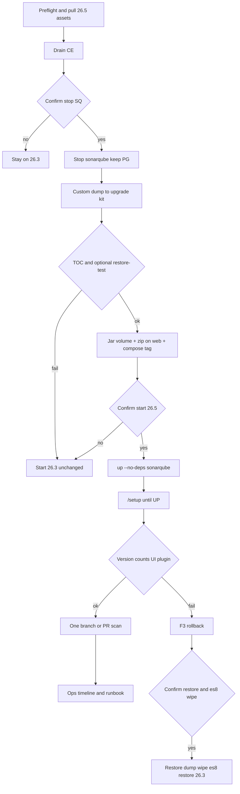

# mac-mini SonarQube 26.5.0 in-place upgrade - Plan

**Target host:** `mac-mini`. Stack lives at `~/stacks/sonarqube/` on that host, not in this repo.

**Product Contract preservation:** new bootstrap. Session-settled choices from the invoking conversation are labeled on the owning Key Decisions.

## Goal Capsule

**Objective:** The mac-mini SonarQube Community instance is on 26.5.0 with matching branch plugin. Existing users, projects, issues, quality profiles, and tokens are intact. If the new version does not come up cleanly, the instance is back on 26.3.0 with the same data.

**Means:** One in-place window: stop `sonarqube` only, custom-format dump, swap plugin jar + plugin webapp + image, run `/setup`. Rollback restores that dump and the 26.3 binaries. (KTD1, KTD2, KTD4)

**Authority:** User confirmed this scope on 2026-09-09. Host danger actions still follow `AGENTS.md`: confirm before stop/start of `sonarqube`, before `pg_restore`, and before wiping `es8`.

**Execution profile:** Smoke-first. Prove dump restore, then change the stopped stack, then prove HTTP/SQL/CI. No unit tests in this repo cover the host.

**Stop when:** `/api/server/version` is `26.5.0.122743` and status is `UP`; plugin 26.5.0 is in the start log; users/projects/issues match the pre-upgrade snapshot; one branch or PR scan succeeds; upgrade dump and 26.3 artifacts are retained; ops timeline and runbook history are committed.

**Out of this goal:** 26.6+; PostgreSQL upgrade; host/OAuth/scanner changes; a parallel stack; disabling mixed-load runners.

---

## Product Contract

### Summary

mac-mini still runs SonarQube `26.3.0.120487` with community-branch-plugin 26.3.0. Community Build has moved to 26.9, but the branch plugin's latest release is 26.5.0. This plan upgrades in place to that matched pair, with a dump that can put 26.3 back if `/setup` or verification fails.

### Problem Frame

Community Build has no LTA. 26.3 left support on 2026-04-10. iCare and evp PR/branch scans depend on the community branch plugin, so the instance cannot follow 26.9 until that plugin exists. An image-only bump would either break branch UI or, after schema migration, leave no supported way back.

### Key Decisions

- **Target is 26.5.0, not 26.9.** (session-settled: user-approved — chosen over 26.9: community-branch-plugin has no 26.6–26.9 release) Governs R1, R5.
- **One hop 26.3 → 26.5.** (session-settled: user-approved — chosen over stopping at 26.4: same-year Community Build may skip; 26.4 and 26.5 update notes are none) Governs R2.
- **In-place with a durable dump, not a parallel stack.** (session-settled: user-approved — chosen over a second compose on another port: extra disk, port, and URL work without changing the rollback contract) Governs R3, R4, R6.

### Requirements

**Version pair**

- R1. Running SonarQube is `26.5.0.122743-community` with community-branch-plugin `26.5.0`. PostgreSQL stays 17.11.
- R2. The hop is 26.3.0.120487 → 26.5.0.122743 in one window. 26.4 is not a required stop.

**Data and rollback**

- R3. After success or F3, these match the snapshot taken after `sonarqube` has exited and before `pg_dump`: users, projects (`qualifier=TRK`), issues, `user_tokens`, non-built-in quality profiles (four Cypresso names plus `active_rules` counts). Analyzer `rules` may increase on a successful 26.5 start only.
- R4. After schema migration, rollback replaces the live database with the dump (drop/create, not `--clean` onto the migrated catalog) and restores the 26.3 image, plugin jar, javaagent names, and web tree, then wipes `es8` in the same confirm. Reverting only the image is not a rollback.
- R5. The 26.3 web bind-mount is not left on 26.5. Web overlay for 26.5 is the plugin release `sonarqube-webapp.zip`.
- R6. The upgrade dump is outside whatever glob `backup.sh` actually prunes. Probe the script in U1; do not assume a subdirectory of `~/backups/sonarqube/` is safe.

**Operations window**

- R7. `sonar-postgres` stays up for the whole window. `docker-compose down` and any `-v` / `volume prune` are forbidden.
- R8. Scans that POST `http://mac-mini:9000` may fail from stop until `status=UP`. Mixed-load runners stay online.
- R9. `SONAR_HOST_URL`, `SONAR_TOKEN`, `sonar.core.serverBaseURL`, and GitHub OAuth callback stay `http://mac-mini:9000/oauth2/callback/github`.
- R10. Operator confirm is required for: first stop of `sonarqube`; first start of 26.5; the combined F3 restore (drop/create database + `es8` wipe + 26.3 binaries). Restore and `es8` wipe are one confirm, not two.

**Docs**

- R11. After the window, `docs/operations/mac-mini.md` records the action and `docs/runbooks/sonarqube-upgrade.md` records the new versions.

### Actors

- A1. Ops implementer on `mac-mini` and this repo.
- A2. Developers whose PRs run SonarQube Scan.
- A3. Compute Engine / Elasticsearch inside the `sonarqube` container.

### Key Flows

- F1. Happy upgrade
  - **Trigger:** Operator starts U1 after R10 confirm is scheduled.
  - **Actors:** A1, A3
  - **Steps:** Drain CE. Confirm, then stop `sonarqube`. Dump and prove restore. Swap jar, javaagent filenames, webapp zip, image tag. Confirm, then start 26.5. Run `/setup`. Wait `UP`. Verify counts, UI, one scan. Write docs.
  - **Covered by:** R1–R11
- F2. Abort before image change
  - **Trigger:** Dump TOC or restore-test fails, or preflight finds dirty web git / missing plugin assets.
  - **Actors:** A1
  - **Steps:** Do not change compose or volumes. Start 26.3 if it was stopped. Instance stays on 26.3.
  - **Covered by:** R7, R10
- F3. Rollback after `/setup`
  - **Trigger:** 26.5 does not reach `UP`, counts drift, plugin does not deploy, or login/branch UI is unusable beyond documented noise.
  - **Actors:** A1
  - **Steps:** One confirm. Stop `sonarqube`. Terminate backends. `DROP DATABASE sonarqube` then `CREATE DATABASE` owned by `sonarqube`. `pg_restore --no-owner --no-privileges --exit-on-error` into the empty DB (no `--create`). Wipe `data/es8` only. Restore 26.3 compose, jar, javaagent, web HEAD. Start 26.3. Prove `26.3.0.120487` and the snapshot.
  - **Covered by:** R4, R7, R10

### Acceptance Examples

- AE1. Covers R1 / F1. `GET http://mac-mini:9000/api/server/version` returns `26.5.0.122743` and `GET /api/system/status` is `UP`.
- AE2. Covers R3. After success and before the verification scan, SQL counts for users, TRK projects, issues, `user_tokens`, and non-built-in profiles/`active_rules` equal the post-stop sidecar. After F3 they equal that sidecar again.
- AE3. Covers R4 / F3. After a rollback drill or a real rollback, version is again `26.3.0.120487` and users, TRK projects, issues, `user_tokens`, and non-built-in profiles/`active_rules` match the post-stop sidecar.
- AE4. Covers R5. 26.5 login page and a project Branches/PR page load without hashed 26.3 asset 404s.
- AE5. Covers R6. Upgrade dump path is not `~/backups/sonarqube/sonarqube-YYYYMMDD.dump` and is not deleted by the next `backup.sh` prune.
- AE6. Covers R8. lemon-imac / mas-go-dev-ci / mac-mini-sonar slots remain `online` during the window. Failed Sonar jobs are rerun after `UP`, not treated as rollback.

### Success Criteria

- The instance serves 26.5.0 with branch/PR analysis, or it is back on 26.3.0 with the snapshot data.
- No GitHub secret or OAuth callback changed.
- A later operator can roll back from the retained dump using the updated runbook.

### Scope Boundaries

**In scope**

- mac-mini `~/stacks/sonarqube/` image, plugin jar, javaagent filenames, web bind-mount, and named volume `es8` wipe on rollback only.
- Durable upgrade dump plus 26.3 artifact kit.
- Announce-and-rerun freeze for jobs that hit `:9000`.
- This repo's operations timeline and runbook history.

**Deferred to Follow-Up Work**

- Move GitHub OAuth App to GitHub App (deprecated, still works on 26.5; needs HTTPS).
- Scanner Java 21 hard requirement (26.8).
- Upgrade beyond 26.5 when a matching plugin exists.
- Port the 26.3 full frontend rebuild. At most append the two grid utility rules onto the 26.5 plugin webapp if login layout is broken.

**Outside this product's identity**

- Parallel 26.5 stack and DNS cutover.
- PostgreSQL 18.
- Changing `SONAR_HOST_URL` or tokens.
- Disabling `mac-mini-sonar` or quality-pool runners for the window.
- Security Hotspots → issues migration (26.9 API).

---

## Planning Contract

### Key Technical Decisions

- KTD1. **Dump with `pg_dump -Fc` after `sonarqube` has exited; prove readability with `pg_restore -l` (no TTY).** A restore-test, if done, uses a throwaway Postgres 17 container or `-d sonarqube_restore_test` without `--create`. It never proves F3. Daily `backup.sh` custom format is the pattern for the dump file, not for live rollback. (session-settled: user-approved — instantiates in-place+backup over a parallel stack: R3, R4, R6)
- KTD2. **Web overlay is plugin 26.5.0 `sonarqube-webapp.zip` unpacked onto `~/stacks/sonarqube/sonarqube-web/` while SQ is stopped. Jar goes to the extensions volume, not that bind-mount.** Plugin README requires zip + jar + both javaagents. The 26.3 CSS fork is a full rebuild with hashed filenames and will 404 on 26.5. Do not rename `SONAR_WEB_JAVAOPTS` / `SONAR_CE_JAVAOPTS`. (R1, R5)
- KTD3. **Freeze is announce + cancel only `SonarQube Scan` jobs. Mixed-load runners stay `online`.** Unfreeze for the one verification scan after `UP` and a terminal `db_migration_status`. That scan is done when CE is `SUCCESS` and a new `snapshots` row exists. Then rerun the backlog. Quality-gate waits during ES rebuild may time out; rerun, do not roll back. Do not rename the required check. (R8)
- KTD4. **Post-migration rollback is drop/create `sonarqube` then `pg_restore --exit-on-error` into the empty DB, wipe `data/es8`, restore 26.3 binaries, start 26.3.** `--clean` onto a migrated catalog leaves 26.5 objects. 26.5 may bump embedded ES 8.x; old binaries refuse a newer `es8`. Restore and wipe are one confirm (R10). Never `compose down`. (R4, R7)
- KTD5. **Compose CLI is whatever the host has; 2026-09-07 ops notes say this Colima user has `docker-compose`, not the v2 plugin.** Probe once. `up -d --no-deps sonarqube` only. Do not pull `postgres:17-alpine`.
- KTD6. **Pull 26.5 image and download jar/zip before stopping SQ.** The window is dump + overlay + `/setup`, not downloads.
- KTD7. **Documented noise is not F3:** Issues `facets=authors` HTTP 400 (plugin 1285); banner "version no longer active" (latest is 26.9). F3 if 26.3 hashed assets 404, plugin 26.5.0 is missing, or version is not `26.5.0.122743`.

### High-Level Technical Design

Five components stay aligned: SQ image, PG 17, branch-plugin jar, plugin webapp overlay, scanners (unchanged). Data of record is PostgreSQL. Elasticsearch is disposable.

### Assumptions

None beyond the confirmed scope. Compose binary and exact volume names are probed in U1, not assumed from the 2026-05 migration text.

### Implementation Constraints

- Bind the official 26.5 update docs and the plugin 26.5.0 README. Deltas vs this repo's runbook are KTD1–KTD5; do not summarize those docs in units.
- `ssh` and `docker exec` for `-Fc` dumps must not allocate a TTY.
- Window avoids 03:15–04:00 CST (`backup.sh` at 03:30 and runner maintenance).
- Colima disk must have headroom for dump + image + a temporary ~2× DB copy during `/setup`.
- Healthcheck must treat `DB_MIGRATION_NEEDED` / `DB_MIGRATION_RUNNING` as healthy before the first 26.5 start. A restart during `/setup` is F3, not a second `up`.

### Sequencing

U1 (backup kit, SQ still 26.3, stop only after confirm) → U2 (stopped stack mutation) → U3 (start 26.5 + `/setup`) → U4 (verify) → U5 (docs). F2 exits after U1, or after U2 via restore-from-kit if binaries already swapped and `/setup` has not run. F3 may fire from U3 or U4; skip remaining upgrade units and continue at U5.

---

## Implementation Units

### U1. Preflight, confirm-stop, durable dump

- **Goal:** Leave a restore-proven 26.3 kit without changing image or plugin.
- **Requirements:** R6, R7, R10
- **Dependencies:** none
- **Files:** none in this repo. Host kit directory `~/backups/sonarqube/upgrade-26.3-to-26.5/` on `mac-mini`.
- **Approach:**
  1. Probe compose binary, `docker-compose config` (image, javaagent keys, volume names, healthcheck), PG 17.11, web git clean HEAD, extensions jar path, Colima disk (dump + live DB + `/setup` copy + optional restore-test), and the real `backup.sh` prune glob.
  2. While 26.3 is still up: pull `sonarqube:26.5.0.122743-community`; download plugin 26.5.0 jar and `sonarqube-webapp.zip`; copy current compose, `.env`, 26.3 jar, image digest, web HEAD. Drain CE (`ce_queue` empty) and cancel in-flight `SonarQube Scan` jobs. Fix healthcheck so a 26.5 `/setup` state is not restarted for lacking `UP` (KTD6 assets stay local).
  3. After R10 confirm: stop `sonarqube` and wait until `Exited` (lengthen stop timeout if needed). Then snapshot SQL (R3 columns) and `schema_migrations` max. Then `pg_dump -Fc` with no TTY into a kit path the prune glob cannot see.
- **Execution note:** This is packaging and backup. Prefer dump TOC / restore-test over any unit test.
- **Patterns to follow:** `docs/solutions/mac-mini/sonarqube-migrated-from-dev-cypresso-2026-05-13.md` §9 restore; host `backup.sh` custom format. Do not follow runbook §1.2 plain SQL.
- **Test scenarios:**
  - Happy: `pg_restore -l` lists `schema_migrations`, `internal_properties`, `users`, `components`, `issues`, `user_tokens`, `rules_profiles` table data.
  - Edge: dump path is outside the probed prune glob (AE5 / R6).
  - Error: TTY-corrupted dump fails `-l`; do not proceed to U2. Container still `running` after stop → do not dump.
  - Integration: optional restore into a temp PG 17 container (or `-d sonarqube_restore_test` without `--create`) matches the post-stop snapshot, then drop that DB. Not a substitute for F3.
- **Verification:** 26.3 can still start if U2 has not run. Kit contains dump, compose.bak, jar, web SHA, post-stop sidecar counts.

### U2. Swap plugin, webapp, and image tag

- **Goal:** Stopped stack is ready to boot 26.5 with matching plugin UI.
- **Requirements:** R1, R5; KTD2, KTD5
- **Dependencies:** U1
- **Files:** none in this repo. Host `~/stacks/sonarqube/docker-compose.yml`, extensions volume plugin jar, `~/stacks/sonarqube/sonarqube-web/`.
- **Approach:**
  1. Copy 26.3 jar out, then replace the single plugin jar in the extensions volume with 26.5.0. Do not `rm` a glob first. Do not put the jar on the web bind-mount.
  2. Sed only the jar filename inside existing `SONAR_WEB_JAVAOPTS` and `SONAR_CE_JAVAOPTS`.
  3. Unzip plugin `sonarqube-webapp.zip` over `sonarqube-web/` (web git was clean in U1).
  4. Change image to `sonarqube:26.5.0.122743-community`. Do not pull or recreate `sonar-postgres`.
- **Execution note:** Host config only. Smoke by reading compose and listing the volume jar, not by starting the container (U3).
- **Patterns to follow:** Plugin 26.5.0 README install order. Runbook §2.4 sed of filenames, not its vendor-26.4 checkout.
- **Test scenarios:**
  - Happy: compose image tag is 26.5.0.122743-community; both javaagent paths end in `sonarqube-community-branch-plugin-26.5.0.jar`; volume has that jar only.
  - Edge: `sonarqube-web/index.html` no longer references 26.3 hashed `main-BHI4wvfe.js`.
  - Error: if web working tree was dirty, abort and restore from kit rather than unzip.
- **Verification:** `sonar-postgres` still healthy. `sonarqube` still stopped.

### U3. Start 26.5 and run setup

- **Goal:** New binaries complete schema migration and reach `UP`.
- **Requirements:** R1, R7, R10; KTD4
- **Dependencies:** U2
- **Files:** none in this repo.
- **Approach:**
  1. After R10 confirm: `docker-compose up -d --no-deps sonarqube` once.
  2. Open `http://mac-mini:9000/setup` (API `POST /api/system/migrate_db` is fallback).
  3. Wait until `GET /api/system/status` is `UP` and `db_migration_status` is a success terminal (`NO_MIGRATION` or `MIGRATION_SUCCEEDED`). `schema_migrations` max has advanced or official notes say 26.3→26.5 has no step.
  4. `RestartCount > 0`, `DOWN`, `MIGRATION_FAILED`, or `schema_migrations` already past the sidecar while status is not `UP` → F3. Do not run `/setup` again. Do not treat `healthy` as done. If stuck past ~30 minutes, read `web.log` / `es.log` then F3.
- **Execution note:** Runtime smoke. Do not start the verification scan until `UP` and migration status is terminal (KTD3).
- **Patterns to follow:** Official Docker update + `/setup`. Never `down -v`.
- **Test scenarios:**
  - Happy: status moves `DB_MIGRATION_*` → `UP`; version is 26.5.0.122743 (AE1); migration status is terminal success.
  - Edge: healthcheck allows `DB_MIGRATION_*` and `RestartCount` stays 0.
  - Error: half-migrated schema triggers F3, not a second `up` or `migrate_db`.
- **Verification:** Postgres never stopped. Logs show Community Branch Plugin 26.5.0 deploy.

### U4. Verify data, UI, and one scan

- **Goal:** Prove the instance is usable for CI, or roll back.
- **Requirements:** R3, R8, R9; KTD3, KTD7
- **Dependencies:** U3
- **Files:** none in this repo.
- **Approach:**
  1. Re-run the post-stop snapshot SQL before any scan (AE2). Analyzer `rules` may rise. Tokens and Cypresso `active_rules` must not drift.
  2. Browser: login (GitHub OAuth callback unchanged), login layout, one project history, four Cypresso Quality Profiles, Marketplace plugin 26.5.0, a Branches/PR page (AE4). Apply KTD7: authors 400 and the inactive-version banner are pass; 26.3 hash 404 is F3.
  3. If login grid is broken, append the two known utility rules to the new main CSS. Do not restore 26.3 hashed assets.
  4. One verification `SonarQube Scan` (prefer `iCare-backend`). Pass only if the GitHub check name is still `SonarQube Scan`, CE activity is `SUCCESS`, and a new `snapshots` row exists for that project. Then rerun the backlog. ES reindex banner and QG timeout are rerun, not F3.
  5. Short watch: `schema_migrations` max stable; mixed-load runners still `online`.
- **Execution note:** End-to-end smoke including one CI job. Quality-gate timeout is rerun, not F3.
- **Patterns to follow:** Runbook §4 checks, with live counts instead of May 2026 numbers.
- **Test scenarios:**
  - Happy: AE1, AE2, AE4, plugin deploy line, CE `SUCCESS`, and a new `snapshots` row. Check name remains `SonarQube Scan`.
  - Integration: OAuth still returns to `http://mac-mini:9000/oauth2/callback/github` (R9). Mixed-load runners stay `online` (AE6).
  - Error: count mismatch or missing plugin deploy → F3 (AE3). Authors 400 or inactive-version banner must not trigger F3 (KTD7).
- **Verification:** A2 can scan again. Rollback kit is still on disk. `schema_migrations` max is stable after unfreeze.

### U5. Record the window in this repo

- **Goal:** Next upgrade does not follow the stale 26.4 / plain-SQL runbook.
- **Requirements:** R11
- **Dependencies:** U4 or F3
- **Files:**
  - `docs/operations/mac-mini.md` (create, newest-first)
  - `docs/runbooks/sonarqube-upgrade.md` (modify §0 table, §2 examples, §5 restore, §7 history)
  - `docs/solutions/mac-mini/workflow-issues/` only if the window produced a new reusable pitfall
- **Approach:**
  1. Operations entry: time CST, reason, impact, kit path, rollback, sequence, verification. Commit on `main` per `AGENTS.md`.
  2. Runbook: highest matched pair is 26.5.0 + plugin 26.5.0; compose CLI is probed; dump is `-Fc`; rollback is KTD4 drop/create not `--clean`/`psql`; delete the "26.5 plugin not released" row.
- **Execution note:** Documentation. `Test expectation: none -- ops timeline and runbook text.`
- **Patterns to follow:** Existing `docs/operations/mac-mini.md` entry shape; runbook §7 table columns.
- **Test scenarios:** none -- documentation
- **Verification:** History table has 2026-09-09 / 26.5.0.122743 / plugin 26.5.0 / PG 17.11.

---

## Verification Contract

This repo has no SonarQube test suite. Gates are host HTTP, SQL, logs, and one GitHub Actions scan.

| Gate | When | Pass |
| --- | --- | --- |
| Dump TOC | End of U1 | `pg_restore -l` lists the tables in U1 scenarios |
| Compose + jar + web | End of U2 | Image, javaagent filenames, single 26.5 jar, web index not on 26.3 hashes |
| API version + migration | End of U3 | `26.5.0.122743`, `status=UP`, migration status terminal success, `RestartCount=0` (AE1) |
| Counts | Start of U4, before scan | R3 columns match post-stop sidecar (AE2) |
| Plugin | End of U4 | Start log deploys Community Branch Plugin 26.5.0 |
| Scan | End of U4 | Check name `SonarQube Scan` success, CE `SUCCESS`, new `snapshots` row |
| Rollback kit | Always | Upgrade dump still present and outside the probed prune glob (AE5) |
| Runners | During window | Mixed-load slots `online`; only Scan jobs cancelled (AE6) |
| Docs | U5 | Operations entry + runbook history row |

Do not use `release:validate`. Do not treat authors-facet 400, the inactive-version banner, ES reindex UI gaps, or QG timeout as a failed gate (KTD7). Half-migrated schema is F3, not a second `/setup`.

---

## Definition of Done

**Global**

- AE1 and AE2 hold and the U4 verification scan gate holds (check name `SonarQube Scan`, CE `SUCCESS`, new `snapshots` row), or AE3 holds after F3 and 26.3 is serving again.
- R9 secrets and OAuth are untouched.
- Upgrade kit remains until a later operator deletes it on purpose.
- U5 docs are on `main`.
- Host scratch (`sonarqube_restore_test`, leftover `/tmp` zips) is removed.

**Per unit**

- U1: restore-proven dump in the non-rotating kit; 26.3 still the running image until U2.
- U2: stopped stack points at 26.5 image + plugin 26.5.0 jar/zip; postgres untouched.
- U3: `UP` on 26.5 or F3 completed.
- U4: live scan or F3 completed.
- U5: operations + runbook match what actually ran.

---

## Risks & Dependencies

| Risk | Mitigation |
| --- | --- |
| Schema migrated, operator only reverts image | KTD4 / F3 drop/create + es8 wipe |
| `--clean` restore leaves 26.5 objects | F3 never restores onto the migrated catalog |
| TTY corrupts `-Fc` dump or restore | No TTY on dump and restore; `-l` then `--exit-on-error` |
| Daily prune deletes the dump | R6: probe `backup.sh` glob |
| Restore-test uses `--create` on live | KTD1: temp container or named test DB without `-C` |
| Counts taken while SQ still writing | Snapshot after `Exited`, before dump |
| 26.3 web left mounted | KTD2 unzip before start |
| Jar copied onto web bind-mount | KTD2; probe volume name in U1 |
| `docker compose` not installed | KTD5 |
| Healthcheck / `unless-stopped` restarts during `/setup` | Probe before first 26.5 start; `RestartCount>0` is F3 |
| Mixed-load runners disabled "to freeze CI" | KTD3: cancel Scan jobs only |
| Protect-release check renamed or bypassed | Required name stays `SonarQube Scan`; red during window is expected |
| Window overlaps 03:30 backup | Avoid 03:15–04:00 CST; do not let `backup.sh` dump a half-migrated DB |
| Plugin Issues `authors` 400 or inactive-version banner | KTD7, not F3 |
| Colima disk full mid-migration | Preflight free space; official `/setup` may copy tables |

**Dependencies:** plugin 26.5.0 GitHub release assets; Docker Hub `sonarqube:26.5.0.122743-community` (arm64); operator at the two confirm gates.

---

## System-Wide Impact

iCare and evp Sonar jobs on `backend-ci` / `frontend-quality-ci` / `mac-mini-sonar` will fail until the verification scan in U4. Protect-release required check name is `SonarQube Scan`; red/`BLOCKED` during the window is the gate working. Do not change the ruleset, rename the check, or bypass cut PRs. Other checks on those mixed-load runners (Lint, Tests, Typecheck) should still be able to go green. Other Colima stacks (sub2api, richer, shared-dev-*) must not be restarted. `mac-mini-mobile-1` is out of scope. Do not resume `umacbook-pro` for this window.

---

## Documentation / Operational Notes

During execution, prefer this plan over `docs/runbooks/sonarqube-upgrade.md` where they conflict (plain SQL, `docker compose`, vendor-26.4, `psql` rollback, `compose down`). U5 folds those deltas back into the runbook.

Announce the window to A2 before U1 stop. Official `/setup` is the migration UI.

---

## Sources / Research

- `docs/runbooks/sonarqube-upgrade.md` — entry runbook; several commands superseded by KTD1–KTD5
- `docs/solutions/mac-mini/sonarqube-migrated-from-dev-cypresso-2026-05-13.md` — stack shape, backup.sh, CSS fork history
- `docs/solutions/mac-mini/integration-issues/sonarqube-github-oauth-callback-after-migration-2026-05-13.md` — why R9 must not move
- `docs/runbooks/ci-runner-pools.md` — who POSTs to `:9000`
- Official: [update path](https://docs.sonarsource.com/sonarqube-community-build/server-update-and-maintenance/update/determine-path.md), [pre-update](https://docs.sonarsource.com/sonarqube-community-build/server-update-and-maintenance/update/pre-update-steps.md), [Docker update / setup](https://docs.sonarsource.com/sonarqube-community-build/server-update-and-maintenance/update/update.md), [reverting](https://docs.sonarsource.com/sonarqube-community-build/server-update-and-maintenance/update/other-procedures.md), [release notes](https://docs.sonarsource.com/sonarqube-community-build/server-update-and-maintenance/release-notes.md)
- [plugin 26.5.0](https://github.com/mc1arke/sonarqube-community-branch-plugin/releases/tag/26.5.0) and tag README (jar + both javaagents + webapp.zip)
- Plugin issues [1285](https://github.com/mc1arke/sonarqube-community-branch-plugin/issues/1285), [1263](https://github.com/mc1arke/sonarqube-community-branch-plugin/issues/1263)
