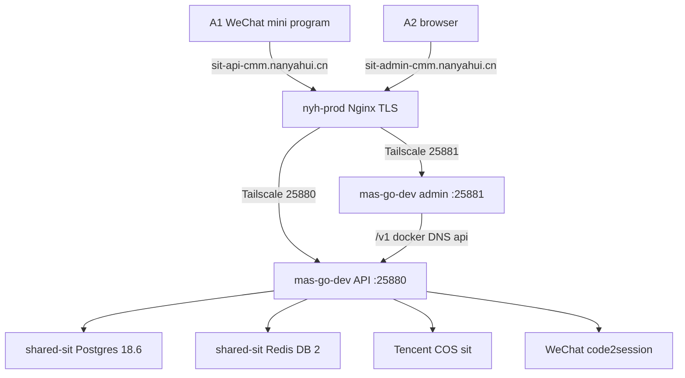

# 菜苗苗 SIT on mas-go-dev via nyh-prod - Plan

**Home repo:** this Server ops repo.
**App repo:** local tree `caimiaomiao`; GitHub/GHCR org is `caimiamiao` (`backend-cmm-api`, `frontend-cmm-admin`, `frontend-cmm-xcx`).
**Target hosts:** `mas-go-dev` (`100.109.223.53`), `nyh-prod` (`47.239.167.8` / `100.78.12.107`).

**Product Contract preservation:** new bootstrap. Session-settled choices from the invoking conversation are labeled on the owning Key Decisions.

## Goal Capsule

**Objective:** Testers can use the 菜苗苗 WeChat mini program against `https://sit-api-cmm.nanyahui.cn` and the staff console at `https://sit-admin-cmm.nanyahui.cn`. SIT data, Redis, and processes stay off `nyh-prod` and off production `cmm-prod`. Staff cookies stay host-only on the admin hostname.

**Means:** App containers and a `shared-sit` tenant on `mas-go-dev`. `nyh-prod` Nginx terminates TLS and reverse-proxies over Tailscale. (KTD1, KTD3, KTD4)

**Authority:** User confirmed this scope on 2026-09-12, including a public admin hostname. Host danger actions still follow `AGENTS.md`: confirm before Nginx reload, firewall, and any restart.

**Execution profile:** Smoke-first. Prove health, same-origin staff login, and one WeChat `wx.request` on the public names. This repo has no unit tests for those hosts.

**Stop when:** both public hostnames serve HTTPS with valid certificates; API `/healthz` and `/readyz` are ok; admin origin `/v1/staff/accounts` is 401 without a cookie and a seeded staff session survives refresh; mini program built with the SIT API base can complete login against the chosen test or development AppID; iCare and EVP on `mas-go-dev` stay healthy; ops timelines are committed.

**Out of this goal:** production `cmm-prod` first launch; `km-landui` as a front; GitHub Actions SIT auto-deploy; `seed-demo` in the production image; Garage as object storage.

---

## Product Contract

### Summary

菜苗苗 SIT runs on `mas-go-dev`. True-device mini program and staff browser hit `nanyahui.cn` names on `nyh-prod`, which reverse-proxies to Tailscale. The stack reuses production GHCR images with a SIT compose, not `deploy/prod/compose.yml` host-network.

### Problem Frame

Production CVM is not yet serving business API. Testers still need a public HTTPS API for WeChat and a staff console. `km-landui` has no reverse proxy and derper owns 443. Putting the app on `nyh-prod` would share a live NYH host and the wrong database engines. `mas-go-dev` already has PostgreSQL 18.6 and Redis on `shared-sit`. `nyh-prod` already speaks HTTPS.

### Key Decisions

- **Public front is `nyh-prod`, not `km-landui`.** (session-settled: user-directed — chosen over `km-landui`: derper owns 443, no Nginx, no Tailscale node, SIT does not care about extra latency) Governs R1, R8.
- **API hostname is `sit-api-cmm.nanyahui.cn`.** (session-settled: user-directed — chosen over `sit-api.caimiaomiao.com`) Governs R2.
- **App and database live on `mas-go-dev`.** (session-settled: user-directed — chosen over a full stack on `nyh-prod`) Governs R3.
- **Staff console is also public HTTPS.** (session-settled: user-directed — chosen over Tailscale-only admin) Governs R4.
- **WeChat uses the existing test or development AppID.** (session-settled: user-approved — chosen over a new production AppID) Governs R5.

### Requirements

**Public names**

- R1. `nyh-prod` terminates TLS for the two SIT hostnames and reverse-proxies only application ports on `mas-go-dev`. It does not host PostgreSQL, Redis, or COS.
- R2. Mini-program traffic uses `https://sit-api-cmm.nanyahui.cn`.
- R3. Application processes, PostgreSQL tenant, and Redis DB run on `mas-go-dev`.

**Staff console**

- R4. Staff use `https://sit-admin-cmm.nanyahui.cn`. Browser `/v1` calls stay on that host so host-only `Secure` cookies work. `CORS_ORIGINS` includes that origin.

**WeChat and files**

- R5. Request 合法域名 on the existing test or development AppID includes `https://sit-api-cmm.nanyahui.cn`. Production `api.caimiaomiao.com` is unchanged. Upload and download 合法域名 include the Tencent COS HTTPS origin used by SIT.
- R6. Object storage is a Tencent COS bucket or prefix dedicated to SIT. Not Aliyun OSS, not Garage.

**Isolation and deploy**

- R7. Images are `ghcr.io/caimiamiao/*@sha256:...`. Deploy is GitHub-hosted or laptop pull plus SSH to `mas-go-dev`. The `cypressoai` runner group `shared-sit` is not used.
- R8. `nyh-prod` upstream is the Tailscale IPv4 of `mas-go-dev`, not MagicDNS. PostgreSQL, Redis, and Garage ports are not published on public Nginx.
- R9. SIT uses `APP_ENV=sit` (not `local` / `development` / `test` / `production`). `COOKIE_SECURE=true`. Cookie `Domain` is unset.
- R10. Shared-sit tenant is its own database and login role `cmm`, Redis DB `2`, `CONNECTION LIMIT` that leaves headroom under Postgres `max_connections=80` (EVP already uses 40).
- R11. Published app ports bind `127.0.0.1` and `100.109.223.53` only. They are not `8080`/`8081` and not EVP `25173`/`25174`/`28081`/`28082`.

**Operator safety**

- R12. Nginx vhost files are backed up under `/www/backup/nginx-vhost/` before edit. Reload is confirmed. The 宝塔 Docker 反代「保存」button is not used on these sites after custom locations exist.
- R13. Compose `down -v` and `--remove-orphans` are forbidden on `mas-go-dev`.

### Actors

- A1. Buyer or merchant on the WeChat mini program (existing test or development AppID).
- A2. Staff in a browser on the admin hostname.
- A3. Ops implementer on `mas-go-dev`, `nyh-prod`, Tencent COS, and WeChat MP admin.

### Key Flows

- F1. Mini-program session
  - **Trigger:** A1 opens the SIT-built mini program.
  - **Steps:** `wx.login` → API `POST /v1/wechat/session` on R2 → later `wx.request` to the same host.
  - **Outcome:** Session works only after R5 is set in WeChat admin.
  - **Covered by:** R2, R5, R9
- F2. Staff login
  - **Trigger:** A2 opens the admin hostname.
  - **Steps:** SPA loads from R4; login `POST /v1/staff/session` on the same host; cookie `Path=/v1/staff` `SameSite=Strict` `Secure`; refresh still authenticated.
  - **Outcome:** Calling the API hostname with the same browser does not send the staff cookie.
  - **Covered by:** R4, R9
- F3. First bring-up
  - **Trigger:** A3 deploys images and env.
  - **Steps:** tenant (R10) → compose up (R7, R11) → TLS sites (R1, R12) → seed one staff → smoke.
  - **Covered by:** R1, R3, R7, R10, R12

### Acceptance Examples

- AE1. Covers R4 / F2. Given admin origin HTTPS, when A2 logs in with the seeded staff user, then a reload still has a session, and `GET https://sit-api-cmm.nanyahui.cn/v1/staff/accounts` from that browser is 401.
- AE2. Covers R5 / F1. Given the chosen test or development AppID has the SIT request domain and the project is not using `touristappid`, when the SIT mini program calls `/v1/wechat/session` with 校验合法域名 on, then the API returns a session.
- AE3. Covers R10. Given role `cmm`, when it connects to database `postgres`, then CONNECT is denied; connecting to database `cmm` succeeds.

### Success Criteria

- Public names present valid certificates on port 443, not only files on disk.
- `deploy/prod/smoke.sh` adapted to SIT bases passes on loopback and again through the public names.
- iCare `api` and EVP SIT containers remain healthy after CMM compose up.
- A3 can roll back by restoring the Nginx backup and `compose stop` of `/opt/cmm-sit` without `down -v`.

### Scope Boundaries

- In: first SIT that A1 and A2 can actually hit.
- Out: `cmm-prod` business launch; `km-landui`; changing production WeChat 合法域名.

#### Deferred to Follow-Up Work

- GitHub Actions workflow that SSHes SIT on `caimiamiao` org `main`.
- `seed-demo` (binary is not in the production image).
- Dedicated Tencent COS bucket if a prefix on an existing non-prod bucket is used first.
- Scheduled Postgres dump for the `cmm` database.

#### Outside this product's identity

- Using NYH MySQL RDS, Hong Kong PG 17 RDS, Tair, or `nyh-prod` Redis `:7480`.
- Registering `caimiamiao` repos into the `cypressoai` `shared-sit` runner group.

---

## Planning Contract

### Key Technical Decisions

- KTD1. **SIT compose uses the `shared-sit` bridge network, not `network_mode: host`.** Production `deploy/prod/compose.yml` cannot land as-is because iCare already owns host `8080`/`8081` and admin nginx listens on `127.0.0.1` only. Cite R3, R11.
- KTD2. **Publish API `25880` and admin `25881`.** Recheck with `ss` before bind. Map container `8080`/`8081` to those host ports on loopback and Tailscale only.
- KTD3. **Admin image gets a SIT nginx overlay: listen `0.0.0.0:8081`, proxy `/v1/`, `/healthz`, and `/readyz` to compose service `api`.** Production nginx listens only on `127.0.0.1:8081`, so Docker port publish cannot work without this overlay. `nyh-prod` reverse-proxies the whole `sit-admin-cmm` host to `:25881` and the whole `sit-api-cmm` host to `:25880`. F2 staff login is HTTPS-only on the public admin hostname because `COOKIE_SECURE=true`. Tailscale `:25881` is health, static, and `/v1` proxy smoke, not a browser login path. Cite R4, R9.
- KTD4. **Nginx `proxy_pass` uses `http://100.109.223.53:<port>`.** MagicDNS at start can fail and take down all of `nyh-prod` Nginx. Sites are ordinary 宝塔 websites with Let's Encrypt, not Docker 功能面板, so `renew_v2` can see them. ACME `/.well-known/acme-challenge/` is a location before the reverse proxy. Cite R1, R8, R12.
- KTD5. **Tenant: database and role `cmm` with `CONNECTION LIMIT 20`; Redis DB `2`; `APP_ENV=sit`; Tencent COS for SIT; `HTTP_ADDR=0.0.0.0:8080` in the API container.** Cite R6, R9, R10.
- KTD6. **First ship reuses already-built production GHCR digests.** No SIT tag, no `shared-sit` runner. Cite R7.
- KTD7. **Upstream keepalive plus a 15–30s `/healthz` probe from `nyh-prod` to `:25880`.** Direct Tailscale is ~40ms today. If it drops, DERP fallback is poor. SIT accepts slowness; it does not accept a hung first request with no probe. Cite R8.

### High-Level Technical Design

`nyh-prod` only forwards 25880 and 25881. Staff `/v1` is same-origin on the admin hostname because admin nginx (overlay) proxies to `api`. Mini program never needs CORS.

### Assumptions

- A records for both hostnames can be created on `nanyahui.cn` pointing at `47.239.167.8`.
- `mas-go-dev` can `docker pull ghcr.io/caimiamiao/*`. If pull fails, U4 falls back to `docker save`/`load` from a host that can pull.
- A3 has a test or development WeChat AppID and can edit 合法域名.
- COS sit credentials exist or can be created in the existing Tencent account without using production `cmm-prod-api` keys.

### Implementation Constraints

- Confirm Nginx reload and any listen-port bind on production-adjacent hosts.
- `api.env` mode `600` on the server. Secrets stay in `mas-go-dev/secrets.local.md` (gitignore) plus the host files.
- Container memory limits: API 256m, worker 128m, admin 64m. `restart: always`.
- Do not join iCare network `shared-services`. Do not create a new container named `redis`; use the shared-sit alias `redis` (container `shared-sit-redis`) in `REDIS_URL`.

### Sequencing

U2 (compose files) may start in the app repo while U1 provisions the tenant. U3 needs the chosen ports from KTD2. U4 needs U1 and U2. U5 after U3 and U4. U6 last.

---

## Implementation Units

### U1. shared-sit tenant and `/opt/cmm-sit`

- **Goal:** Isolated Postgres role/database and Redis DB `2`, plus an empty deploy directory.
- **Requirements:** R3, R10, R13
- **Dependencies:** none
- **Files:**
  - `mas-go-dev/README.md` (tenant row)
  - `mas-go-dev/shared-sit/bootstrap.sh` (parallel `cmm` block, no EVP reuse)
  - `mas-go-dev/secrets.local.md` (gitignore; location only in git)
- **Approach:**
  1. Create login role and database `cmm` per `mas-go-dev/README.md` 「新项目怎么接入」.
  2. `CONNECTION LIMIT 20`, `REVOKE CONNECT ON DATABASE cmm FROM PUBLIC`.
  3. Leave Redis DB `2` empty; do not create a Garage bucket.
  4. Directory `/opt/cmm-sit` owned by `ec2-user`, mode `750`.
- **Execution note:** This is host provisioning; prefer SQL and `redis-cli` smoke over unit tests.
- **Patterns to follow:** `mas-go-dev/shared-sit/bootstrap.sh` EVP tenant; never copy EVP passwords.
- **Test scenarios:**
  - Role `cmm` connects to database `cmm` and `SELECT current_user` returns `cmm`.
  - Same role connecting to `postgres` is rejected (AE3).
  - `ec2-user` can write `/opt/cmm-sit`; `actions-runner` is not required.
  - EVP `evp` database still accepts its own role.
- **Verification:** AE3 holds. `docker exec shared-sit-postgres` shows both databases. iCare and EVP containers still healthy.

### U2. SIT compose and admin nginx overlay

- **Goal:** A compose file that runs production GHCR images on `shared-sit` without host network.
- **Requirements:** R4, R7, R9, R11
- **Dependencies:** none for files; U1 before first `up`
- **Files:**
  - `caimiaomiao` `backend-cmm-api/deploy/sit/compose.yml`
  - `caimiaomiao` `backend-cmm-api/deploy/sit/nginx.conf`
  - `caimiaomiao` `backend-cmm-api/deploy/sit/api.env.example`
  - `caimiaomiao` `backend-cmm-api/deploy/sit/smoke.sh` (wrapper around `deploy/prod/smoke.sh`)
  - this repo `mas-go-dev/cmm-sit/` (optional对照 copy; server `/opt/cmm-sit` wins)
- **Approach:**
  1. Services `api`, `worker`, `admin`; ops profile `migrate` / `seed` / `verify` from the same API image. Every service, including ops profile jobs, joins `networks: [shared-sit]` with `shared-sit` `external: true`. No leftover `network_mode: host`.
  2. Overlay nginx: `listen 0.0.0.0:8081`; proxy `/v1/`, `/healthz`, `/readyz` to `http://api:8080`; static as today. Copy proxy headers from `frontend-cmm-admin/deploy/nginx.conf` (`Host`, `X-Forwarded-Proto`, `X-Forwarded-For`) and prefer inbound `X-Real-IP` from `nyh-prod` when present.
  3. Bind-mount that file over `/etc/nginx/nginx.conf` at mode `644` (container user `nginx` must read it). Do not use `api.env` mode `600` on this overlay.
  4. `HTTP_ADDR=0.0.0.0:8080`, `COOKIE_SECURE=true`, `CORS_ORIGINS=https://sit-admin-cmm.nanyahui.cn`.
  5. Publish `127.0.0.1:25880:8080`, `100.109.223.53:25880:8080`, same pattern for `25881:8081`.
- **Execution note:** Prefer install/runtime smoke over unit coverage.
- **Patterns to follow:** `mas-go-dev/evp-sit/docker-compose.yml` bind and mem_limit; production `deploy/prod/compose.yml` image digest and read-only flags where they still apply.
- **Test scenarios:**
  - From `mas-go-dev`, `GET http://127.0.0.1:25880/healthz` is ok and `25881/` contains the admin root div.
  - `GET http://127.0.0.1:25881/v1/meta` returns cmm-api JSON (overlay proxy works).
  - `ss` shows 25880/25881 on 127.0.0.1 and 100.109.223.53, not `0.0.0.0`.
  - `192.168.2.22:25880` does not connect (Tailscale-only publish).
- **Verification:** Compose `ps` healthy. EVP and iCare `StartedAt` unchanged after `up`.

### U3. nyh-prod DNS, certificates, Nginx

- **Goal:** Public HTTPS names forward to the Tailscale ports.
- **Requirements:** R1, R2, R4, R8, R12
- **Dependencies:** U2 (port numbers)
- **Files:**
  - host `/www/server/panel/vhost/nginx/` (two new sites)
  - backup `/www/backup/nginx-vhost/`
  - `docs/operations/nyh-prod.md` (after cutover, U6)
- **Approach:**
  1. A records to `47.239.167.8`.
  2. Ordinary 宝塔 websites, reverse proxy, Let's Encrypt.
  3. `proxy_pass http://100.109.223.53:25880` and `:25881`. Set `Host`, `X-Forwarded-Proto https`, `proxy_set_header X-Real-IP $remote_addr`, and `proxy_set_header X-Forwarded-For $remote_addr` (overwrite, do not append). HTTP/1.1 keepalive.
  4. ACME location serves files, not the upstream.
  5. 15–30s probe of `http://100.109.223.53:25880/healthz` (cron or existing monitor). Do not expose 5432/6380/3900.
- **Execution note:** Confirm before `nginx -s reload`. Backup then `diff` after any 宝塔 UI touch.
- **Patterns to follow:** `docs/solutions/nyh-prod/integration-issues/baota-ssl-acme-challenge-routing-fix-2026-05-19.md`; `docs/solutions/dev-cypresso/runtime-errors/nginx-fail-on-boot-dns-not-ready-2026-05-13.md`; `docs/solutions/nyh-prod/integration-issues/baota-domain-replace-wipes-custom-nginx-2026-09-11.md`.
- **Test scenarios:**
  - `https://sit-api-cmm.nanyahui.cn/healthz` is 200 and certificate SAN matches.
  - `https://sit-admin-cmm.nanyahui.cn/` is 200 HTML.
  - `http://sit-api-cmm.nanyahui.cn/.well-known/acme-challenge/` is not proxied to the API (no JSON 404 from Go).
  - `nginx -t` passes. `load.nanyahui.com` still 200 after reload.
  - Certificate end date on TCP 443 matches the new LE cert.
- **Verification:** Verification Contract Public smoke and Cert on the wire pass. `load.nanyahui.com` still 200. AE1 waits until after U4.

### U4. First boot: env, migrate, seed, smoke

- **Goal:** Running SIT with one staff user and passing smoke.
- **Requirements:** R7, R9, R10
- **Dependencies:** U1, U2
- **Files:**
  - host `/opt/cmm-sit/api.env` (600, not in git)
  - host `/opt/cmm-sit/.deploy.env`
- **Approach:**
  1. Copy compose overlay and examples to `/opt/cmm-sit`.
  2. Fill `DATABASE_URL` via `postgres:5432`, `REDIS_URL=redis://:<shared-sit-redis-password>@redis:6379/2` (password from host Redis env / `secrets.local.md`; missing password is `NOAUTH` on `/readyz`). Generate SIT-only `CSRF_SECRET` (≥32 random bytes), `SEED_ADMIN_PASSWORD`, WeChat test/dev secret, and COS sit credentials. Do not copy `cmm-prod` `api.env`.
  3. `docker pull` the same digests production already built.
  4. `compose --profile ops run --rm migrate` then `seed` then `verify`, then `up` api/worker/admin.
  5. Run SIT `smoke.sh` against loopback 25880/25881.
- **Execution note:** Smoke-first on the host. If GHCR pull fails, save/load from a pulling machine rather than building on `mas-go-dev` under memory pressure.
- **Patterns to follow:** `backend-cmm-api/deploy/prod/deploy.sh` order migrate → seed → verify → up → smoke, without requiring Tencent `BACKUP_RECEIPT`.
- **Test scenarios:**
  - `/readyz` reports db and redis ready.
  - Anonymous `GET /v1/staff/accounts` is 401.
  - Optional pre-TLS check: curl loopback `/v1/staff/session` with `Origin: https://sit-admin-cmm.nanyahui.cn` only proves CORS/header path, not browser Secure cookies. Staff session-survives-refresh is AE1 after U3.
  - Worker container is running.
  - `ALLOW_DEMO_SEED` is unset; production `seed` ran, not `seed-demo`.
- **Verification:** smoke script prints passed. No `down -v`.

### U5. WeChat 合法域名, COS CORS, SIT mini-program base

- **Goal:** A1 can complete session from a real device or WeChat devtools with domain check on.
- **Requirements:** R5, R6
- **Dependencies:** U3, U4
- **Files:**
  - `caimiaomiao` `frontend-cmm-xcx/config/` (SIT `TARO_APP_API` injection; no production default change)
  - COS bucket CORS (Tencent console; not in git)
- **Approach:**
  1. COS sit bucket or prefix: private, versioning off, CORS for `https://servicewechat.com` plus SIT admin origin if the console uploads.
  2. WeChat MP: request domain `https://sit-api-cmm.nanyahui.cn`; uploadFile/downloadFile = COS HTTPS origin.
  3. Build mini program with `TARO_APP_API=https://sit-api-cmm.nanyahui.cn`. Replace `touristappid` with the chosen test or development AppID before 校验合法域名 smoke. Do not upload that build as production.
- **Execution note:** Runtime smoke in WeChat; curl alone does not prove 合法域名.
- **Patterns to follow:** `caimiaomiao` `docs/deploy/runbooks/api-admin-deploy.md` 小程序 section; production COS inventory constraints.
- **Test scenarios:**
  - Devtools with 校验合法域名 on and real AppID (not `touristappid`): session request succeeds (AE2).
  - Credential or image upload (if SIT needs it) succeeds against the sit COS origin.
  - Production `api.caimiaomiao.com` 合法域名 list is unchanged.
- **Verification:** AE2. A3 records the AppID environment used (test vs development) in `secrets.local.md`, not the secret.

### U6. Ops documentation

- **Goal:** The two host timelines and `mas-go-dev` README describe the live SIT.
- **Requirements:** R12, R13
- **Dependencies:** U3, U4, U5
- **Files:**
  - `docs/operations/mas-go-dev.md`
  - `docs/operations/nyh-prod.md`
  - `mas-go-dev/README.md`
- **Approach:** Time-desc entries: why, impact, backup, rollback, verification. README table for `cmm` tenant like EVP.
- **Execution note:** Documentation only after the window.
- **Patterns to follow:** existing operations entries from 2026-09-12.
- **Test expectation:** none -- documentation after a verified window.
- **Verification:** entries exist on `main` with no secrets.

---

## Verification Contract

| Gate | When | Signal |
| --- | --- | --- |
| Tenant SQL | U1 | AE3 |
| Loopback smoke | U4 | `deploy/sit/smoke.sh` or `deploy/prod/smoke.sh` with `http://127.0.0.1:25880` and `:25881` |
| Public smoke | U3 after U4 | same checks on the two `https://sit-*-cmm.nanyahui.cn` bases |
| Staff cookie | U3 after U4 | AE1 |
| WeChat domain | U5 | AE2 |
| Neighbor health | U2, U4 | iCare api healthy; EVP 25173/25174 200 |
| NYH regression | U3 | `https://load.nanyahui.com` 200 after reload |
| Cert on the wire | U3 | Python/`openssl` against `:443` SAN and notBefore |

`release:validate` does not apply. No unit suite in this repo covers the hosts.

---

## Definition of Done

- All of Goal Capsule **Stop when** is true.
- U1–U6 verification fields hold.
- Abandoned compose experiments are not left as extra containers; `/opt/cmm-sit` is the only CMM app compose project.
- Secrets are 600 on the hosts and absent from git.
- `docs/operations/mas-go-dev.md` and `docs/operations/nyh-prod.md` record the window.

Per unit: the unit's **Verification** field.

---

### Open Questions

- Deferred: whether Tailscale ACL should restrict `25880`/`25881` to `nyh-prod` plus operator nodes. First ship treats the tailnet as trusted cleartext equivalent to loopback.
- Deferred: whether `sit-api-cmm` should 404 `/v1/staff`. First ship proxies the full API on both public names; staff cookies still do not attach to the API hostname (AE1).

## Risks & Dependencies

- Tailscale direct drop between Hong Kong and home NAT. Mitigation: KTD7. Residual: slow or failed SIT while home is on DERP `hkg`.
- 宝塔 UI rewrite of vhosts. Mitigation: R12, backups.
- `mas-go-dev` 8G already runs iCare, EVP, runners. Mitigation: mem_limit. Residual: swap pressure during image pull.
- GHCR pull from `mas-go-dev` unproven. Mitigation: U4 fallback save/load.
- WeChat 合法域名 is a human console step. SIT mini program is blocked until U5.

## Sources / Research

- `mas-go-dev/README.md` tenant rules; `mas-go-dev/evp-sit/docker-compose.yml`
- `caimiaomiao` `backend-cmm-api/deploy/prod/compose.yml`, `api.env.example`, `cmd/api/main.go` (`isLocalEnvironment`, COS/WeChat required)
- `caimiaomiao` `frontend-cmm-admin/deploy/nginx.conf` and `docs/deploy/runbooks/api-admin-deploy.md`
- `docs/operations/nyh-prod.md` and `docs/operations/mas-go-dev.md` 2026-09-12 connectivity
- `docs/solutions/nyh-prod/integration-issues/baota-ssl-acme-challenge-routing-fix-2026-05-19.md`
- `docs/solutions/nyh-prod/integration-issues/baota-domain-replace-wipes-custom-nginx-2026-09-11.md`
- `docs/solutions/dev-cypresso/runtime-errors/nginx-fail-on-boot-dns-not-ready-2026-05-13.md`
- `docs/solutions/dev-cypresso/integration-issues/docker-compose-env-file-edit-triggers-recreate-2026-05-28.md`
