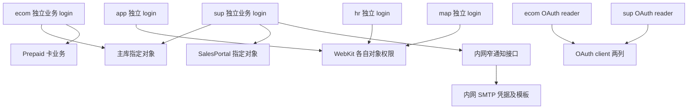
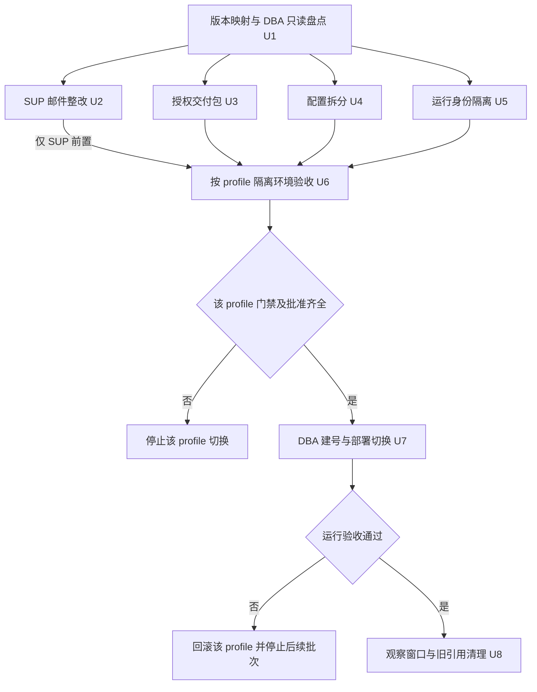

# CYP-2600 公网数据库账号隔离 - Plan

文档归属：Server 运维仓。实施目标：iCare 根仓及其 `backend`、`public-backend`、`terraform` 子仓。
下文 `Server:` 和 `iCare:` 指定路径所属仓库，路径均相对该仓根目录。新增文件会明确标注；SQL 名称和 secret 名称是待盘点确认的方案，不代表已经创建。

## 2026-09-22 实施进度补充

- 用户接通 VPN 后，以本机 `.env.preprod` 的 `mas_ref_owner` 经 TCP 连接 `ihc-db-uat`。五库 `db_owner=1`，`sysadmin=0`。Azure MFA 过期，未走上次 sysadmin Run Command。
- 跑完 `inventory-followup.sql` 的 SELECT 批次（官方 sysadmin THROW 跳过）。`tblprovidertemplate`、`tblretailquotationbenefitclass` 确认不存在，不建表、不 GRANT。
- 密钥为 AES_256 `ENCRYPTION BY PASSWORD V2`。主库仅复制 DDL 触发器。审核包已更新 matrix/README/followup-findings。
- 仍未执行建号、授权、最终 digest 签收、隔离正反向测试。
- 2026-09-22 列收口：全部业务表 SELECT/UPDATE 已写入列清单（含 SUP 39 张）。INSERT/DELETE 仍表级。审核包 `column-tightening.md`。未执行 SQL。
- 2026-09-22 sysadmin owner 映射（Azure Run Command）：SalesPortal=`dcandaya`，Prepaid=`eapelegrino`，auth=`ihc-db-uat\ihcadmin`；主库/WebKit=`sa`。七候选 login 仍缺失。未建号。

## 2026-09-17 实施进度补充

- U1：六库高权限只读盘点已交付，本机复核归档、原 SQL、六 JSON 的 SHA-256/字节数、ZIP CRC、102 个结果集及行数通过。执行入口是 Shared Memory，TCP/ACA 未验收。
- 用户明确最终 digest 尚未选定，先按候选 backend `0268903a` / public-backend `03abb25d` 整理审核草案；O1 保持未签收。
- U3：Terraform 实施工作区 `docs/deployment/sql/cyp-2600-public-logins/` 已准备 metadata-review、permission-matrix、module-evidence、补充只读查询及建号/授权/回滚草案。98 行需求匹配 96 行对象，两行 SUP 表因原 inventory 过滤尚待补证，暂不生成 GRANT。
- O2：不再等待原始盘点。待 DBA 私下审核模块/动态 SQL/密钥链、两张表、public diagram 继承、列收口和 owner/SID。七候选 login 与六库同名 user 在快照均缺失，不替代执行窗口复查。
- U3 草案不等于最终执行版；两份变更 SQL 除无条件 THROW 外全为注释。U3/U6 的隔离 SQL Server 正反向、重复执行及回滚验证未完成，U7/U8、生产写入批准、O3/O4 继续待办。
- 本轮只处理本地文件，没有连接或改动 SQL/Azure，没有改业务源码。最新审核说明见 [DBA 执行清单](../runbooks/icare-prod-dba-login-cyp-2600.md)。

## Goal Capsule

- **Objective：** 运维人员可以单独停用或轮换某个公网服务的数据库身份，其余服务仍能正常工作；该服务不能借自己的身份访问超出业务需要的数据。
- **Means：** 五个 profile 各用独立业务 login，保留两个 OAuth reader，配套收紧密码读取边界并分批切换（KTD1、KTD2、KTD5）。
- **Authority：** 用户指令与各仓操作守则优先；Product Contract 约束行为，Planning Contract 决定实现，Implementation Units 不改变二者。
- **Execution profile：** 本次仅保存计划。未来实施先完成代码、配置及非生产验证，再由 DBA 执行获批的 SQL 变更，由部署负责人执行获批的 KV/RBAC 与发布变更。
- **Stop conditions：** 目标实例或账号归属不明、权限依赖无法核验、SUP 邮件仍依赖公网 SMTP、可跨服务取数据库密码、拟部署镜像未对齐源码，均阻止相关服务切换。缺少生产写入批准时停在交付包。
- **Landing：** Server 文档只在 `main` 提交；其它仓执行时读取各自规则，不将 Server 分支规则外推。DBA、应用负责人和部署负责人分别签收自身结果，不能以代码合并替代上线验收。

---

## Product Contract

### Summary

将 ecom、sup、app、hr、map 从共享数据库身份迁到各自的最小权限身份。先解决 SUP 邮件凭据依赖，形成可审核的授权与配置交付包，再分批建号、切换、验证和移除旧引用。

### Problem Frame

当前 Terraform 让这五个 profile 复用 `mas_prod_owner`，权限与故障影响难以按服务划分。同一 login 的多库连接还引用了多个密码 secret，存在映射不一致风险。

代码核对表明各服务需要的权限不同。SUP 确有主库写入，还会从 `sys_app_settings` 整表读取配置后筛选邮件凭据；只建低权限账号会暴露这些旧依赖。当前本地源码与拟部署镜像尚未逐一对应，线上身份和授权也未由 DBA 核验。

### Requirements

**账号与访问边界**

- R1. 五个 profile 各持有独立的业务 login 和密码，不复用 MAS、其它 profile 或 UAT 的业务身份；同一 login 的多 catalog 连接使用同一个密码来源。
- R2. 每个业务账号仅获得实际挂载功能需要的对象及操作权限，以既有取证清单为起点，结合列、UDF/SP、密钥、触发器和实际 SQL 收口。
- R3. app、hr、map 只直连 WebKit；ecom 和 sup 保留已查明的必要跨库范围，各自 OAuth reader 仅读 `oauth_clients` 的 `id`、`secret`。
- R4. SUP 注册、恢复及通知邮件由内网发送；公网 SUP 不再读取 SMTP 凭据或 `sys_app_settings`，保持现有对外业务语义。
- R5. 每个公网服务的运行身份不能从 Key Vault 取得 MAS 或其它 profile 的数据库密码；不能仅靠隐藏环境变量宣称完成隔离。

**兼容、验收与执行责任**

- R6. 保留各服务现有成功、失败和数据归属语义；SQL 账号隔离不替代会员、公司和调用方授权。
- R7. 使用受限身份完成正向功能与反向越权验证，证据覆盖真实 SQL Server 和最终工作负载路径。
- R8. DBA 负责目标实例的账号及权限变更；变更前备份身份和配置状态，生产写入、RBAC 修改及发布须有对应批准。
- R9. 账号交付不得修改旧 preprod/UAT principal、密码、SID，也不得以建号为由修改业务 schema/data；MAS 仍使用的共享 login 不因公网迁出而被删除或降权。
- R10. 交付材料明确源码 SHA、镜像 digest、配置版本、授权差异、secret URI/版本、执行人及验证结果，未完成的验收不得记为通过。

### Key Decisions

- **由 DBA 执行建号清单。** 沿用现有 DBA 分工。Governs R8. (session-settled: user-directed — chosen over 向助手提供受控 DBA 凭据执行: 用户选择由 DBA 执行清单)

### Actors

- A1. 应用负责人：核对实际 SQL、改造邮件边界、提交权限需求与测试证据。
- A2. DBA：核验实例、身份及对象，审核和执行 SQL 交付包，提供回执。
- A3. 部署/KV 管理员：创建受控 secret、配置运行身份与授权、实施流量切换和回滚。
- A4. 用户/变更批准人：审阅最终交付包，确定生产窗口与批准范围。

### Scope Boundaries

范围固定为上述五个 profile 及两个 OAuth reader。MAS、Operations、telemed、insurer connector、accredited 等其它消费者仅盘点关联，账号整改另行规划；本计划不声称已覆盖全部公网服务。

不恢复整库、不改变 SQL TLS 配置、不迁移 catalog、不运行 seed/migrate，不重做登录协议或全系统行级安全。现有主库与 preprod/UAT 共用事实仍然存在，账号名带 `prod` 不等于数据已按环境隔离。

#### Deferred to Follow-Up Work

其它通信凭据、共享存储/Redis 身份、其它公网 profile 与 MAS/Operations 的权限治理另行处理；与 R5 直接相关的数据库密码取用路径必须在本计划内关闭。

### Acceptance Examples

- AE1. Covers R1, R3, R7. MAP 可注册和改密，但不能删除会员账号、读取主库业务表或使用 App 独有健康记录表；App 的合法功能不受影响。
- AE2. Covers R2, R6. SUP 的合法申请写入与失败补偿成功，更新企业加盟标记时不能修改未授权列；不得为通过测试给全库 writer。
- AE3. Covers R4, R6. SUP 注册落库后邮件失败，仍按现有契约记录失败且不回滚注册；公网进程无法读取邮件配置。
- AE4. Covers R5. 某 profile 能取自己的 SQL 密码；尝试取得其它 profile 或 MAS 数据库密码被拒绝，结果不输出 secret 内容。
- AE5. Covers R8, R9. DBA 遇到已有同名 login 且归属不明时停止，不重置密码、重绑旧 user 或删除重建。

---

## Planning Contract

### Evidence Baseline

源码基线：backend `88ab59e591eb784c2f2a68a2a20b55dbdbb7e9c4`、public-backend `03abb25d0f57be86598ed7db444fe0401f61f4bf`、Terraform `2769f44753834b99db205ed3d854a49043d2709f`。它们是本地证据，不代表当前部署版本。

目标配置指向 `10.100.0.4:1433`，历史交接为 SQL Server 2017。catalog 为 `medicalassistance_preprod`、`maswebkit_preprod`、`insularsalesportal_preprod`、`masprepaid_preprod`、`authprovidermasuat`。DBA 在执行窗口复核实例版本和对象；`replicated` 配置实际指主库。

### Key Technical Decisions

- KTD1. **按服务建 SQL 身份，不按连接串另建身份。** 实现 R1、R3。ecom 可在主库与 Prepaid 映射不同 user，但它们属于同一 login；sup 主库、replicated、SalesPortal 同理。OAuth reader 保持分开，不借业务账号读 OAuth。
- KTD2. **对象授权直接绑定该 profile 的独立 user，暂不引入通用权限角色。** 实现 R2。禁止宽泛 reader/writer、`db_owner`、schema 级全量授权或提权原语；核对 `public`、guest、角色继承与所有权链的有效权限。授权列表不能只看显式 GRANT，依据 [Microsoft 有效权限说明](https://learn.microsoft.com/en-us/sql/relational-databases/security/authentication-access/determining-effective-database-engine-permissions?view=sql-server-ver17)。`OUTPUT` 返回列及触发器限制也需检查，依据 [OUTPUT 文档](https://learn.microsoft.com/en-us/sql/t-sql/queries/output-clause-transact-sql?view=sql-server-ver17)。不为跨库访问开启 `TRUSTWORTHY` 或跨库所有权链。
- KTD3. **SUP 邮件复用内网通知领域和认证机制。** 实现 R4、R6。新增窄业务能力，以持久化代理/申请标识和固定 purpose 定位收件人及模板；欢迎邮件必需的一次性临时密码可作为受校验的秘密参数传入，但不记录、不回显。公网不得提供任意收件人、主题、HTML 或模板地址。先刻画现有失败语义，不自动加入重试、队列或“恰好一次”承诺。
- KTD4. **Terraform 显式按 profile 生成连接及 secret 绑定。** 实现 R1、R3。PROD 缺少独立用户名或 URI 时直接阻止发布，不回退到 MAS 凭据。保留非 PROD 已有行为的显式兼容路径，并用测试证明本次不会隐式改变 UAT。
- KTD5. **数据库密码边界同时约束 Azure 运行身份。** 实现 R5。当前多个容器挂载共享 `runtime_identity` 是静态事实，实际 RBAC 尚待核验。五个 profile 使用各自专属 UAMI，并仅允许读取自身必需 secret；ACR 拉取权限随专属身份配置，不继续附带可读 MAS 数据库密码的共享身份。已有符合要求的专属身份可复用。Azure RBAC 仍由既有外部分工交付，Terraform 不擅自接管组织管理的授权。
- KTD6. **先证明权限可用，再分批切换。** 实现 R7、R8、R10。默认顺序 MAP → HR → App → ecom → sup，SUP 等 U2 完成。新增身份不动现有会话；未部署服务保持关闭，直到自身门禁齐备。新旧 revision 并存期间评估连接池总量，不同时全量扩容。
- KTD7. **回滚只撤销本次差异。** 实现 R8、R9。按下文回滚规则恢复 revision/引用或撤销新增授权，不恢复共享整库。保留 MAS 仍需的旧 login，不将“公网已迁出”当成删号依据。

### Proposed Identity Map

DBA 盘点无冲突后，由应用与部署负责人签收此映射。候选名称不是执行授权；OAuth 名称沿用现有配置。

| profile | 业务 login 候选 | 业务 catalog | KV secret 候选 | 权限摘要 |
| --- | --- | --- | --- | --- |
| ecom | `ecom_runtime_prod` | 主库、Prepaid | `ecom-db-password` | 主库指定表查询；卡表增改查 |
| sup | `sup_runtime_prod` | 主库、SalesPortal | `sup-db-password` | SalesPortal 按表读写；主库申请增改删查及加盟标记更新 |
| app | `public_app_runtime_prod` | WebKit | `public-app-db-password` | 会员、通知、报销、健康等必要操作 |
| hr | `public_hr_runtime_prod` | WebKit | `public-hr-db-password` | 企业账号查询修改；未同步修订查询删除 |
| map | `public_map_runtime_prod` | WebKit | `public-map-db-password` | 会员查询新增修改、密码历史新增、附件字典查询 |
| ecom OAuth | `ecom_oauth_reader_prod` | OAuth | `ecom-auth-db-password` | 只读 `oauth_clients(id, secret)` |
| sup OAuth | `sup_oauth_reader_prod` | OAuth | `sup-auth-db-password` | 同上，独立身份 |

### High-Level Technical Design

SUP 邮件调用顺序：公网完成原业务写入 → 内网验证专属服务身份和窄 scope → 按业务标识查收件人与固定模板 → 发送并返回有限结果 → 公网沿用原错误处理。内网失败不允许降级回公网 SMTP。

### Assumptions

以下为实施方案假设，尚非线上核验结论：拟继续使用现有五个 catalog；有可供验证的隔离 SQL Server 环境；能够为五个 profile 提供专属 Azure 运行身份。U1/U5 核验失败时阻止相应实施，不自行扩大到建库或更改网络拓扑。

分批顺序采用 KTD6，观察窗口暂定每批至少 30 分钟并覆盖一次已批准的业务冒烟；低流量下仅“无报错”不能作为通过证据。最终窗口由发布负责人在生产批准前写入回执。

### Open Questions

以下均为**生产实施阻塞项**，不阻止先准备本地代码和交付文档：

- O1. 应用负责人提供各 profile 实际拟部署 digest 对应源码 SHA；消除与本报告基线的差异后才签权限表。
- O2. DBA 返回对象 schema、同义词/触发器、加解密原语定义及有效权限、同名身份归属和共享依赖；检查结果不得由低权限查询空结果代替。
- O3. KV 管理员核实每个可被容器使用的身份及继承授权，确认专属身份不能取得其它数据库密码；交付独立 secret 的 URI/版本和取用回执，不交付明文到文档。
- O4. 发布负责人明确各 profile 是否已部署、当前 revision/流量、可回退版本、执行窗口、冒烟身份和批准人。未知时不触发 deploy/apply。

### System-Wide Impact

SUP 会新增对 MAS 内网通信入口的依赖。新增 caller 与 scope 必须覆盖服务 token、传输认证、私网可达性和日志归因；不能借用 public-app/hr/map 的身份。MAS 发版顺序先于新 SUP，旧 API 契约保持可用。

SQL 连接池在新旧 revision 并存时可能翻倍。交付包需记录各 profile 的池上限和 replica 数，DBA 核对共享实例预算。KV 身份拆分也影响 ACR、Redis、存储等既有依赖的可用性：只迁移本服务必要读取授权，不顺带改服务功能。

---

## Implementation Units

### U1. Freeze Evidence and DBA Inventory

**Goal：** 将本地推断转成 DBA 和部署方可以签收的精确映射。**Requirements：** R2、R8、R9、R10。**Dependencies：** 无。

**Files：** Server: `docs/runbooks/icare-prod-dba-login-cyp-2600.md`、`docs/runbooks/icare-prod-public-db-permissions-cyp-2600.md`；iCare: `terraform/docs/deployment/prod-dba-handoff.md`、`docs/deployment/prod-ops-log.md`。

**Approach：** 依据既有 DBA 只读查询核对 O1/O2/O4，逐行记录 profile、host、login/user/SID、catalog、对象动作、镜像版本、secret 引用和执行责任。账号“缺失、已存在且归属明确、冲突待查”分别处理。

**Test expectation：** 无应用行为变更，不新增单元测试。审阅场景：同名冲突必须停止该行；元数据不可见不能判定不存在；源码不匹配镜像时权限表不能签收。

**Verification：** 每项证据有来源和时间，所有未核验值显式保留为阻塞项；未读取密码或业务行。

### U2. Move SUP Mail Behind Internal Boundary

**Goal：** 解除 SUP 对邮件配置表与 SMTP 的依赖。**Requirements：** R4、R6、R7。**Dependencies：** U1 的源码基线，不依赖生产建号。

**Files：** iCare: `backend/internal/modules/sup/runtime.go`、`backend/internal/modules/sup/accreditation/registration_effects.go`、`backend/internal/modules/sup/accreditation/registration_service.go`、`backend/internal/modules/sup/user/registration_service.go`；`backend/internal/modules/notifications/{dto,service,repository}/`、`backend/internal/modules/notifications/delivery/http/internalapi/handler.go`、`backend/internal/modules/notifications/module.go`；`backend/internal/platform/serviceauth/registry.go`、`backend/internal/config/config.go`、`backend/internal/server/server.go`。新增 SUP 通知客户端文件放在 `backend/internal/modules/sup/` 内，具体名字在实现时确定。

**Test files：** 现有 `backend/test/sup/registration_effects_test.go`、`user_registration_test.go`、`accreditation_registration_test.go`、`production_registration_test.go`；`backend/internal/modules/notifications/delivery/http/internalapi/handler_test.go`、`backend/internal/platform/serviceauth/registry_test.go`；新增 `backend/test/sup/internal_notification_contract_test.go`、`backend/internal/modules/notifications/service/agent_notice_test.go`。

**Approach：** 按 KTD3 扩展既有领域服务，新增 SUP 专属 caller/scope 与客户端配置。公网调用改用持久化记录标识；内网读取代理人和管理员收件人、套固定模板。移除公网 MailSettings 注入，重新核对 `tblpushemailnotification` 与 `tblusers.emailadd` 是否仍需授权。

**Execution note：** 先用现有测试刻画所有实际挂载的注册、恢复和通知路径，尤其是落库后发信失败语义。

**Test scenarios：**

1. Covers AE3. 注册成功后内网发送失败，数据库提交与对外结果保持原有语义，并有无敏感内容的失败记录。
2. 欢迎、申请通知和密码恢复分别使用正确模板及数据库收件人；用户输入不能覆盖收件人、主题或 HTML。
3. 错 caller、错 scope、不存在或不属于该业务范围的标识均被拒绝；public-app/hr/map 无法借其身份调用新增 SUP 能力。
4. 超时与重复请求不自动产生无界重试；已完成注册不重复写入，日志不记录一次性密码。
5. 集成环境撤销 SUP 的配置表读取权限后，注册和恢复链仍可运行；MAS 及其它现有通知调用不回归。

**Verification：** 新 SUP 的运行装配及实际调用均不访问 SMTP 设置；新接口只挂内网，功能与失败契约有测试证据。

### U3. Produce Object Grants and Reverse Changes

**Goal：** 交付 DBA 可逐项审核的建号、授权、验证和反向操作材料。**Requirements：** R1、R2、R3、R8、R9。**Dependencies：** U1；SUP 最终授权还依赖 U2 结果。

**Files：** iCare: `terraform/docs/deployment/prod-dba-handoff.md`；新增 `terraform/docs/deployment/sql/cyp-2600-public-logins/README.md`、`create-and-grant.sql`、`verify.sql`、`rollback.sql`。Server 两份 runbook 仅更新引用及最终范围。

**Approach：** 按 KTD1/KTD2 逐对象生成材料，密码通过获批保密工具注入，不进入源码或命令参数。脚本核验目标实例/catalog、同名归属和版本，已存在身份不得自动重置。反向材料只包含本次创建的主体与新增授权。

**Test scenarios：**

1. Covers AE5. 同名冲突、对象缺失或实例不符时失败关闭，不继续后续授权。
2. 重复执行不扩大权限、不更改既有密码/SID；明确记录部分成功状态，失败后可定位精确差异。
3. ecom 的跨库查询、SUP 加解密/补偿、HR 解密、App 的 applock 和 INSERT OUTPUT 返回值均在隔离 SQL Server 验证。
4. OAuth 仅所需列可读且不能写；MAP 不能 DELETE；SUP 不能读 `sys_app_settings`；没有额外 catalog 的业务访问能力。
5. 对本次新增身份执行反向材料后，原 preprod/UAT/MAS 身份及权限快照一致。

**Verification：** DBA 审核对象和列清单；权限检测同时覆盖直接、继承及可经模块获得的权限。授权 SQL 不包含建表、改表、seed 或业务 DML。

### U4. Split Terraform Database Bindings

**Goal：** 每个 profile 只收到自己的数据库身份与连接配置。**Requirements：** R1、R3、R9、R10。**Dependencies：** U1 的映射；可与 U2/U3 并行准备。

**Files：** iCare: `terraform/workloads/main.tf`、`variables.tf`、`modules/container_apps/main.tf`、`modules/container_apps/variables.tf`、`terraform/environments/prod.workloads.tfvars`；测试 `terraform/workloads/tests/prod-workloads.tftest.hcl`、`prod-gates.tftest.hcl`、`workload-contract.tftest.hcl`。

**Approach：** 按 KTD4 增加 profile 级 username 与 URI 输入，拆开 `database_env` 和各 secret bindings。sup 主库/replicated/SalesPortal 引用同一业务 secret；ecom Prepaid 延用已存在跨库访问方式。未使用的 WebKit/SalesPortal 配置不随 MAS 共享映射进入公网容器。

**Test scenarios：**

1. 七个 SQL 身份映射明确，业务用户名及 secret 对象彼此独立，且均不同于 MAS/UAT 来源；URI 比较不能被不同版本后缀绕过。
2. 缺用户名、空 URI、复用 MAS 密码来源、sup 多连接密码来源分叉时，PROD 发布门禁失败。
3. app/hr/map 不出现主库凭据；ecom/sup 不收到无关库密码；OAuth 仍使用各自 reader。
4. 未开启的 profile 不要求提前交付其 secret，也不意外创建工作负载；现有 UAT 契约仍通过。

**Verification：** mock provider 测试和 Terraform 静态校验通过；配置中只有 URI，无 secret 值，实际发布开关保持原值直到 U7。

### U5. Isolate Runtime Secret Access

**Goal：** 关闭通过共享 Azure 身份绕过 SQL 隔离的路径。**Requirements：** R5、R8、R9。**Dependencies：** U1、U4。

**Files：** iCare: `terraform/workloads/main.tf`、`modules/container_apps/main.tf`、`modules/container_apps/variables.tf`，复用 `terraform/workloads/modules/identities/`；`terraform/docs/deployment/prod-dba-handoff.md` 记录 RBAC 外部交付；测试扩展 `terraform/workloads/tests/prod-workloads.tftest.hcl`、`prod-gates.tftest.hcl`。

**Approach：** 按 KTD5 核对可挂载身份与 Azure 继承权限，交付每 profile 的专属身份及必要 secret/ACR 访问矩阵。先准备新身份和授权，再切容器绑定，保留其它消费者仍需的共享身份。若 KV 授权模型或组织权限无法做到隔离，停在阻塞说明，不临时扩大到整 vault 读取。

**Test scenarios：**

1. Covers AE4. 各身份能解析自身业务/OAuth 及必要运行 secret，不能读取 MAS 或其它 profile 的 SQL secret。
2. 仅更换 secret 引用但仍附带有广泛 KV 权限的共享身份时，验收失败。
3. 新身份可拉取固定 digest 镜像，既有 Redis/存储等必需依赖正常，现有 MAS 不受影响。
4. 缺少授权回执时发布被阻止；回退绑定不会撤销其它消费者的角色授权。

**Verification：** 静态配置及实际角色作用域两层证据齐全；受控取用探针只报告结果，不打印密码。不得将 mock 测试当成线上 RBAC 证据。

### U6. Validate with Restricted Identities

**Goal：** 在切生产前证明“该做的能做、不该做的做不了”。**Requirements：** R2、R6、R7、R10。**Dependencies：** U3–U5 的对应 profile 交付；仅 SUP 额外依赖 U2，其余四个 profile 不等待 SUP 邮件整改。

**Files：** 新增 iCare: `docs/deployment/prod-public-db-acceptance-cyp-2600.md`；U2/U3/U4/U5 所列测试与校验文件。

**Approach：** 用与拟发布版本对应的镜像、相同授权差异和隔离 SQL Server 运行验收。业务写入、删除、补偿与触发器测试仅使用获准的非生产数据；不能用 SQLite/mock 代替 SQL 权限证明。

**Test scenarios：**

1. Covers AE1, AE2. 各 profile 覆盖取证报告中的实际读写路径，包括 HR 认领预置行、MAP 注册、App 删号与健康软删除、ecom 卡注册、SUP 跨库申请及失败补偿。
2. 分别尝试额外表、额外写动作、额外 catalog、配置表与密钥管理操作，确认越权被拒绝；对跨会员/公司的请求验证原有应用级隔离。
3. 轮换或停用一个隔离环境业务账号，其它 profile 独立连接仍成功；恢复后验证新连接生效，不能只看旧连接池。
4. Covers AE3, AE4. 无 SUP SMTP 表权限仍能完成邮件链；跨服务 KV 密码读取失败。

**Verification：** 回执关联镜像、SQL 版本、授权和配置版本，逐项写通过/失败/未测。失败先定位具体依赖，不临时提升到全库角色。

### U7. DBA Provisioning and Phased Cutover

**Goal：** 在批准窗口内将验收过的身份用于目标工作负载。**Requirements：** R7、R8、R9、R10。**Dependencies：** 该 profile 的 U1、U3–U6 证据齐全；SUP 另需 U2；O1–O4 与生产批准均已闭合。

**Files：** iCare: `terraform/environments/prod.workloads.tfvars`、`docs/deployment/prod-ops-log.md`、`docs/deployment/prod-public-db-acceptance-cyp-2600.md`；Server: `docs/operations/ihc-db-uat.md`（如不存在则新增）。

**Approach：** DBA 保存身份权限快照并执行 U3 获批差异；KV 管理员交付独立密码及版本；部署负责人按 KTD6 发布新 revision、更新连接池并逐批切流。批准材料区分 SQL 建号、KV/RBAC 和发布三类动作，不将其中一项批准外推到全部上线门禁。

**Verification scenarios：**

1. 每个 login 用真实凭据从最终工作负载路径连接，确认实例、catalog、登录身份和 user/SID；管理员 impersonation 或本地 VPN 成功不足以完成此项。
2. 生产以元数据有效权限、无数据查询及已有授权业务冒烟验收；任何写入冒烟另需明确数据范围和批准，禁止用真实业务 DML 验权限。
3. 探活成功但 SQL 身份仍是旧账号时失败；新 revision 未接流时不误报已经切换。
4. 出现认证失败、缺权、关键业务失败、SUP 邮件失败或密钥读取异常，停止后续批次并按回滚规则处理。

**Verification：** 每批执行人及批准引用、前后 revision/流量、secret 版本、连接预算、无敏感日志和验证结果可追踪。未部署服务不能冒称完成工作负载路径验收。

### U8. Remove Old References and Close Handoff

**Goal：** 消除公网服务对旧共享 SQL 凭据的依赖并完成运维交付。**Requirements：** R1、R5、R9、R10。**Dependencies：** U7 与观察窗口通过。

**Files：** Server 两份 runbook 和 `docs/operations/ihc-db-uat.md`；iCare: `docs/deployment/prod-ops-log.md`、`docs/deployment/prod-public-db-acceptance-cyp-2600.md`、`terraform/docs/deployment/prod-dba-handoff.md`。

**Approach：** 盘点旧 revision、定时任务、连接池及其它消费者，移除本次五个公网 profile 的旧引用和不再需要的身份绑定。旧 login 若仍由 MAS 使用则保留；可撤销的授权必须有“无剩余消费者”证据及独立批准。

**Test expectation：** 不新增单元测试。复核一次新连接与密钥访问矩阵；旧 revision 不再接流且不能自动恢复共享凭据；MAS/UAT 身份快照无非预期差异。

**Verification：** 交付方可按 profile 独立维护密码，有明确轮换/停用责任人；所有验收回执完整，未解决事项不隐藏在“已完成”表述中。

---

## Verification Contract

本节列出未来实施检查，本次计划编写不运行应用测试或 SQL。

| 层次 | 检查依据 | 通过条件 |
| --- | --- | --- |
| Backend 代码 | `backend/Makefile` 的 `test`、`lint` 与现有 CI；U2 的具体测试文件 | SUP 新旧契约、错误语义、内部授权均有覆盖，受影响检查通过 |
| Terraform | 仓库已有 fmt check、validate、test 门禁及 U4/U5 的 `.tftest.hcl` | 不同 profile 的身份和绑定准确，错误映射会阻止 PROD，UAT 无意外差异 |
| SQL 集成 | U3/U6 隔离 SQL Server 验收 | 必要业务和拒绝路径均通过，含真实加解密/触发器/跨库路径 |
| Azure/KV | U5 角色作用域、继承授权与受控取用回执 | 公网工作负载无法获取其它数据库密码，ACR 和必要运行依赖正常 |
| 生产工作负载 | U7 回执 | 固定 digest 新 revision 实际使用目标身份，业务与错误监控通过 |
| 收尾与回滚 | U8 清单、前后身份/权限/配置快照 | 无旧公网引用，无共享库及其它消费者的非预期变化 |

生产建号前保存 login/user/SID、显式及继承权限、对象所有权，以及 ACA revision/流量、环境键名与 secret URI/版本、Azure 身份/RBAC 快照。敏感备份只放受控位置，仓库保存索引及差异，不保存密码、token、完整连接串或业务数据。

### Rollback and Stop Rules

1. 尚未切流：保留旧服务状态，停止后续变更；本次新身份只有确认无消费者且获批后才撤销。
2. 已切流：先阻止继续放量，回到事先审核的可用 revision/引用；共享库数据不回滚。新服务原先关闭时，恢复关闭状态。
3. 若唯一旧版本仍依赖共享宽权限账号或公网 SMTP，不能将其称为安全回滚。批准前必须明确是否接受有时限的风险例外；没有例外或合规可回退版本时停止该服务上线。
4. 缺权优先保留失败证据并修正最小清单，不现场授全库权限。部分建号成功按 U3 差异清单处置，不批量删除既有账号。
5. 生产实际操作后按仓库约定记录时间、原因、影响、备份、变更及验证；文档提交不代表尚未做的动作已经完成。

---

## Definition of Done

- R1–R10 有逐项证据，U1–U8 达到各自 Verification；七个 SQL 身份与五个业务运行身份映射可审计。
- SUP 相关公网装配不再加载邮件凭据，内网窄接口及原有业务语义验证通过。
- 五个 profile 的有效 SQL 权限和 KV 读取权限都符合签收清单；业务运行正常，拒绝路径有证据。
- 实际部署 digest 与取证源码一致；未运行 seed/migrate，旧 preprod/UAT/MAS 使用者无非预期变化。
- 旧公网凭据引用已移除，回滚材料和维护责任人齐全；临时宽权限、实验代码及废弃配置不留在最终变更中。

---

## Sources

- Server: `docs/runbooks/icare-prod-public-db-permissions-cyp-2600.md`：逐对象动作与路由证据，实施时按最终源码增量复核。
- Server: `docs/runbooks/icare-prod-dba-login-cyp-2600.md`：DBA 只读盘点、审批、备份、回执及反向操作边界。
- Server: `docs/solutions/pve/runtime-errors/mas-web-login-fail-stale-mssql-user-in-mas-api-2026-06-15.md`：账号改动必须更新真实消费者并验证实际 SQL 身份，不能以 HTTP 200 代替连接验证。
- iCare: `backend/AGENTS.md` 公网红线与内网通知约定；`backend/internal/modules/notifications/delivery/http/internalapi/handler.go`、`backend/internal/platform/serviceauth/registry.go` 为 KTD3 的扩展基线。
- iCare: `backend/internal/modules/sup/accreditation/registration_effects.go` 和 `backend/internal/modules/sup/user/registration_service.go`：同步发送、注册后失败处理及待迁移邮件能力。
- iCare: `terraform/workloads/modules/container_apps/main.tf` 的共享 DB 配置、secret bindings 和 `runtime_identity` 挂载；`terraform/workloads/tests/prod-workloads.tftest.hcl` 与 `prod-gates.tftest.hcl` 为 KTD4/KTD5 测试基线。
- iCare: `docs/deployment/mas-production-go-live-checklist.md`：完整上线的其它门禁继续独立生效，本计划只交付账号隔离部分。
