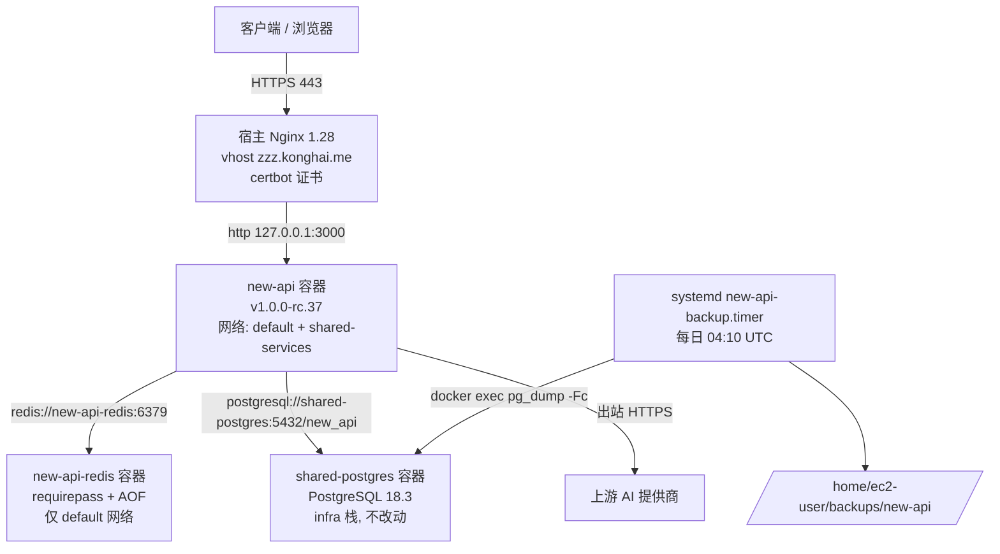
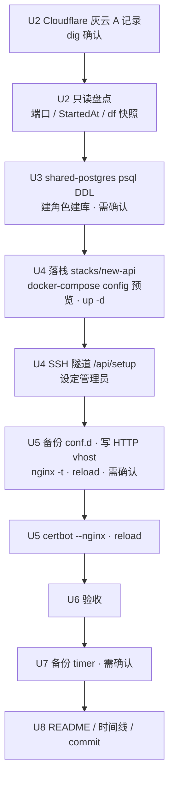

# new-api 单机部署到 dev-cypresso（zzz.konghai.me） - Plan

## Goal Capsule

- **Objective:** `https://zzz.konghai.me` 对外提供 new-api（AI API 网关）服务，数据落在 dev-cypresso 的共享 PostgreSQL 18，流式响应经宿主 Nginx 不被截断，部署配置沉淀在本仓库可复现。
- **Means:** 在 dev-cypresso 新建独立 compose 栈 `new-api`，复用 `shared-postgres` 建独立库，单独起带密码 Redis，宿主 Nginx + certbot 反代（KTD1、KTD2、KTD3）。
- **Authority:** 用户当前指示 > `AGENTS.md` 生产服务器操作守则 > 本计划 > 上游 handoff 推导。
- **Stop conditions:** 需要 reload nginx、启用 systemd timer、在共享库上执行 DDL 之前必须先向用户确认；发现 `zzz.konghai.me` 解析未生效时停在 certbot 之前；任何操作触碰到 iCare / EVP / moo-ticket 容器即停止。
- **Execution profile:** 手工 SSH 执行，分步验证，每步先备份；不接 CI。
- **Tail ownership:** 执行完成后由执行者追加 `docs/operations/dev-cypresso.md` 时间线并提交。

---

## Product Contract

### Summary

在 dev-cypresso 上按服务器既有惯例新建 `new-api` 栈：容器只绑回环端口，宿主 Nginx 新增 vhost 并用 certbot 签 Let's Encrypt 证书对外提供 `https://zzz.konghai.me`。数据库复用 `shared-postgres` 单独建库建角色，Redis 单独起带密码实例。compose、Nginx vhost、环境变量模板和备份单元沉淀到 `dev-cypresso/new-api/`，密钥只放 gitignore 的 `dev-cypresso/secrets.local.md`。

### Problem Frame

new-api 是 Go 编写的 AI API 网关，官方只给出"单机 compose + PostgreSQL 15 + 无密码示例"的模板。用户已决定在自有服务器 dev-cypresso 上单机部署，并要求 PostgreSQL 18。dev-cypresso 同时承载 iCare SIT、EVP 生产、moo-ticket 生产与共享基础设施栈，任何部署都必须遵循"只绑回环、DDL 不碰 infra 栈、reload 不 restart、先备份再改"的既有约束。上游 handoff（`/tmp/compound-engineering-501/ce-handoff/new-api-4cbef078/single-node-deploy-zzz-konghai-me.md`，机器本地临时文件）给出了组件清单与必改变量，但没有指定服务器，且部分事实（初始管理员、请求体默认值）与当前镜像源码不符，本计划以源码核实结果为准。

### Key Decisions

- **域名固定 `zzz.konghai.me`，单机部署在自有服务器。** 用户在 handoff 中决定。Governs R1、R2。
- **主库使用 PostgreSQL 18。** (session-settled: user-directed — chosen over 官方 compose 示例的 PostgreSQL 15: 用户明确不接受 15。) Governs R5。
- **目标服务器 dev-cypresso。** (session-settled: user-directed — chosen over tizi-cyp / rao-tizi / nyh-prod / pve 新 VM: 用户在候选列表中选定。) Governs R1、R3。
- **反向代理沿用宿主既有 Nginx。** (session-settled: user-directed — chosen over Caddy: 用户选定，避免在同机引入第二个 80/443 监听者。) Governs R3、R4。
- **DNS 走 Cloudflare 但不开代理。** (session-settled: user-approved — chosen over Cloudflare 橙云代理: 与同机其它站点一致，避免流式超时与真实来源 IP 的额外处理。) Governs R2。
- **备份纳入本次范围，但作为需单独确认的计划任务单元。** (session-settled: user-approved — chosen over 本次不做备份: 用户确认纳入。) Governs R14。

### Requirements

**网络与域名**

- R1. new-api 通过 `https://zzz.konghai.me` 对外提供服务，HTTP 自动 301 到 HTTPS，证书由 Let's Encrypt 签发并自动续期。
- R2. `zzz.konghai.me` 的 A 记录指向 dev-cypresso 公网 IP `32.192.186.193`，Cloudflare 记录为 DNS only。
- R3. new-api、Redis 从公网不可达；new-api 只在宿主回环端口暴露给 Nginx，Redis 不发布宿主端口。
- R4. 反代必须透传 `X-Forwarded-For` / `X-Real-IP` / `X-Forwarded-Proto`，关闭代理缓冲，读超时不低于 new-api 的流式空闲超时，请求体上限与 new-api 默认值对齐。

**组件与数据**

- R5. 主数据库为 `shared-postgres`（PostgreSQL 18.3）上新建的独立库，使用独立非超级用户角色，带连接数上限。
- R6. Redis 为 new-api 专用容器，设密码，开启 AOF 持久化，容器名不得为 `redis` 或 `shared-redis`。
- R7. new-api 镜像钉到具体版本 tag，不使用 `latest`。
- R8. 对 `shared-postgres` 只执行 DDL，不修改 `stacks/infra/` 下任何文件，不在该目录执行 `up -d`；部署前后 `shared-postgres`、`shared-redis`、`moo-ticket`、EVP 容器的 `StartedAt` 不变。

**配置与安全**

- R9. 所有密码与密钥由 CSPRNG 生成，不使用任何示例值；真实值只存在于服务器 600 权限 `.env` 与本地 gitignore 的 `dev-cypresso/secrets.local.md`。
- R10. `SESSION_SECRET` 与 `CRYPTO_SECRET` 首次部署即设定并记录为不可随意轮换。
- R11. `SESSION_COOKIE_SECURE=true` 且 `SESSION_COOKIE_TRUSTED_URL=https://zzz.konghai.me`。
- R12. `TRUSTED_PROXIES` 显式设置为反代到达容器时的来源网段，使 new-api 记录到真实客户端 IP。
- R13. 首个管理员在 vhost 对外暴露之前通过 SSH 隧道完成 `/api/setup` 初始化，公网可达时不存在未初始化窗口。

**备份与运维**

- R14. new-api 库每日 `pg_dump` 到服务器本地备份目录，保留不少于 7 天；调度机制与服务器现状一致。
- R15. 部署配置模板（compose、`.env.example`、Nginx vhost、备份单元）入库到 `dev-cypresso/new-api/`，`dev-cypresso/README.md` 记录站点入口，`docs/operations/dev-cypresso.md` 追加时间线并提交。

### Success Criteria

- 从本地发起一次 `stream: true` 的对话请求，输出持续超过 90 秒仍完整收尾，无 Nginx 截断。
- 重启 `new-api` 容器一次后，第二次启动日志无迁移错误，已创建的用户与令牌仍在。

### Scope Boundaries

- 不做多节点部署；将来扩展需共享同一库、同一 Redis 与相同 `SESSION_SECRET` / `CRYPTO_SECRET`。
- 不配置后台业务项：SMTP、OAuth、支付渠道、上游 AI 提供商密钥由使用方在管理后台完成。
- 不接 GitHub Actions 自动部署。
- 不清理服务器磁盘：不执行 `docker system prune`、`docker image prune -a`、`--remove-orphans`，不触碰 `/var/cache/buildx`。
- 不做 Tailscale 内网专用入口。
- 不修改防火墙、SSH、AWS 安全组。

#### Deferred to Follow-Up Work

- `dev-cypresso/README.md` 补齐 moo-ticket / EVP 等既有公网站点的完整站点表（本次只加 new-api 一行与表头）。
- new-api 文件日志的定期清理（本次不挂日志卷，日志留在容器写层，观察增长后再定）。
- 证书续期失败告警（同机既有站点均无此机制）。
- 将 `TRUSTED_PROXIES` 从网段收紧为具体网关 IP（部署后按日志验证再定）。

### Outstanding Questions

- 备份调度采用 systemd timer 而非 crontab（deferred，非阻塞）：dev-cypresso 没有 cronie，`crontab` 命令不存在；U7 执行前向用户确认这一替代方式即可。

### Sources

- 上游 handoff：`/tmp/compound-engineering-501/ce-handoff/new-api-4cbef078/single-node-deploy-zzz-konghai-me.md`（机器本地临时文件，OS 可能清理）。
- new-api 源码（本机 `~/Code/Project/new-api`，HEAD `7209b6d`，tag `v1.0.0-rc.37` 之后 26 个提交）：`common/redis.go`、`common/trusted_proxies.go`、`common/session_cookie.go`、`common/init.go`、`model/main.go`、`controller/setup.go`、`Dockerfile`、`.env.example`、`docs/authentication.md`。
- 同机先例：`docs/operations/dev-cypresso.md` 2026-09-03 moo-ticket 部署、2026-09-09 EVP 生产部署与只读盘点、2026-09-10 域名切换。
- 复盘：`docs/solutions/dev-cypresso/integration-issues/docker-compose-env-file-edit-triggers-recreate-2026-05-28.md`、`docs/solutions/dev-cypresso/runtime-errors/nginx-fail-on-boot-dns-not-ready-2026-05-13.md`、`docs/solutions/dev-cypresso/integration-issues/docker-image-buildup-fills-disk-2026-05-14.md`。
- 样板：`mas-go-dev/shared-sit/redis/docker-compose.yml`（带密码 Redis）、`mas-go-dev/shared-sit/bootstrap.sh`（建库建角色 SQL）、`docs/plans/2026-08-16-001-ops-mac-mini-sub2api-deploy-plan.md`（同类 AI 网关 SSE 反代要点）。

---

## Planning Contract

### Key Technical Decisions

- KTD1. **复用 `shared-postgres`，为 new-api 建独立库 `new_api` 与同名角色。** (session-settled: user-approved — chosen over 为 new-api 单独起 `postgres:18` 容器: 与同机 moo-ticket / EVP 惯例一致，少占 2 GB 内存，且现有容器已是 PG 18.3 并正确挂载 `/var/lib/postgresql`。) 角色为 `LOGIN NOSUPERUSER NOCREATEDB NOCREATEROLE CONNECTION LIMIT 30`，库 `REVOKE CONNECT FROM PUBLIC`，SQL 范式照 `mas-go-dev/shared-sit/bootstrap.sh`。`max_connections=100`，当前用 12。实现 R5、R8。
- KTD2. **new-api 专用 Redis 容器 `new-api-redis`，只在 compose 默认网络，不发布端口。** (session-settled: user-approved — chosen over 复用 `shared-redis`: 共享实例 2026-05-28 起无密码且 `allkeys-lru` 淘汰，iCare 在用 db0。) 参数照 `mas-go-dev/shared-sit/redis/docker-compose.yml`：`--requirepass`、`--appendonly yes`、`--maxmemory 128mb --maxmemory-policy allkeys-lru`，`mem_limit 256m`。实现 R6。
- KTD3. **new-api 加入两个网络：compose 默认网络（连 Redis）与 external `shared-services`（连 `shared-postgres:5432`）。** 同机 moo-ticket、EVP 都以 external 网络连共享库；`host-gateway` 方式无先例。Redis 不加入 `shared-services`，避免在共享网络注册 `redis` 别名。
- KTD4. **new-api 绑 `127.0.0.1:3000`，Nginx `proxy_pass http://127.0.0.1:3000`。** 端口 3000 经 `ss` 核实空闲。upstream 写纯 IP，规避 nginx 开机 DNS 未就绪失败的既有故障。实现 R3、R4。
- KTD5. **镜像钉 `calciumion/new-api:v1.0.0-rc.37`（2026-09-11，amd64）。** Docker Hub 有该 tag，与当前 `latest` 相同。升级流程为改 tag、pull、`up -d`、删旧 tag 镜像。实现 R7。
- KTD6. **`TRUSTED_PROXIES=172.16.0.0/12`。** 宿主 Nginx 经 docker-proxy 到达容器时来源 IP 是 Docker 网关（默认网络 `172.x.0.1` 或 `shared-services` 网关 `172.19.0.1`），不是 `127.0.0.1`。填 `127.0.0.1` 会让 `ClientIP()` 退化为网关 IP，按 IP 的限流与审计全部失真。收紧为具体网关 IP 列入 Deferred。实现 R12。
- KTD7. **初始化经 SSH 隧道在 vhost 建立前完成。** 当前版本首启走 `/api/setup` 向导，谁先打开谁成为管理员；`createRootAccountIfNeed` 已是死代码，handoff 中 "root/123456" 的验收项作废。实现 R13。
- KTD8. **备份用 systemd timer，不用 crontab。** dev-cypresso 无 cronie，唯一既有定时任务是 `gha-runner-maintenance.timer`（每日 03:50 UTC）。`new-api-backup.timer` 定在每日 04:10 UTC 错峰，`docker exec shared-postgres pg_dump -Fc` 只导 `new_api` 库到 `/home/ec2-user/backups/new-api/`，保留 14 份。启用前需用户确认。实现 R14。
- KTD9. **连接池压低：`SQL_MAX_OPEN_CONNS=20`、`SQL_MAX_IDLE_CONNS=5`。** 源码默认 1000 / 100，会撑爆共享库的 100 连接上限。配合 KTD1 的 `CONNECTION LIMIT 30`。
- KTD10. **不挂 `/data` 与日志卷。** DSN 为 `postgresql://` 时 `/data` 只放文件日志与 pprof，无 SQLite、无上传物。日志留在容器写层，随重建清零；同机有两次磁盘写满复盘，不 bind mount 无人管理的日志目录。
- KTD11. **Nginx vhost 流式参数：`proxy_http_version 1.1`、`Connection ""`、`proxy_buffering off`、`proxy_cache off`、`proxy_read_timeout 600s`、`proxy_send_timeout 600s`、`client_max_body_size 128m`。** new-api `STREAMING_TIMEOUT` 源码默认 300s，`MAX_REQUEST_BODY_MB` 默认 128（README 写 32 已过时）。宿主 http 级 `client_max_body_size 100M` 在 vhost 内覆盖。实现 R4。
- KTD12. **compose 命令统一用独立二进制 `docker-compose`（v2.24.5）。** dev-cypresso 没有 `docker compose` 插件，`docker compose` 会报 "not a docker command"。
- KTD13. **`SESSION_SECRET`、`CRYPTO_SECRET` 分别独立生成。** `CRYPTO_SECRET` 缺省会回退到 `SESSION_SECRET`；两者独立后轮换会话密钥不会连带让已加密的渠道密钥不可解密。实现 R10。

### High-Level Technical Design

组件拓扑：

上线时序（每个门都可回滚到前一门）：

### Assumptions

- 上游 AI 提供商可从 AWS us-east-1 直接出站访问，不需要代理。
- `TZ=Asia/Shanghai`，沿用 handoff 与官方 compose 默认值。
- new-api 在 PG 18 上的 AutoMigrate 未实测；源码只用 9.6+ 标准语法（`pg_advisory_xact_lock`、`to_regclass`、`LOCK TABLE`），驱动 pgx v5.9.2 / gorm postgres v1.5.9。首次启动日志是最终证据。

### Implementation Constraints

- 所有服务器改动前先备份（`cp -a file file.bak.YYYYMMDD-newapi-deploy`），只 reload nginx 不 restart。
- 危险动作（在共享库执行 DDL、reload nginx、`systemctl enable --now`、任何 DROP / rm）先征得用户确认。
- 计划与仓库文档不出现任何明文密码、密钥；模板用 `<generated>` 占位。
- `.gitignore` 忽略 `.env` 与 `.env.*`（`.env.example` 例外），模板文件名遵守此规则。

---

## Implementation Units

### U1. 仓库内部署模板与密钥记录

- **Goal:** 在本仓库落下可复现的 new-api 部署模板，并在本地密钥文件中预留段落。
- **Requirements:** R6、R7、R9、R11、R12、R15
- **Dependencies:** 无
- **Files:**
  - `dev-cypresso/new-api/docker-compose.yml`（新建）
  - `dev-cypresso/new-api/.env.example`（新建）
  - `dev-cypresso/new-api/nginx/zzz.konghai.me.conf`（新建，HTTP 版 vhost，certbot 会改写为 HTTPS）
  - `dev-cypresso/new-api/systemd/new-api-backup.service`、`dev-cypresso/new-api/systemd/new-api-backup.timer`（新建）
  - `dev-cypresso/new-api/README.md`（新建，首行声明"以服务器 `/home/ec2-user/stacks/new-api/` 为准，本目录只放不含密钥的对照副本"）
  - `dev-cypresso/secrets.local.md`（本地 gitignore，新增 `## new-api` 段，含 PG 密码、Redis 密码、`SESSION_SECRET`、`CRYPTO_SECRET`、管理员账号，标注哪些不可轮换）
- **Approach:**
  1. compose：服务 `new-api`（镜像按 KTD5，`container_name: new-api`，`restart: always`，`ports: 127.0.0.1:3000:3000`，`env_file: .env`，`mem_limit: 1g`，healthcheck 用镜像内 `wget` 打 `/api/status`，`depends_on` Redis healthy，`networks: [default, shared-services]`，`logging` json-file 10m×3）；服务 `new-api-redis` 按 KTD2（`container_name: new-api-redis`，命名卷 `new-api_redis_data`，healthcheck 带 `-a` 与 `--no-auth-warning`，只在 `default`）；`networks.shared-services.external: true`。不挂 `/data`（KTD10）。
  2. `.env.example` 列出并注释：`SQL_DSN=postgresql://new_api:<generated>@shared-postgres:5432/new_api`、`REDIS_PASSWORD`、`REDIS_CONN_STRING=redis://:<generated>@new-api-redis:6379/0`、`SESSION_SECRET`、`CRYPTO_SECRET`、`SESSION_COOKIE_SECURE=true`、`SESSION_COOKIE_TRUSTED_URL=https://zzz.konghai.me`、`TRUSTED_PROXIES=172.16.0.0/12`、`NODE_NAME=new-api-dev-cypresso-1`、`TZ=Asia/Shanghai`、`ERROR_LOG_ENABLED=true`、`BATCH_UPDATE_ENABLED=true`、`STREAMING_TIMEOUT=300`、`SQL_MAX_OPEN_CONNS=20`、`SQL_MAX_IDLE_CONNS=5`。生成方式注明 `openssl rand -hex 32`。
  3. vhost 模板照 `t.moospark.com.conf` 的 location 块，叠加 KTD11 参数；`server_name zzz.konghai.me`，只写 `listen 80`。
  4. systemd 单元按 KTD8：service 为 oneshot，以 `ec2-user` 运行 `docker exec shared-postgres pg_dump -U new_api -Fc -d new_api` 输出到带日期文件名，再删除 14 天前的文件；timer `OnCalendar=*-*-* 04:10:00 UTC`，`Persistent=true`。
- **Patterns to follow:** `mas-go-dev/cmm-sit/`（模板入库与 README 声明写法）、`mas-go-dev/shared-sit/redis/docker-compose.yml`（Redis 参数）、`mas-go-dev/evp-sit/.env.example`。
- **Test scenarios:**
  - 在临时目录复制 `docker-compose.yml` 并把 `.env.example` 复制为 `.env`，执行 `docker compose config` 渲染成功，`new-api-redis` 不出现 `ports`，`new-api` 的 `ports` 只有 `127.0.0.1:3000:3000`。compose 中 `env_file: .env` 保持必需（不加 `required: false`），以免服务器漏放 `.env` 时 new-api 静默退回 SQLite。
  - `git status` 显示 `.env.example` 可入库、`secrets.local.md` 未被跟踪。
  - 全文 grep 模板目录不含任何 32 位十六进制串或 `123456`。
- **Verification:** 模板目录五个文件就位，`git diff --stat` 只含模板与 README。

### U2. DNS 记录与上线前只读盘点

- **Goal:** `zzz.konghai.me` 解析到 dev-cypresso，并留下部署前的服务器状态快照。
- **Requirements:** R2、R8
- **Dependencies:** 无
- **Files:** 无仓库文件；快照文本留在对话中，稍后写入 U8 的时间线。
- **Approach:**
  1. Cloudflare `konghai.me` 区域新增 A 记录 `zzz` → `32.192.186.193`，代理状态关闭（灰云），不加 AAAA。
  2. 本地 `dig +short zzz.konghai.me @1.1.1.1` 返回 `32.192.186.193` 后才进入 U3；返回空则等待，不提前跑 certbot。
  3. 服务器只读快照：`ss -ltnp` 确认 3000 仍空闲；`docker inspect` 抓 `shared-postgres`、`shared-redis`、`moo-ticket`、`evp-provider-api` 的 `StartedAt`；`df -h /` 与 `docker system df`；`systemctl show nginx -p Restart -p DropInPaths` 确认自愈 drop-in 仍在；`sudo nginx -t` 记录既有 warning 基线。
- **Patterns to follow:** `docs/operations/dev-cypresso.md` 2026-09-09 12:42 "EVP 生产部署前只读盘点"条目。
- **Test scenarios:**
  - `dig` 经 `1.1.1.1` 与 `8.8.8.8` 均返回目标 IP，且 `dig +short zzz.konghai.me CNAME` 为空（证明不是橙云 CNAME 扁平化）。
  - 3000 端口若被占，改用 `83xx` 空闲端口并同步修改 U1 模板与 vhost，不改域名与容器内端口。
- **Verification:** 快照四项齐全（端口、StartedAt、磁盘、nginx 基线），DNS 已生效。

### U3. shared-postgres 建角色建库

- **Goal:** 为 new-api 准备独立的 `new_api` 库与角色，不触碰 infra 栈。
- **Requirements:** R5、R8、R9
- **Dependencies:** U2（快照已留）
- **Files:** 无仓库文件；SQL 参考 `mas-go-dev/shared-sit/bootstrap.sh`。
- **Approach:**
  1. 本地 `openssl rand -hex 32` 生成角色密码，先写入 `dev-cypresso/secrets.local.md`。
  2. 向用户确认后，`docker exec -i shared-postgres psql -U postgres` 执行：建角色（KTD1 属性）、`CREATE DATABASE new_api OWNER new_api`、`REVOKE CONNECT ON DATABASE new_api FROM PUBLIC`、连接到 `new_api` 后 `REVOKE ALL ON SCHEMA public FROM PUBLIC; ALTER SCHEMA public OWNER TO new_api`。
  3. 不进入 `/home/ec2-user/stacks/infra/`，不改其 `.env` / `docker-compose.yml`。
- **Execution note:** 每条 SQL 单独执行并回显结果，出错即停；不要用脚本一次灌入。
- **Patterns to follow:** 2026-09-03 moo-ticket、2026-09-09 EVP 建库记录；`mas-go-dev/README.md` "新项目怎么接入"。
- **Test scenarios:**
  - `\du new_api` 显示非超级用户、不可建库建角色、`CONNECTION LIMIT 30`。
  - 用 `new_api` 角色从宿主 `psql -h 127.0.0.1 -U new_api -d new_api` 登录成功，`SELECT 1` 返回。
  - 用 `new_api` 角色连接 `moo_ticket` 库被拒绝（`REVOKE CONNECT` 生效，其它租户默认也应拒绝，若能连则记入时间线不处理）。
  - `docker inspect shared-postgres` 的 `StartedAt` 仍为 `2026-05-28T07:24:56Z`。
- **Verification:** 库与角色存在，共享库未重建，密码只在两处密钥文件中。

### U4. 服务器落栈、启动与隧道内初始化

- **Goal:** new-api 与 Redis 在 dev-cypresso 运行并通过健康检查，管理员账号在暴露公网前设定完成。
- **Requirements:** R3、R6、R7、R9、R10、R11、R12、R13
- **Dependencies:** U1、U3
- **Files:** 服务器 `/home/ec2-user/stacks/new-api/{docker-compose.yml,.env}`（机器本地）；来源为 U1 模板。
- **Approach:**
  1. `scp` U1 的 compose 到栈目录；在服务器上由 `.env.example` 生成 `.env`，填入 U3 密码与新生成的 Redis 密码、`SESSION_SECRET`、`CRYPTO_SECRET`（KTD13），`chmod 600`。
  2. `docker-compose config` 预览渲染结果，核对端口、网络、镜像 tag（KTD12）。
  3. `docker-compose pull` 后 `docker-compose up -d`；观察 `docker logs new-api` 直到出现健康检查通过，记录启动横幅是否有 `TRUSTED_PROXIES` 或 cookie 相关 Warning（预期均无）。
  4. 用 `docker network inspect` 读取 `new-api_default` 与 `shared-services` 两个网络的网关，确认都落在 KTD6 的 `172.16.0.0/12` 内；若任一网关不在（Docker 第二地址池为 `192.168.0.0/16`），先把 `.env` 的 `TRUSTED_PROXIES` 改为实际网关网段并 `up -d` 重建后再继续，并把网关值记入 U8 时间线。
  5. 本地 `ssh -L 3000:127.0.0.1:3000 dev-cypresso`，浏览器打开 `http://127.0.0.1:3000` 完成 `/api/setup` 向导，设定管理员用户名与强密码，写入 `secrets.local.md`。
  6. 后台"系统设置"填服务器地址 `https://zzz.konghai.me`；在「登录注册设置」关闭「允许新用户注册」。new-api 默认开放注册且未开 Turnstile 与邮箱验证，SMTP 不在本次范围，暴露公网前必须关闭。
- **Execution note:** 启动失败时先看 `docker logs new-api` 的 `FatalLog` 文案（Redis Ping、TRUSTED_PROXIES 解析、SESSION_COOKIE 校验都是启动即退出），不要反复 `up -d`。
- **Patterns to follow:** `docs/operations/dev-cypresso.md` 2026-09-09 12:56 EVP 部署时序（栈目录、`.env` 600、只绑回环）。
- **Test scenarios:**
  - `docker-compose ps` 两个容器均 `healthy`；`docker inspect new-api` 显示网络 `new-api_default` 与 `shared-services` 各一个 IP。
  - 服务器 `curl -s http://127.0.0.1:3000/api/status` 含 `"success":true`。
  - `docker exec new-api-redis redis-cli ping` 无密码返回 `NOAUTH`，带密码返回 `PONG`。
  - `docker logs new-api` 首次启动含 AutoMigrate 成功、无 `ERROR`；`docker-compose restart new-api` 后第二次启动同样无迁移错误。
  - 隧道内 `/api/setup` 完成后，再次 `GET /api/setup` 或访问首页不再进入向导。
  - `ss -ltnp` 无 `0.0.0.0:3000`、无 6379 新监听。
- **Verification:** 两容器 healthy，管理员已设定，自助注册已关闭，`.env` 600，公网尚不可达（vhost 未建）。

### U5. Nginx vhost 与 Let's Encrypt 证书

- **Goal:** `https://zzz.konghai.me` 经宿主 Nginx 反代到 new-api，HTTP 301 到 HTTPS。
- **Requirements:** R1、R4
- **Dependencies:** U2、U4（前置条件：管理员已设定且自助注册已关闭）
- **Files:** 服务器 `/etc/nginx/conf.d/zzz.konghai.me.conf`（机器本地）；来源 `dev-cypresso/new-api/nginx/zzz.konghai.me.conf`。
- **Approach:**
  1. `sudo cp -a /etc/nginx/conf.d /etc/nginx/conf.d.bak.20260918-newapi-pre`。
  2. 写入 HTTP vhost，立即复制为 `.bak.20260918-deploy`；`sudo nginx -t` 只应有既有 warning。
  3. 向用户确认后 `sudo systemctl reload nginx`。
  4. `sudo certbot --nginx -d zzz.konghai.me`，选择 redirect；certbot 会改写 vhost 为 HTTPS + 301 并 reload。
  5. certbot 改写后核对 location 块内 KTD11 参数仍在；把最终 vhost 拉回本地更新 `dev-cypresso/new-api/nginx/zzz.konghai.me.conf`。
- **Patterns to follow:** 2026-09-10 域名切换条目的备份、vhost、certbot、reload 顺序；`t.moospark.com.conf` 结构。
- **Test scenarios:**
  - `curl -sI http://zzz.konghai.me/` 返回 301 且 `Location: https://zzz.konghai.me/`。
  - `curl -sI https://zzz.konghai.me/api/status` 返回 200；`openssl s_client` 显示 SAN 为 `zzz.konghai.me`、颁发者 Let's Encrypt。
  - `sudo certbot renew --dry-run` 对 `zzz.konghai.me` 成功。
  - 同机 `https://t.moospark.com/`、`https://evp.moospark.com/health/ready` 在 reload 前后均 200。
  - `sudo nginx -T` 中 `zzz.konghai.me` server 块含 `proxy_buffering off` 与 `proxy_read_timeout 600s`。
- **Verification:** HTTPS 可访问，证书有效，续期 dry-run 通过，邻居站点无影响。

### U6. 验收

- **Goal:** 逐条证明部署满足要求，并留下可写入时间线的证据。
- **Requirements:** R1、R3、R4、R8、R12、R13；Success Criteria 两条
- **Dependencies:** U5
- **Files:** 无。
- **Approach:** 从本地和服务器两端分别验证，结果原文粘贴进 U8 时间线"验证"栏。
- **Test scenarios:**
  - 本地 `nc -zv -w3 32.192.186.193 3000 5432 6379` 三个端口均不可达；80、443 可达。
  - 用管理员创建一个渠道与令牌后，本地 `curl -N` 发起 `stream: true` 对话，选一个会持续输出 90 秒以上的提示，输出逐块到达并以 `[DONE]` 收尾。
  - 后台日志或 `docker logs new-api` 中该请求记录的客户端 IP 是本地公网 IP，不是 `172.x.0.1`。
  - 未初始化窗口：公网访问 `/api/setup` 不再允许设定管理员。
  - 公网调用注册接口 `POST /api/user/register` 返回注册已关闭，不能创建账号。
  - `docker-compose restart new-api` 后令牌仍可调用，第二次启动日志无迁移错误。
  - 部署后再次抓四个邻居容器（`shared-postgres`、`shared-redis`、`moo-ticket`、`evp-provider-api`）的 `StartedAt`，与 U2 快照一致。
  - `df -h /` 与 `docker system df` 与 U2 快照对比，增长仅为 new-api 镜像与 Redis 卷。
- **Verification:** 上述场景全部通过；任一失败先回滚到对应门（见 Definition of Done 的回滚栏）再修。

### U7. 每日备份 systemd timer

- **Goal:** `new_api` 库每日自动 `pg_dump`，保留 14 份。
- **Requirements:** R14
- **Dependencies:** U4（库已有数据）、U1（单元文件模板）
- **Files:** 服务器 `/etc/systemd/system/new-api-backup.service`、`/etc/systemd/system/new-api-backup.timer`、`/home/ec2-user/backups/new-api/`（机器本地）；来源 `dev-cypresso/new-api/systemd/`。
- **Approach:**
  1. 先向用户确认采用 systemd timer（KTD8）与时间点。
  2. 创建备份目录 `chmod 700`，属主 `ec2-user`。
  3. 安装单元文件，`systemctl daemon-reload`，先 `systemctl start new-api-backup.service` 手动跑一次，再 `enable --now` timer。
- **Patterns to follow:** 既有 `gha-runner-maintenance.timer`；`docs/solutions/mac-mini/sonarqube-migrated-from-dev-cypresso-2026-05-13.md` §9「备份」小节的 `pg_dump --format=custom` 与滚动保留写法。
- **Test scenarios:**
  - 手动跑一次后目录中出现当日 `.dump` 文件，`pg_restore --list` 能读出表清单。
  - `systemctl list-timers` 显示 `new-api-backup.timer` 下次触发为 04:10 UTC，与 03:50 的 runner 清理错开。
  - 人为放一个 15 天前时间戳的旧文件，再跑一次 service，旧文件被删，当日文件保留。
  - service 失败时（如临时改错库名）`systemctl status` 显示 failed 且不影响 new-api 运行。
- **Verification:** timer 激活，首份备份可读，仅含 `new_api` 库。

### U8. 文档沉淀与提交

- **Goal:** 仓库记录本次部署的入口、模板与时间线。
- **Requirements:** R15
- **Dependencies:** U1 到 U7
- **Files:**
  - `dev-cypresso/README.md`（修改：新增"公网站点"表，本次只填 new-api 一行；共享栈表补一行说明 new-api 使用 `shared-postgres` 的 `new_api` 库）
  - `docs/operations/dev-cypresso.md`（修改：顶部追加条目）
  - `dev-cypresso/new-api/nginx/zzz.konghai.me.conf`（用 certbot 改写后的最终版本覆盖）
- **Approach:**
  1. 时间线条目沿用既有九字段：时间、服务器、操作人、原因、影响、选型、备份（conf.d 整目录、vhost `.bak`）、回滚方式（代码块：`docker-compose down` 不带 `-v`、删 vhost、`nginx -t` + reload、`certbot delete` 可选、库与角色 DROP 需另确认、timer `disable --now`、Cloudflare 记录删除）、变更时序、验证（粘贴 U6 证据与邻居 `StartedAt`）。
  2. 若过程中发现可复用经验（如 PG 18 迁移、TRUSTED_PROXIES 取值），另用 `/ce:compound` 写 `docs/solutions/dev-cypresso/best-practices/`。
  3. `git commit`，提交信息形如 `docs: 部署 new-api 到 dev-cypresso（zzz.konghai.me）`。
- **Patterns to follow:** `docs/operations/dev-cypresso.md` 2026-09-09、2026-09-10 条目；`docs/operations/README.md` 模板。
- **Test scenarios:** Test expectation: none -- 纯文档。
- **Verification:** `git log -1` 显示提交在 `main`；`grep -r "zzz.konghai.me" dev-cypresso docs/operations` 至少命中 README、模板与时间线；仓库内不含任何真实密钥。

---

## Verification Contract

| 检查项 | 命令或方法 | 期望 | 适用单元 |
| --- | --- | --- | --- |
| 模板可渲染 | 临时目录内 `cp .env.example .env` 后 `docker compose config` | 成功，Redis 无 `ports` | U1 |
| DNS 生效 | `dig +short zzz.konghai.me @1.1.1.1` | `32.192.186.193` | U2 |
| 共享库未重建 | `docker inspect shared-postgres --format '{{.State.StartedAt}}'` | `2026-05-28T07:24:56Z` | U3、U6 |
| 容器健康 | `docker-compose ps`；`curl -s http://127.0.0.1:3000/api/status` | 两容器 healthy；含 `"success":true` | U4 |
| 迁移幂等 | `docker logs new-api` 两次启动 | 无 ERROR / migration 失败 | U4、U6 |
| HTTPS 与跳转 | `curl -sI http://…/` 与 `https://…/api/status` | 301 / 200 | U5 |
| 续期可用 | `sudo certbot renew --dry-run` | 成功 | U5 |
| 邻居站点 | `curl -sI https://t.moospark.com/`、`https://evp.moospark.com/health/ready` | 200 | U5、U6 |
| 端口不可达 | 本地 `nc -zv -w3 32.192.186.193 3000 5432 6379` | 全部失败 | U6 |
| 注册已关闭 | 本地 `POST https://zzz.konghai.me/api/user/register` | 返回注册已关闭 | U6 |
| 流式不截断 | 本地 `curl -N` 打 `/v1/chat/completions` `stream: true` | 90 秒以上持续输出并 `[DONE]` | U6 |
| 真实来源 IP | new-api 日志中的客户端 IP | 本地公网 IP | U6 |
| 备份可读 | `pg_restore --list <dump>` | 列出表 | U7 |
| 仓库无密钥 | `git grep -E '[0-9a-f]{64}' dev-cypresso docs/plans` | 无命中 | U1、U8 |

---

## Definition of Done

- 全局：R1 到 R15 全部满足，Verification Contract 每行通过，`docs/operations/dev-cypresso.md` 条目已提交到 `main`。
- 全局：服务器上不留试错残留：失败的容器、多余的 vhost 备份之外的临时文件、未启用的单元文件均清理；`stacks/infra/` 与邻居容器零改动。
- 全局：任何一步失败时的回滚栈：U5 失败删 vhost 并 reload；U4 失败 `docker-compose down`（不带 `-v`）；U3 失败 DROP 库与角色需另行确认；U2 失败删除 Cloudflare 记录。

| 单元 | 完成信号 |
| --- | --- |
| U1 | 五个模板文件入库，`secrets.local.md` 新段存在且未跟踪 |
| U2 | DNS 生效，四项快照记录在案 |
| U3 | `new_api` 库与角色存在，共享库 `StartedAt` 未变 |
| U4 | 两容器 healthy，管理员已在隧道内设定 |
| U5 | HTTPS 200、HTTP 301、`renew --dry-run` 通过 |
| U6 | 验收七个场景全部通过并留有原文证据 |
| U7 | timer 激活，首份 dump 可 `pg_restore --list` |
| U8 | 提交落在 `main`，README 有 new-api 入口 |

---

## Risks

| 风险 | 处理 |
| --- | --- |
| PG 18 上 AutoMigrate 未实测 | U4 首启日志为准；失败则 `down` 后按错误信息处理，库可 DROP 重来（需确认） |
| certbot HTTP-01 在 DNS 未传播时失败并消耗失败配额 | U2 强制 `dig` 通过后才进入 U5 |
| `TRUSTED_PROXIES` 网段过宽，同机其它容器理论上可伪造 XFF | 所有容器均自有；收紧为网关 IP 列入 Deferred |
| 新版 new-api 变量语义变化 | 模板只用源码核实过的变量；升级前对照对应 tag 的 `.env.example` |
| 容器写层日志无限增长 | 不挂卷，随重建清零；`docker system df` 入时间线，超阈值再做清理 timer（Deferred） |
| 共享库连接数被占满 | KTD1 `CONNECTION LIMIT 30` + KTD9 连接池 20 |
| reload nginx 影响同机站点 | reload 优雅不断连；U5 前后验证邻居 200 |

---

## Deferred / Open Questions

### From 2026-09-18 review

- **文档提交单元硬依赖可选的备份单元** — U8 文档沉淀与提交（P1, scope-guardian, confidence 75）

  若用户在备份单元 U7 的确认门前选择推迟或拒绝启用备份，整条部署链会卡在文档收尾这一步：U8 的依赖写的是 U1 到 U7，没有为这种情况留出路径。此时服务本身已上线可用，却因一个计划自己标记为"需单独确认"的可选项，导致时间线与提交无法按计划完成。需要决定：U7 被推迟时，U8 是把 U7 从硬依赖中摘出、在时间线注明"备份待启用"后照常提交，还是等 U7 落地后再收尾。
