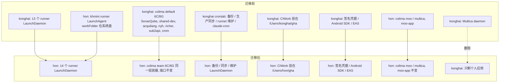
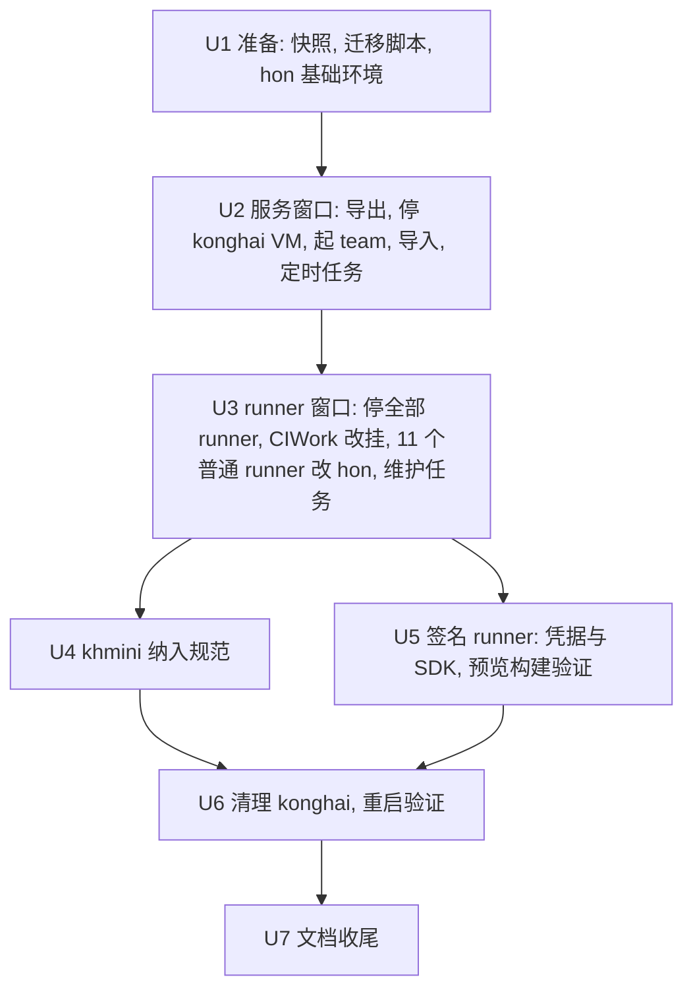

# mac-mini 团队资产从 konghai 迁到 hon - Plan

## Goal Capsule

- **Objective:** mac-mini 上 `konghai` 回归纯私人账户（iCloud、个人应用），不再承载任何团队 CI、服务、数据或凭据；团队用到的 runner、数据库、SonarQube 等全部由 `hon` 账户承载。对使用者来说地址、端口、runner 名称都不变，重启后无需任何人登录 hon 就自动恢复。
- **Means:** 复用现有 CIWork 卷改挂到 hon（KTD1），runner 整目录迁移、保留注册（KTD2），容器在 hon 下新建 colima profile 重建（KTD6、KTD7），所有常驻进程改为 `UserName=hon` 的 LaunchDaemon（KTD3）。
- **Authority:** 用户在本次会话中确认的范围（R1–R12）> 本计划 KTD > 单元内细节。`AGENTS.md` 的「生产服务器操作守则」始终有效：每个停机窗口、删除、改 sudoers / fstab / nyh-prod 前仍需用户逐次确认。
- **Stop conditions:** 任一窗口内数据核对不一致（行数、库大小、Sonar 项目数）立即停止并回滚该窗口；签名 runner 在 hon 下无法完成一次 iOS 构建时停在 U5，保留 konghai 运行签名 runner，回来找用户。
- **Execution profile:** 分 4 个有停机的窗口执行：U2+U3 连续做完（一个窗口）、U4、U5、U6。U2 停掉 konghai 的 VM 后，仍以 konghai 运行的 runner 就没有 Docker 可用，所以 U2 和 U3 之间不能停留。其余窗口之间系统可长期稳定运行；每个窗口结束追加 `docs/operations/mac-mini.md` 并提交。
- **Who finishes:** Claude 经 `ssh mac-mini` / `ssh mac-mini-hon` 执行；需要 root 的步骤走 KTD10 的受限 sudo 脚本，或由用户在终端用 `!` 执行。

---

## Product Contract

### Summary

把 mac-mini 上 `konghai` 名下所有团队资产迁到 `hon`：13 个 GitHub runner、CIWork 卷、konghai colima 里的全部容器和数据、备份与同步任务、签名凭据。同时把 hon 自装的 `khmini` runner 纳入同一规范，删除不再使用的 `claude-cron` 和 konghai 的 Multica daemon，最后清空 konghai 的开发环境。

### Problem Frame

`konghai` 是用户的私人账户（含 iCloud 同步），但团队的 CI runner、SonarQube、共享开发库、AcquiLang 生产同步都跑在它下面，团队凭据（iCare 商店提交密钥、EAS、nyh-prod root 密钥）也放在这里。与此同时，同事在 `hon` 账户下自装了 moo-decision 的 `khmini` runner：LaunchAgent 启动、workFolder 在系统数据卷、没有缓存与维护，绕开了 2026-10-20 做的 CIWork / fseventsd 优化。

两个账户各管一半，导致优化只覆盖一半、权限边界不清、私人账户里混着团队生产凭据。用户决定：konghai 以后不做开发，`hon` 作为团队共用的部署与 runner 账户。

### Requirements

**账户边界**

- R1. 迁移完成后，konghai 名下不再运行任何 runner、容器、VM、团队定时任务或 Multica daemon。
- R2. konghai 名下不再保存团队凭据：`~/.config/icare/`、`~/.expo` 会话、各 stack 的 `.env`、nyh-prod 同步用密钥的团队用途。
- R3. `claude-cron`（目录、容器、镜像、crontab 行）与 konghai 的 Multica daemon（`ai.multica.daemon.konghai`、runtime `mac-mini-konghai`）直接删除，不迁移。

**Runner**

- R4. konghai 下全部 13 个 runner 改为以 hon 运行，runner 名称、GitHub 注册、labels 不变；`acquilang-ci-4/5` 保持 disabled。
- R5. hon 自装的 `khmini` runner 改为与其它 runner 相同的规范：LaunchDaemon、workFolder 在 CIWork、per-slot 缓存、纳入定时维护。
- R6. CIWork 的既有优化全部保留：`no_log`、Spotlight 关闭、300G 配额、卷没挂上时写不进挂载点。

**服务与数据**

- R7. konghai colima 里的全部容器迁到 hon，数据完整：SonarQube（含 `sonar-postgres`）、`shared-dev-postgres` / `-s3` / `-redis`、`acquilang-postgres`、`nyh-postgres`、`richer-postgres` / `richer-grafana`、`sub2api`（含其 postgres / redis）、`cmm-postgres`（保持停止状态）。
- R8. 各服务对外的端口和地址不变（`:9000`、`:5432`、`:5433`、`:5434`、`:5437`、`:6379`、`:3900`、`:3001`、`:18080`，以及 Tailscale serve 的 3900 / 5434 / 6379），使用方不改任何配置。
- R9. 定时任务保持原有时刻继续运行：SonarQube 备份 03:30、AcquiLang 备份 04:00、AcquiLang 生产同步 0/6/12/18 点、runner 维护每日 03:15 与周日 04:30。

**运维**

- R10. mac-mini 重启并完成 FileVault 解锁后，不需要任何人登录 hon，所有 runner、容器、定时任务自动恢复。
- R11. 每个停机窗口事先说明影响与时长，先备份再改动，并有写明的回滚方式。
- R12. `AGENTS.md`、runbook、`scripts/` 与 `mac-mini/` 下涉及 `/Users/konghai` 的团队路径全部更新；每个窗口在 `docs/operations/mac-mini.md` 留时间线。

### Key Decisions

- **konghai 只做私人用途，hon 作为团队账户。** (session-settled: user-directed — chosen over 在 konghai 下给 moo-decision 另建 runner：konghai 是含 iCloud 的私人账户，hon 本来就给同事部署用) Governs R1, R2, R4, R7
- **konghai 下的全部 VM、数据库、容器都迁，包括 sub2api 与 richer。** (session-settled: user-directed — chosen over 把 sub2api / richer 当私人留在 konghai：konghai 以后不做开发) Governs R7
- **claude-cron 和 konghai Multica 删除不迁。** (session-settled: user-directed — chosen over 迁到 hon：两者早已不用) Governs R3

### Success Criteria

- `ps -U konghai` 里看不到 `Runner.Listener`、`colima`、`limactl`、`multica`；`/Library/LaunchDaemons` 里没有 `UserName=konghai` 的团队任务。
- 一次计划内重启后，所有 runner 在 GitHub 显示 online，全部容器 healthy / Up，无人工干预。
- 迁移后一周内，各池 job 成功率与迁移前持平，没有因路径或权限导致的失败。

### Scope Boundaries

- 不改任何业务仓库的 workflow，包括 moo-decision 的 CI 建设（迁移完成后单独做）。
- 不改 runner labels / runner group / 池划分（`docs/runbooks/ci-runner-pools.md` 只更新路径）。
- konghai 的个人项目不动：`hapi-hub`、`playonflag`、`ptpblocker`、iCloud、个人 App 等。
- Homebrew 归属不变（KTD4）。
- 不建 2026-10-20 计划里的 `colima-ci` Linux 容器 runner；若以后做，profile 建在 hon 下。
- 考虑过但不做：迁移期间用符号链接让 `/Users/konghai/gha` 继续可用。符号链接会让 `GITHUB_WORKSPACE` 与真实路径不一致（LCOV 对不上 Sonar），维护脚本的 `find` 也不跟进符号链接（见 `AGENTS.md` lemon-imac 约定）。

#### Deferred to Follow-Up Work

- moo-app（`ai.cypresso.moo-app.{server,worker,web}`）现在靠 deploy.sh 在 `user/504` 域 bootstrap，重启后要等下一次部署才回来。改成 LaunchDaemon 需要改 moo-decision 的 `deploy/khmini/`，放到 moo-decision CI 那次做。
- hon 的 `colima-moo` / `colima-multica` / multica runtime 仍由 hon crontab `@reboot` 拉起；可能被 Multica 覆盖 crontab（见 2026-10-20 15:25 运维记录）。是否改成 LaunchDaemon 另议。
- `moo-dev-infra` 5 个容器 `restart=no` 的问题（同上记录）。

---

## Planning Contract

### Key Technical Decisions

- KTD1. **CIWork 卷不新建，改挂到 `/Users/hon/gha` 并整体 chown 给 hon。** 卷是 `disk3s7`（UUID `8FF8D622-BAB7-47C3-8601-44CBB7988E7F`），`Owners: Enabled`，当前子目录属 konghai 且多为 755/700，hon 进得去但写不了。换挂载点只改 `/etc/fstab` 一行，chown 只动元数据；新建卷会让 77G 缓存全部作废。挂载点下方的原目录照 2026-10-20 的做法设为 `root:wheel 755`，卷没挂上时写入直接失败。(session-settled: user-approved — chosen over 在 hon 下新建 CIWork 卷：保留缓存和既有优化)
- KTD2. **runner 整目录迁移，不重新注册。** `.runner` / `.credentials*` 随目录走，名称和 labels 不变；需要改的是 `.runner` 的 `workFolder`、`.env` 的缓存路径、`.path`、LaunchDaemon plist 的 `UserName` / `HOME` / 路径 / 日志路径 / `DOCKER_HOST`。(session-settled: user-approved — chosen over 在 hon 下重新注册：免去 token 与 label 重建，GitHub 侧零变化)
- KTD3. **所有常驻进程都是 `UserName=hon` 的 LaunchDaemon。** runner、colima `team` 守护、备份 / 同步 / 维护任务都这样做，不用 hon 的 crontab 或 LaunchAgent：后者要求 hon 有登录会话，crontab 还可能被 Multica 覆盖。(session-settled: user-approved — chosen over hon crontab / LaunchAgent：注销后仍在线，不怕被覆盖) 这些 LaunchDaemon（全部 runner 的 plist、备份、同步、维护任务）一律显式设置 `DOCKER_HOST=unix:///Users/hon/.colima/team/docker.sock`。hon 下同时有 `moo`、`multica`、`team` 三个 profile，docker 的当前 context 会随最后一次 `colima start` 漂移，不能依赖它。
- KTD4. **Homebrew 保持 konghai 所有。** hon 只读 / 执行 `/opt/homebrew`，装软件仍由 konghai 做。(session-settled: user-approved — chosen over 把 /opt/homebrew chown 给 hon：避免动全局工具链)
- KTD5. **签名 runner 最后单独迁（U5）。** (session-settled: user-approved — chosen over 与普通 runner 同批：签名链路风险最高) 冲突说明：CIWork 改挂（U3）时卷只能挂一个位置，`mac-mini-mobile-1` / `mac-mini-acquilang-native-1` 的 workFolder（`m1` / `al1`）也在卷上，所以它们必须在 U3 窗口一起停、改 workFolder 路径。U3 到 U5 之间它们仍以 konghai 运行，`m1`、`al1` 和一个临时的 `cache/pnpm-store-signing` 保持 konghai 所有。konghai 属 `staff` 组，能穿过 `/Users/hon`（`drwxr-x---+`），需在 U3 前确认 ACL 不拦。
- KTD6. **hon 下新建一个 colima profile `team` 替代 konghai 的 `default`，规格不变（6 CPU / 8G / 100G）。** 先导出数据，再停 konghai VM，再起 `team`，两台 VM 不同时运行：VM 内存只占不还（见 memory「mac-mini VM 内存占了不还」）。迁移后 VM 内存合计 `team` 8G + `moo` 6G + `multica` 3G = 17G，与现在相同。`team` 的 `colima.yaml` 以 konghai 的 `~/.colima/default/colima.yaml` 为模板，只把 `mounts` 从 `/Users/konghai/stacks` 改为 `/Users/hon/stacks`（grafana 那条 `/Users/hon/richer/deployments/grafana` 不变），其余键保持一致。默认配置会把整个家目录挂进 VM，而迁移后 CIWork 就挂在 `/Users/hon/gha`，等于撤销 2026-08-18 收窄 virtiofs 的优化。
- KTD7. **数据搬运以「停容器后打包原始卷」为主，`pg_dumpall` 为保险。** 迁移前后 postgres 镜像版本不变，原始卷 tar 是逐字节一致的最短路径；每个 postgres 另留一份逻辑 dump，原始卷导入失败时可退回。bind 目录（sub2api 的 `data` / `postgres_data` / `redis_data`、`cmm-postgres/postgres_data`、`sonarqube-web`）用 ditto 复制。镜像用 `docker save` / `load` 搬，不重新拉取。
- KTD8. **stack 目录迁到 `/Users/hon/stacks/<name>`，备份迁到 `/Users/hon/backups/`，端口映射保持原样。** colima 默认只共享 VM 属主的家目录，所以 bind 源必须在 hon 家目录下；端口不变即满足 R8，Tailscale serve 指向 `127.0.0.1` 也无需改。hon 现有 `moo` / `multica` 的端口（8080、3000、15432、16379、19000、9092、8083、19094）与迁入的端口无冲突。
- KTD9. **AcquiLang 生产同步改用 hon 专用的受限密钥，不复制 konghai 的 nyh-prod root 密钥。** 现在 `sync-from-prod.sh` 用 konghai 的 `~/.ssh/id_ed25519_recovery` 以 root 登录 nyh-prod，并通过 `ssh nyh-prod bash -s` 把一段 heredoc（读 `backup-rds.sh` 里的凭据、`docker run pg_dump`）送到远端执行。强制命令会替换客户端请求的命令，heredoc 方式在受限密钥下不再生效，所以分三步落地：
  - 把 heredoc 的远端部分固化为 nyh-prod 上 root 所有的 `/usr/local/sbin/acquilang-sync-export`：dump 输出到 stdout，元信息输出到 stderr。源码放 `mac-mini/acquilang-postgres/acquilang-sync-export.sh`。
  - hon 的新密钥写进 nyh-prod `authorized_keys`，选项为 `restrict,command="/usr/local/sbin/acquilang-sync-export"`。`restrict` 关掉端口转发、agent 转发和 pty，否则 `command=` 挡不住 `ssh -N -L` 打到 nyh-prod 回环上的服务。mac-mini 访问 nyh-prod 的出口地址固定时，再加 `from=`。
  - `sync-from-prod.sh` 改为不带远端脚本、直接 `ssh` 到 hon `~/.ssh/config` 里新的 Host 别名。

  这是 nyh-prod 的改动，执行前须单独征得用户确认；未确认前同步任务在 hon 下保持 disabled，konghai 的 crontab 行在 U2 窗口移除，期间开发库停留在最后一次同步的状态。
- KTD10. **需要 root 的步骤集中到一个 root 所有的迁移脚本，配受限 sudoers。** 照搬 2026-10-20 CIWork 的做法：源码 `scripts/migrate-mac-mini-team-to-hon.sh`，安装为 `/usr/local/sbin/hon-migrate.sh`（root:wheel 755），`/etc/sudoers.d/konghai-hon-migrate` 只放行这一个路径，按子命令分阶段执行；迁移结束后删除脚本和 sudoers。macOS `/bin/bash` 是 3.2，变量后紧跟中文全角字符要写成 `${VAR}`。
- KTD11. **删除都有保留期。** konghai 的 colima VM 停用后保留 7 天再 `colima delete`；konghai 下的凭据副本在 U5 验证通过后删除；迁移前快照（plist、crontab、fstab、`.runner` / `.env`）保留到 U6 结束后经用户同意再删。

### High-Level Technical Design

迁移前后的账户归属：

窗口顺序与依赖。U2 必须先于 U3：sonar runner 的 plist 设置了 `DOCKER_HOST=/Users/konghai/.colima/default/docker.sock`，hon 无权访问，runner 迁到 hon 前 `team` 的 socket 必须已经存在。

### Risks & Dependencies

| 风险 | 缓解 |
|---|---|
| SonarQube 停机期间所有仓库的 Sonar 检查失败 | U2 选夜间或周末，事先告知团队；窗口目标 60 分钟内 |
| 原始卷导入后 postgres 起不来（属主 / 权限） | 每个库有 `pg_dumpall` 保险（KTD7）；konghai VM 磁盘保留 7 天（KTD11） |
| sub2api 的 bind 数据目录经 virtiofs 后属主映射不同 | 导入后先单独起 sub2api 核对；不行则改为命名卷后导入 |
| runner 依赖 konghai 家目录里的工具（plist PATH 含 `~/.cargo/bin`、`~/.volta/bin`；`~/.sonar`、`~/.npm`、`~/.cache/golangci-lint`） | U1 盘点每个 runner 的真实依赖，缺的在 hon 下补齐或从 PATH 去掉；`~/.sonar` 等缓存允许首次重建 |
| hon 账户由同事使用，迁入后能接触 iCare 商店密钥、AcquiLang 生产库副本 | 已是用户决定（Key Decisions）。文件权限 600 只防其他本地账户，不防 hon 下的进程：全部 runner job（含 khmini、caimiamiao、friends-lab）、hon 的 Multica AI agent runtime、moo-app 都能读到这些文件，也能经 `team` 的 docker socket 访问各库。nyh-prod 只给受限密钥（KTD9） |
| U3 到 U5 之间签名 runner 以 konghai 运行在 hon 名下的卷上 | KTD5 的过渡安排；U3 后立即跑一次 Android preview 构建确认 |
| FileVault 开启，意外重启后需 konghai 解锁 | 与现状相同，不受本迁移影响；R10 验证用计划内重启 |
| 13 个 runner 同时停机 | U3 等所有 `Runner.Worker` 结束再停，参照 2026-10-20 实测约 16 分钟 |

### Sources

- `docs/operations/mac-mini.md` 2026-10-20 14:26（CIWork 迁移）、15:25（colima-moo 守护、restart=no）、2026-10-20 13:15（VM 内存不还）
- `scripts/migrate-mac-mini-ci-to-nofsevents-volume.sh` — 受限 sudo 脚本、分阶段子命令、等 runner 空闲的写法
- `docs/plans/2026-08-17-001-ops-mac-mini-mobile-preview-slot-plan.md` KTD8 — iOS 签名走 EAS 临时钥匙串，不用 login keychain
- `docs/runbooks/ci-runner-pools.md` — 缓存基线、上线 checklist（gnupg、`.path`、短 workFolder）
- `scripts/install-lemon-imac-runner-daemons.sh` — `UserName` + LaunchDaemon 的 runner / 维护 plist 写法
- `mac-mini/acquilang-postgres/sync-from-prod.sh` — 同步流程与 nyh-prod 依赖
- moo-decision `deploy/khmini/deploy.sh` — SIT 部署依赖 `user/$(id -u)` 域与 `$HOME/moo-app`

---

## Implementation Units

### U1. Preparation, snapshot and privileged script

**Goal:** 不停机地做完所有准备，让后续每个窗口只剩「停、搬、起、验」。

**Requirements:** R11

**Dependencies:** 无

**Files:**
- `scripts/migrate-mac-mini-team-to-hon.sh`（新建）
- `docs/operations/mac-mini.md`

**Approach:**
1. 快照到 `/var/backups/hon-migration-YYYYMMDD/`（root 所有）：全部 runner plist、`/etc/fstab`、konghai crontab、每个 runner 的 `.runner` / `.env` / `.path`、`/etc/sudoers.d/*`、各 stack 的 compose 与 `.env`。
2. 写迁移脚本（KTD10），子命令按后续单元划分：`--status`、`--services-export`、`--services-import`、`--runners`、`--khmini`、`--signing`、`--cleanup`。由用户安装到 `/usr/local/sbin/hon-migrate.sh` 并加 sudoers。
3. 盘点每个 runner 对 konghai 家目录的依赖：plist PATH、`.path`、`.env`，以及 Sonar Scanner、golangci-lint、npm 的缓存位置。缺的工具补到 hon，或从 PATH 去掉。
4. hon 基础环境：`/opt/homebrew/bin` 可执行，`gpg` / `dirmngr` 可用，`~/.ssh` 存在，git 身份按 runner 需要配置。
5. 确认 konghai 能穿过 `/Users/hon` 的 ACL（KTD5 的前提）。
6. 在 Multica 服务端确认没有任务指定给 runtime `mac-mini-konghai`。

**Patterns to follow:** `scripts/migrate-mac-mini-ci-to-nofsevents-volume.sh` 的分阶段、日志、`--start-runners` 兜底写法。

**Test scenarios:**
- `--status` 在 konghai 下经 sudo 运行，能列出 13 个 runner 的状态、CIWork 挂载点、两个账户的 colima 状态，且不做任何改动。
- 以 hon 身份执行 `command -v gpg dirmngr docker colima` 全部有结果。
- 快照目录里每个 runner 都有 `.runner` 和 plist 副本，数量为 13。

**Verification:** 脚本已安装且 `--status` 输出与本计划盘点一致；依赖清单里没有未处理项。

### U2. Services window: move all containers to hon colima team

**Goal:** konghai colima 里的全部容器和数据迁到 hon 的 `team` profile，端口和数据保持不变（R7、R8）。

**Requirements:** R3, R7, R8, R9, R10, R11；KTD6, KTD7, KTD8, KTD9

**Dependencies:** U1

**Files:**
- `scripts/migrate-mac-mini-team-to-hon.sh`
- `mac-mini/acquilang-postgres/sync-from-prod.sh`（`DOCKER_HOST` / `HOME` 默认值改 hon；去掉 heredoc，改走受限密钥，KTD9）
- `mac-mini/acquilang-postgres/acquilang-sync-export.sh`（新建：nyh-prod 侧只读导出脚本，KTD9）
- `scripts/install-mac-mini-team-services-daemons.sh`（新建：colima `team` 守护与三个定时任务的 plist）
- `docs/operations/mac-mini.md`

**Approach:**
1. 窗口前记录基线：每个 postgres 的库列表、库大小、关键表行数；Sonar 项目数；garage bucket 列表；redis `DBSIZE`。
2. 从 konghai crontab 删除 claude-cron、SonarQube 备份、AcquiLang 备份、AcquiLang 同步这几行；runner 维护两行留到 U3。同步任务在 KTD9 落地前不在 hon 启用。
3. `--services-export`：逐 stack `docker compose stop`，打包命名卷，做 `pg_dumpall`，`docker save` 用到的镜像，ditto 复制 stack 目录到 `/Users/hon/stacks/`，备份目录到 `/Users/hon/backups/`，全部 chown hon。claude-cron 与匿名的孤立卷不导出。
4. 停 konghai VM：bootout 并 disable `com.konghai.colima`，`colima stop`（磁盘保留，KTD11）。
5. 以 hon 建 `team` profile（6C / 8G / 100G，`colima.yaml` 按 KTD6 从 konghai 的模板改 mounts），由 LaunchDaemon 守护（KTD3）。
6. `--services-import`：load 镜像，导入卷，逐个 `compose up -d`。`cmm-postgres` 只导入不启动。
7. 装 SonarQube 备份、AcquiLang 备份两个 LaunchDaemon，时刻同 R9，`DOCKER_HOST` 按 KTD3 显式指定；同步任务装好但保持 disabled。
8. 经用户单独确认后落地 KTD9：在 nyh-prod 安装导出脚本和受限密钥，改写 `sync-from-prod.sh`，enable 同步 LaunchDaemon 并手动跑一次。不确认就保持 disabled，Definition of Done 里记为用户决定停用。

**Execution note:** 先迁 SonarQube，在 hon 侧确认能登录、项目数一致，再迁其余 stack；任一库核对不一致即回滚到 konghai VM。数据核对通过后不结束窗口，直接进入 U3：从停掉 konghai VM 起，仍以 konghai 运行的 runner 已经没有 Docker 可用。

**Patterns to follow:** 现有 `~/stacks/*/compose` 与 `.env`；`~/stacks/sonarqube/backup.sh`、`~/scripts/acquilangai-backup.sh` 的恢复说明。

**Test scenarios:**
- 每个 postgres 迁移后的库列表、库大小（误差在 vacuum 范围内）和关键表行数与基线一致。
- `http://mac-mini:9000` 能登录，项目数与基线相同。真实的 PR Sonar 扫描放在 U3 完成后验证（sonar runner 此时还没迁）。
- `team` VM 内 `findmnt -t virtiofs` 只出现 `/Users/hon/stacks` 和 grafana 两个路径。
- KTD9 落地后：用 hon 的同步密钥做交互登录、执行任意命令、`ssh -N -L` 端口转发都被拒绝；手动触发一次同步，开发库切换成功。
- 经 Tailscale 从另一台机器连 `mac-mini:5434`、`:6379`、`:3900` 成功，客户端配置未改。
- `sub2api` 首页 `:18080` 可用，原有账号仍在。
- `richer-grafana` `:3001` 能看到原有 dashboard。
- 手动触发一次 SonarQube 备份 LaunchDaemon，`/Users/hon/backups/sonarqube/` 生成当天 dump。
- `cmm-postgres` 为 Exited，数据目录完整。
- konghai 下 `colima status` 显示停止，`launchctl print system/com.konghai.colima` 为 disabled。

**Verification:** 全部容器 Up / healthy；基线核对全部一致；运维记录写明停机时长和回滚方式（重新 enable `com.konghai.colima` 并 `colima start`）。

### U3. Runner window: remount CIWork and move the 11 regular runners

**Goal:** CIWork 改挂到 hon（KTD1），11 个非签名 runner 以 hon 运行（KTD2），维护任务改为 hon 的 LaunchDaemon（R9）。

**Requirements:** R4, R6, R9, R10, R11；KTD1, KTD2, KTD3, KTD5

**Dependencies:** U2（`team` 的 docker socket 必须已存在）

**Files:**
- `scripts/migrate-mac-mini-team-to-hon.sh`
- `scripts/install-mac-mini-runner-maintenance-daemons.sh`（新建，仿 lemon-imac）
- `scripts/install-caimiamiao-runner-daemon.sh`
- `scripts/install-konghai-friends-lab-runner-daemon.sh`
- `scripts/install-mac-mini-acquilang-ci-runner-daemon.sh`
- `docs/operations/mac-mini.md`

**Approach:**
1. 等所有 `Runner.Worker` 退出，停全部 13 个 runner。khmini 现在装在 `/Users/hon/actions-runner` 根下（有 `bin/`、`externals/`、`.runner`），先停它的 LaunchAgent，把整个目录挪进 `/Users/hon/actions-runner/khmini/`，改 plist 路径后重新拉起。这样 hon 的 runner 根目录下只有 runner 子目录，按 `actions-runner/*/bin/Runner.Listener` 判断 runner 是否停完的写法也不会误匹配。
2. 卸载 CIWork，`/etc/fstab` 挂载点改为 `/Users/hon/gha`，原 `/Users/konghai/gha` 删除，`/Users/hon/gha` 设为 `root:wheel 755` 后挂载。
3. 卷内除 `m1`、`al1` 外整体 chown 为 hon；`cache/go-mod` 先 `chmod -R u+w`（2026-10-20 遇到过只读）。
4. 11 个普通 runner（sonar 1–4、acquilang-ci 1–5、caimiamiao-1、konghai-friends-lab-1）ditto 到 `/Users/hon/actions-runner/`，按 KTD2 改配置；每个 runner 的 `DOCKER_HOST` 都按 KTD3 指向 `team` socket；日志路径改到 hon 的 `~/Library/Logs/`。
5. 两个签名 runner 只改 `.runner` 的 `workFolder` 为 `/Users/hon/gha/{m1,al1}`，`PNPM_STORE_PATH` 改为 konghai 所有的 `cache/pnpm-store-signing`，仍以 konghai 运行（KTD5）。
6. bootstrap 全部 runner，`acquilang-ci-4/5` 保持 disabled。
7. 维护任务：删 konghai crontab 的两行，装 hon 的日 / 周维护 LaunchDaemon，`WORK_DIRS` / `GOCACHE_DIRS` 用新路径。
8. 退役 `/usr/local/sbin/ciwork-migrate.sh` 与 `/etc/sudoers.d/konghai-ciwork`（路径已过期）。

**Patterns to follow:** `scripts/migrate-mac-mini-ci-to-nofsevents-volume.sh` 的等空闲与挂载顺序；`scripts/install-lemon-imac-runner-daemons.sh` 的维护 plist。

**Test scenarios:**
- `diskutil info CIWork` 挂载点为 `/Users/hon/gha`；卷没挂时以 hon 向 `/Users/hon/gha` 写文件得到 Permission denied。
- `.fseventsd/no_log` 仍在，`mdutil -s /Users/hon/gha` 显示 indexing disabled。
- GitHub API 显示 11 个启用的 runner online（`acquilang-ci-4/5` 仍 offline / disabled），labels 与快照一致。
- 每类池各跑通一个 job：iCare-backend Sonar（`backend-ci`）、iCare-frontend-mas 测试分片（`frontend-tests-ci`）、AcquiLang sonar（`acquilang-ci`）、caimiamiao 检查、friends-lab 任一 job。
- 对 `Runner.Listener` 进程核对环境：`USER=hon`、`HOME=/Users/hon`、`GOCACHE` 为新路径、`DOCKER_HOST` 为 `team` socket、PATH 能找到 `gpg`。
- khmini 挪进子目录后，跑一次 `Deploy SIT (khmini)` 成功。
- 手动触发一次日维护 LaunchDaemon，日志显示扫描了全部新 `WORK_DIRS`，没有 `No such file`。
- `mac-mini-mobile-1` 跑一次 Android preview 构建成功（验证 KTD5 的过渡安排）。

**Verification:** 以上全部通过；运维记录写明停机时长；回滚方式（按快照恢复 plist / `.runner` / `.env`，fstab 改回，chown 回 konghai）写进记录。

### U4. Bring the khmini runner under the standard

**Goal:** hon 自装的 `khmini` runner 改为 LaunchDaemon，workFolder 迁到 CIWork，纳入缓存与维护（R5）。

**Requirements:** R5, R9, R10

**Dependencies:** U3

**Files:**
- `scripts/install-mac-mini-khmini-runner-daemon.sh`（新建）
- `scripts/install-mac-mini-runner-maintenance-daemons.sh`
- `docs/operations/mac-mini.md`

**Approach:**
1. 等 SIT 部署空闲，bootout `ai.cypresso.actions-runner`（hon user 域），保留 plist 备份。
2. 目录已在 U3 挪到 `/Users/hon/actions-runner/khmini`，不改名、不重新注册；`workFolder` 改为 `/Users/hon/gha/khm1`，`.env` 加 `GOCACHE`（per-slot）、`GOMODCACHE`、`PNPM_STORE_PATH`（共享）。
3. 装 `UserName=hon` 的 LaunchDaemon；维护任务的 `WORK_DIRS` / `GOCACHE_DIRS` 加上 `khm1`。
4. 删除系统盘上旧的 `_work`（1.5G），先征得确认。

**Test scenarios:**
- 在 moo-decision 手动触发一次 `Deploy SIT (khmini)`，成功；`launchctl print user/504/ai.cypresso.moo-app.server` 为 running；`http://127.0.0.1:18180/healthz` 返回 200。
- 部署 job 的工作目录在 `/Users/hon/gha/khm1` 下。

**Verification:** SIT 部署成功，runner 由 LaunchDaemon 守护。若 deploy.sh 的 `launchctl bootstrap user/$(id -u)` 在 daemon 上下文失败，回滚为原 LaunchAgent，并在 moo-decision CI 工作里处理。

### U5. Signing runners: mobile-1 and acquilang-native-1

**Goal:** 两个签名 runner 以 hon 运行，iOS 和 Android 构建都能完成（R4），konghai 下不再保留签名凭据（R2）。

**Requirements:** R2, R4, R10；KTD2, KTD5, KTD11

**Dependencies:** U3

**Files:**
- `scripts/install-mac-mini-acquilang-native-runner-daemon.sh`
- `scripts/acquilang-first-local-eas-builds.sh`
- `docs/runbooks/mac-mini-runner-start-stop.md`
- `docs/operations/mac-mini.md`

**Approach:**
1. 复制凭据到 hon，权限 600 / 700：`~/.config/icare/{preview,production}`。不复制 `~/.expo` 会话：EAS 认证只用 job 注入的 `EXPO_TOKEN`（2026-08-17 mobile preview slot 计划 KTD7）。
2. Android SDK 复制到 `/Users/hon/Library/Android/sdk`；`.gradle`（18G）与 CocoaPods 缓存不复制，首次构建重建。
3. 确认 Xcode 对 hon 可用：license 已接受，`xcodebuild -runFirstLaunch` 已执行。签名走 EAS 临时钥匙串，不导入任何证书到 hon 的 login keychain。
4. 两个 runner 按 KTD2 迁目录、改 plist（PATH 中的 Android `platform-tools` 改 hon 路径），`m1` / `al1` chown hon，`PNPM_STORE_PATH` 回到共享 store，删除 `cache/pnpm-store-signing`。
5. 只确认 `/opt/homebrew/bin/az` 在 runner 的 PATH 中。hon 下不执行 `az login`，不留 `~/.azure` 登录态：需要 Azure 的 job 走 `azure/login` OIDC（见 `AGENTS.md` mac-mini 约定）。

**Execution note:** 先跑 Android，再跑 iOS preview；iOS 失败时停下，runner 回到 konghai，不要尝试解锁 login keychain。

**Test scenarios:**
- iCare-mobile-app preview Android APK 在 `mac-mini-mobile-1` 上构建成功。
- iCare-mobile-app preview iOS IPA 构建成功，过程中 hon 的 login keychain 未被解锁或修改。
- AcquiLangAI 在 `mac-mini-acquilang-native-1` 上完成一次 iOS 或 Android 本地构建（不触发 production submit）。
- 进程核对：两个 `Runner.Listener` 的 `USER=hon`。

**Verification:** 三次构建成功后，删除 konghai 下的 `~/.config/icare` 和 `~/Library/Android/sdk`；在 Expo 后台注销 konghai 在 mac-mini 上的会话，再删本地 `~/.expo/state.json`（KTD11，删前确认）。`az account list` 在 hon 下为空。

### U6. Clean konghai and reboot test

**Goal:** konghai 下不再有任何团队进程、数据或凭据（R1–R3），重启验证自动恢复（R10）。

**Requirements:** R1, R2, R3, R10；KTD11

**Dependencies:** U2, U3, U4, U5

**Files:**
- `scripts/migrate-mac-mini-team-to-hon.sh`
- `docs/operations/mac-mini.md`

**Approach:**
1. Multica：bootout 并删除 `ai.multica.daemon.konghai`，服务端注销 runtime `mac-mini-konghai`，删除 `~/.multica/profiles/konghai` 与 `~/multica_workspaces_konghai`。
2. 删除 `~/claude-cron`。
3. U2 后满 7 天：`colima delete` konghai 的 `default`，删除 `com.konghai.colima` plist、`~/stacks`、`~/scripts/acquilangai-backup.sh`、`~/backups`、`~/actions-runner` 残留。
4. konghai crontab 已空则清除。确认 konghai 下没有任何团队脚本或任务还在引用 `~/.ssh/id_ed25519_recovery`；这把密钥本身是用户登录 nyh-prod 的个人密钥，保留（R2 只要求撤掉它的团队用途）。
5. 删除迁移脚本与 `konghai-hon-migrate` sudoers；`konghai-diag`、`konghai-fsetest` 保留（用户要求长期保留）。
6. 计划内重启（FileVault 由用户解锁），不登录 hon。

**Test scenarios:**
- `ps -U konghai` 中没有 `Runner.Listener`、`colima`、`limactl`、`multica`、`docker`。
- `grep -l konghai /Library/LaunchDaemons/*.plist` 只剩与团队无关的条目（`com.konghai.fseventsd-watchdog` 是系统级看门狗，保留）。
- 重启后 10 分钟内：12 个启用的 runner online（共 14 个，`acquilang-ci-4/5` disabled）；`team` 全部容器 Up；`moo` / `multica` 照常；手动触发一次日维护成功。

**Verification:** 以上通过；运维记录写明删除内容与不可恢复项。

### U7. Documentation and conventions

**Goal:** 仓库里的约定、runbook、脚本与现状一致（R12）。

**Requirements:** R12

**Dependencies:** U6（各单元的运维记录随单元提交；本单元做最终一致性检查）

**Files:**
- `AGENTS.md`（mac-mini 行与目录约定：runner 路径、CIWork 挂载点、GOCACHE、LaunchDaemon 名、hon 角色）
- `docs/runbooks/mac-mini-runner-start-stop.md`
- `docs/runbooks/ci-runner-pools.md`（缓存路径表、维护表）
- `scripts/install-mac-mini-fseventsd-watchdog.sh`
- `scripts/migrate-mac-mini-ci-to-nofsevents-volume.sh`（文件头注明已被本次迁移取代）
- memory：新增「mac-mini 团队资产在 hon」条目

**Approach:** 全仓库 grep `/Users/konghai`，只改与 mac-mini 团队资产相关的引用；`docs/runbooks/icare-prod-dba-login-cyp-2600.md` 等与本迁移无关的个人路径不动。

**Test expectation:** none -- 纯文档；以 grep 结果为准。

**Verification:** `grep -rn "/Users/konghai" AGENTS.md docs/runbooks scripts mac-mini` 只剩明确属于个人用途或历史说明的行。

---

## Verification Contract

本仓库没有自动化测试；每个单元的「Test scenarios」都是在 mac-mini 上执行的核对项，结果写进当次运维记录。

| 关卡 | 方法 | 适用 |
|---|---|---|
| runner 在线与 labels | `gh api orgs/cypressoai/actions/runners`、caimiamiao / friends-lab / AcquiLangAI 对应的 org / repo API，对比 U1 快照 | U3、U4、U5、U6 |
| job 实跑 | 每个池至少一个真实 job 成功（见 U3、U4、U5） | U3、U4、U5 |
| 数据一致 | 基线（库列表、库大小、关键表行数、Sonar 项目数、bucket、`DBSIZE`）迁移前后对比 | U2 |
| 进程身份 | `ps eww` 检查 `Runner.Listener` 的 `USER` / `HOME` / `GOCACHE` / PATH | U3、U5 |
| 定时任务 | `launchctl kickstart` 手动触发一次并检查产物 | U2、U3 |
| 重启恢复 | 计划内重启，不登录 hon | U6 |

## Definition of Done

- R1–R12 全部满足，Success Criteria 三条成立。
- 每个窗口在 `docs/operations/mac-mini.md` 有记录（时间、原因、影响、备份、回滚、变更时序、验证），并已提交。
- 迁移脚本、临时 sudoers、过渡用的 `cache/pnpm-store-signing` 都已删除；快照目录经用户同意后删除。
- KTD9 的 nyh-prod 受限密钥已获用户确认并启用，hon 下生产同步按 0/6/12/18 点运行；或用户明确决定停用同步。

## Open Questions

- KTD9 需要在 nyh-prod 上新增导出脚本和一条 `authorized_keys`。这一步是生产改动，U2 第 8 步前要征得用户确认；不确认的话同步任务保持停用。（阻塞 R9 中的生产同步一项，不阻塞其它单元）
- mac-mini 访问 nyh-prod 的出口地址是否固定，决定 KTD9 能否加 `from=`。（延后，U2 第 8 步执行时确认）
- `~/scripts/acquilangai-backup.sh` 按 2026-10-10 的记录可能仍在打包旧卷 `acquilangai_postgres_data`，而不是现用的 `acquilangai_postgres18_data`。迁移时原样搬还是顺手改正，U2 执行时先核对脚本再定。（延后）
- `.gradle`（18G）是否值得复制给 hon 以免首次 Android 构建变慢。（延后，U5 执行时看首次构建耗时再定）
