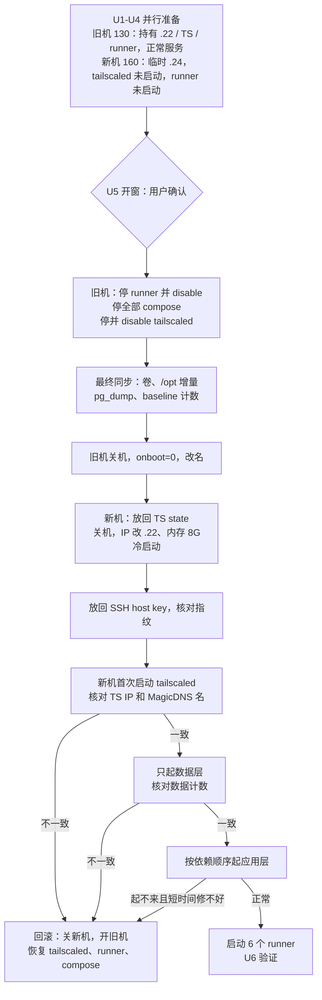

# mas-go-dev 从 AL2023 迁到 Debian 13 - Plan

## Goal Capsule

- **Objective:** 团队和 CI 照常使用 mas-go-dev：同样的地址、同样的 SIT 数据、同样的 6 个 runner，什么都不用改。底下的系统换成 Debian 13，安全补丁能及时打上，运维方式和其它 Debian 13 机器一致。
- **Means:** 在 PVE 上并行新建 VM，迁移数据和配置，在一个停机窗口内接管原 LAN IP、Tailscale 身份和 MagicDNS 名，旧 VM 关机保留作回滚（KTD2、KTD3、KTD4）。
- **Authority:** 用户在本次会话中确认的范围（R1–R10）> 本计划 KTD > 单元内细节。`AGENTS.md` 的「生产服务器操作守则」始终有效：切换窗口、关停旧 VM、销毁旧盘之前，都要用户逐次确认。
- **Stop conditions:**
  - U5 窗口内，只起数据层时做的数据核对不通过（标准见 Verification Contract 的数据基准行），立即按「回滚」恢复旧 VM，不在新机上修补。
  - 新 VM 拿不到原 Tailscale IP，或 MagicDNS 名不是 `mas-go-dev`，停在 U5 并回滚。
  - U1 发现业务仓 workflow 的 step 依赖 AL2023（`dnf`、`yum`、写死 `python3.12` 路径等），先停下来找用户，不进入 U5。`runs-on` 里引用 `al2023` label 不算，那是保留 label 的预期用法。
- **Execution profile:** U1–U4 不停机，旧机照常服务；U5 是唯一的停机窗口；U6 在窗口内完成主验证，重启测试可以在窗口后补做；U7 在观察期结束后做。每个单元结束都在 `docs/operations/` 追加记录并提交。
- **Who finishes:** Claude 经 `ssh pve`、`ssh mas-go-dev`（旧机，切换后指向新机）和临时地址执行。GitHub runner / workflow 查询用 `gh`。窗口时间由用户定。

---

## Product Contract

### Summary

新建 Debian 13 VM 160，先在临时地址上把系统、工具链、用户和目录准备好，并预拷贝数据与镜像。然后在一个停机窗口内：停旧机服务，做最终同步，旧 VM 关机，新 VM 接管 `192.168.2.22`、`100.109.223.53` 和 `mas-go-dev`，启动全部 SIT 服务和 runner。旧 VM 130 关机保留 7 天作回滚，之后经用户确认销毁。

### Problem Frame

mas-go-dev 当初选 Amazon Linux 2023，是为了和线上 `dev-cypresso` 保持一致；`dev-cypresso` 已于 2026-10-31 永久删除，这个理由不存在了。

AL2023 在这台机器上还带来两个实际问题。一是 CVE-2026-98432：AL2023 默认 `kernel`（6.1）的修复到 10-31 仍是 pending，而 Debian 13 在 10-16 就发布了 `6.12.113`（`docs/reviews/2026-10-31-cve-2026-98432-kernel-exposure.md`）。二是 AL2023 官方仓库没有 `qemu-guest-agent`，PVE 的正常关机和快照冻结一直用不上（`docs/operations/mas-go-dev.md` 2026-06-12）。

另外，其它服务器（PVE 宿主、`nyh-prod`、`cmm-prod`、`tizi-*`）都已是 Debian 13，只有这台还在用 dnf，补丁节奏也不一样。

这台机器同时承载 iCare SIT、EVP SIT、共享 PostgreSQL / Garage / Redis 和 6 个 self-hosted runner。shared-sit 租户的连接串、EVP 的 `PUBLIC_ORIGIN`、`nyh-prod` nginx 的 CMM 反代都写死了这台的 Tailscale IP。所以换系统的前提是：对所有使用方完全透明。

### Requirements

**服务连续性**

- R1. 切换后，切换前在运行的所有 SIT 入口在原地址上可用（LAN `192.168.2.22`、Tailscale `100.109.223.53`、MagicDNS `mas-go-dev`），端口和绑定方式与旧机相同。
- R2. SIT 数据原样迁移：每个库的表数和行数、Garage 各 bucket 对象数、各 Redis DB 的 key 数、azurite 数据和 CORS 规则，都与切换前一致。
- R3. 6 个 runner 以原名称、原 runner group、原 labels（包括 `al2023`）上线，每个池至少有一次真实 job 在新机上成功。
- R4. 出站依赖可用：`mssql-ref` `192.168.2.20:1433`、短名 `mac-mini:9000`（SonarQube）、GitHub、GHCR、公网 DNS，宿主和容器内都能访问。

**切换安全**

- R5. 任何时刻只有一台机器持有 `192.168.2.22`、这个 Tailscale 节点身份和这 6 个 runner。切换后旧 VM 不会自启。
- R6. 观察期结束前，回滚到旧 VM 的路径一直可用，旧 VM 的盘和数据保持原样。
- R7. 停机只发生在一个事先约定、通知过团队的窗口内。

**平台**

- R8. 新 VM 运行 Debian 13，内核已修 CVE-2026-98432，`qemu-guest-agent` 可用，自动安装安全更新。
- R9. 开机行为经过真实重启验证：DNS、Tailscale、容器和 runner 在 VM 重启后无人干预自动恢复。

**文档**

- R10. 仓库里所有写着 AL2023、VMID 130 或旧做法的地方都改成新现状。新增一篇 AL2023 → Debian 13 的经验总结。

### Key Decisions

- **用 Debian 13，不用 Ubuntu 24.04，也不继续用 AL2023。** (session-settled: user-approved — chosen over Ubuntu 24.04 / staying on AL2023: Debian 修 CVE-2026-98432 最快，且与其它服务器统一) Governs R8.
- **对使用方完全透明，地址和身份都不变。** (session-settled: user-approved — chosen over 新地址再改各项目配置: 地址被 shared-sit 租户连接串、EVP `PUBLIC_ORIGIN`、nyh-prod 反代等多处写死) Governs R1, R5.
- **SIT 数据原样迁移，不重建。** (session-settled: user-approved — chosen over 重新初始化并重灌种子数据: EVP / CMM 的 SIT 数据不可再生) Governs R2.
- **保留用户名 `ec2-user` 和 runner label `al2023`。** (session-settled: user-approved — chosen over 借机改名: 属主、文档、脚本、workflow 都不用改) Governs R3. label 在确认没有 workflow 使用后再删，见 U7。

### Success Criteria

- 切换后第一个工作日，团队没有收到任何「地址变了」「数据没了」「runner 不见了」类问题。
- 新机重启一次后，R1–R4 的检查全部再通过一遍。

### Scope Boundaries

- 不改 PVE 宿主的网络、存储和其它 VM。
- 不改各业务仓的 workflow、compose 文件和部署脚本。U1 发现确实需要改的地方，记录下来交给对应仓库处理（iCare 仓库的 PR 以 `develop` 为 base）。
- 不调整 runner 的分组、labels 和并发数，除了观察期后删掉 `al2023`（U7）。
- 不迁移 CI 的临时产物：BuildKit cache、构建缓存、悬空镜像、`_work` 里的 checkout。新机从空缓存开始，第一次构建会慢一些。

#### Deferred to Follow-Up Work

- 给新机的 Tailscale 分配独立 UDP 端口，改善家宽打洞（`docs/operations/pve.md` 里有建议，与本次迁移无关）。
- 统一 runner 版本（现在混着 2.335.1 到 2.337.0）。
- `mas-go-dev/README.md` 以外的历史计划和文档里提到 AL2023 的地方保持原样，它们是历史记录。

#### Considered and not built

- **切换前在新机上把 SIT 完整跑一遍：** 不做。SIT 容器的端口直接绑在 `100.109.223.53` 上，新机拿到这个 IP 之前起不来。要提前跑，就得给 compose 加临时 override 或开 `net.ipv4.ip_nonlocal_bind`，这本身就是新的差异。改为在 U3 / U4 验证底座（Docker、DNS、工具链、镜像能起），并保留快速回滚。如果 U5 里有服务起不来且短时间修不好，就按回滚处理。
- **搭建期给新机挂一个临时 Tailscale 节点：** 不做。切换时要 logout，并去 console 删节点，还可能抢 MagicDNS 名。搭建期走 LAN 临时 IP（在 PVE subnet route `192.168.2.16/28` 内，tailnet 也能访问）就够了。
- **主机防火墙：** 不加。旧机没有，暴露面靠端口绑定地址控制。加防火墙会引入 tailscale0 zone 和 Docker 绕过 ufw 的问题，偏离「对使用方透明」。

---

## Planning Contract

### Key Technical Decisions

- KTD1. **新 VM 用 Debian 13 genericcloud 镜像 + cloud-init，按 team-svc 的建机做法。** 用户 `ec2-user`，静态 IP、网关和 DNS 都是 `192.168.2.1`，盘放 `nvme-data`（discard、iothread、ssd），`--cpu host`，`--balloon 0`。UEFI 和 Secure Boot 的老坑不再沿用（AL2023 专属）。Governs R8。
- KTD2. **并行新建 VMID 160，旧 VM 130 关机保留作回滚。** (session-settled: user-approved — chosen over 在原 VM 原地重装: 原地重装停机长且没有回滚余地) VMID 160 是永久编号，PVE 里的名字切换后改成 `mas-go-dev`，旧 VM 改名 `mas-go-dev-al2023` 并设 `onboot: 0`。Governs R5, R6。
- KTD3. **Tailscale 用「先放回 state 再首次启动」接管身份。** 新机装好 tailscale 包，但在 U5 之前不启动 `tailscaled`，`/var/lib/tailscale` 保持为空。切换时，先在旧机停掉并禁用 `tailscaled`，再把旧的 `/var/lib/tailscale` 整个拷到新机，最后首次启动。这是 2026-10-31 tizi-kh 在 Debian 13 上验证过的做法（`docs/operations/tizi-kh.md`）。OS hostname 设为 `mas-go-dev`，切换后核对 MagicDNS 名，不对就去 admin console 改回。Governs R1, R5。
- KTD4. **SSH 主机密钥一起迁过去。** 切换时把旧机 `/etc/ssh/ssh_host_*` 放到新机，本机、mac-mini、同事的 known_hosts 都不用清（tizi-kh 先例）。密钥在 U5 的冷启动之后再放入，并核对指纹（KTD13）。Governs R1。
- KTD5. **用户和组的 UID/GID 与旧机完全一致，在装 Docker 之前预建。** `ec2-user` 1000:1000，`actions-runner` 993:992，`acquilang-ci` 991:990，`tk-flywheel-ci` 992:991，`docker` 组 gid 993（成员 `ec2-user`、`actions-runner`）。全新 Debian 13 镜像里，systemd-sysusers 和 `groupadd -r` 会从 999 往下给发行版账户分配号，990–999 可能已被占，所以 U3 先实测占用，再显式指定号建用户和组；Docker CE 安装时会自己建 `docker` 组，所以必须在装 Docker 之前建好。所有拷贝都保留数字属主（rsync `--numeric-ids` / tar `--numeric-owner`），容器 UID（如 FCM 凭据的 `10001:999`）也就原样保留。Governs R2, R3。
- KTD6. **数据卷「停服务后整卷拷贝」，PostgreSQL 另留逻辑导出。** 同架构、同镜像，卷拷贝是最忠实的方式；Garage 拷完节点 ID 不变（mac-mini → team-svc 先例）。PostgreSQL 停容器前每个库做一份 `pg_dump -Fc`，放在旧机和本机 `_backups/` 作保险，不用于正常恢复。迁移范围只包括 U1 盘点出的长期 compose 项目的命名卷，不迁 CI 临时卷。Governs R2。
- KTD7. **长期服务的镜像用 `docker save` / `load` 迁过去，不依赖 CI 重新构建。** iCare、EVP 的镜像是本机构建的本地 tag，不在任何 registry 里。这样切换后的容器与旧机完全相同，验证结论不受「构建有没有变」干扰；之后 CI 正常部署时会在新机上重新构建。Governs R1, R2。
- KTD8. **runner 整目录迁移，不重新注册。** `.runner`、`.credentials*`、`.env`、`.path` 跟着目录走，名称、group、labels 不变（2026-10-22 hon 迁移 KTD2 先例）。systemd unit 和 drop-in（`restart.conf`、`env.conf`、`runner-override.conf`）从旧机原样拷贝。旧机的 6 个 runner 服务先 stop + disable，确认 GitHub 上显示 offline 后，新机才启动。`.path` 里的 AL2023 路径在 U4 核对。Governs R3, R5。
- KTD9. **内存：新 VM 搭建期 4G 并开 ballooning（最低 2G），切换时改为 8G、balloon 0。** PVE 宿主 31G，三台常驻 VM 静态配置已占 30G 且都关了 ballooning（`docs/plans/2026-10-31-0010-ops-mac-mini-vms-to-pve-plan.md`），新机即使只给 4G，静态配置也超了。KVM 内存按需分配，实际能否放下取决于宿主 MemAvailable；新机开 ballooning 后，宿主吃紧时 PVE 只会回收这台不跑业务的 VM，其它三台不受影响。U1 设闸门：宿主 MemAvailable ≥ 6G 且 swap 没有持续增长，才进入 U2。旧机关机后，新机改为 8G、balloon 0，借 U5 的冷启动生效；这次启动同时就是 R9 的开机验证。Governs R5, R9。
- KTD10. **DNS：装 `systemd-resolved`，复刻现有 MagicDNS drop-in。** Debian 13 默认不装 resolved；不装的话，现有 `tailscale-magicdns.conf` 不生效，`mac-mini:9000` 短名会解析失败。装上后把 `/etc/resolv.conf` 固定为指向 `/run/systemd/resolve/resolv.conf` 的符号链接（与旧机相同；不能用默认的 `stub-resolv.conf`，因为 resolved 的 stub 不把单标签名发给单播 DNS，短名 `mac-mini` 会解析失败），放入同样的 drop-in（`DNS=100.100.100.100`、`Domains=~taila93443.ts.net`）。`accept-dns=false` 存在 Tailscale state 里，会跟着 KTD3 一起过来。Governs R4, R9。
- KTD11. **Docker CE 从 download.docker.com 安装，配 `log-driver: local`，关闭 containerd image store，数据目录保持 `/var/lib/docker`。** 与 team-svc 一致。Docker 29 新装默认启用 containerd image store，镜像 ID 的含义和存放位置都和旧机的经典 overlay2 存储不同，所以在 load 任何镜像之前，`daemon.json` 里关掉 `containerd-snapshotter`。版本从 25.0 跳到 29.x，U3 要验证 compose 的 `env_file required: false`、buildx，以及现有 compose 文件能 `config` 通过。Governs R1, R3。
- KTD13. **cloud-init 只负责首次开机，之后不再改主机名、`/etc/hosts` 和 SSH 主机密钥。** PVE 的 cloud-init instance-id 由 user-data 和网络配置的哈希生成，U5 改 `ipconfig0` 后，cloud-init 会把那次开机当成新实例，默认会删除并重建 SSH 主机密钥，并按 PVE 的 VM 名改主机名。U3 写一个 `cloud.cfg.d` 配置：`ssh_deletekeys: false`、`ssh_genkeytypes: []`、`preserve_hostname: true`、`manage_etc_hosts: false`。新 IP 仍由 cloud-init 在那次开机时下发。Governs R1, R9。
- KTD12. **切换后旧 VM 保留 7 天，期间保持关机；之后经用户确认才销毁。** 回滚方式是「先关新机，再开旧机」，并在旧机上恢复 `tailscaled` 和 runner 服务。7 天内新机上新写入的 SIT 数据，回滚时会丢失，回滚前需告知用户。Governs R6。

### High-Level Technical Design

谁持有身份（LAN IP、Tailscale 节点、runner）在每个阶段的归属，决定了切换顺序：

compose 启动顺序（U5）：数据层 `shared-sit-postgres` / `shared-sit-s3` / `shared-sit-redis` / `icare-backend-infra`（在这里做数据核对）→ 应用层 `icare-backend`（等 `/healthz`）→ `frontend-mas`、`icare-public-backend`、`public-frontend` → `evp-sit`（api 先起，web 后起或 api 起来后重启 web）→ `vps-traffic-monitor`。

### Assumptions

- `192.168.2.24` 和 VMID 160 未被占用，U1 核实，被占用就换下一个空闲值。
- `nvme-data` 的实际占用（Data%）允许再建一块 300G 的 thin 盘；旧机实际用量 194G，大部分是不迁的镜像和构建缓存，新盘实际占用会小得多。U1 核实，不够就改用 `local-lvm`。

### Risks & Dependencies

| 风险 | 影响 | 应对 |
| --- | --- | --- |
| 旧 VM 因 PVE 重启或误操作自启，与新机同时持有 IP / TS 身份 / runner | IP 冲突、TS 节点双开、runner 抢 job | KTD2：旧 VM `onboot: 0`；U5 里先 disable 旧机的 tailscaled 和 runner 服务，再关机；回滚步骤按「先关新机」写 |
| Debian 13 cloud image 的网络或 cloud-init 行为与 AL2023 不同（覆盖 `/etc/hosts`、`networking.service` failed） | 开机异常、名字解析问题 | U3 重启验证 `systemctl --failed` 为空；cloud-init `manage_etc_hosts` 的行为在 U3 确认 |
| Docker 25 → 29 版本跨度带来 compose 行为差异 | 某个 stack 起不来 | U3 用实际 compose 文件做 `config` 校验；U4 预加载镜像后，用临时网络单独试起不绑 TS IP 的服务 |
| 第一次 CI 构建在新机上没有缓存，`vite build` 可能 Node 堆 OOM | 首批 job 失败或很慢 | 内存不低于旧机（8G，KTD9）；U6 观察首批构建的耗时和内存 |
| 业务仓 workflow 依赖 AL2023（`dnf`、`yum`、python3.12 路径） | job 在新机失败 | U1 用 `gh` 搜索各业务仓 workflow；命中就进入 Stop condition |
| `vps-traffic-monitor`、`public-frontend`、`uploads` 卷在文档里没有记录 | 漏迁 | U1 只读盘点，把每个 compose 项目的目录、卷、端口、env 文件列全 |

依赖：PVE 有 Debian 13 genericcloud 镜像（U2 下载）；GitHub 上 6 个 runner 的 group 和 labels（U1 用 API 读取当前值作为验收基准）。

### Sources

- 现网清单与地址依赖：`mas-go-dev/README.md`、`docs/operations/mas-go-dev.md`、`docs/operations/nyh-prod.md`（CMM 反代）、`mas-go-dev/shared-sit/bootstrap.sh`、`mas-go-dev/evp-sit/docker-compose.yml`、`mas-go-dev/cmm-sit/compose.yml`。
- 建机做法：`docs/operations/pve.md`、`team-svc/README.md`、`docs/plans/2026-05-17-001-feat-mas-go-dev-deployment-plan.md`、`docs/solutions/pve/best-practices/mas-go-dev-deployment-2026-05-17.md`。
- Tailscale 身份接管与 SSH 主机密钥：`docs/operations/tizi-kh.md`、`docs/runbooks/proxy-node-reinstall-upgrade.md`、`scripts/backup-proxy-node-pre-reinstall.sh`。
- runner 整目录迁移、卷拷贝、save/load：`docs/plans/2026-10-22-1645-ops-mac-mini-team-assets-to-hon-plan.md`（KTD2、KTD7、KTD11）、`docs/operations/team-svc.md`。
- DNS 方案：`docs/operations/mas-go-dev.md` 2026-09-17 条目。
- runner 主机准备：`docs/solutions/icare-uat-runner-2/workflow-issues/buildx-cache-dir-missing-on-new-uat-runner-2026-08-23.md`、`docs/solutions/mas-go-dev/integration-issues/sonar-scan-fails-no-dirmngr-on-x86-runner-2026-06-10.md`、`docs/runbooks/ci-runner-pools.md`。
- 内存约束：`docs/plans/2026-10-31-0010-ops-mac-mini-vms-to-pve-plan.md`、`docs/operations/pve.md`。

---

## Implementation Units

### U1. Preflight：只读盘点、基准和备份

**Goal:** 在动任何东西之前，把旧机的完整现状、验收基准和离机备份准备好，并确认没有阻断条件。

**Requirements:** R1, R2, R3, R4, R5

**Dependencies:** 无

**Files:**
- `docs/operations/mas-go-dev.md`（盘点结果，不含密钥）
- `docs/operations/pve.md`（容量核对）
- `mas-go-dev/README.md`（补全文档漂移：6 个 runner、`public-backend`、`public-frontend`、`vps-traffic-monitor`）
- `_backups/mas-go-dev-2026-11/`（gitignored，本机离机备份）

**Approach:**
1. 逐个 compose 项目列出目录、命名卷、bind mount、端口绑定、env 文件和镜像（tag 与 ID），重点补齐 `vps-traffic-monitor`、`public-frontend`、`uploads` 卷的归属。CMM SIT（`/opt/cmm-sit`、端口 25880/25881）10-31 已不在本机，仓库里没有下线记录，只迁它留在 shared-sit 里的库 `cmm` 和 Redis DB 2。
2. 列出 `/opt`、`/home/ec2-user`、`/home/actions-runner`、`/etc/systemd/system`（runner unit 和 drop-in、3 组 timer）、`/opt/gha-scripts`、`/etc/hosts`、`/etc/sysctl.d`、sudoers 里与本机相关的条目。找出开机时保证 Docker 在 `tailscaled` 拿到 `100.109.223.53` 之后才启动绑定该 IP 的容器的机制（systemd 依赖、drop-in 或其它），U3 要原样复刻。
3. 用 GitHub API 读取 6 个 runner 当前的 group、labels、状态，作为 U6 的验收基准。
4. 检查业务仓 workflow。`gh search code` 只索引默认分支，而 iCare 日常 CI 跑在 `develop`，所以不用它：对用到这批 runner 的每个仓库，用 `gh api` 取默认分支和活跃分支（iCare 至少含 `develop`），拉下每个分支的 `.github/workflows/` 和 composite action，在本地 grep `dnf`、`yum`、`amazon`、`python3.12`。step 里命中就停下来找用户（Stop condition）。另外单独列出引用 `al2023` 的 `runs-on`，按「仓库 × 分支」记录，留给 U7。
5. 记录数据基准：每个库每张用户表的精确行数和库大小、Garage 各 bucket 对象数、各 Redis DB 的 key 数、azurite 容器列表。
6. 核实 PVE：VMID 160 和 `192.168.2.24` 空闲，`nvme-data` Data%，宿主 MemAvailable ≥ 6G 且 swap 没有持续增长（KTD9 的闸门，不满足就停下来找用户）。
7. 把只在主机上的密钥和配置（env 文件、`garage.toml`、FCM 凭据、`/var/lib/tailscale`、`/etc/ssh/ssh_host_*`）打包到本机 `_backups/`，权限 600。

**Patterns to follow:** `scripts/backup-proxy-node-pre-reinstall.sh` 的离机备份做法；`docs/plans/2026-10-22-1645-ops-mac-mini-team-assets-to-hon-plan.md` U1 的 baseline。

**Test scenarios:**
- 每个仓库的每个活跃分支都检查过，step 里没有 AL2023 相关写法，记录「仓库 × 分支 + 结果」；有命中则记录位置并停止。
- `al2023` 的 `runs-on` 引用清单已记录（可以为空）。
- 本机 `_backups/` 里的 tailscale state 和 SSH 主机密钥可以列出、大小非零。
- 基准文件里每个长期 compose 项目都有对应条目，没有「未知归属」的命名卷。

**Verification:** 盘点记录写进 `docs/operations/mas-go-dev.md` 并提交；离机备份存在；没有阻断条件。

---

### U2. 在 PVE 上创建 VM 160

**Goal:** 新 VM 在临时地址上开机，可以用 `ec2-user` SSH 登录。

**Requirements:** R5, R8

**Dependencies:** U1

**Files:**
- `docs/operations/pve.md`

**Approach:**
1. 下载 Debian 13 genericcloud qcow2 到 `/var/lib/vz/template/iso/`，并校验 SHA512。
2. 按 KTD1 建 VM 160：4 vCPU、4G 并开 ballooning（最低 2G，KTD9）、300G 系统盘、cloud-init 用户 `ec2-user`、`ipconfig0` 为 `192.168.2.24/24`、SSH 公钥与旧机 `sshkeys` 相同、`agent: enabled=1`、`onboot: 0`（切换时再改成 1）、`startup` 与旧机相同（`order=30,up=60,down=180`）。
3. 开机，确认 cloud-init 完成、根分区已自动扩到 300G。

**Patterns to follow:** `docs/operations/pve.md` 里建 VM 150 的条目。

**Test scenarios:**
- `ssh ec2-user@192.168.2.24` 能登录，`hostnamectl` 显示 Debian 13。
- `qm agent 160 ping` 在 U3 装好 agent 后返回成功（本单元先记录为待验）。
- 新机开机后，宿主 MemAvailable 和 swap 用量没有持续恶化（KTD9）。

**Verification:** VM 160 运行中，`onboot: 0`，旧 VM 130 不受影响。

---

### U3. 系统底座：用户、软件包、DNS、Docker、工具链

**Goal:** 新机具备旧机所有的主机级能力，重启后仍然正常。

**Requirements:** R3, R4, R8, R9

**Dependencies:** U2

**Files:**
- `docs/operations/mas-go-dev.md`（新机条目）
- `mas-go-dev/README.md`（新机系统说明）

**Approach:**
1. 主机名设为 `mas-go-dev`，时区 `Asia/Shanghai`，写入 KTD13 的 cloud-init 配置。
2. 用 `getent` 列出 990–999 和 1000 的占用；被发行版系统账户占用的号，先挪到 990 以下的空闲号并修正对应文件属主。然后按 KTD5 显式指定号预建用户和组（含 docker 组），`ec2-user` 加入 `sudo` 组。
3. `apt full-upgrade`，保证内核是已修 CVE-2026-98432 的版本；配置并启用 `unattended-upgrades` 的自动安全更新。安装 `qemu-guest-agent`、`systemd-resolved`（KTD10）、`unattended-upgrades`、`gnupg` 和 `dirmngr`、`build-essential`、`git`、`jq`、`rsync`、`zstd`、`unzip`、`python3`、`libatomic1`、`sysstat`，以及 `btm`、`sqlcmd`（旧机 `/usr/local/bin` 里有）。
4. 先写好 `daemon.json`（`log-driver: local`、关闭 `containerd-snapshotter`，KTD11），再安装 Docker CE、compose 插件和 buildx。按 U1 找到的机制，复刻 Docker 与 `tailscaled` 的开机顺序。
5. 安装 tailscale 包，然后 `systemctl disable --now tailscaled`，确认 `/var/lib/tailscale` 为空（KTD3）。
6. 复刻 sysctl（`/etc/sysctl.d` 里非发行版默认的条目）、8G `/swapfile`、`/var/cache/buildx`（`actions-runner`，775）、`/var/cache/gha/pnpm-store`。
7. 把 `/etc/resolv.conf` 链到 `/run/systemd/resolve/resolv.conf`，放入 MagicDNS drop-in（KTD10）。
8. 重启一次，再验证一遍。

**Patterns to follow:** `team-svc/README.md` 的系统初始化；`docs/runbooks/ci-runner-pools.md` 的 runner 主机要求。

**Test scenarios:**
- `uname -r` ≥ `6.12.113`（CVE-2026-98432 已修）。
- `id` 输出的 4 个用户和 docker 组的 UID/GID 与 U1 记录完全一致。
- `sudo -u actions-runner docker version` 不需要 sudo 就成功。
- `getent hosts github.com` 能解析，`readlink /etc/resolv.conf` 等于 `/run/systemd/resolve/resolv.conf`。
- `docker info` 的 Storage Driver 是 `overlay2`，没有启用 containerd snapshotter。
- `apt-config dump` 显示自动安全更新已启用。
- `gpg --recv-keys` 用 runbook 里的 key 能成功（dirmngr 可用）。
- 用旧机的实际 compose 文件执行 `docker compose config`，全部通过（验证 Docker 29 的兼容性）。
- 重启后 `systemctl --failed` 为空，`qm agent 160 ping` 成功。
- `mac-mini` 短名在这个阶段还解析不了（tailscaled 没启动），这是预期结果，留到 U6 验证。

**Verification:** 以上检查都在重启后通过，并记录在 `docs/operations/mas-go-dev.md`。

---

### U4. 预同步：目录、runner、unit、镜像

**Goal:** 在不停机的前提下，把除最终数据增量以外的所有东西都放到新机上，把 U5 的窗口压到最短。

**Requirements:** R1, R2, R3

**Dependencies:** U3

**Files:**
- `docs/operations/mas-go-dev.md`

**Approach:**
1. 用 rsync（保留数字属主、权限和 ACL）从旧机拷贝 `/opt` 下的长期目录（`mas-go-dev`、`shared-sit`、`evp-sit`、`vps-traffic-monitor`、`gha-scripts`、`acquilang-ci`、`tk-flywheel-ci`）和 `/opt/actions-runner`。排除 `_work`、`cache/go-build` 等 CI 临时内容。
2. 拷贝 runner 的 systemd unit 和 drop-in、3 组 timer unit，只 `daemon-reload`，不 enable、不 start（KTD8）。
3. 检查每个 runner 的 `.path` 和 `.env`，把只在 AL2023 上存在的路径改成 Debian 对应路径，并记录改了什么。
4. 用 `docker save` / `load` 把 U1 列出的长期服务镜像迁过来（KTD7），核对镜像 ID 一致。
5. 预拷贝一次命名卷（服务仍在运行，只是为了让 U5 的增量更小；这份数据不作为最终结果）。
6. 把预拷贝的 PG 卷 `cp -a` 一份到临时目录，用一个不绑 TS IP 的临时容器、`shared-sit-postgres` 的镜像读这份副本，确认 PG18 能启动；验证后删除临时容器和副本。临时 PG 不碰正式的预拷贝卷。

**Patterns to follow:** hon 迁移计划的 KTD2（runner 整目录迁移）和 KTD7（save/load）。

**Test scenarios:**
- 新旧机上 `/opt` 各目录的文件数和属主（数字）一致。
- 新机上 6 个 runner unit 是 `disabled` / `inactive`，GitHub 上这 6 个 runner 仍然由旧机在线。
- 每个长期服务的镜像 ID 在两台机器上相同。
- 临时 PG 容器能读预拷贝卷的副本并正常启动，`\l` 列出的库与 U1 一致；副本和临时容器已删除。

**Verification:** 预同步完成，旧机服务没有中断；记录写进 `docs/operations/mas-go-dev.md`。

---

### U5. 切换窗口

**Goal:** 在一个窗口内把身份、数据和服务从旧机移到新机，或者干净地回滚到旧机。

**Requirements:** R1, R2, R3, R5, R6, R7

**Dependencies:** U4，以及用户确认窗口时间、窗口已通知团队

**Files:**
- `docs/operations/mas-go-dev.md`
- `docs/operations/pve.md`

**Approach:**
1. 确认 6 个 runner 都没有在跑 job，然后在旧机上 stop + disable 全部 runner 服务，等 GitHub 显示 offline（KTD8）。
2. 在旧机上先停应用层 compose（数据层以外的全部项目），在数据层仍运行时采最终数据基准（R2），给每个库做 `pg_dump -Fc` 并拷到本机 `_backups/`（KTD6），然后再停数据层。
3. 用 rsync 同步到新机，保留数字属主：命名卷带 `--delete`，与停服后的源端逐文件一致；`/opt` 增量同步时排除每个 runner 目录的 `.path` 和 `.env`，保留 U4 改好的 Debian 版本。
4. 在旧机上 stop + disable `tailscaled`，把 `/var/lib/tailscale` 拷到新机，此时不要启动（KTD3）。旧机的 `/etc/ssh/ssh_host_*` 先拷到新机的暂存目录。
5. 旧机关机，在 PVE 上设 `onboot: 0`，改名为 `mas-go-dev-al2023`（KTD2、KTD12）。
6. 新机关机，在 PVE 上改 `ipconfig0` 为 `192.168.2.22`、内存 8G、balloon 0（KTD9）、`onboot: 1`、名字 `mas-go-dev`，然后冷启动。
7. 把暂存的 SSH 主机密钥放到 `/etc/ssh/` 并重启 ssh，核对指纹与 U1 备份一致（KTD4、KTD13）。然后 enable 并启动 `tailscaled`，核对 `tailscale ip -4` 是 `100.109.223.53`，MagicDNS 名是 `mas-go-dev`。任一不一致就回滚。
8. 先只起数据层，按 Verification Contract 的数据基准行核对，不通过就回滚。通过后按「High-Level Technical Design」里的顺序起应用层；有服务起不来且短时间修不好，就回滚。
9. 确认每个 runner 的 `.path` 和 `.env` 仍是 U4 记录的版本，然后 enable 并启动 6 个 runner 服务和 3 组 timer。

**Execution note:** 每一步完成后再进入下一步；第 7、8 步是回滚闸门，不要越过。

**Patterns to follow:** `docs/plans/2026-10-31-0010-ops-mac-mini-vms-to-pve-plan.md` 的窗口记录方式。

**Test scenarios:**
- 第 1 步后，GitHub API 显示 6 个 runner 都是 offline，且没有被中断的 job。
- 第 5 步后，`qm config 130` 显示 `onboot: 0`，`ping 192.168.2.22` 不通，直到第 6 步新机开机。
- 第 7 步：新机 `ssh_host_ed25519_key.pub` 的指纹与 U1 备份一致；`tailscale status --self` 显示 `100.109.223.53` 和 `mas-go-dev`；本机 `ssh mas-go-dev` 不报 host key 变化。
- 第 8 步：只起数据层时，按 Verification Contract 的数据基准行比对，全部通过后才起应用层。
- 第 8 步：icare `/healthz` 返回 200 后再检查前端，不把启动期的 502 误判为失败。
- 回滚演练路径（只在需要时执行）：关新机 → 新机 `onboot: 0` → 开旧机 → 旧机 enable 并启动 `tailscaled`、compose、runner → 旧机上 R1 检查通过。

**Verification:** 新机持有全部身份，数据核对一致，6 个 runner 在线；或者已完整回滚，旧机恢复服务。窗口结束时写记录并提交。

---

### U6. 切换后验证与重启测试

**Goal:** 证明使用方看到的一切都和以前一样，并且重启后依然如此。

**Requirements:** R1, R2, R3, R4, R9

**Dependencies:** U5

**Files:**
- `docs/operations/mas-go-dev.md`

**Approach:**
1. 按「Verification Contract」逐项检查 R1–R4。
2. 在每个 runner 池触发或重跑一次真实 job：iCare 部署、`backend-ci`（含 Sonar）、`frontend-quality-ci`、EVP（`shared-sit`）、AcquiLang `acquilang-build`、tk-flywheel。
3. 用 `qm reboot 160` 重启 VM，再把 R1–R4 的检查做一遍（R9）。
4. 通知团队窗口结束。

**Test scenarios:**
- `curl http://mac-mini:9000/api/system/status` 在宿主和 `--network host` 的容器内都返回 `UP`。
- 从新机 `sqlcmd` 连 `192.168.2.20:1433` 成功。
- 从 tailnet 另一台机器分别经 `100.109.223.53`、`mas-go-dev` 短名、`192.168.2.22`（经 PVE subnet route）访问 `:5174`，都返回 200。
- 每个池的首个 job 都成功，`backend-ci` 的 Sonar 步骤能拉到 gpg key。
- 重启后不做任何手动操作，以上检查全部再次通过，`systemctl --failed` 为空，SSH 主机密钥指纹没有变化。

**Verification:** 所有检查在重启前后都通过，记录写进 `docs/operations/mas-go-dev.md` 并提交。

---

### U7. 文档更新、观察期后清理

**Goal:** 文档反映新现状；观察期结束后释放旧 VM 资源，去掉过时的 label。

**Requirements:** R6, R10

**Dependencies:** U6；清理部分还依赖 7 天观察期和用户确认

**Files:**
- `AGENTS.md`（服务器表 `mas-go-dev` 行和 mas-go-dev 目录约定）
- `README.md`
- `pve/README.md`
- `mas-go-dev/README.md`
- `docs/runbooks/ci-runner-pools.md`
- `docs/operations/mas-go-dev.md`、`docs/operations/pve.md`
- `docs/solutions/mas-go-dev/best-practices/al2023-to-debian13-migration-2026-11-XX.md`（新增，日期按实际完成日）

**Approach:**
1. 切换完成后立即更新文档：系统改为 Debian 13，VMID 改为 160，用 `apt` 的做法替换 `dnf` 的做法，补上 resolved / Tailscale / UID 约定。
2. 写经验总结（`/ce:compound` lightweight 模式）。
3. 观察期满 7 天且用户确认后，销毁 VM 130 及其 `unused0` 盘；如有快照，手动删除。
4. 按 U1 第 4 步的方法（逐仓库、逐活跃分支拉取 workflow）重新确认没有 `runs-on` 引用 `al2023`。经用户确认后，从 U1 基准里带这个 label 的 runner 上删掉它（按仓库记录是 `mas-go-dev`、`mas-go-dev-ci-1`、`mas-go-dev-ci-2`、`shared-sit` 这 4 个，以 U1 实查为准），并更新 `docs/runbooks/ci-runner-pools.md`。

**Test scenarios:**
- `grep -rn "AL2023\|al2023\|Amazon Linux" AGENTS.md README.md pve/README.md mas-go-dev/README.md docs/runbooks/` 只剩下历史说明，没有描述现状的条目。
- 删除 label 后，各 runner 池仍能接到 job（触发一次即可）。

**Verification:** 文档已提交；旧 VM 已销毁或仍在观察期内且明确记录了到期日；label 状态和文档一致。

---

## Verification Contract

本仓库没有自动化测试，验证就是对服务器状态的只读检查，结果写进运维时间线。

| 检查 | 对应 | 时机 | 通过标准 |
| --- | --- | --- | --- |
| 数据基准对比（表行数、Garage 对象数、Redis key 数、azurite 容器） | R2 | U5 第 8 步，只起数据层时 | 与 U5 第 2 步的最终基准相比：每张表的精确行数、Garage 各 bucket 对象数、azurite 容器列表完全一致；Redis 各 DB 的 `keys − expires`（不带 TTL 的 key 数）完全一致，总 key 数不大于基准（带 TTL 的 key 在窗口内可能过期） |
| Tailscale 身份 | R1, R5 | U5 第 7 步、U6 重启后 | `100.109.223.53`，MagicDNS `mas-go-dev`，console 里只有一个节点 |
| SIT 入口（5173/5174/5175、8090–8092、25173/25174/28081/28082、5432/3900/6380/10000/6379，以 U1 盘点为准） | R1 | U6，重启前后 | 都在原绑定地址监听，HTTP 入口返回 200 |
| runner 状态和 labels | R3 | U5 第 9 步、U6 | 与 U1 的 GitHub API 基准一致，6 个都 online |
| 每个 runner 池的真实 job | R3 | U6 | 各成功一次 |
| 出站依赖（mssql-ref、`mac-mini:9000`、GitHub、GHCR、公网 DNS） | R4 | U6，重启前后 | 宿主和容器内都可用 |
| 旧 VM 不会自启 | R5 | U5 第 5 步 | `qm config 130` 显示 `onboot: 0` |
| 内核、guest agent、自动安全更新 | R8 | U3、U6 | 内核 ≥ `6.12.113`，`qm agent 160 ping` 成功，`apt-config dump` 显示自动安全更新已启用 |
| 重启后无人干预恢复 | R9 | U3、U6 | `systemctl --failed` 为空，以上检查全部再次通过 |

## Definition of Done

- U1–U6 完成，Verification Contract 全部通过，并记录在 `docs/operations/mas-go-dev.md` 和 `docs/operations/pve.md`。
- 文档已按 U7 第 1、2 步更新并提交，没有描述 AL2023 现状的残留条目。
- 旧 VM 130 处于关机且 `onboot: 0` 的状态，到期日已写进 `docs/operations/pve.md`；或者已在用户确认后销毁。
- `_backups/` 里的离机备份保留到旧 VM 销毁之后，再由用户决定是否删除。
- 执行过程中做过、但没有采用的临时改动（临时容器、临时网络、临时 override 文件）都已删除。

## Open Questions

- 切换窗口的具体时间由用户决定，需提前通知 iCare、EVP 的使用者（不阻断 U1–U4）。
- CMM SIT 已不在本机运行（`/opt/cmm-sit`、容器、25880/25881 都没有），但 `nyh-prod` 的 nginx 仍把 CMM 入口反代到这台的 25880/25881。是有意下线还是丢失，需要用户确认；本计划不恢复它，只迁移它在 shared-sit 里的数据（不阻断）。
