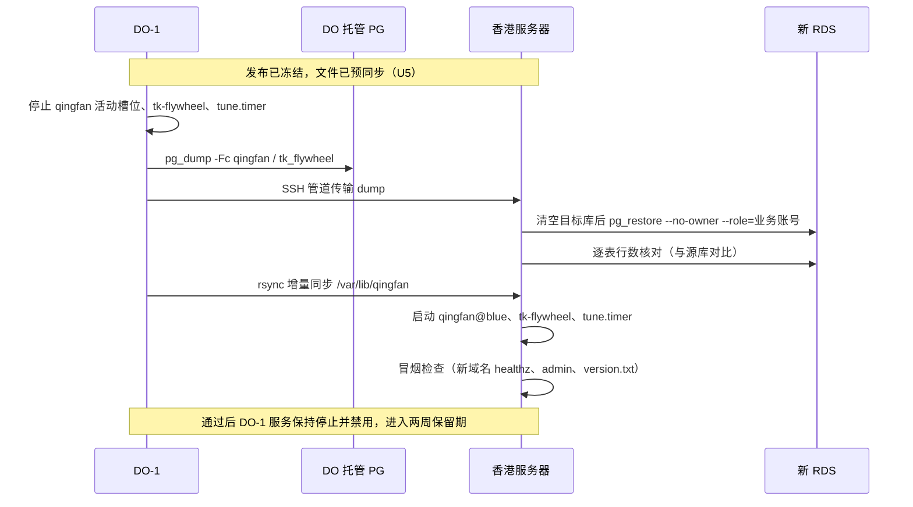

> **归档说明（2026-11-11）**：迁自已废弃的 `DigitalOcean` 仓库。文中 `hk-1` = `qingfan-prod`、`tk-pro` / DO-1 = `do-1`；路径 `hosts/hk-1/`、`hosts/tk-pro/` 已改写为本仓库的 `qingfan-prod/`、`do-1/`。

# qingfan 与 tk-flywheel 迁移到香港轻量服务器 - Plan

## Goal Capsule

- **Objective:** 用户通过 `https://qingfan.app` 使用青帆（官网、下载、`/admin/` 后台、桌面端 API），通过 `https://flywheel.qingfan.app` 使用 tk-flywheel，数据与迁移前 DO 上的线上数据一致；之后两个仓库的 CI 发布直接上线到新环境。
- **Means:** 在香港轻量服务器 `8.210.153.241` 上按 DO-1 现有模式（systemd + Nginx + 蓝绿/软链发布 + certbot）重建运行环境，数据库落在新账号 RDS `pgm-j6cd36m59smx6n9g`，一次停服窗口内完成最终导库与文件同步（KTD1、KTD2）。
- **Authority:** 本计划 > 仓库 `do-1/` 现有模式 > 执行时临场判断。与用户已拍板的决定（标 `session-settled`）冲突时停下来问，不自行改。
- **Stop conditions:** 演练（U5）任一冒烟检查失败不进入切换；切换（U7）中导库行数核对不一致或健康检查失败，立即按 R12 回滚。
- **Execution profile:** 绝大部分是服务器配置与运维操作，验证以运行时冒烟检查为主，没有单元测试。
- **Who finishes:** Claude 通过 SSH 和本机 CLI 执行全部步骤；需要用户在控制台或 GitHub 操作的点在单元里写明。

---

## Product Contract

### Summary

把 qingfan 和 tk-flywheel 从旧金山 DO-1 + DO 托管 PG，整体迁到香港轻量服务器 + 阿里云 RDS，换用新域名 `qingfan.app` / `flywheel.qingfan.app`，旧域名停用。
运行环境照搬 DO-1 的部署方式并把配置收进本仓库 `qingfan-prod/`，两个 GitHub 仓库（`IAmKongHai/qingfan`、`tk-flywheel`）的 CI 改为发布到香港。
切换采用一次 15～30 分钟的停服窗口，DO-1 上的旧服务停而不删，保留两周作为回滚路径。

### Problem Frame

两个服务目前在 DigitalOcean 旧金山（DO-1，`137.184.127.196`），数据库是 DO 托管 PG，连接上限只有 25。
用户已在新阿里云账号买了香港轻量服务器（已升级 Debian 13.7）和 RDS PG 18（`10.0.0.67`，经轻量服务器“内网互通”打通，强制 SSL，库和账号已建好），并把产品换到 `qingfan.app` 域名下。
项目处于测试阶段（只有一位测试人员装了浏览器插件），可以接受短暂停服，也不需要兼容旧域名。
服务器以后完全由 Claude 维护，用户不登录、不装面板，所以环境必须可以只靠本仓库还原。

### Requirements

**运行环境**

- R1. 香港服务器以与 DO-1 相同的进程模型运行两个服务：qingfan 为 `qingfan@blue/green` 蓝绿槽位，tk-flywheel 为单实例加每小时 `tune` 定时任务。
- R2. Nginx 只为 `qingfan.app` 和 `flywheel.qingfan.app` 提供 HTTPS 站点，证书由 certbot 签发并自动续期；未知 Host 与裸 IP 访问一律拒绝（沿用 DO-1 的 `default_server` 规则）。
- R3. 应用连接新 RDS 时使用各自的业务账号和 `sslmode=require`，凭据只存在服务器上权限受限的 env 文件里。

**数据迁移**

- R4. 两个库在切换时一次性从 DO 托管 PG 迁到 RDS，迁移后每张表的行数与源库一致。
- R5. qingfan 的数据目录 `/var/lib/qingfan`（含 `server/master.key`、`server/providers.enc`、安装包 `downloads/`、`models/`、`production/`）原样迁移，属主和权限保持不变；tk-flywheel 的 `MODEL_MASTER_KEY` 保持不变，否则库里加密的模型配置无法解密。

**发布与运维**

- R6. `qingfan` 仓库的 release 工作流和 `tk-flywheel` 的 CI 部署到香港服务器，发布后的健康检查使用新域名（本地的 `qingfan-team-svc` 目录是 `qingfan` 仓库的一个 worktree，不是独立仓库）。
- R7. 代码里写死的旧域名改为新域名：qingfan 桌面端构建时写入的服务端地址、发布记录上报地址、采集器默认服务端地址、仓库内的 Nginx 与建机脚本，以及 tk-flywheel 插件构建参数与帮助页链接。
- R8. 两个库每天自动备份（`pg_dump` 自定义格式并校验可还原），保留 14 天，发布前额外备份一次（沿用现有 `*-backup` 脚本语义）。
- R9. 香港服务器的全部配置（Nginx、systemd、env 示例、发布/回滚/备份脚本、cron、sshd 加固）收进本仓库 `qingfan-prod/`，并有一份对应的运维手册。

**切换与回滚**

- R10. 切换期间停服不超过 30 分钟，期间 DO-1 上两个服务不再写库。
- R11. 切换后 DO-1 上的 qingfan、tk-flywheel 停止并禁用但不删除，DO 托管库中的两个库保留，保留期两周（至 2026-11-24）。
- R12. 切换后若出现阻断问题，可以在 30 分钟内回到 DO-1：在 DO-1 上重新启动旧服务，并让测试人员临时使用旧域名访问。

### Key Decisions

- **新域名 `qingfan.app` / `flywheel.qingfan.app`，旧域名彻底停用，不做跳转。** Governs R2, R7. (session-settled: user-directed — chosen over 香港同时服务新旧域名以兼容已发出的插件: 项目在测试阶段，只有一位测试人员，重装插件即可)
- **一次停服窗口内完成最终导库和文件同步。** Governs R4, R10. (session-settled: user-approved — chosen over 数据库逻辑复制做零停机切换: 两个库共约 220MB，停服导库几分钟内完成，复制方案的复杂度不值得)
- **DO-1 旧服务停而不删，保留两周。** Governs R11, R12. (session-settled: user-approved — chosen over 切换后立即清理 DO-1: 留出回滚路径)

### Scope Boundaries

- new-api、sub2api 继续运行在 DO-1，不迁移，不改动。
- 旧域名 `qingfan.konghai.me`、`tk.konghai.me` 不在香港配置站点、不签证书、不做跳转。
- Gemini TTS（`generativelanguage.googleapis.com`）在香港可能被地区封锁，由用户后续自行做转发；本计划只在演练中记录它的实际可用性，不实现转发。
- 不安装宝塔等 Web 面板。
- 不做 22 端口的按需开放：22 端口对公网开放，只允许密钥登录（见 KTD4）。

#### Deferred to Follow-Up Work

- 2026-11-24 之后清理 DO-1 上的 qingfan、tk-flywheel 发布目录、数据目录、systemd 单元、证书，以及 DO 托管库中的 `qingfan`、`tk_flywheel` 两个库。
- `/opt/tk-flywheel/releases` 在 DO-1 上已累积 48 个版本（21GB），发布脚本没有清理旧版本；香港上同样会累积，后续给 `tk-flywheel-deploy` 加保留最近 N 个版本的清理。
- 备份目前只存在本机，异地副本（例如同步到 OSS）留待后续。

#### Considered and not built

- **切换前把 qingfan 的模型供应商改走 DO-1 转发**：用户已决定 Gemini 转发由自己处理；其他加密存储的供应商在 U5 演练中实测，只有发现被封锁时才提出，不预先建转发。
- **给香港机器加 swap**：8GB 内存，两个服务在 DO-1 上实际用量不到 1GB，无证据需要。
- **fail2ban**：sshd 只允许密钥登录且 `MaxAuthTries 3`，暴力破解无法成功；如日志显示扫描量影响性能再加。

### Dependencies

- 新域名 A 记录已由用户在 Cloudflare 指向 `8.210.153.241`。截至写计划时 `1.1.1.1` 上还查不到记录；签证书（U3、U4）前必须能解析，且记录必须是“仅 DNS”（灰色云朵），否则 HTTP-01 校验与客户端真实 IP 都会出问题。
- 新 RDS 已就绪：业务账号 `qingfan`、`tk_flywheel` 与同名库已建，库属主是同名业务账号，两个库都已 `REVOKE CONNECT ... FROM PUBLIC`；凭据在服务器 `/root/rds-credentials.env`。
- 改 GitHub 仓库 secrets（`qingfan` 的 `DEPLOY_HOST`、`DEPLOY_KNOWN_HOSTS`，`tk-flywheel` 的 `PRODUCTION_KNOWN_HOSTS`）需要 `gh` CLI 对两个仓库有 admin 权限，否则由用户在网页上改。
- qingfan 桌面端在构建时把服务端地址写进客户端（`scripts/package.sh` 的 `QINGFAN_SERVER_URL`，默认旧域名）。已安装的客户端在切换后连不上服务端，需要从 `https://qingfan.app` 重装切换后发布的新版本。
- 采集器 `qingfan-collector` 常驻在一台国内电脑上，由 crontab 每 5 分钟用 `start.sh` 保活；只改源码默认值不会影响这台机器上已在运行的进程。

### Sources

- DO-1 现有配置：`do-1/`（Nginx 站点、systemd 单元、`qingfan-deploy`/`qingfan-rollback`/`qingfan-backup`、`tk-flywheel-deploy`/`tk-flywheel-backup`、`etc/cron.d/tk-pro-backups`、`etc/ssh/sshd_config.d/00-hardening.conf`）。
- DO-1 运维手册：`docs/runbooks/do-1-ops-manual.md`。
- 香港服务器系统升级记录：`docs/runbooks/aliyun-swas-debian12-to-13-upgrade.md`。
- CI 工作流与脚本：`qingfan` 仓库 `origin/main` 上的 `.github/workflows/release.yml`、`scripts/package.sh`、`scripts/publish-release.sh`、`deploy/`、`cmd/qingfan-collector/main.go`、`docs/deploy.md`（采集器部署方式）；`tk-flywheel/.github/workflows/ci.yml`、`tk-flywheel/deploy/package.sh`、`tk-flywheel/deploy/nginx.conf`。
- tk-flywheel 的 `tune` 在 `EXECUTION_ENABLED` 不为 `true` 时直接报错返回（`backend/tuning.go`），线上该值为 `false`；单个模型配置可用后台的“测试模型”接口验证（`backend/ops.go` 中 `POST /models/:id/test`）。

---

## Planning Contract

### Key Technical Decisions

- KTD1. **照搬 DO-1 的部署形态，不引入容器或新编排。** 发布脚本、蓝绿切换、forced-command 部署入口都已在线上验证过，CI 只需要换目标主机；环境用 `qingfan-prod/` 的文件逐一落到服务器上。
- KTD2. **停服窗口内用 `pg_dump -Fc` 在 DO-1 上导出，经 SSH 管道直接 `pg_restore` 进 RDS。** DO 托管库只有 VPC 私网地址，香港访问不到，所以导出必须在 DO-1 上做；还原时用 `--no-owner --role=<业务账号>`，让对象属主落到业务账号，与 DO 上的属主关系一致。演练（U5）和正式切换（U7）用同一套命令。
- KTD3. **文件先预同步、窗口内增量同步。** `/var/lib/qingfan` 约 12GB（主要是 106 个安装包），停服前用 `rsync -aHAX --numeric-ids` 预同步一次，窗口内只补差量，把停服时间控制在 R10 内。同步方向为 DO-1 推到香港：DO-1 目前没有到香港的访问凭据，U5 配一把临时密钥，限制来源 IP 和可执行的命令，用完删除。香港上的服务用户按 DO-1 的 UID/GID 创建（`qingfan` 995/986、`tk-flywheel` 997/987），`--numeric-ids` 同步后属主天然一致。
- KTD4. **22 端口对公网开放，只允许密钥登录，CI 直接连。** 去掉 qingfan 工作流里调 DigitalOcean 防火墙 API 临时放行 runner IP 的步骤。(session-settled: user-directed — chosen over 平时关闭 22、发布时调阿里云防火墙 API 临时放行: 只允许密钥登录，安全风险可接受，流程更简单)
- KTD5. **沿用现有的两把 CI 部署密钥，只换主机。** 把 DO-1 上 `qingfan-deploy` 用户和 root 的 `authorized_keys` 中对应公钥原样装到香港（tk-flywheel 的那条保留 `restrict,command="/usr/local/sbin/tk-flywheel-deploy"`），GitHub 上只需更新主机地址和 known_hosts，私钥 secret 不动。
- KTD6. **香港系统时区改为 UTC。** DO-1 是 UTC，cron 备份时间（03:15 起）和日志都按 UTC 写；保持一致避免备份与 `tune` 定时漂移 8 小时。
- KTD7. **`QINGFAN_DB_MAX_CONNS` 保持 1。** 只是从 25 连接上限的托管库换成 400 上限的 RDS，并不说明需要更多连接；改动应用连接池属于调优，不在迁移里顺手做。
- KTD8. **CI 改动在切换完成后才合并。** 从演练开始到切换结束冻结两个仓库的发布，切换后合并 CI 改动并立即各发一次版，以此作为“CI 能部署到香港”的验证，同时产出用新域名构建的插件和桌面端安装包。
- KTD9. **演练的行数基准取自导出时的同一快照。** 演练时 DO-1 还在写库，事后统计的源库行数必然与导出内容不同；在 DO-1 上开一个 `REPEATABLE READ` 事务导出快照（`pg_export_snapshot()`），`pg_dump --snapshot` 使用它，同一事务内统计各表 `count(*)` 作为基准。切换时服务已停，同一套脚本照用。

### High-Level Technical Design

迁移后的拓扑：

```mermaid
flowchart TB
  U[用户 / 桌面端 / 浏览器插件] -->|HTTPS qingfan.app| N
  U -->|HTTPS flywheel.qingfan.app| N
  subgraph HK[香港轻量服务器 8.210.153.241]
    N[Nginx :443] --> QB[qingfan@blue :8090]
    N -.蓝绿切换.-> QG[qingfan@green :8091]
    N --> TF[tk-flywheel :8087]
    T[tk-flywheel-tune.timer 每小时] --> TF2[flywheel tune]
  end
  QB --> RDS[(RDS PG18 10.0.0.67:5432 强制 SSL)]
  QG --> RDS
  TF --> RDS
  TF2 --> RDS
  CI[GitHub Actions: qingfan / tk-flywheel] -->|SSH :22 密钥| HK
  TF2 --> M[sub2api.cypresso.ai / api.deepseek.com]
```

切换窗口的顺序（U7）：



### Assumptions

- tk-flywheel 的自托管 runner 构建出的 `node` 二进制能在 Debian 13（glibc 2.41）上运行；DO-1 是 Ubuntu 24.04（glibc 2.39），runner 不会比它更新。U4 先在香港运行一次 DO-1 上的当前版本来确认。
- `qingfan-server` 与 `flywheel` 是静态链接的 Go 二进制（`CGO_ENABLED=0` 已在 `tk-flywheel/deploy/package.sh` 中确认，qingfan 待 U3 用 `file` 确认），不依赖系统库版本。

### Sequencing

U1 → U2 → U3、U4（可并行） → U5（演练） → U6（CI 改动准备好但不合并） → U7（切换） → U8（收尾）。

---

## Implementation Units

### U1. HK host baseline

**Goal:** 香港服务器具备运行两个服务所需的系统基础，配置收进 `qingfan-prod/`。

**Requirements:** R2, R9

**Dependencies:** 无

**Files:**
- `qingfan-prod/etc/ssh/sshd_config.d/00-hardening.conf`（创建，内容同 `do-1/etc/ssh/sshd_config.d/00-hardening.conf`）
- `qingfan-prod/etc/nginx/conf.d/00-defaults.conf`（创建：`server_tokens off` 与 `default_server` 拒绝规则，从 `do-1/etc/nginx/sites-available/tk-flywheel.conf` 开头拆出）

**Approach:**
1. 时区改为 UTC（KTD6）。
2. 安装 `nginx`、`certbot`（webroot 方式签证书，与 DO-1 一致，不装 certbot 的 nginx 插件）、`rsync`、`file`、`jq`。`postgresql-client-18` 已从 PGDG 装好。
3. 安装 sshd 加固文件并 `sshd -t` 后重载；确认 root 仍可用密钥登录（CI 的 tk-flywheel 部署需要 root forced-command）。
4. 部署 Nginx 默认拒绝规则，删除 Debian 自带的 `sites-enabled/default`。
5. 确认轻量服务器防火墙模板放行 22/80/443（只读查询，需要时用 `new-hk` profile 修改）。

**Patterns to follow:** `do-1/etc/ssh/sshd_config.d/00-hardening.conf`；`tk-flywheel.conf` 开头的 `server_tokens off` 与两段 `default_server`。

**Test scenarios:**
- 用本机密钥 SSH 登录 root 成功；用密码登录被拒绝。
- `curl -k https://8.210.153.241/` 握手被拒绝；`curl http://8.210.153.241/` 返回空响应（444）。
- `timedatectl` 显示 `Etc/UTC`。

**Verification:** `nginx -t` 通过，`sshd -T` 中 `permitrootlogin prohibit-password`、`passwordauthentication no`、`maxauthtries 3`。

### U2. Database credentials and admin tooling on HK

**Goal:** 香港服务器上有备份和迁移用的 PG 连接配置，指向新 RDS。

**Requirements:** R3, R8

**Dependencies:** U1

**Files:**
- `qingfan-prod/etc/qingfan/pg.env.example`、`qingfan-prod/etc/tk-flywheel/pg.env.example`、`qingfan-prod/etc/tk-flywheel/admin.env.example`（创建，主机改为 `pgm-j6cd36m59smx6n9g.pg.cnhk.rds.aliyuncs.com:5432`，管理账号为 `qf_admin`、库为 `postgres`）

**Approach:**
1. 从 `/root/rds-credentials.env` 生成 `/etc/qingfan/pg.env`、`/etc/tk-flywheel/pg.env`（备份脚本以 root 读取，`root:root` 0600），以及管理账号的 `/etc/tk-flywheel/admin.env`（`root:root` 0600，服务用户不可读）。
2. 仓库里只放 `.example`，密码用占位符。

**Patterns to follow:** `do-1/etc/qingfan/pg.env.example`。

**Test scenarios:**
- 用每个 env 文件 `psql -c 'select current_user, current_database()'` 返回预期账号和库。
- 用 `qingfan` 的 pg.env 连接 `tk_flywheel` 库被拒绝（无 CONNECT 权限）。

**Verification:** 三个 env 文件都能连通，且都是 `root:root` 0600。

### U3. qingfan runtime on HK

**Goal:** qingfan 在香港以蓝绿槽位运行并通过 `https://qingfan.app` 提供服务（先用空库或演练数据）。

**Requirements:** R1, R2, R3, R5

**Dependencies:** U1, U2；签证书前新域名必须能解析到 `8.210.153.241`

**Files:**
- `qingfan-prod/etc/systemd/system/qingfan@.service`（复制自 `do-1/`）
- `qingfan-prod/etc/qingfan/app.env.example`、`slot-blue.env`、`slot-green.env`
- `qingfan-prod/etc/nginx/sites-available/qingfan.app.conf`、`qingfan-prod/etc/nginx/upstreams/qingfan-upstream.conf`
- `qingfan-prod/usr/local/bin/qingfan-deploy`、`qingfan-prod/usr/local/sbin/qingfan-rollback`、`qingfan-prod/usr/local/sbin/qingfan-backup`（复制，脚本本身不改）
- `qingfan-prod/etc/sudoers.d/qingfan-deploy`
- `qingfan-prod/etc/letsencrypt/renewal-hooks/deploy/reload-nginx`（复制 DO-1 上现有、但未收进仓库的续期钩子：`nginx -t` 通过后重载 Nginx）

**Approach:**
1. 建用户 `qingfan`（服务，UID/GID 995/986，与 DO-1 一致，见 KTD3）和 `qingfan-deploy`（CI 入口），`qingfan-deploy` 的 `authorized_keys` 装 DO-1 上 `qingfan-github-deploy` 公钥（KTD5），sudoers 只允许 `/usr/local/bin/qingfan-deploy`。
2. 建目录 `/opt/qingfan/{releases,slots}`、`/var/lib/qingfan`（属主 `qingfan`，0700 级别与 DO-1 一致）、`/var/www/qingfan-acme`。
3. `app.env`：`QINGFAN_DATABASE_URL` 指向新 RDS（`sslmode=require`），`QINGFAN_ADMIN_ORIGIN=https://qingfan.app`，其余键（`COLLECTOR_KEY`、`RUNNER_KEY`、`TTS_*`、`PRODUCTION_OSS_*`、`DB_MAX_CONNS=1`）从 DO-1 原值复制（KTD7）。
4. Nginx 站点由 `qingfan.konghai.me.conf` 改 `server_name` 与证书路径而来，其余指令不变；先只上 80 端口站点，用 webroot 签发 `qingfan.app` 证书后再启用 443，并装上续期后重载 Nginx 的钩子。
5. 从 DO-1 复制当前版本 `/opt/qingfan/releases/0.1.46`，绑定到 blue 槽位并写 `active_slot=blue`，使发布脚本的蓝绿状态与 DO-1 一致。

**Patterns to follow:** `do-1/etc/nginx/sites-available/qingfan.konghai.me.conf`、`do-1/usr/local/bin/qingfan-deploy`。

**Test scenarios:**
- `curl https://qingfan.app/healthz` 返回 200；`https://qingfan.app/admin/` 返回后台首页。
- `http://qingfan.app/x` 301 到 `https://qingfan.app/x`。
- 以 `qingfan-deploy` 身份 `sudo -n /usr/local/bin/qingfan-deploy 0.1.46` 之外的命令被拒绝。
- 手动执行一次 `qingfan-rollback 0.1.46`：切到 green 槽位、健康检查通过、Nginx upstream 指向 8091，再切回。

**Verification:** `qingfan@blue` active，证书 `certbot certificates` 中有 `qingfan.app` 且续期 dry-run 通过。

### U4. tk-flywheel runtime on HK

**Goal:** tk-flywheel 在香港运行并通过 `https://flywheel.qingfan.app` 提供服务，部署入口与 DO-1 一致。

**Requirements:** R1, R2, R3, R5

**Dependencies:** U1, U2；新域名能解析

**Files:**
- `qingfan-prod/etc/systemd/system/tk-flywheel.service`、`tk-flywheel-tune.service`、`tk-flywheel-tune.timer`（复制）
- `qingfan-prod/etc/tk-flywheel/app.env.example`
- `qingfan-prod/etc/nginx/sites-available/flywheel.qingfan.app.conf`
- `qingfan-prod/usr/local/sbin/tk-flywheel-deploy`、`qingfan-prod/usr/local/sbin/tk-flywheel-backup`（复制）
- `qingfan-prod/root/.ssh/authorized_keys.example`（记录 forced-command 行的格式，公钥打码）

**Approach:**
1. 建用户 `tk-flywheel`（UID/GID 997/987，与 DO-1 一致）、目录 `/opt/tk-flywheel/releases`、`/var/www/tk-flywheel-acme`。
2. root `authorized_keys` 追加 `restrict,command="/usr/local/sbin/tk-flywheel-deploy"` 加 DO-1 上的 `tk-flywheel-github-deploy` 公钥（KTD5）。
3. `app.env`：`APP_ORIGIN=https://flywheel.qingfan.app`，`DATABASE_URL` 指向新 RDS，`MODEL_MASTER_KEY`、`EXECUTION_ENABLED` 等从 DO-1 原值复制（R5）。
4. Nginx 站点由 `tk-flywheel.conf` 改域名与证书路径，并去掉开头已移入 `00-defaults.conf` 的 `server_tokens` 与 `default_server` 段（否则 `nginx -t` 报重复）；签证书流程同 U3。
5. 从 DO-1 复制当前版本 `releases/b6d024bf6e7bcf5f0da9055fe275955495306a43` 并把 `current` 指向它；对空库执行一次 `flywheel migrate` 建表（演练时会被还原覆盖）。
6. `tk-flywheel-tune.timer` 先保持禁用，切换时再启用，避免演练期间用空库或演练数据调用模型。

**Patterns to follow:** `do-1/usr/local/sbin/tk-flywheel-deploy`、`do-1/etc/nginx/sites-available/tk-flywheel.conf`。

**Test scenarios:**
- `curl https://flywheel.qingfan.app/healthz` 返回 200，`/version.txt` 返回 `b6d024bf…`。
- forced-command 限制生效：用一把临时测试密钥按同样的 `restrict,command=` 行授权后连接，执行 `ls` 返回 `Expected deploy <commit SHA>`，验证完删除这行（不接触 CI 私钥）。
- `release/bin/node --version` 在香港可运行（验证 Assumptions 中的 glibc 假设）。

**Verification:** `tk-flywheel` active，tune timer 存在但未启用，证书含 `flywheel.qingfan.app`。

### U5. Migration rehearsal

**Goal:** 用线上数据完整演练一次导库和文件同步，确认新环境用真实数据能工作，并测出窗口所需时间。

**Requirements:** R4, R5, R10

**Dependencies:** U3, U4

**Files:**
- `qingfan-prod/usr/local/sbin/hk-migrate-db`（创建：KTD2 的导出、管道、清库、还原，以及 KTD9 的快照内行数基准与核对；演练与切换共用，以库名为参数）
- `qingfan-prod/usr/local/sbin/hk-migrate-recv`（创建：临时迁移密钥的 forced command，只放行对 `/var/lib/qingfan` 的 `rrsync` 写入和 `hk-migrate-db` 的还原端；切换后与密钥一起删除）

**Approach:**
1. 冻结两个仓库的发布后，核对 DO-1 上 qingfan 的活动版本和 tk-flywheel 的 `current` SHA 是否仍是 U3、U4 复制的版本；不一致就重新复制并切换，保证香港运行的版本与将要还原的库结构一致。
2. 在 DO-1 上生成临时 SSH 密钥，装到香港 root 的 `authorized_keys`，带 `restrict,from="137.184.127.196",command="/usr/local/sbin/hk-migrate-recv"`（KTD3）。
3. 预同步 `/var/lib/qingfan` 到香港（`rsync -aHAX --numeric-ids`，UID/GID 已与 DO-1 一致）。
4. 不停服做一次导库演练：按 KTD9 在快照内导出并统计基准行数，管道传到香港，`pg_restore --no-owner --role=<业务账号> --clean --if-exists` 进 RDS，逐表与基准比对。
5. 演练数据下启动两个服务做冒烟检查，并实测外部依赖：qingfan 的 OSS 上传、加密的模型供应商（记录哪些在香港被封锁，报告给用户，不在本计划内修）、Gemini TTS 的实际返回；tk-flywheel 用后台“测试模型”接口逐个测试已配置的模型（`tune` 在 `EXECUTION_ENABLED=false` 时直接返回，不能用来验证）。
6. 记录导库和增量同步的耗时，确认窗口能控制在 R10 内。

**Execution note:** 先跑行数核对再跑冒烟检查；行数不一致时不继续往下做。

**Test scenarios:**
- 两个库每张表行数与快照内的基准一致（`schema_migrations` 一致尤其重要）。
- `qingfan.app` 后台用真实账号登录成功，安装包列表与 DO-1 一致（106 个文件，校验和抽查一致）；`/var/lib/qingfan/server/master.key` 属主为 `qingfan`。
- `flywheel.qingfan.app` 用真实账号登录，店铺、计划、素材数据可见。
- tk-flywheel 后台对每个已配置模型执行“测试模型”都返回成功（证明 `MODEL_MASTER_KEY` 能解密库里的配置，且 `sub2api.cypresso.ai`、DeepSeek 在香港可达）。
- 在 RDS 上用 `qingfan` 账号对还原后的表做一次写入再回滚，确认对象属主正确、没有权限错误。
- 用临时迁移密钥执行 `id` 之类的任意命令被拒绝；用它向 `/var/lib/qingfan` 以外的路径 rsync 被拒绝。

**Verification:** 演练记录（耗时、行数、外部依赖结论）写入运维手册的迁移章节；全部冒烟检查通过。

### U6. CI and hardcoded domain changes

**Goal:** 两个仓库的发布流程指向香港和新域名，改动在分支上准备好，等切换后合并（KTD8）。

**Requirements:** R6, R7

**Dependencies:** U3, U4（需要香港的 SSH host key 和部署入口）

**Files:**
- 目标仓库 `IAmKongHai/qingfan`（在一个从 `origin/main` 新开的分支上改，本地 `qingfan` 的 `main` 落后于远端，`qingfan-team-svc` 只是它的 worktree）：`.github/workflows/release.yml`、`scripts/package.sh`、`scripts/publish-release.sh`、`cmd/qingfan-collector/main.go`、`deploy/nginx-qingfan.conf`、`deploy/setup-server.sh`
- 目标仓库 `tk-flywheel`：`.github/workflows/ci.yml`、`deploy/package.sh`、`deploy/nginx.conf`、`frontend/public/help/extension.html`

**Approach:**
1. qingfan：删除调 DigitalOcean 防火墙 API 临时放行 runner 的步骤及 `DIGITALOCEAN_TOKEN` 引用（KTD4）；健康检查 URL 改为 `https://qingfan.app/healthz`、`/admin/`。
2. qingfan 内其余旧域名默认值改为 `https://qingfan.app`：桌面端构建时写入的 `QINGFAN_SERVER_URL`、发布记录上报的 `QINGFAN_SERVER`、`qingfan-collector` 的 `-server`、仓库内 Nginx 配置与建机脚本的域名。
3. tk-flywheel：部署目标从 `root@137.184.127.196` 改为 `root@8.210.153.241`；`FLYWHEEL_SERVER` 与发布后检查改为 `https://flywheel.qingfan.app`；`deploy/package.sh` 的插件构建参数、`deploy/nginx.conf` 的域名、帮助页里的链接同步改。
4. GitHub secrets：`qingfan` 的 `DEPLOY_HOST`、`DEPLOY_KNOWN_HOSTS`，`tk-flywheel` 的 `PRODUCTION_KNOWN_HOSTS`，在切换后与合并同时更新；`gh` 权限不够时交给用户。

**Patterns to follow:** 各仓库现有的工作流写法；只改主机、域名和删除防火墙步骤，不重构工作流。

**Test scenarios:**
- 合并后 qingfan 打一个新补丁版本标签：部署步骤 SSH 到香港成功，蓝绿切换完成，`https://qingfan.app/healthz` 检查通过，发布记录上报到 `https://qingfan.app` 成功。
- 新版 qingfan 桌面端安装后连接的服务端为 `https://qingfan.app`（安装后在客户端里确认，或检索构建产物）。
- tk-flywheel 推一次 main：部署步骤完成，`https://flywheel.qingfan.app/version.txt` 等于提交 SHA。
- 新构建的插件 ZIP 里请求的服务端为 `https://flywheel.qingfan.app`（解压后检索构建产物）。

**Verification:** 两个仓库各有一次成功发布到香港的工作流运行；两个仓库的默认分支里不再出现 `qingfan.konghai.me`、`tk.konghai.me`、`137.184.127.196`。

### U7. Cutover

**Goal:** 在一次停服窗口内把线上数据切到香港，新域名开始提供正式服务。

**Requirements:** R4, R5, R10, R11, R12

**Dependencies:** U5（演练全部通过）、U6（改动已备好）

**Files:**
- `qingfan-prod/usr/local/sbin/hk-migrate-db`（复用）

**Approach:**
1. 提前告知用户窗口开始时间，确认两个仓库没有进行中的发布。
2. 按 High-Level Technical Design 的切换顺序执行：DO-1 停服并禁用（qingfan 停 `/opt/qingfan/active_slot` 记录的活动槽位，并确认 blue、green 两个槽位都已停止）→ 最终导库与行数核对 → `/var/lib/qingfan` 增量同步 → 香港启动服务并启用 tune timer → 冒烟检查。
3. 冒烟检查通过后合并 U6 改动、更新 secrets，各仓库发一次版（这一步不计入停服时间）。
4. 通知测试人员：从 `https://flywheel.qingfan.app/downloads/tk-flywheel-extension.zip` 重装插件，从 `https://qingfan.app` 重装新版桌面端。
5. 让采集器改连新域名：在采集电脑的 `start.sh` 里加 `-server https://qingfan.app` 并重启进程（Claude 无法登录这台电脑时，把这一步交给用户）。
6. 删除 U5 创建的临时迁移密钥和 `hk-migrate-recv`。
7. 窗口内失败时的回滚（R12）：停香港服务，在 DO-1 上重新启用并启动原活动槽位、`tk-flywheel`、tune timer；DO 托管库在窗口内未被写入，数据仍是停服时的状态。

**Execution note:** 每一步完成后记录时间戳，任何一步失败立即执行回滚，不在窗口内排查。

**Test scenarios:**
- 停服后 DO 托管库在导出期间没有新的写入连接（`pg_stat_activity` 中无业务账号活动会话）。
- 行数核对全部一致后才启动香港服务。
- 切换后 `https://qingfan.app`、`https://flywheel.qingfan.app` 冒烟检查同 U3、U4，并用真实账号登录各操作一次。
- DO-1 上 `qingfan@blue`、`qingfan@green`、`tk-flywheel`、`tk-flywheel-tune.timer` 均为 disabled 且未运行，文件与 DO 托管库仍在。
- 采集器改连后，下一次采集的数据出现在香港 RDS 的 qingfan 库里。

**Verification:** 从停 DO-1 服务到香港冒烟检查通过不超过 30 分钟；DO-1 两个服务处于停止并禁用状态。

### U8. Post-cutover operations and documentation

**Goal:** 新环境进入日常运维状态，仓库能完整描述这台机器。

**Requirements:** R8, R9, R11

**Dependencies:** U7

**Files:**
- `qingfan-prod/etc/cron.d/hk-1-backups`（创建：只含 qingfan 与 tk-flywheel 两行，时间沿用 `tk-pro-backups`）
- `docs/runbooks/qingfan-prod-ops-manual.md`（创建：主机信息、服务清单、发布与回滚、备份与还原、证书、RDS 连接、切换记录与 DO-1 保留期）
- `docs/runbooks/do-1-ops-manual.md`（修改：注明 qingfan、tk-flywheel 已迁出 DO-1，指向新手册）

**Approach:**
1. 安装备份 cron，手动执行一次两个备份脚本确认能产出并校验 dump。
2. 用 `new-hk` profile 给系统盘建自动快照策略（每天一次，保留 7 天），作为整机级恢复手段。
3. 把服务器上最终生效的配置与 `qingfan-prod/` 逐文件比对，确保仓库与服务器一致（密钥与密码只留占位符）。
4. 在运维手册里写明 2026-11-24 的 DO-1 清理事项（见 Deferred to Follow-Up Work），并更新本机记忆中的服务器状态。

**Test scenarios:**
- `/var/backups/qingfan/`、`/var/backups/tk-flywheel/` 各出现一个 `*-scheduled.dump`，`pg_restore --list` 成功。
- 新建一个临时库，用最新 dump 还原成功后删除（证明备份可用）。
- SWAS 快照策略已绑定系统盘。

**Verification:** 只看仓库 `qingfan-prod/` 与运维手册，能还原出香港服务器上两个服务的全部配置（凭据除外）。

---

## Verification Contract

本仓库没有自动化测试，迁移的正确性由以下运行时检查证明：

| 检查 | 方法 | 适用单元 |
|---|---|---|
| 站点可用 | `curl -fsS https://qingfan.app/healthz`、`/admin/`；`https://flywheel.qingfan.app/healthz`、`/version.txt` | U3, U4, U5, U7 |
| 配置有效 | `nginx -t`、`sshd -t`、`systemd-analyze verify` 对新增单元 | U1, U3, U4 |
| 证书 | `certbot certificates` 含两个新域名；`certbot renew --dry-run` 成功 | U3, U4 |
| 数据一致 | 源库与 RDS 逐表 `count(*)` 一致，`schema_migrations` 一致 | U5, U7 |
| 文件一致 | `rsync --dry-run --itemize-changes` 无差异；安装包抽查 sha256 | U5, U7 |
| 发布链路 | qingfan 一次版本标签发布、tk-flywheel 一次 main 推送，均成功部署到香港 | U6, U7 |
| 备份可还原 | `pg_restore --list` 与临时库实际还原 | U8 |

## Definition of Done

- `https://qingfan.app` 与 `https://flywheel.qingfan.app` 用真实账号可正常使用，数据与切换前一致。
- 两个仓库的 CI 发布直达香港并通过新域名健康检查；新版桌面端与插件连接新域名。
- 采集器已改连 `https://qingfan.app`，新的采集数据进入香港 RDS。
- DO-1 上 qingfan、tk-flywheel 停止并禁用，文件和 DO 托管库保留到 2026-11-24。
- 每日备份已运行并验证可还原，SWAS 自动快照已开启。
- `qingfan-prod/` 与服务器实际配置一致，`docs/runbooks/qingfan-prod-ops-manual.md` 已写好。
- 演练和切换中创建的临时密钥、临时库、临时文件已删除。
- 演练发现的外部依赖问题（被封锁的模型供应商、Gemini TTS 状态）已报告给用户。
