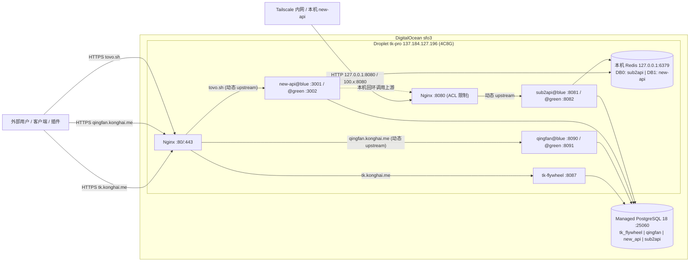

# tk-pro 服务器运维手册（tk-flywheel / qingfan / new-api / sub2api）

> **归档说明（2026-11-11）**：本手册迁自已废弃的 `DigitalOcean` 仓库（原 `docs/tk-flywheel-服务器运维手册.md`，最后提交 `d0e8b49`），文中 `tk-pro` 即 `do-1`。qingfan / tk-flywheel 已于 2026-11-10 迁到 `qingfan-prod`，new-api（`tovo.sh`）已迁到 `nyh-prod-2026`，2026-11-11 三者都已从 DO-1 彻底移除，DO-1 只剩 sub2api（下文其余项目的内容仅作历史参考）；DO-1 当前状态以 [`do-1/README.md`](../../do-1/README.md) 和 [`docs/operations/do-1.md`](../operations/do-1.md) 为准。

> 整理日期：2026-11-02（已连上生产机 `137.184.127.196` 核实硬件、网络、数据库及线上服务状态）
> 来源：代码仓库 `IAmKongHai/tk-flywheel`、`IAmKongHai/qingfan`、`QuantumNous/new-api`、`Wei-Shaw/sub2api` 以及本运维仓库 `do-1/`。
> 本文档只记录资源与操作方法，**不含任何密码、私钥或连接串**；凭据只存在服务器 `/etc/{tk-flywheel,qingfan,new-api,sub2api}/` 和 GitHub Actions Secrets 中。

---

## 1. 资源总览（已上机核实）

### 1.1 生产环境（DigitalOcean sfo3）

| 资源 | 规格 / 标识 | 说明 |
|---|---|---|
| Droplet | SSH 别名 `do-1`，主机名 `ubuntu-s-4vcpu-8gb-sfo3`，公网 IP `137.184.127.196`，Tailscale IP `100.86.92.103`，区域 **sfo3**（旧金山），Ubuntu 24.04（`6.8.0-147-generic`） | **4 vCPU / 8 GiB 内存 / 154 GB 磁盘**（当前仅用 551 MiB 内存、30 GB 磁盘，余量充裕） |
| VPC 与网卡 | `eth0` 公网 `137.184.127.196/20`（Anchor `10.48.0.5/16`）<br>`eth1` VPC 内网 `10.124.0.2/20` | VPC 网段 `10.124.0.0/20`，与托管数据库同处一个私有网络 |
| 托管数据库 | DigitalOcean Managed PostgreSQL 18，同区 sfo3 | VPC 内网地址 `private-db-pgsql-sfo3-95693-do-user-45140304-0.i.db.ondigitalocean.com:25060`，`sslmode=require`，**`max_connections = 25`**（详见 1.3 节） |
| 业务库 / 账号（4 库隔离） | 1. 库 `tk_flywheel` / 账号 `tk_flywheel`<br>2. 库 `qingfan` / 账号 `qingfan`<br>3. 库 `new_api` / 账号 `new_api`<br>4. 库 `sub2api` / 账号 `sub2api` | 每个应用和各自备份脚本只使用各自的专用账号，互不越权 |
| 管理账号 | `doadmin` | 只用于建库建号，凭据在 `/etc/tk-flywheel/admin.env`，**任何应用均不使用** |
| 本机 Redis | `redis-server`（绑定 `127.0.0.1:6379`） | 启用 `requirepass` 密码认证；`sub2api` 用 `DB 0`，`new-api` 用 `DB 1` |
| 公网域名 | 1. `tk.konghai.me`（`tk-flywheel`）<br>2. `qingfan.konghai.me`（青帆官网、下载、`/admin/` 后台与桌面端 API）<br>3. `tovo.sh`（`new-api` 统一入口：登录、控制台与 `/v1` API） | A 记录均指向 `137.184.127.196` |
| 内网入口（`sub2api`） | `127.0.0.1:8080` 及 Tailscale 内网 IP `100.86.92.103:8080` | **不暴露公网、不绑公网域名**；仅限本机（如 `new-api` 调上游）与 Tailscale 节点访问 |

### 1.2 四项目端口与蓝绿槽位矩阵

| 项目 | 暴露方式 | Nginx 入口 | 蓝槽 (Blue) | 绿槽 (Green) | 发布策略 | 健康检查 |
|---|---|---|---|---|---|---|
| `tk-flywheel` | 公网 HTTPS | `https://tk.konghai.me` | `127.0.0.1:8087`（单实例） | — | 软链原子切换 + `restart` | `/healthz` + `/version.txt` |
| **`qingfan`** | 公网 HTTPS | `https://qingfan.konghai.me` | `127.0.0.1:8090` | `127.0.0.1:8091` | **蓝绿零中断发布** | `/healthz` |
| **`new-api`** | 公网 HTTPS | `https://tovo.sh` | `127.0.0.1:3001` | `127.0.0.1:3002` | **蓝绿零中断发布** | `/api/status` |
| **`sub2api`** | 仅本机 + Tailscale | `http://127.0.0.1:8080`<br>`http://<Tailscale_IP>:8080` | `127.0.0.1:8081` | `127.0.0.1:8082` | **蓝绿零中断发布** | `/health` |

### 1.3 数据库连接池预算（极其关键：`max_connections = 25`）

经上机执行 `SHOW max_connections;` 核实，当前 DO 托管 PostgreSQL 实例的总连接数上限为 **25**（其中保留 3 个 superuser 连接、DO 内部监控占约 3～4 个连接，**所有业务应用合计可用连接约 18～20 个**）。

因此，四个项目必须严格按以下预算配置连接池（内网千兆延迟 < 1ms，单实例 3～4 个连接足以支撑高并发）：

| 组件 / 项目 | 环境变量控制项 | 常驻连接上限（单实例） | 蓝绿切换瞬时双实例上限 |
|---|---|---|---|
| DO 内部监控 (`_dodb` / `postgres`) | 系统保留 | ~4 | ~4 |
| `tk-flywheel` (+ `tune` / `pg_dump`) | 默认 | 2（峰值 3） | 3 |
| **`qingfan`**（含 3 个内部存储池） | `QINGFAN_DB_MAX_CONNS=1` | `1 × 3 = 3` | 6 |
| **`new-api`** | `SQL_MAX_OPEN_CONNS=4`<br>`SQL_MAX_IDLE_CONNS=2` | 4 | 8 |
| **`sub2api`** | `DATABASE_MAX_OPEN_CONNS=4`<br>`DATABASE_MAX_IDLE_CONNS=2` | 4 | 8 |
| **合计** | — | **日常稳态 ≤ 17 / 25** | **单项目蓝绿发布时 ≤ 21 / 25** |

> [!WARNING]
> **切勿删除 `app.env` 中的连接池上限配置**！`new-api` 默认 `SQL_MAX_OPEN_CONNS=1000`、`sub2api` 默认 `50`、`qingfan` 默认 `3×3=9`，一旦使用默认值，单个项目就会瞬间打满 25 个连接，导致全站报 `remaining connection slots are reserved`。如果未来业务并发大幅增长，可在 DigitalOcean 数据库后台开启自带的 **PgBouncer 连接池**。

---

## 2. 架构



- 服务器上已安装 `ffmpeg` 和本地编译的 `/usr/local/bin/whisper-cli`（带 `/var/lib/qingfan/server/models/ggml-small.bin` 模型），供 `qingfan` 服务端进行视频探测和本地中文语音转录。
- `qingfan`、`new-api`、`sub2api` 全部采用 **Systemd `@` 模板双槽位（Blue/Green）+ Nginx 动态 Upstream + 存量连接排空（Connection Draining）** 机制，升级和回滚全程零中断。

---

## 3. 服务器目录与文件

| 路径 | 属主 / 权限 | 用途 |
|---|---|---|
| `/opt/tk-flywheel/` | root, 0755 | `tk-flywheel` 根目录（`releases/<SHA>` + `current` 软链） |
| `/opt/qingfan/` | root, 0755 | `qingfan` 根目录（`releases/<version>` + `slots/{blue,green}` + `active_slot` + `current`） |
| `/opt/new-api/` | `root:new-api`, 0750 | `new-api` 根目录（`releases/<SHA>` + `slots/{blue,green}` + `active_slot` + `current`） |
| `/opt/sub2api/` | `root:sub2api`, 0750 | `sub2api` 根目录（`releases/<SHA>` + `slots/{blue,green}` + `active_slot` + `current`） |
| `/var/lib/qingfan/server/` | `qingfan:qingfan`, 0700 | `qingfan` 加密密钥 (`master.key`, `providers.enc`)、Whisper 模型与安装包 `downloads/` |
| `/var/lib/new-api/` | `new-api:new-api`, 0700 | `new-api` 运行工作目录（日志在 `/var/log/new-api/`） |
| `/var/lib/sub2api/data/` | `sub2api:sub2api`, 0700 | `sub2api` 跨槽位共享持久化目录（存放 `.installed` 和 `config.yaml`） |
| `/etc/{tk-flywheel,qingfan,new-api,sub2api}/` | 0711 / 0750 | 各项目配置和凭据目录（`app.env`、`pg.env`、`slot-{blue,green}.env`） |
| `/usr/local/bin/qingfan-deploy` | root, 0755 | `qingfan` 蓝绿发布脚本（由 `qingfan-deploy` 账号通过 sudoers 无密码调用，100% 兼容现有 GitHub Actions） |
| `/usr/local/sbin/{tk-flywheel,new-api,sub2api}-deploy` | root, 0755 | `tk-flywheel`、`new-api`、`sub2api` 发布接收脚本 |
| `/usr/local/sbin/{qingfan,new-api,sub2api}-rollback` | root, 0755 | 蓝绿一键秒级回滚脚本 |
| `/usr/local/sbin/{tk-flywheel,qingfan,new-api,sub2api}-backup` | root, 0755 | 四个数据库的 `pg_dump` 备份脚本 |
| `/etc/systemd/system/{qingfan,new-api,sub2api}@.service` | — | 三个项目的蓝绿模板服务 |
| `/etc/nginx/upstreams/{qingfan,new-api,sub2api}-upstream.conf` | 0644 root | 由发布/回滚脚本动态更新的 Nginx upstream 文件 |
| `/etc/nginx/sites-available/{tk.konghai.me,qingfan.konghai.me,new-api,sub2api}.conf` | — | Nginx 站点配置（软链到 `sites-enabled/`） |
| `/etc/cron.d/tk-pro-backups` | 0644 root | 每日错峰备份四个数据库（03:15 / 03:20 / 03:25 / 03:30 UTC） |
| `/var/backups/{tk-flywheel,qingfan,new-api,sub2api}/` | 0700，文件 0600 | 四个项目的数据库备份，保留 14 天 |

> [!CAUTION]
> **必须离线妥善备份的核心主密钥与文件（丢失后无法解密存量数据）**：
> 1. `tk-flywheel`：`/etc/tk-flywheel/app.env` 中的 `MODEL_MASTER_KEY`
> 2. `qingfan`：`/var/lib/qingfan/server/master.key` 和 `providers.enc`（以及 `/etc/qingfan/app.env` 中的 `QINGFAN_COLLECTOR_KEY`）
> 3. `new-api`：`/etc/new-api/app.env` 中的 `SESSION_SECRET` 与 `CRYPTO_SECRET`
> 4. `sub2api`：`/etc/sub2api/app.env` 中的 `JWT_SECRET` 与 `TOTP_ENCRYPTION_KEY`

---

## 4. 蓝绿零中断发布机制（`qingfan` / `new-api` / `sub2api`）

### 4.1 为什么 `qingfan` 特别需要蓝绿发布 + 连接排空？
`qingfan` 服务端（[`cmd/qingfan-server/main.go`](file:///Users/konghai/code/Project/qingfan/cmd/qingfan-server/main.go#L197)）直接调用 `server.ListenAndServe()`，没有内置 `SIGTERM` 优雅停机钩子，而它的视频处理、Whisper 转录和 `/v1/` 模型代理请求超时长达 **900 秒**。此前直接 `systemctl restart qingfan` 会立即掐断所有正在处理的视频/AI 任务。

升级为 [`usr/local/bin/qingfan-deploy`](../../do-1/usr/local/bin/qingfan-deploy) 蓝绿脚本后：
1. **保持 GitHub Actions 100% 兼容**：CI 依然上传到 `~qingfan-deploy/incoming/<version>/` 并执行 `sudo /usr/local/bin/qingfan-deploy <version>`，无需修改 `qingfan` 仓库的 `.github/workflows/release.yml`。
2. **先在备用槽位拉起新版本**：比如当前线上是 `blue` (`:8090`)，新版本会在 `green` (`:8091`) 启动并检查 `/healthz`。如果健康检查失败，直接停掉 `green`，线上 `blue` 完全不受影响。
3. **原子切换 `/admin/` 静态资源与 Nginx Upstream**：健康检查通过后，同时原子切换 `/opt/qingfan/current`（供 Nginx `/admin/` 别名读取）和 `/etc/nginx/upstreams/qingfan-upstream.conf`，并执行 `systemctl reload nginx`。
4. **外部连接排空（Connection Draining）**：切流后，脚本循环检查旧端口上的 `ESTABLISHED` 连接数（`ss -Htn state established "( sport = :8090 )"`），等存量请求全部处理完毕后再执行 `systemctl stop qingfan@blue`。

### 4.2 `new-api` 与 `sub2api` 的零侵入外部构建与蓝绿发布
`new-api` 和 `sub2api` 是直接 clone 的第三方开源项目，**不在其仓库内修改任何代码或添加文件**。日常升级只需：

```sh
# 1. 在开源仓库直接 git pull（工作区 100% 干净，永不冲突）
git -C /Users/konghai/code/Project/new-api pull
git -C /Users/konghai/code/Project/sub2api pull

# 2. 使用本运维仓库的外部打包脚本一键构建并推送蓝绿发布
/Users/konghai/Code/Project/Server/do-1/ci-templates/new-api-package.sh --deploy
/Users/konghai/Code/Project/Server/do-1/ci-templates/sub2api-package.sh --deploy
```

---

## 5. 日常运维操作

### 5.1 健康检查

```sh
# 1. 公网检查三个 HTTPS 站点
curl -fsS https://tk.konghai.me/healthz
curl -fsS https://qingfan.konghai.me/healthz
curl -fsS https://tovo.sh/api/status

# 2. 在服务器本机或通过 Tailscale 检查 sub2api 及各蓝绿槽位状态
ssh -i ~/.ssh/id_ed25519 root@137.184.127.196 '
  curl -fsS http://127.0.0.1:8080/health && echo
  for app in qingfan new-api sub2api; do
    slot=$(cat /opt/$app/active_slot 2>/dev/null || echo "uninitialized")
    echo "$app active slot: $slot ($(systemctl is-active $app@$slot 2>/dev/null || echo inactive))"
  done
'
```

### 5.2 蓝绿一键秒级回退（`qingfan` / `new-api` / `sub2api`）

```sh
# 自动切回另一个槽位上的上一版本：
sudo /usr/local/sbin/qingfan-rollback
sudo /usr/local/sbin/new-api-rollback
sudo /usr/local/sbin/sub2api-rollback

# 或指定任意历史版本号 / SHA 回退：
sudo /usr/local/sbin/qingfan-rollback 0.1.16
sudo /usr/local/sbin/new-api-rollback <40位旧SHA>
sudo /usr/local/sbin/sub2api-rollback <40位旧SHA>
```

---

## 6. 服务器落地执行清单（把 `qingfan` 切入蓝绿 + 上线 `new-api` 与 `sub2api`）

### 6.1 将线上 `qingfan` 无缝切换为蓝绿架构（零停机迁移）

线上 `qingfan` 目前以单实例 `qingfan.service` 运行在 `:8090`（当前版本 `0.1.17`）。按以下步骤可在不中断服务的情况下切换为蓝绿双槽位：

```sh
# 1. 追加 QINGFAN_DB_MAX_CONNS=1 到 /etc/qingfan/app.env（控制连接数 <= 3）
grep -q '^QINGFAN_DB_MAX_CONNS=' /etc/qingfan/app.env || echo 'QINGFAN_DB_MAX_CONNS=1' >> /etc/qingfan/app.env

# 2. 安装 slot 配置、systemd 模板和蓝绿脚本
install -d -m 0755 /opt/qingfan/slots /etc/nginx/upstreams
cp do-1/etc/qingfan/slot-{blue,green}.env /etc/qingfan/
cp do-1/etc/systemd/system/qingfan@.service /etc/systemd/system/
cp do-1/usr/local/bin/qingfan-deploy /usr/local/bin/qingfan-deploy
cp do-1/usr/local/sbin/qingfan-{rollback,backup} /usr/local/sbin/
systemctl daemon-reload

# 3. 先在 green (:8091) 拉起当前版本 0.1.17，验证通过后切 Nginx upstream，再停掉旧的单实例 qingfan.service
ln -sfn "$(readlink -f /opt/qingfan/current)" /opt/qingfan/slots/blue
ln -sfn "$(readlink -f /opt/qingfan/current)" /opt/qingfan/slots/green
systemctl start qingfan@green
curl -fsS http://127.0.0.1:8091/healthz

cat > /etc/nginx/upstreams/qingfan-upstream.conf <<'EOF'
upstream qingfan_backend {
    server 127.0.0.1:8091;
    keepalive 32;
}
EOF
cp do-1/etc/nginx/sites-available/qingfan.konghai.me.conf /etc/nginx/sites-available/qingfan.konghai.me.conf
nginx -t && systemctl reload nginx

echo "green" > /opt/qingfan/active_slot
systemctl stop qingfan.service && systemctl disable qingfan.service
rm -f /etc/systemd/system/qingfan.service
systemctl daemon-reload
systemctl enable qingfan@green
```

### 6.2 初始化 `new-api` 与 `sub2api` 运行环境

1. **安装 Redis 与 Tailscale**（目前服务器上尚未安装这两项）：
   ```sh
   apt-get update && apt-get install -y redis-server
   # 在 /etc/redis/redis.conf 设置 requirepass <强密码>，确认 bind 127.0.0.1 -::1
   systemctl enable --now redis-server

   curl -fsSL https://tailscale.com/install.sh | sh
   tailscale up
   ```
2. **创建 `new_api` 和 `sub2api` 数据库与账号**：
   ```sh
   set -a; . /etc/tk-flywheel/admin.env; set +a
   psql -v ON_ERROR_STOP=1 <<'SQL'
   CREATE ROLE new_api LOGIN PASSWORD '<NEW_API_DB_PASSWORD>';
   CREATE DATABASE new_api OWNER new_api;
   CREATE ROLE sub2api LOGIN PASSWORD '<SUB2API_DB_PASSWORD>';
   CREATE DATABASE sub2api OWNER sub2api;
   SQL
   ```
3. **创建系统用户、目录并安装本仓库 `do-1/` 下的配置文件**：
   详见第 3 节目录表，复制 `new-api@.service`、`sub2api@.service`、`new-api.conf`、`sub2api.conf` 以及 `/usr/local/sbin/{new-api,sub2api}-*` 脚本，并为 `tovo.sh` 签发 Certbot 证书。

---

## 7. 本运维仓库目录结构

2026-11-11 起本手册与配置迁入 Server 仓库，`do-1/` 下按服务器绝对路径镜像存放：

```text
do-1/
├── README.md                                       # 主机档案（当前状态以它为准）
├── ci-templates/{new-api,sub2api}-package.sh       # 零侵入外部打包/部署脚本
├── etc/
│   ├── cron.d/tk-pro-backups
│   ├── {qingfan,new-api,sub2api}/{app.env.example,pg.env.example,slot-blue.env,slot-green.env}
│   ├── nginx/{nginx.conf,sites-available/,upstreams/}
│   ├── ssh/sshd_config.d/00-hardening.conf
│   ├── sysctl.d/98-cross-ocean-tcp.conf
│   └── systemd/system/
└── usr/local/{bin/qingfan-deploy,sbin/}
```
